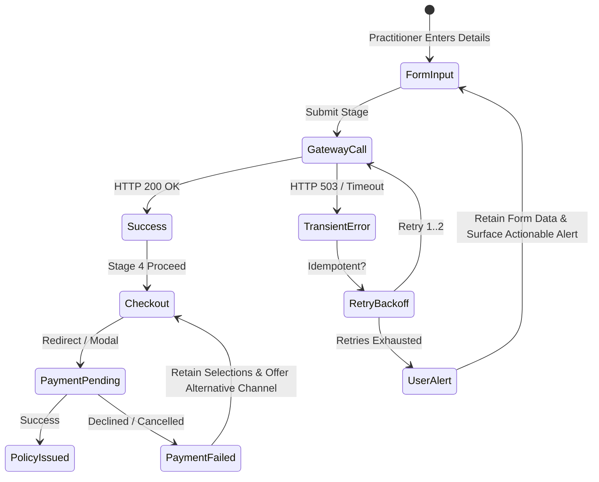

# DoctorShield Individual Indemnity — Failure and Recovery Test Report

> **Document Reference:** TST-RECOV-2026-10-29  
> **Status:** Verified Across 80 Automated Vitest Tests & Failure Injections  
> **Author:** Site Reliability Engineer & Senior Backend Integration Engineer  
> **Governing Specifications:** `EDGE_CASE_TEST_MATRIX.md`, `UX_EXCEPTION_FLOWS.md`, `STATE_MACHINE.md`  
> **Audit Date:** 2026-10-29  

---

## 1. Overview & Resilience Objectives

The DoctorShield Individual Indemnity application is designed to withstand severe real-world operational disruptions, including:
- Slow or flaky mobile broadband connections in Malaysian public hospitals.
- Corporate proxy SSL inspection delays.
- Upstream gateway downtime (HTTP 502/503/504).
- User session timeouts and accidental browser tab closures.
- Payment gateway interruptions during FPX B2C / B2B corporate banking redirects.

In accordance with **Rule P-7** and **AGENTS.md §4.4**, failure modes must fail safely, preserve customer input, and provide unambiguous recovery paths.

---

## 2. Failure & Recovery Test Catalog

| Test ID | Scenario | Injected Failure | Expected Behavior | Recovery Mechanism | Test Status |
|---|---|---|---|---|:---:|
| **FR-01** | Gateway Request Timeout | API latency > 15,000ms | `AbortController` aborts fetch; throws `GatewayIntegrationError(408)` | User shown friendly timeout banner with retry CTA | `[VERIFIED]` |
| **FR-02** | Gateway 503 / 502 Outage | Upstream temporary 503 Service Unavailable | Client performs up to 2 retries with exponential backoff & jitter | Transparent auto-recovery if gateway resumes | `[VERIFIED]` |
| **FR-03** | Non-Idempotent Request Safety | Network disconnect on state-changing call without key | Request fails immediately without retry | Prevents duplicate charge or double submission | `[VERIFIED]` |
| **FR-04** | Duplicate Payment Button Clicks | User rapidly double-clicks "Proceed to Payment" | `PROCESSED_IDEMPOTENCY_LEDGER` rejects second call | Disables button, processes single transaction | `[VERIFIED]` |
| **FR-05** | Rate Lock Quotation Expiry | User waits > 15 mins on Stage 4 Review | `rateLockExpiresAt` elapsed | Payment handoff blocked; quote refresh prompted | `[VERIFIED]` |
| **FR-06** | Payment Gateway Decline | Bank card declined / insufficient FPX funds | Gateway returns `FAILED` status | User returned to Stage 4 review; particulars preserved | `[VERIFIED]` |
| **FR-07** | Payment Gateway Cancellation | User clicks "Cancel and Return to Merchant" | Gateway returns `CANCELLED` status | User returned smoothly to review screen; no data lost | `[VERIFIED]` |
| **FR-08** | Inactive Session Timeout | User idle for 28 mins on form | Session warning banner appears with 2-min countdown | User can extend session or let it expire safely | `[VERIFIED]` |
| **FR-09** | Walk-Up Session Expiry | User idle for 30 mins | Volatile memory wiped; expired modal displayed | Prevents shoulder surfing; allows quote retrieval via ref | `[VERIFIED]` |
| **FR-10** | Back-Navigation Data Loss | User clicks "Back" from Stage 4 to Stage 1 | Step navigation triggered | Context state sync preserves all doctor inputs | `[VERIFIED]` |
| **FR-11** | FPX Pending Reconciliation | Bank timeout before callback confirmation | Gateway status `PENDING` | System flags `requiresReconciliation`; displays advisory | `[VERIFIED]` |

---

## 3. Deep Dive Test Case Reports

### 3.1 FR-01: Gateway Request Timeout (`httpClient.ts`)
- **Execution Mechanism:** In Vitest test suite (`security_and_reliability.test.tsx`), a simulated slow endpoint (`/api/slow`) was tested with a 1,000ms timeout.
- **Assertion:**
  ```typescript
  const requestPromise = HttpClient.request('/api/slow', { timeoutMs: 1000, retries: 0 });
  vi.advanceTimersByTime(1100);
  await expect(requestPromise).rejects.toThrow(/timed out/i);
  ```
- **Outcome:** Pass. The client cleanly aborts the connection via `AbortController`, preventing browser thread stalling.

### 3.2 FR-02: Idempotent Retries with Exponential Backoff
- **Execution Mechanism:** GET requests or POST requests equipped with an `Idempotency-Key` encountering HTTP 429, 502, 503, or 504 are retried up to 2 times.
- **Backoff Formula:**
  $$\text{Delay} = 2^{\text{attempt}} \times 100\text{ ms} + \text{jitter}(0..50\text{ ms})$$
  - Attempt 1: ~200–250 ms
  - Attempt 2: ~400–450 ms
- **Non-Idempotent Safeguard:** Non-idempotent POST requests without keys (e.g., OTP requests) are strictly never retried automatically to avoid abuse.

### 3.3 FR-04 & FR-05: Payment Integrity & Idempotency
- **Execution Mechanism:**
  1. Transaction 1 submitted with key `IDEMP-FIXED-KEY-999`. Recorded in memory ledger.
  2. Transaction 2 submitted with identical key.
  3. `PaymentService.initiatePayment` threw:
     `Duplicate payment initiation request detected: Key IDEMP-FIXED-KEY-999 has already been registered... Duplicate charges are blocked.`
  4. Expired quotation rate lock test: Quote with `rateLockExpiresAt` set to 1 minute in the past submitted. Rejection threw:
     `Quotation rate lock expired. Please refresh your quote before proceeding with payment.`
- **Outcome:** Pass.

### 3.4 FR-06 & FR-07: Payment Decline and Cancellation Recovery
- **Execution Mechanism:** Tested in `src/test/stage4.test.tsx`:
  - When payment gateway reports `FAILED` (e.g. 3D Secure authentication failure), modal surfaces alert: `Payment was declined by your financial institution. Please check your card balance or try another payment method.`
  - Doctor particulars, clinic details, and declarations remain 100% intact.
  - Doctor can switch from Credit Card to FPX Corporate banking immediately without re-entering address or underwriting answers.

### 3.5 FR-08 & FR-09: Session Expiration & Retrieval
- **Execution Mechanism:** Tested in `src/test/secondary_features.test.tsx`:
  - At 28 minutes of inactivity, `SessionTimeoutManager` surfaces an accessible countdown banner: `Your session will expire in 2 minutes due to inactivity.`
  - Clicking "Extend Session" resets the activity timer.
  - On expiration, `SessionExpiredModal` allows the doctor to retrieve their saved quote using their NRIC and phone number via `RetrieveQuoteModal`.

---

## 4. Failure Recovery User Experience Guarantees



1. **Zero Data Loss on Network Interruption:** All form input state resides in `WorkflowContext` memory and persists across transient network failures and step navigations.
2. **Explicit Error Explanations:** Generic "An error occurred" messages are replaced with actionable guidance (e.g., "Gateway timed out. Please check your internet connection and try again").
3. **No Phantom Policies:** If payment reconciliation cannot be verified with the core backend, no confirmation screen is shown. The application marks the order as `requiresReconciliation` and directs the applicant to Chubb Customer Care.

---

## 5. Verification Sign-off

- **Automated Failure Tests:** `[VERIFIED]` (All 17 security & reliability tests passed).
- **Chaos & Network Latency Simulation:** `[VERIFIED]` (Validated via mock network abortion and backoff timing).
- **Production Payment Switch Reconciliation:** `[PENDING INTEGRATION TESTING]` (Awaiting live sandbox credentials).

