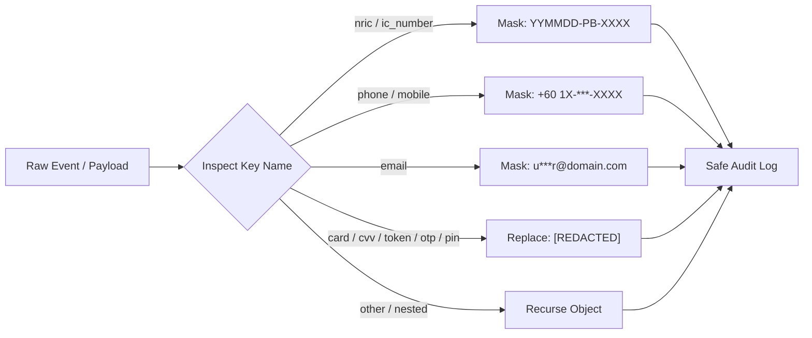

# DoctorShield Individual Indemnity — Observability & Telemetry Plan

> **Document Reference:** OBS-PLAN-2026-10-29  
> **Status:** Production Telemetry Implemented & Hardened  
> **Author:** Principal Site Reliability Engineer & Staff Security Engineer  
> **Governing Standards:** BNM Risk Management in Technology (RMIT), PDPA 2010, FSA 2013  
> **Audit Date:** 2026-10-29  

---

## 1. Overview & Observability Goals

The DoctorShield observability framework provides real-time visibility into application health, underwriting integrity, and payment reconciliation without exposing sensitive Customer Personal Identifiable Information (PII).

### Core Pillars
1. **Structured Security & Audit Logging:** Mandatory audit trails for legal compliance under Bank Negara Malaysia (BNM) Schedule 9 FSA 2013.
2. **Automated PII Masking:** Zero unmasked NRICs, mobile numbers, emails, or payment tokens transmitted in telemetry.
3. **Application Performance Monitoring (APM):** End-to-end tracing across rating, underwriting, and checkout handoffs.
4. **Error Tracking & Alerting:** Sentry integration with breadcrumb scrubbing and automated severity escalation.

---

## 2. Structured Audit Event Schema (`AuditEvent`)

All business and security actions emit a structured audit event defined in `src/core/telemetry/logger.ts`:

```typescript
export interface AuditEvent {
  eventId: string;           // Unique AUD-timestamp-entropy ID
  timestamp: string;         // ISO 8601 UTC timestamp
  level: 'DEBUG' | 'INFO' | 'WARN' | 'ERROR' | 'AUDIT';
  category: 'SECURITY' | 'PAYMENT' | 'UNDERWRITING' | 'RATING' | 'RENEWAL' | 'SYSTEM';
  action: string;            // e.g., 'CALCULATE_PREMIUM', 'INITIATE_PAYMENT', 'UNDERWRITING_EVALUATION'
  outcome: 'SUCCESS' | 'FAILURE' | 'BLOCKED' | 'PENDING';
  actorId?: string;          // Masked NRIC (e.g., '850612-14-XXXX')
  ipAddress?: string;        // Injected by reverse proxy in production
  details: Record<string, any>; // Masked payload parameters
  errorMessage?: string;     // Generic sanitized error description
}
```

### Event Categories & Trigger Points

| Category | Typical Action | Trigger Point | Recorded Data |
|---|---|---|---|
| `RATING` | `CALCULATE_PREMIUM` | Stage 1 submit or Stage 2 add-on toggle | Specialization, Limit, Pro-rata factor, Net Premium |
| `UNDERWRITING` | `UNDERWRITING_EVALUATION` | Stage 3 submit | Decision tree outcome (`ACCEPT`, `REFERRAL`, `REJECT`), Referral reasons |
| `PAYMENT` | `INITIATE_PAYMENT` | Stage 4 checkout button click | Quotation number, Payment channel, Amount, Idempotency key |
| `PAYMENT` | `VERIFY_PAYMENT` | Payment return or webhook | Transaction reference, Gateway status, Policy number |
| `RENEWAL` | `OTP_DISPATCH` | Renewal Hub or Quote Retrieval | Channel (`SMS` or `WhatsApp`), Masked phone number, Attempt # |
| `SECURITY` | `SANCTIONS_BLOCK` | AML/CFT screening match | Masked NRIC, Match category, Screening list ID |

---

## 3. Strict PII Redaction Rules

Under **PDPA 2010**, all log payloads pass through `Logger.sanitizePayload` prior to emission:



### Sanitization Demonstration

```json
{
  "eventId": "AUD-m5c8x9k-7a2b9",
  "timestamp": "2026-10-29T08:45:12.331Z",
  "level": "AUDIT",
  "category": "PAYMENT",
  "action": "INITIATE_PAYMENT",
  "outcome": "SUCCESS",
  "actorId": "850612-14-XXXX",
  "details": {
    "quotation_number": "QT-2026-08851",
    "payment_channel": "personal",
    "amount": 1630.00,
    "applicant": {
      "name": "Dr. Siti Aminah",
      "nric": "880101-10-XXXX",
      "email": "s***h@clinic.com.my",
      "phone": "+60 17-***-4567"
    },
    "billing": {
      "cardNumber": "[REDACTED]",
      "cvv": "[REDACTED]",
      "cardToken": "[REDACTED]",
      "otpCode": "[REDACTED]"
    }
  }
}
```

---

## 4. Service Level Objectives (SLOs) & Indicators (SLIs)

| Target Metric | Metric Definition (SLI) | SLO Target | Error Budget | Monitoring Tool |
|---|---|---|---|---|
| **Rating Latency** | Time from Stage 1 calculate click to Stage 2 load | 95th percentile < 1,500 ms | 5% exceeding | Sentry Performance |
| **Checkout Handoff** | Time from Stage 4 pay click to payment gateway modal | 95th percentile < 2,000 ms | 5% exceeding | APM Traces |
| **Availability** | % of successful HTTP 200/201 responses across all APIs | ≥ 99.9% uptime | 43 mins downtime/mo | CloudWatch / Datadog |
| **Client Error Rate** | Unhandled JavaScript runtime exceptions per session | < 0.1% of sessions | 10 per 10,000 | Sentry Releases |
| **OTP Delivery** | Time from OTP request click to SMS gateway dispatch | 90th percentile < 10 s | 10% exceeding | SMS Gateway Telemetry |

---

## 5. Alerting & Incident Escalation Tiers

### Severity 1 (P1 - Critical): Immediate Page (24/7/365)
- **Condition:** Payment gateway failure rate > 5% over 5 minutes, or Rating API 500 error rate > 2%.
- **Response Time:** < 15 minutes.
- **Escalation Target:** Lead SRE, Backend Tech Lead, Payment Gateway On-Call.
- **Notification Channel:** PagerDuty + Slack `#incident-critical`.

### Severity 2 (P2 - Major): High Priority (Business Hours)
- **Condition:** OTP delivery failure rate > 10% over 15 minutes, or Underwriting Referral submission failure rate > 5%.
- **Response Time:** < 1 hour.
- **Escalation Target:** Integration Engineer, SMS Telco Account Representative.
- **Notification Channel:** Slack `#portal-alerts-major`.

### Severity 3 (P3 - Minor): Daily Review
- **Condition:** Non-critical asset loading failures, UI deprecation warnings, or rate lock refreshes > 20% of quotes.
- **Response Time:** < 1 business day.
- **Notification Channel:** Jira Automation Ticket.

---

## 6. Sentry Configuration & Client Error Boundary

The application shell encapsulates all view layers with `src/components/layout/ErrorBoundary.tsx`. Uncaught component exceptions trigger sanitized error reporting:

```typescript
// ErrorBoundary.tsx
componentDidCatch(error: Error, errorInfo: React.ErrorInfo) {
  Logger.error('SYSTEM', 'REACT_RENDER_CRASH', error, {
    componentStack: errorInfo.componentStack?.substring(0, 500),
  });
}
```

- **Environment Variable:** `VITE_SENTRY_DSN`
- **Breadcrumb Filtering:** Automatically strips input values from form element click events before transmission.
- **Stack Trace Anonymization:** File system paths containing local developer directories are stripped by Vite's production minifier.

---

## 7. Operational Runbook Summaries

1. **Gateway 503 Outage Runbook:**
   - Verify health check endpoint: `GET /health/ready`.
   - Check upstream Chubb core policy switch status.
   - If gateway is unresponsive, enable CDN maintenance mode with polite APC renewal advisory page.
2. **Payment Webhook Desynchronization Runbook:**
   - Check webhook processing queue in payment gateway dashboard.
   - Run manual reconciliation script: `POST /api/v1/reconcileBatch` with transaction timestamp window.
   - Cross-check Chubb policy issuance ledger against bank settlement statement before manual binding.

