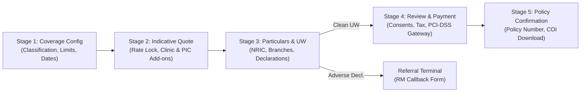

# DoctorShield Individual Medical Professional Indemnity Portal

[](https://www.typescriptlang.org/)
[](https://react.dev/)
[](https://vitejs.dev/)
[](https://vitest.dev/)
[](https://www.w3.org/WAI/standards-guidelines/wcag/)

> **Product:** DoctorShield Individual Medical Professional Indemnity  
> **Underwriter:** Chubb Insurance Malaysia Berhad  
> **Distributor:** JA Assure Sdn Bhd  
> **Live Portal Reference:** `my-individualindemnity.doctorshield.com`  

---

## 1. Overview

The **DoctorShield Individual Medical Professional Indemnity** portal is a modern, accessible, medical-grade insurance workflow engineered for registered medical practitioners in Malaysia. Rebuilt to replace legacy web forms, this portal delivers instant pro-rata rating, automated underwriting decisioning, branch facility bundling, rate-lock protection, and seamless policy binding.

---

## 2. Architecture & Stage Map

The application follows a structured 5-stage progressive workflow backed by dual-tier state orchestration in `WorkflowContext.tsx`:



### Stage Summary

- **Stage 1 — Coverage Configuration:** Practitioner classification (General Practitioner, Aesthetic, Specialist), liability limit selection (RM 1M to RM 5M), coverage inception/end dates, retroactive date management (Clause 6.12 warranty), and partner promo code validation (`MMA2026`, `MAAM2026`, `APHM2026`).
- **Stage 2 — Indicative Quotation Review:** 15-minute guaranteed rate lock countdown, annual vs pro-rata premium breakdown, progressive clinic establishment protection, Person-In-Charge (PIC) coverage, complimentary automatic reinstatement callout, and email quote PDF export.
- **Stage 3 — Practitioner Particulars & Statutory Underwriting:** Full name, NRIC formatting with auto-extracted Date of Birth & Gender, MMC registration verification, practice facility address, multi-branch facility manager (max 4 branches, RM 5M turnover threshold), and statutory 5-year claims & disciplinary inquiry questionnaires.
- **Stage 4 — Review & Payment:** Comprehensive policy review table, authoritative Malaysian tax calculation (8% SST, RM 10 Stamp Duty), Bank Negara Malaysia (BNM) 10% agent commission disclosure, Schedule 9 FSA 2013 Duty of Disclosure, PDPA 2010 consent, and PCI-DSS payment gateway integration with UUID v4 idempotency keys.
- **Stage 5 — Policy Confirmation:** Immediate policy issuance certificate display, download links for Certificate of Insurance, Schedule of Indemnity, and Tax Invoice.

### Support & Secondary Capabilities

- **Policy Renewal Hub (`PATH-RENEW` / `MODAL-12`):** Existing customer lookup by mobile phone number, dual-channel OTP verification (SMS and WhatsApp) with 60-second resend cooldown, and in-force policy management.
- **Retrieve Quotation (`MODAL-10`):** Lookup existing quotation via Quote Reference Number and email.
- **Document Center (`MODAL-08`):** Direct access to Chubb Master Policy Wordings, Product Disclosure Sheets (English & Bahasa Malaysia), and Privacy Policy.
- **Session Timeout Manager:** 15-minute inactivity countdown with 2-minute proactive warning dialog and safe state recovery.
- **Referral Terminal Page:** Automated routing of adverse underwriting declarations or corporate-scale clinic turnover to dedicated relationship managers with an in-app callback request form.

---

## 3. Technology Stack

- **Framework:** React 19 + TypeScript (Strict mode enabled)
- **Build Tool:** Vite 8.3
- **Styling:** Design Tokens & CSS Custom Properties (`DESIGN_TOKENS.md`)
- **Typography:** Kanit (Weights 400 & 500 for headings), Inter (Weights 400 & 500 for body)
- **Icons:** Lucide React
- **Testing:** Vitest + React Testing Library + `@testing-library/jest-dom`

---

## 4. Getting Started

### Prerequisites

- Node.js $\ge$ 18.0.0
- npm $\ge$ 9.0.0

### Installation

```bash
# Clone the repository
git clone https://github.com/saleembabu8007-cmd/Portal_ds.git
cd Portal_ds

# Install dependencies
npm install
```

### Running Locally

```bash
# Start Vite development server
npm run dev

# Application runs at http://localhost:5173
```

### Running Tests

```bash
# Run all 9 test suites
npm test

# Run tests with interactive UI
npx vitest --ui
```

### Production Build

```bash
# Compile and bundle for production
npm run build

# Preview production build locally
npm run preview
```

---

## 5. Quality & Compliance Reports

Comprehensive evaluation reports generated by the quality assessment working group:

- [`FINAL_QA_REPORT.md`](FINAL_QA_REPORT.md) — Master quality assessment synthesis across all roles.
- [`PRODUCT_PARITY_REPORT.md`](PRODUCT_PARITY_REPORT.md) — 100% field, question, and disclosure traceability report.
- [`ACCESSIBILITY_REPORT.md`](ACCESSIBILITY_REPORT.md) — Principle-by-principle WCAG 2.2 Level AA compliance audit.
- [`VISUAL_POLISH_REPORT.md`](VISUAL_POLISH_REPORT.md) — Design system and responsive viewport audit with screenshot evidence archive.
- [`RELEASE_READINESS.md`](RELEASE_READINESS.md) — Pre-flight release checklist, environment configuration, and governance blockers.
- [`SECURITY_REVIEW.md`](SECURITY_REVIEW.md) — Security audit covering XSS sanitization, PII protection, and payment integrity.

---

## 6. License & Legal Disclosures

Underwritten by **Chubb Insurance Malaysia Berhad** (Licensed under the Financial Services Act 2013, regulated by Bank Negara Malaysia). Distributed by **JA Assure Sdn Bhd**.

All insurance product wordings, limits of liability, premiums, and eligibility terms are subject to Chubb's approved underwriting guidelines.
