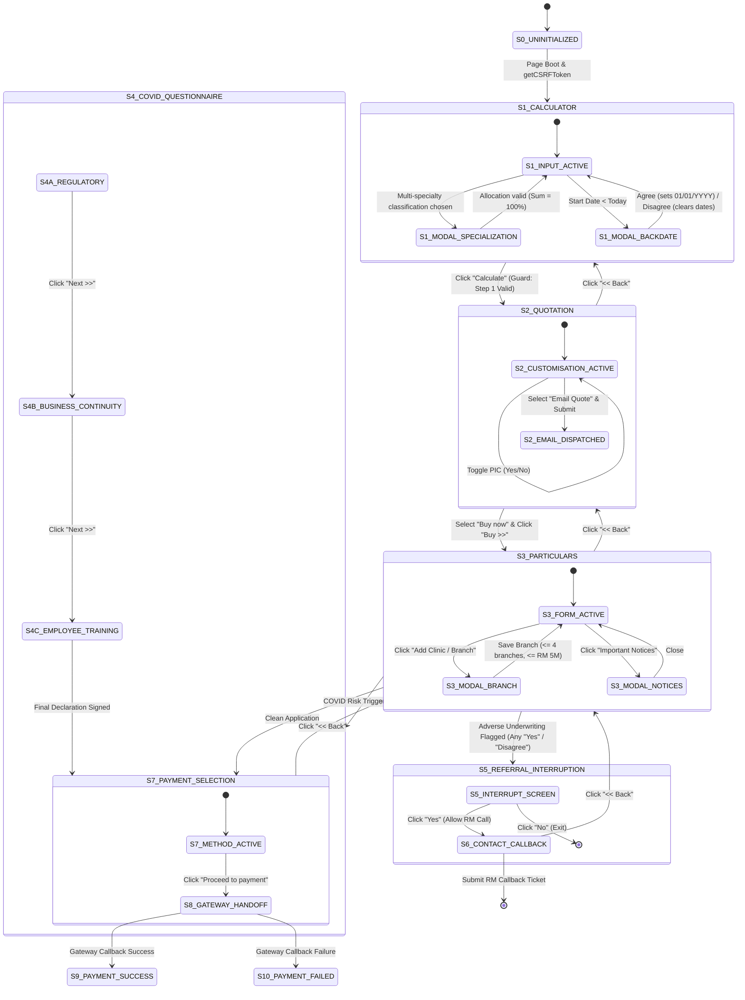

# APPLICATION STATE MODEL
## DoctorShield Individual Medical Professional Indemnity Portal

> **Document ID:** `DOC-STATE-MDL-001`  
> **Status:** Authoritative Baseline (Phase 1)  
> **Classification:** [VERIFIED]  
> **Last Updated:** 2026-10-29  
> **Owner:** Senior Solutions Architect & Engineering Lead  
> **Scope:** Complete finite-state machine (FSM) defining states, transitions, guards, actions, and persistence behaviors for the DoctorShield application lifecycle.

---

## 1. High-Level Lifecycle State Machine

---

## 2. State-Transition Table

| Current State | Transition Trigger (Event) | Guard Condition | Target State | Executed Action / Side Effect |
|---|---|---|---|---|
| **`S0_UNINITIALIZED`** | Window `load` | None | **`S1_CALCULATOR`** | Fetches CSRF token via `GET /api/getCSRFToken`; initializes Calentim datepickers; renders `#jsPage1`. |
| **`S1_CALCULATOR`** | Classification `change` | Classification has sub-specialties | **`S1_MODAL_SPECIALIZATION`** | Opens `#specializationModal`. |
| **`S1_MODAL_SPECIALIZATION`** | Click `Submit` | $\sum \% = 100 \land \forall v > 0$ | **`S1_CALCULATOR`** | Persists JSON into hidden input `specializations`; closes modal. |
| **`S1_CALCULATOR`** | Date input `blur` | `start_date < current_date` | **`S1_MODAL_BACKDATE`** | Opens `#jsBackDateEnableModel`. |
| **`S1_MODAL_BACKDATE`** | Click `Agree` | User accepted Clause 6.12 | **`S1_CALCULATOR`** | Start date set to `01/01/YYYY`; binds retroactive exclusion flag. |
| **`S1_MODAL_BACKDATE`** | Click `Disagree` | User declined | **`S1_CALCULATOR`** | Start and End dates cleared; user must re-enter forward date. |
| **`S1_CALCULATOR`** | Click `Calculate` (`#jsPage1Submit`) | All Step 1 fields valid $\land$ consent checked | **`S2_QUOTATION`** | Serializes form, calls `POST /api/calculatePremium`, transitions `#jsPage1` to hidden, unhides `#jsPage2`, scrolls to top. |
| **`S2_QUOTATION`** | Toggle Clinic `Yes` | Clinic owned | **`S2_QUOTATION`** | Unhides clinic structure, locum questions, clinic liability tiers, and clinic package card. |
| **`S2_QUOTATION`** | Toggle PIC `Yes` | PIC in own/other clinic | **`S2_QUOTATION`** | Unhides PIC coverage recommendation card. |
| **`S2_QUOTATION`** | Click `Submit` | `emailMeOrOnline` = `"email_quote"` | **`S2_EMAIL_DISPATCHED`** | Calls `POST /api/sendIndicativeQuoteMail`, sends quote PDF to email, displays `#jsReIndicativeQuoteErrorModel`. |
| **`S2_QUOTATION`** | Click `<< Back` | User wants to revise | **`S1_CALCULATOR`** | Unhides `#jsPage1`, hides `#jsPage2`. Retains inputs. |
| **`S2_QUOTATION`** | Click `Buy >>` | `emailMeOrOnline` = `"buy_online"` | **`S3_PARTICULARS`** | Unhides `#jsPage3`, hides `#jsPage2`, pre-populates email. |
| **`S3_PARTICULARS`** | Click `Add Clinic / Branch` | Clinic owned | **`S3_MODAL_BRANCH`** | Opens `#jsBranchModal`. |
| **`S3_MODAL_BRANCH`** | Click `Add Clinic / Branch` | Name, address, phone valid $\land$ revenue $\le$ RM 5M | **`S3_PARTICULARS`** | Appends branch card; serializes into `branch_details`; closes modal. |
| **`S3_PARTICULARS`** | Click `<< Back` | Revision | **`S2_QUOTATION`** | Unhides `#jsPage2`, hides `#jsPage3`. |
| **`S3_PARTICULARS`** | Click `Next >>` | $\ge 1$ Declaration = Adverse (`Yes`/`Disagree`) | **`S5_REFERRAL`** | Halts online payment; unhides `#jsPage8`; dispatches `sendContactUsClaimsEmail()`. |
| **`S3_PARTICULARS`** | Click `Next >>` | All Declarations Clean $\land$ COVID Trigger Active | **`S4_COVID_PAGE11`** | Unhides `#jsPage11RegulatoryAndVirusQuestions`. |
| **`S3_PARTICULARS`** | Click `Next >>` | All Declarations Clean $\land$ Standard Risk | **`S7_PAYMENT`** | Unhides `#jsPage10`; calls `setSummaryDetail()`. |
| **`S4_COVID_PAGE11`** | Click `Next >>` | Page 11 inputs valid | **`S4_COVID_PAGE12`** | Unhides `#jsPage12BusinessContiunityQuestions`. |
| **`S4_COVID_PAGE12`** | Click `Next >>` | Page 12 inputs valid | **`S4_COVID_PAGE13`** | Unhides `#jsPage13EmployeeAndCommunicationQuestions`. |
| **`S4_COVID_PAGE13`** | Click `Next >>` | Final declaration checked | **`S7_PAYMENT`** | Unhides `#jsPage10`. |
| **`S5_REFERRAL`** | Click `Yes` (`#jsPage8Yes`) | User permits RM call | **`S6_CALLBACK`** | Unhides `#jsContact` ("CONTACT DETAIL"). |
| **`S5_REFERRAL`** | Click `No` (`#jsPage8No`) | User declines | **`EXIT`** | Advises doctor to contact JA Assure directly. |
| **`S6_CALLBACK`** | Click `Submit` | Contact fields valid | **`SUBMITTED`** | Calls `POST /api/contactSupport`; generates CRM ticket. |
| **`S7_PAYMENT`** | Click `Proceed to payment` | Payment method chosen | **`S8_GATEWAY`** | Calls `POST /api/initiatePayment`; redirects browser to payment provider. |
| **`S8_GATEWAY`** | Webhook / Return Callback | Payment Authorized | **`S9_ISSUED`** | Displays `/success`; dispatches Certificate of Insurance & receipt email. |
| **`S8_GATEWAY`** | Webhook / Return Callback | Payment Declined / Cancelled | **`S10_FAILED`** | Displays `/error` or payment retry screen with retry token. |

---

## 3. Dedicated Renewal Sub-State Machine (`/renew`)

| State | Event | Condition | Next State | Action |
|---|---|---|---|---|
| **`R0_LOOKUP`** | User accesses `/renew` | None | **`R0_MOBILE_INPUT`** | Displays mobile input with country code `+60`. |
| **`R0_MOBILE_INPUT`** | Click `Generate OTP` | Mobile format valid | **`R1_OTP_VERIFICATION`** | Dispatches OTP via SMS or WhatsApp; starts 5-min timer. |
| **`R1_OTP_VERIFICATION`**| Click `Verify` | OTP code matches | **`R2_POLICY_LIST`** | Unhides `#jsUserPolicyList` with active policy cards. |
| **`R2_POLICY_LIST`** | Click `Select Policy` | Policy due for renewal | **`S2_QUOTATION`** | Pre-populates wizard with prior year profile & updated rate. |
| **`R2_POLICY_LIST`** | Click `Select Policy` | Already renewed | **`MODAL_ALREADY_RENEWED`**| Displays `#jsEmailErrorModel`: *"You are policy has been already renewed..."* |

