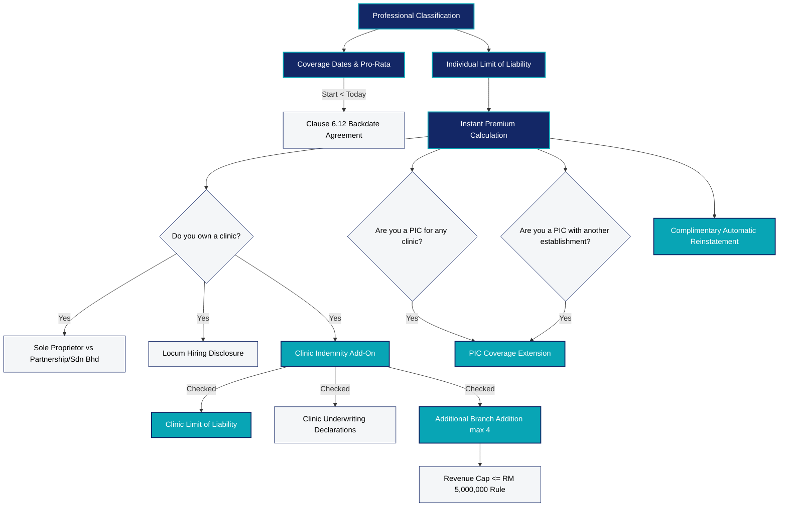

# COVERAGE DEPENDENCY MATRIX
## DoctorShield Individual Medical Professional Indemnity Portal

> **Document ID:** `DOC-MTX-DEP-001`  
> **Status:** Authoritative Baseline (Phase 1)  
> **Classification:** [VERIFIED]  
> **Last Updated:** 2026-10-29  
> **Owner:** Senior Solutions Architect & Underwriting Business Analyst  
> **Purpose:** Formal matrix mapping every functional dependency, mutual exclusion, prerequisite, and cascading effect across coverage choices, add-ons, and underwriting gates.

---

## 1. Master Coverage Hierarchy & Dependency Graph

---

## 2. Comprehensive Dependency Specifications

| Dependency ID | Primary Selection / Trigger | Prerequisite Condition | Dependent / Cascading Actions | Mutual Exclusions | Invariant Rule & Enforcement | Status |
|---|---|---|---|---|---|---|
| **DEP-01** | `Individual Limit of Liability` (`FLD-CALC-LIAB-002`) | `classification_id` selected (`FLD-CALC-CLASS-001`) | Populates eligible liability tiers via `/api/getSpecialization` | Cannot select limit until classification is chosen | Approved limit schedule per medical specialty. E.g., Govt doctors can select RM 250k; Private Specialists start from RM 500k. | [VERIFIED] |
| **DEP-02** | `Policy Backdating Protocol` (`POP-BACKDATE-001`) | `insurance_start_date` < current system date | Triggers modal `#jsBackDateEnableModel`. If agreed, sets start date to `01/01/YYYY`. | If user clicks `Disagree`, start date and end date are wiped. | Enforces Clause 6.12 Non-Continuous Retroactive Coverage exclusion. | [VERIFIED] |
| **DEP-03** | `Clinic Structure Selection` (`FLD-QUOTE-CLINIC-TYPE-009`) | `do_you_own_clinic_status_value` = `1` (`Yes`) | Progressively reveals button group: `Sole Proprietor` vs `Partnership / Sdn Bhd` | Inaccessible if Clinic Ownership = `No` | Enforces corporate SSM declaration if Partnership/Sdn Bhd chosen. | [VERIFIED] |
| **DEP-04** | `Clinic Locum Hiring Disclosure` (`FLD-QUOTE-LOCUM-HIRE-010`) | `do_you_own_clinic_status_value` = `1` (`Yes`) | Progressively reveals `Do you hire locums who sees new patients on their own?` | Inaccessible if Clinic Ownership = `No` | Mandatory underwriting disclosure for clinic vicarious exposure. | [VERIFIED] |
| **DEP-05** | `Clinic Indemnity Add-On` (`FLD-QUOTE-ADDON-CLINIC-014`) | `do_you_own_clinic_status_value` = `1` (`Yes`) | Unhides recommended coverage card and triggers `#clinic_liability_id` selector | Inaccessible if Clinic Ownership = `No` | Bundles entity defense & indemnity. Adds clinic premium to payable total. | [VERIFIED] |
| **DEP-06** | `Clinic Limit of Liability` (`FLD-QUOTE-CLINIC-LIAB-013`) | `medical_establishment_package` = `true` | Selects sum insured for clinic entity | Inaccessible if Clinic Add-on unchecked | Must be ≤ or equal to approved corporate schedules (e.g. RM 500k, RM 1M, RM 2M). | [VERIFIED] |
| **DEP-07** | `Clinic Underwriting Declarations` (`FLD-UW-CLINIC-036-041`) | `medical_establishment_package` = `true` | Unhides 4 corporate-level underwriting declarations on Step 3 | Hidden if Clinic Add-on unchecked | Evaluates claims, inquiries, and criminal charges for partners, directors, and clinic staff. | [VERIFIED] |
| **DEP-08** | `PIC Coverage Extension` (`FLD-QUOTE-ADDON-PIC-015`) | `pic_of_own_clinic` = `1` OR `are_you_pic_of_any_clinic` = `1` | Dynamically reveals **"Buy PIC coverage"** card with link `Why is this recommended?` | Inaccessible if both PIC answers are `No` | Adds PIC statutory defense surcharge to quote. | [VERIFIED] |
| **DEP-09** | `Automatic Reinstatement` (`FLD-QUOTE-ADDON-REINSTATE-016`) | Quoted policy | Auto-checked and displayed as complimentary | None | Reinstates indemnity limit once depleted by claim. | [VERIFIED] |
| **DEP-10** | `Additional Clinic Branches` (`FLD-PART-BRANCHES-027`) | `medical_establishment_package` = `true` OR clinic owned | Unhides `Add Clinic / Branch` button and triggers `#jsBranchModal` | Excluded if no clinic entity owned | Maximum 4 branches. Total combined revenue must not exceed RM 5,000,000 per annum. | [VERIFIED] |
| **DEP-11** | `Multi-Specialty Allocation` (`POP-SPEC-001`) | Multi-disciplinary classification selected (e.g. GP with Aesthetics) | Triggers `#specializationModal` allocation table | Cannot submit Step 1 until allocation is validated | Percentage sum across listed sub-specialties must equal exactly **100%**. Each value must be > 0. | [VERIFIED] |
| **DEP-12** | `Adverse Underwriting Referral` (`SCREEN-05` / `#jsPage8`) | Any declaration = `Yes` (Errors, Disciplinary, Criminal) OR Claims = `Disagree` | Intercepts payment flow, halts checkout, unhides `#jsPage8` and transitions to `#jsContact` callback | Mutually exclusive with immediate online payment | Dispatches `sendContactUsClaimsEmail()`. Assigns Relationship Manager. | [VERIFIED] |
| **DEP-13** | `COVID-19 Questionnaire Flow` (`SCREENS-04A-C`) | `is_active_supplementarty_covid_questions` = `true` on submission | Diverts flow through Pages 11, 12, and 13 prior to payment | Bypassed if clean individual standard proposal | Mandatory statutory questionnaire covering virus screening, BCP, and staff PPE training. | [VERIFIED] |
| **DEP-14** | `Renewal Promo Code Substitution` (`POP-PROMO-SUB-001`) | Existing NRIC attempting first-time promotional discount | Replaces entered promo code with renewal partner discount via `POST /api/nricPromoCodeCheck` | Cannot apply new-customer acquisition code to existing renewal | Displays notice `#jsNewPromocodeChangeModel`. Recalculates quote. | [VERIFIED] |

