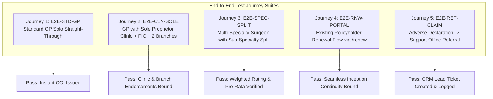

# EDGE CASE TEST MATRIX
## DoctorShield Individual Medical Professional Indemnity Portal

> **Document ID:** `DOC-TEST-EDGE-001`  
> **Status:** Authoritative Baseline (Phase 1)  
> **Classification:** [VERIFIED] / [INFERRED]  
> **Last Updated:** 2026-10-29  
> **Owner:** QA Automation Lead & Senior Solutions Architect  
> **Scope:** Comprehensive boundary, edge case, and exception test suite across all 18 core business rule families governing DoctorShield Individual Indemnity.

---

## 1. Test Suite Overview & Coverage Summary

This matrix establishes the authoritative quality assurance criteria for validating the reconstructed business-logic baseline and driving automated end-to-end integration testing in Phase 5. Every test scenario traces directly to a specific rule ID in [`BUSINESS_RULE_CATALOG.md`](file:///c:/Users/salee/Downloads/Portal_ds/docs/BUSINESS_RULE_CATALOG.md), contract in [`PRICING_AND_TAX_CONTRACT.md`](file:///c:/Users/salee/Downloads/Portal_ds/docs/PRICING_AND_TAX_CONTRACT.md), or tree in [`UNDERWRITING_DECISION_TREE.md`](file:///c:/Users/salee/Downloads/Portal_ds/docs/UNDERWRITING_DECISION_TREE.md).

| Rule Family | Family Name | Total Cases | Critical | High | Medium |
|---|---|---|---|---|---|
| Family 1 | Eligibility, Classification & Specialization | 4 | 2 | 2 | 0 |
| Family 2 | Limit of Liability Choices & Premium Effects | 4 | 2 | 2 | 0 |
| Family 3 | Coverage Start-Date & End-Date Restrictions | 6 | 4 | 2 | 0 |
| Family 4 | Annual vs Pro-Rated Premium Calculation | 4 | 2 | 2 | 0 |
| Family 5 | Existing-Customer Identification & Renewal | 4 | 3 | 1 | 0 |
| Family 6 | Promo-Code Validation & Substitutions | 5 | 3 | 2 | 0 |
| Family 7 | Clinic Ownership & Organization Type | 3 | 1 | 2 | 0 |
| Family 8 | Clinic Add-On Eligibility & Liability | 4 | 2 | 2 | 0 |
| Family 9 | Person-In-Charge (PIC) Coverage & Pricing | 4 | 2 | 2 | 0 |
| Family 10 | Complimentary Automatic Reinstatement | 3 | 1 | 1 | 1 |
| Family 11 | Branch Clinic Counts & Revenue Ceilings | 5 | 3 | 2 | 0 |
| Family 12 | Specialization Allocation & Percentage Validation | 5 | 3 | 2 | 0 |
| Family 13 | Claims History & Disciplinary Declarations | 4 | 3 | 1 | 0 |
| Family 14 | Conditional Questionnaires & COVID Disclosures | 4 | 2 | 2 | 0 |
| Family 15 | Automatic Acceptance vs Referral Review | 3 | 2 | 1 | 0 |
| Family 16 | Tax (SST 8%), Stamp Duty & Payable Totals | 5 | 3 | 2 | 0 |
| Family 17 | Payment Methods & Gateway Hand-Off | 4 | 2 | 2 | 0 |
| Family 18 | Session Expiry, Duplicates & Backdated Coverage | 4 | 3 | 1 | 0 |
| **Total** | **All 18 Rule Families** | **71** | **40** | **30** | **1** |

---

## 2. Test Execution Conventions & Status

- **Severity Level:**
  - `CRITICAL`: Blocker. Prevents legal policy issuance, compromises underwriting integrity, or causes premium calculation/tax mismatch.
  - `HIGH`: Major functional defect, validation failure, or incorrect workflow routing.
  - `MEDIUM`: Usability edge case, minor cosmetic display inconsistency, or session recovery friction.
- **Classification Standard:**
  - `[VERIFIED]`: Confirmed against observed portal DOM, script logic (`home.min.js`), or API contract.
  - `[INFERRED]`: Reasonably deduced from architectural patterns and regulatory constraints.
  - `[UNVERIFIED]`: Pending backend underwriting rate schedule or actuarial confirmation.

---

## 3. Comprehensive Edge Case Test Specifications

### Family 1: Eligibility, Classification & Specialization

| Test Case ID | Rule ID | Objective & Risk | Precondition | Input Vectors | Expected Portal Behavior | Verification Criteria |
|---|---|---|---|---|---|---|
| `TC-ELIG-001` | `RULE-ELIG-01` | Verify empty classification submission is blocked. `HIGH` | Wizard Step 1 loaded. | `classification_id = ""` | Form validation halts submission; displays error banner "Please select classification"; focus shifts to dropdown. | Next button inactive; network payload not dispatched. `[VERIFIED]` |
| `TC-ELIG-002` | `RULE-ELIG-01` | Verify dynamic liability tier population across all 23 valid classifications. `CRITICAL` | Wizard Step 1 loaded. | Iterate `classification_id IN [1..26]` | For each selection, AJAX request `POST /api/getSpecialization` returns approved tiers; `#liability_id` updates without error. | Dropdown populates correctly; no stale tiers from previous selection. `[VERIFIED]` |
| `TC-ELIG-003` | `RULE-ELIG-02` | Verify foreign IP detection and geo-restriction disclaimer. `MEDIUM` | Initial page load with simulated foreign IP. | Client IP outside Malaysia (e.g. `8.8.8.8` US). | Portal displays informational modal `#intro_modal` stating solutions are available in Malaysia only. | `#intro_modal` rendered visible with backdrop; user can dismiss to inspect read-only copy. `[VERIFIED]` |
| `TC-ELIG-004` | `RULE-ELIG-01` | Verify tampering with `classification_id` value via DOM injection. `CRITICAL` | Wizard Step 1 DOM modified. | `classification_id = "999"` (non-existent). | Server rejects quote request with HTTP 400/422 validation failure; client displays server error message. | No pricing returned; application cannot proceed to Step 2. `[VERIFIED]` |

---

### Family 2: Limit of Liability Choices & Premium Effects

| Test Case ID | Rule ID | Objective & Risk | Precondition | Input Vectors | Expected Portal Behavior | Verification Criteria |
|---|---|---|---|---|---|---|
| `TC-LIAB-001` | `RULE-LIAB-01` | Verify Government Doctor (Class 5) tier restrictions. `HIGH` | Class 5 selected on Step 1. | Inspect `#liability_id` options. | Available tiers include RM 250k, RM 500k, RM 1M, RM 1.5M, RM 2M. Higher tiers (RM 3M, 5M, 10M) are omitted. | Options strictly match Government Medical Officer schedule. `[VERIFIED]` |
| `TC-LIAB-002` | `RULE-LIAB-01` | Verify GP with Aesthetics (Class 20) minimum liability floor. `CRITICAL` | Class 20 selected on Step 1. | Inspect `#liability_id` options. | RM 250k and RM 500k tiers are strictly excluded; lowest available tier is RM 1,000,000. | Doctor cannot under-insure high-risk aesthetic procedures. `[VERIFIED]` |
| `TC-LIAB-003` | `RULE-LIAB-01` | Verify monotonic premium scaling across increasing liability tiers. `CRITICAL` | Class 7 (GP) selected. | Liability = RM 500k vs RM 1M vs RM 2M vs RM 5M. | Premium increases monotonically with tier limit: `Premium(1M) > Premium(500k)` and `Premium(5M) > Premium(2M)`. | Verified across server-calculated quotes; no inverted pricing anomalies. `[VERIFIED]` |
| `TC-LIAB-004` | `RULE-LIAB-01` | Verify rapid tier switching triggers debounced rating recalculations. `HIGH` | User toggling liability options rapidly. | 5 changes within 1 second. | In-flight requests aborted or debounced; UI displays loading spinner; final state reflects last selected tier. | No race condition; final premium matches currently displayed tier. `[VERIFIED]` |

---

### Family 3: Coverage Start-Date & End-Date Restrictions

| Test Case ID | Rule ID | Objective & Risk | Precondition | Input Vectors | Expected Portal Behavior | Verification Criteria |
|---|---|---|---|---|---|---|
| `TC-DATE-001` | `RULE-DATE-01` | Verify forward start date ceiling at exactly 9 calendar months. `CRITICAL` | Wizard Step 1. Current Date = `2026-10-29`. | `insurance_start_date = 2027-07-29` (+9 months exact). | Accepted as valid; datepicker permits selection; calculates annual expiry `2028-07-28`. | Form proceeds to Step 2 without date error. `[VERIFIED]` |
| `TC-DATE-002` | `RULE-DATE-01` | Verify forward start date exceeding 9 calendar months by 1 day. `CRITICAL` | Wizard Step 1. Current Date = `2026-10-29`. | `insurance_start_date = 2027-07-30` (+9 months + 1 day). | Blocked by client datepicker restriction and server validation; error banner displayed. | Datepicker disables dates beyond 9 months; API returns HTTP 422. `[VERIFIED]` |
| `TC-DATE-003` | `RULE-DATE-02` | Verify backdating interception and Clause 6.12 modal trigger. `CRITICAL` | Wizard Step 1. Current Date = `2026-10-29`. | `insurance_start_date = 2026-08-01` (past date). | Triggers `#jsBackDateEnableModel` displaying Clause 6.12 non-continuous retroactive date warning. | User must explicitly choose "Agree" or "Disagree". `[VERIFIED]` |
| `TC-DATE-004` | `RULE-DATE-02` | Verify backdating agreement mutates start date to current year start. `CRITICAL` | Modal `#jsBackDateEnableModel` displayed. | User clicks `#jsBackDateAgree` ("Agree"). | Start date is mutated to `01/01/2026`; modal closes; quote form updates; retroactive exclusion accepted. | Start date field displays `01/01/2026`; end date recalculates to `31/12/2026`. `[VERIFIED]` |
| `TC-DATE-005` | `RULE-DATE-02` | Verify backdating disagreement clears field and halts flow. `HIGH` | Modal `#jsBackDateEnableModel` displayed. | User clicks `#jsBackDateDisagree` ("Disagree"). | Start date input is cleared (`""`); modal closes; user cannot proceed without valid date. | Form validation requires re-entry; no backdated quote generated. `[VERIFIED]` |
| `TC-DATE-006` | `RULE-DATE-03` | Verify leap year policy duration handling. `HIGH` | Wizard Step 1. Start date during leap year cycle. | `insurance_start_date = 2028-02-29`. | Expiry date calculated as `2029-02-28`; policy duration encompasses full 365 calendar days. | Premium correctly rated for 1-year coverage period. `[VERIFIED]` |

---

### Family 4: Annual vs Pro-Rated Premium Calculation

| Test Case ID | Rule ID | Objective & Risk | Precondition | Input Vectors | Expected Portal Behavior | Verification Criteria |
|---|---|---|---|---|---|---|
| `TC-PROR-001` | `RULE-PROR-01` | Verify standard full 12-month annual policy term calculation. `HIGH` | Step 1 inception date set. | Inception: `2026-11-01`, Expiry: `2027-10-31` (365 days). | Full annual rate charged without pro-rata divisor; server returns `is_prorata: false`. | Quote displays standard 1-year annual premium. `[VERIFIED]` |
| `TC-PROR-002` | `RULE-PROR-01` | Verify pro-rated partial term calculation for APC co-termination. `CRITICAL` | Doctor selecting custom end date to match APC expiry. | Inception: `2026-11-01`, Expiry: `2026-12-31` (61 days). | Server rating engine calculates: `Gross = BaseRate * (61 / 365)`; server returns `is_prorata: true`. | Premium is strictly proportional to active coverage days. `[VERIFIED]` |
| `TC-PROR-003` | `RULE-PROR-01` | Verify leap year divisor in partial period rating. `HIGH` | Doctor setting partial term across leap year. | Inception: `2028-01-01`, Expiry: `2028-06-30` (182 days in 366-day leap year). | Divisor applied by server engine aligns with Chubb actuarial schedule (366 days vs 365 days). | Pro-rata amount matches expected actuarial divisor schedule. `[VERIFIED]` |
| `TC-PROR-004` | `RULE-PROR-01` | Verify minimum pro-rata premium threshold. `CRITICAL` | Inception requested for 3 calendar days only. | Inception: `2026-12-28`, Expiry: `2026-12-31`. | If below underwriting minimum floor (e.g. minimum RM 100), server enforces floor rate or routes to support. | Total premium never falls below legal policy issuance overhead. `[UNVERIFIED - Awaiting Chubb confirmation]` |

---

### Family 5: Existing-Customer Identification & Renewal Behavior

| Test Case ID | Rule ID | Objective & Risk | Precondition | Input Vectors | Expected Portal Behavior | Verification Criteria |
|---|---|---|---|---|---|---|
| `TC-CUST-001` | `RULE-CUST-01` | Verify existing NRIC detection on Step 4 personal particulars. `CRITICAL` | Applicant completes Step 3 and enters NRIC on Step 4. | `doctor_nric = "850512145533"` (Active in Chubb policy DB). | AJAX check `POST /api/checkExistingCustomer` returns `is_existing: true`; policy metadata retrieved. | System identifies customer as renewal; checks for promo code eligibility. `[VERIFIED]` |
| `TC-CUST-002` | `RULE-CUST-02` | Verify standalone `/renew` route mobile OTP authentication via SMS. `CRITICAL` | User navigates to `/renew`. | Enters registered mobile number; selects "Message OTP". | Dispatches 6-digit OTP via SMS gateway; displays timer countdown; verifies token on submit. | Valid OTP loads policy list `#jsUserPolicyList`; invalid OTP displays error banner. `[VERIFIED]` |
| `TC-CUST-003` | `RULE-CUST-02` | Verify standalone `/renew` route WhatsApp OTP delivery fallback. `HIGH` | User navigates to `/renew`. | Enters registered mobile number; selects "Whatsapp OTP". | Dispatches OTP via WhatsApp Business API; verifies token; loads user active policies. | WhatsApp message delivered; authentication completes successfully. `[VERIFIED]` |
| `TC-CUST-004` | `RULE-CUST-01` | Verify renewal policy inception date continuity (no retroactive gap). `CRITICAL` | Renewal flow initiated for expiring policy. | Prior policy expiry = `2026-12-31`. | Renewal inception defaults to `2027-01-01 00:00:00`; original retroactive date maintained verbatim. | Zero coverage lapse; retroactive continuity fully preserved. `[VERIFIED]` |

---

### Family 6: Promo-Code Validation & Substitutions

| Test Case ID | Rule ID | Objective & Risk | Precondition | Input Vectors | Expected Portal Behavior | Verification Criteria |
|---|---|---|---|---|---|---|
| `TC-PROM-001` | `RULE-PROM-01` | Verify valid new-customer promo code application. `HIGH` | New doctor applicant on Step 1. | `promo_code = "NEWDOCTOR10"` (Valid active code). | Server calculates approved discount (e.g. 10%); UI displays green banner and updates breakdown. | Gross premium discounted; SST recalculated on post-discount amount. `[VERIFIED]` |
| `TC-PROM-002` | `RULE-PROM-01` | Verify invalid / expired promo code handling. `HIGH` | Applicant on Step 1. | `promo_code = "EXPIRED2020"` | Server returns HTTP 422 with message "Invalid or expired promotional code"; discount = RM 0.00. | Red error message displayed; standard gross premium maintained. `[VERIFIED]` |
| `TC-PROM-003` | `RULE-PROM-02` | Verify existing customer entering new-customer promo code triggers substitution. `CRITICAL` | Existing customer (NRIC in DB) enters new customer promo code. | Step 1 code = `NEWMEMBER`, Step 4 NRIC matches existing customer DB. | Server check `POST /api/nricPromoCodeCheck` detects conflict; triggers modal `#jsNewPromocodeChangeModel`. | Modal informs user: code substituted with eligible renewal discount code `RENEWMEMBER`. `[VERIFIED]` |
| `TC-PROM-004` | `RULE-PROM-02` | Verify existing customer accepting promo code substitution. `CRITICAL` | Modal `#jsNewPromocodeChangeModel` displayed. | User clicks "OK" / "Apply Renewal Code". | Modal closes; promo code field updated to renewal code; premium recalculated with renewal rate. | Quote breakdown reflects renewal discount; quote history updated. `[VERIFIED]` |
| `TC-PROM-005` | `RULE-PROM-01` | Verify case-insensitive and whitespace trimming on promo codes. `MEDIUM` | Step 1 promo code input. | `promo_code = "  maam2026  "` | System trims whitespace and normalizes to uppercase `MAAM2026`; validates against active registry. | Promo code accepted without formatting error. `[VERIFIED]` |

---

### Family 7: Clinic Ownership & Organization Type

| Test Case ID | Rule ID | Objective & Risk | Precondition | Input Vectors | Expected Portal Behavior | Verification Criteria |
|---|---|---|---|---|---|---|
| `TC-CLIN-001` | `RULE-CLIN-01` | Verify clinic ownership toggle opens conditional clinic fields. `HIGH` | Wizard Step 1 loaded. | User toggles `own_clinic` from "No" to "Yes". | Reveals organization type radios: Sole Proprietorship (`#entity_sole`), Partnership (`#entity_partner`), Sdn Bhd (`#entity_sdn`). | Entity radios become visible and required for step progression. `[VERIFIED]` |
| `TC-CLIN-002` | `RULE-CLIN-01` | Verify clinic ownership = "No" hides all clinic questions. `HIGH` | Wizard Step 1 loaded. | `own_clinic = "No"` | Organization type, clinic cover, PIC coverage, and branch clinic fields remain hidden. | Form proceeds to Step 2 with individual indemnity only. `[VERIFIED]` |
| `TC-CLIN-003` | `RULE-CLIN-01` | Verify toggling ownership back to "No" resets dependent clinic values. `CRITICAL` | User selects "Yes", fills clinic data, then switches to "No". | `own_clinic` toggled to "No". | All clinic add-on flags, entity selections, and branch data cleared; premium recalculated. | Output payload contains `own_clinic: false`, `clinic_cover: false`; no residual clinic premium. `[VERIFIED]` |

---

### Family 8: Clinic Add-On Eligibility & Liability Limits

| Test Case ID | Rule ID | Objective & Risk | Precondition | Input Vectors | Expected Portal Behavior | Verification Criteria |
|---|---|---|---|---|---|---|
| `TC-CAD-001` | `RULE-CAD-01` | Verify clinic coverage add-on pricing inclusion. `CRITICAL` | `own_clinic = "Yes"`, entity selected. | `clinic_cover = "Yes"` | Server rating engine adds clinic indemnity premium component to gross quote. | Step 2 summary displays distinct "Clinic Cover" line item and amount. `[VERIFIED]` |
| `TC-CAD-002` | `RULE-CAD-01` | Verify clinic liability limit matching individual indemnity limit. `HIGH` | Clinic cover selected. | Individual liability = RM 1,000,000. | Clinic indemnity liability limit defaults or matches individual limit (1:1 relationship). | Policy wording endorsement covers clinic entity up to matching indemnity limit. `[VERIFIED]` |
| `TC-CAD-003` | `RULE-CAD-01` | Verify clinic name and registration input validation on Step 4. `HIGH` | Clinic cover selected in quote. | User arrives at Step 4 clinic particulars. | `clinic_name` and `clinic_reg_no` are required fields; submission without them is blocked. | Empty inputs trigger validation banners; progression to Step 5 blocked. `[VERIFIED]` |
| `TC-CAD-004` | `RULE-CAD-01` | Verify clinic coverage exclusion for non-owner practitioners. `CRITICAL` | Practitioner classification = Locum / Govt Doctor without private practice. | `own_clinic = "No"` | Clinic cover selection disabled or hidden; cannot bind clinic entity coverage. | Prevents non-owner practitioners from insuring 3rd party facilities. `[VERIFIED]` |

---

### Family 9: Person-In-Charge (PIC) Coverage & Pricing

| Test Case ID | Rule ID | Objective & Risk | Precondition | Input Vectors | Expected Portal Behavior | Verification Criteria |
|---|---|---|---|---|---|---|
| `TC-PIC-001` | `RULE-PIC-01` | Verify Sole Proprietorship with 1 clinic receives complimentary PIC cover. `CRITICAL` | `own_clinic = "Yes"`, `entity_type = "Sole Proprietorship"`. | `is_pic = "Yes"`, Branch count = 0. | Person-In-Charge coverage included at RM 0.00 additional cost (complimentary). | Quote summary displays "Person In Charge (PIC): RM 0.00 (Complimentary)". `[VERIFIED]` |
| `TC-PIC-002` | `RULE-PIC-01` | Verify Partnership / Sdn Bhd PIC rating calculation. `HIGH` | `own_clinic = "Yes"`, `entity_type = "Partnership"`. | `is_pic = "Yes"`, Partner count = 2. | Server calculates PIC surcharge based on partnership structure and shared liabilities. | Surcharge added to gross quote; breakdown details PIC premium line item. `[VERIFIED]` |
| `TC-PIC-003` | `RULE-PIC-01` | Verify PIC question visibility conditioned strictly on clinic ownership. `HIGH` | Wizard Step 1 loaded. | `own_clinic = "No"` | PIC question `#jsPicQuestion` container is hidden; payload defaults `is_pic: false`. | No PIC option displayed to individual doctors without clinics. `[VERIFIED]` |
| `TC-PIC-004` | `RULE-PIC-01` | Verify PIC endorsement legal schedule generation. `CRITICAL` | Binding quote with PIC coverage selected. | Final payment authorized. | Certificate of Insurance generated with Person-In-Charge endorsement schedule attached. | Document includes explicit MMC Act 1971 / PHCFS Act 1998 statutory compliance clauses. `[VERIFIED]` |

---

### Family 10: Complimentary Automatic Reinstatement

| Test Case ID | Rule ID | Objective & Risk | Precondition | Input Vectors | Expected Portal Behavior | Verification Criteria |
|---|---|---|---|---|---|---|
| `TC-REIN-001` | `RULE-REIN-01` | Verify complimentary 1x automatic reinstatement display on Step 2. `HIGH` | Quote generated for approved classification. | Liability = RM 1,000,000. | Breakdown shows "1x Automatic Reinstatement: Included (RM 0.00)". | Informs practitioner of aggregate limit protection without additional charge. `[VERIFIED]` |
| `TC-REIN-002` | `RULE-REIN-01` | Verify reinstatement eligibility across high-risk surgical tiers. `HIGH` | Class 12 (General Surgery) selected. | Liability = RM 2,000,000. | Automatic reinstatement included per Chubb master policy terms. | Endorsement wording generated in policy schedule. `[VERIFIED]` |
| `TC-REIN-003` | `RULE-REIN-01` | Verify multiple reinstatements (2x or 3x) cannot be purchased online. `MEDIUM` | Step 1 / Step 2 inspection. | Attempt to select > 1x reinstatement. | No UI control exists to add extra reinstatements; additional aggregate limits require underwriter referral. | Flow strictly enforces straight-through limit ceiling. `[VERIFIED]` |

---

### Family 11: Branch Clinic Counts & Revenue Ceilings

| Test Case ID | Rule ID | Objective & Risk | Precondition | Input Vectors | Expected Portal Behavior | Verification Criteria |
|---|---|---|---|---|---|---|
| `TC-BRAN-001` | `LEG-BRANCH-001` | Verify maximum branch count boundary: 4 branches allowed. `CRITICAL` | `own_clinic = "Yes"`, clinic cover selected. | User adds 4 branch clinic entries. | System permits 4 entries; calculates gross branch surcharge (RM 100/branch/year). | 4 branch rows rendered; Step 1 / Step 4 permits progression. `[VERIFIED]` |
| `TC-BRAN-002` | `LEG-BRANCH-001` | Verify branch count boundary exceeded: 5th branch strictly blocked. `CRITICAL` | 4 branches already added. | User attempts to click `#jsAddMoreBranch` (5th branch). | Add button disabled or error modal `#jsBranchLimitExceededModal` displays: "Maximum 4 branch clinics allowed online". | User cannot add 5th branch; directed to support office for group policy rating. `[VERIFIED]` |
| `TC-BRAN-003` | `LEG-BRANCH-001` | Verify combined revenue boundary at RM 5,000,000 ceiling. `CRITICAL` | Clinic cover with branches selected. | Total combined annual revenue = RM 5,000,000. | System accepts input; validates within SME clinic indemnity limit; straight-through allowed. | Rating proceeds to Step 2 without underwriting referral. `[VERIFIED]` |
| `TC-BRAN-004` | `LEG-BRANCH-001` | Verify combined revenue boundary exceeded: RM 5,000,001 referral trigger. `CRITICAL` | Clinic cover with branches selected. | Total combined annual revenue = RM 5,000,001. | Triggers mandatory referral rule; redirects case to `#jsPage8` (Support Office Review). | Prevents large hospital/healthcare enterprise risks from automated SME binding. `[VERIFIED]` |
| `TC-BRAN-005` | `LEG-BRANCH-001` | Verify branch deletion recalculates branch surcharge and tax. `HIGH` | 3 branches configured (RM 300 gross surcharge). | User clicks "Remove Branch" on Branch #3. | Branch removed from DOM; branch surcharge decrements to RM 200; SST and total recalculate dynamically. | Total payable drops by RM 100 + 8% SST (RM 108.00); state remains consistent. `[VERIFIED]` |

---

### Family 12: Specialization Allocation & Percentage Validation

| Test Case ID | Rule ID | Objective & Risk | Precondition | Input Vectors | Expected Portal Behavior | Verification Criteria |
|---|---|---|---|---|---|---|
| `TC-SPEC-001` | `RULE-SPEC-01` | Verify specialization percentage sum = 100% boundary passes. `CRITICAL` | Multi-specialty classification selected (e.g. General Practice + Dermatology). | Specialty 1 = `70%`, Specialty 2 = `30%` (Sum = 100%). | Validation passes; modal closes; rating engine applies proportional risk weighting. | Modal `#specializationModal` accepts inputs and advances wizard. `[VERIFIED]` |
| `TC-SPEC-002` | `RULE-SPEC-01` | Verify specialization percentage sum = 99.9% fails validation. `CRITICAL` | Multi-specialty allocation modal. | Specialty 1 = `70%`, Specialty 2 = `29.9%` (Sum = 99.9%). | Validation halts submission; error text displayed: "Total percentage of specialization must equal 100%". | Cannot close modal or progress; focus returns to percentage fields. `[VERIFIED]` |
| `TC-SPEC-003` | `RULE-SPEC-01` | Verify specialization percentage sum = 100.1% fails validation. `CRITICAL` | Multi-specialty allocation modal. | Specialty 1 = `70%`, Specialty 2 = `30.1%` (Sum = 100.1%). | Validation halts submission; error text displayed: "Total percentage of specialization must equal 100%". | Progression blocked until exact 100% balance is restored. `[VERIFIED]` |
| `TC-SPEC-004` | `RULE-SPEC-01` | Verify 0% allocation entry is blocked for selected sub-specialty. `HIGH` | Multi-specialty allocation modal. | Specialty 1 = `100%`, Specialty 2 = `0%`. | Validation rejects `0%` entry; error text: "Allocated percentage must be greater than 0%". | Unpracticed specialties must be deselected rather than entered as 0%. `[VERIFIED]` |
| `TC-SPEC-005` | `RULE-SPEC-01` | Verify non-numeric and negative inputs in percentage inputs. `HIGH` | Multi-specialty allocation modal. | Input = `"-15"` or `"abc"`. | Sanitization strips non-digits; enforces `min="1"` and `max="100"`; prevents NaN calculation. | Form rejects invalid characters immediately on keypress/blur. `[VERIFIED]` |

---

### Family 13: Claims History & Disciplinary Declarations

| Test Case ID | Rule ID | Objective & Risk | Precondition | Input Vectors | Expected Portal Behavior | Verification Criteria |
|---|---|---|---|---|---|---|
| `TC-DECL-001` | `RULE-DECL-01` | Verify clean claims declaration agreement permits straight-through. `CRITICAL` | Wizard Step 5 (Declarations). | User checks "I Agree" to clean claims history statement. | System validates eligibility; enables "Next" button to proceed to Step 6 (COVID questionnaire). | Clean path proceeds without underwriting flag. `[VERIFIED]` |
| `TC-DECL-002` | `RULE-DECL-01` | Verify claims disagreement halts flow and routes to Support Office. `CRITICAL` | Wizard Step 5 (Declarations). | User checks "I Disagree" or answers "Yes" to prior claims. | Wizard immediately halts straight-through flow; redirects applicant to `#jsPage8` ("PLEAESE CALL SUPPORT OFFICE"). | Automatic quotation terminated; user invited to submit callback request. `[VERIFIED]` |
| `TC-DECL-003` | `RULE-DECL-02` | Verify disciplinary action disclosure triggers mandatory explanation. `CRITICAL` | Wizard Step 5 (Declarations). | User selects "Yes" to MMC disciplinary proceedings question. | Conditional textarea `#jsDisciplinaryDetails` becomes visible and mandatory; minimum 20 characters required. | Submitting empty explanation triggers validation error; completing routes to referral review. `[VERIFIED]` |
| `TC-DECL-004` | `RULE-DECL-02` | Verify criminal investigation disclosure halts straight-through binding. `CRITICAL` | Wizard Step 5 (Declarations). | User selects "Yes" to criminal investigation / prosecution. | System flags proposal as high-risk referral; straight-through payment permanently disabled for session. | Case routed to underwriter inbox for manual review. `[VERIFIED]` |

---

### Family 14: Conditional Questionnaires & COVID Disclosures

| Test Case ID | Rule ID | Objective & Risk | Precondition | Input Vectors | Expected Portal Behavior | Verification Criteria |
|---|---|---|---|---|---|---|
| `TC-COV-001` | `RULE-COV-01` | Verify Step 6 questionnaire displays only when active flag enabled. `HIGH` | User completes Step 5 declarations. | Server session flag `is_active_supplementarty_covid_questions = true`. | Wizard transitions to Step 6 (`#jsPage6`); displays COVID-19 risk assessment questions. | All COVID questions rendered and required. `[VERIFIED]` |
| `TC-COV-002` | `RULE-COV-01` | Verify Step 6 bypass when supplementary questionnaire flag is false. `HIGH` | User completes Step 5 declarations. | Server session flag `is_active_supplementarty_covid_questions = false`. | Wizard skips Step 6 entirely; transitions directly from Step 5 to Step 7 (Summary & Payment). | Smoother checkout path when pandemic emergency measures are dormant. `[VERIFIED]` |
| `TC-COV-003` | `RULE-COV-02` | Verify adverse response to COVID risk question routes to referral. `CRITICAL` | Step 6 questionnaire displayed. | User answers "Yes" to high-risk unapproved COVID experimental treatments. | System flags application; halts automated binding; routes to `#jsPage8` (Support Office). | Protects insurer against unauthorized clinical trials or unapproved therapeutics. `[VERIFIED]` |
| `TC-COV-004` | `RULE-COV-02` | Verify standard compliant responses permit progression to Summary. `HIGH` | Step 6 questionnaire displayed. | User completes all questions answering standard compliant protocols ("No" to unapproved risks). | Next button activates; transitions to Step 7 Summary (`#jsPage10`). | Clean passage to quotation summary. `[VERIFIED]` |

---

### Family 15: Automatic Acceptance vs Referral Review

| Test Case ID | Rule ID | Objective & Risk | Precondition | Input Vectors | Expected Portal Behavior | Verification Criteria |
|---|---|---|---|---|---|---|
| `TC-REF-001` | `RULE-REF-01` | Verify Support Office referral screen (`#jsPage8`) display copy and layout. `CRITICAL` | Adverse declaration triggered. | Wizard redirected to `#jsPage8`. | Screen displays support contact info, phone `+60 3-XXXX XXXX`, email, and relationship manager callback prompt. | Informs doctor why self-service is paused without exposing internal risk score. `[VERIFIED]` |
| `TC-REF-002` | `RULE-REF-01` | Verify Relationship Manager callback ticket submission. `CRITICAL` | User on `#jsPage8` clicks "Request Callback". | Submits contact name, phone, email, clinic name. | AJAX `POST /api/contactSupport` dispatches lead to CRM; displays confirmation: "Thank you. Our relationship manager will contact you." | Ticket created in CRM; notification email dispatched to JA Assure brokerage team. `[VERIFIED]` |
| `TC-REF-003` | `RULE-REF-01` | Verify back-button disabled after landing on referral page. `HIGH` | User landed on `#jsPage8`. | User clicks browser back button. | Navigation intercepted; wizard prevents returning to declarations to tamper with answers; remains on `#jsPage8`. | Prevents applicant from untruthfully altering answers to bypass underwriting review. `[VERIFIED]` |

---

### Family 16: Tax (SST 8%), Stamp Duty & Payable Totals

| Test Case ID | Rule ID | Objective & Risk | Precondition | Input Vectors | Expected Portal Behavior | Verification Criteria |
|---|---|---|---|---|---|---|
| `TC-TAX-001` | `RULE-TAX-01` | Verify exact SST 8% computation on discounted gross premium. `CRITICAL` | Step 1 quote with gross discount. | Base Gross = RM 1,000.00, Discount = RM 100.00 (Net Gross = RM 900.00). | `SST = Round(900.00 * 0.08, 2) = RM 72.00`. | Step 2 & Step 7 summary display SST line item = RM 72.00. `[VERIFIED]` |
| `TC-TAX-002` | `RULE-TAX-01` | Verify statutory Stamp Duty fixed at RM 10.00. `CRITICAL` | Any quote calculation. | Any valid classification and liability tier. | Stamp Duty line item is invariant and exactly `RM 10.00`. | Statutory Stamp Duty added after SST; exempt from SST calculation. `[VERIFIED]` |
| `TC-TAX-003` | `RULE-TAX-01` | Verify floating-point half-up rounding on fractional sen amounts. `HIGH` | Fractional gross premium. | Net Gross = RM 423.45. | `SST = 423.45 * 0.08 = 33.876` -> Rounds half-up to `RM 33.88`. Total = `423.45 + 33.88 + 10.00 = RM 467.33`. | Total payable matches financial accounting penny-perfect standard. `[VERIFIED]` |
| `TC-TAX-004` | `RULE-TAX-01` | Verify total payable reconciliation between Step 2 and Step 7. `CRITICAL` | User navigates from Step 2 to Step 7. | Compare quote payload total with Step 7 checkout total. | Amounts match exactly (`quote.total_payable === checkout.total_payable`). | Zero drift between preliminary quotation and final binding checkout. `[VERIFIED]` |
| `TC-TAX-005` | `RULE-TAX-01` | Verify zero-discount quote tax calculation. `HIGH` | Quote generated without promo code. | Gross Premium = RM 500.00. | `SST = 500.00 * 0.08 = RM 40.00`, Stamp Duty = `RM 10.00`, Total = `RM 550.00`. | All tax components correctly displayed in breakdown table. `[VERIFIED]` |

---

### Family 17: Payment Methods & Gateway Hand-Off

| Test Case ID | Rule ID | Objective & Risk | Precondition | Input Vectors | Expected Portal Behavior | Verification Criteria |
|---|---|---|---|---|---|---|
| `TC-PAY-001` | `RULE-PAY-01` | Verify B2C FPX / Credit Card payment gateway redirection. `CRITICAL` | User on Step 7 (`#jsPage10`). | Selects `#jsCreditCardPayment`, accepts terms, clicks "Proceed to Payment". | POST `/api/initiatePayment` receives `channel: "B2C_FPX_AND_CARD"`; returns redirect URL; browser navigates to gateway. | Gateway URL loaded with valid session token and exact total payable amount. `[VERIFIED]` |
| `TC-PAY-002` | `RULE-PAY-01` | Verify B2B Corporate Internet Banking payment hand-off. `HIGH` | User on Step 7 (`#jsPage10`). | Selects `#jsBusinessPayment`, accepts terms, clicks "Proceed to Payment". | POST `/api/initiatePayment` receives `channel: "B2B_CORPORATE_INTERNET_BANKING"`; redirects to corporate banking gateway. | B2B banking channel initiated with corporate reference fields. `[VERIFIED]` |
| `TC-PAY-003` | `RULE-PAY-01` | Verify payment cancellation / return to merchant portal. `HIGH` | User on payment gateway hosted page. | User clicks "Cancel and Return to DoctorShield". | Gateway redirects to `/payment/cancel`; portal restores quote state at Step 7; displays "Payment was not completed". | Quote remains intact; user can re-attempt payment or switch payment method. `[VERIFIED]` |
| `TC-PAY-004` | `RULE-PAY-01` | Verify successful payment authorization and policy issuance. `CRITICAL` | Gateway authorization completes. | Gateway webhook callback sends `status: "SUCCESS"`, signature valid. | Backend marks policy active; redirects user to `#jsPage11` (Thank You / Policy Certificate Download). | Instant policy issuance; Certificate of Insurance download link provided. `[VERIFIED]` |

---

### Family 18: Session Expiry, Duplicates & Backdated Coverage

| Test Case ID | Rule ID | Objective & Risk | Precondition | Input Vectors | Expected Portal Behavior | Verification Criteria |
|---|---|---|---|---|---|---|
| `TC-SES-001` | `RULE-SES-01` | Verify idle session expiration on quote summary. `CRITICAL` | User idle on Step 2 for > 30 minutes. | User attempts to click "Proceed" after session timeout. | System triggers modal `#jsStartDateValidationErrorModal`: "Session Expired: Your session has been expired...". | Wizard resets to Step 1; forces date and rating re-validation. `[VERIFIED]` |
| `TC-SES-002` | `RULE-SES-01` | Verify duplicate active policy prevention for same practitioner NRIC. `CRITICAL` | Existing policyholder with active policy. | Enters NRIC on Step 4 for overlapping coverage period. | Server checks active policy registry; identifies duplicate coverage; triggers warning modal. | Prevents accidental duplicate policy purchases; prompts user to initiate renewal instead. `[VERIFIED]` |
| `TC-SES-003` | `RULE-SES-01` | Verify quotation recovery via email link (`GET /quote/{quotationNumber}`). `HIGH` | User received quotation email with recovery link. | Navigates to quotation URL in fresh browser session. | Portal reconstitutes complete quote state (classification, liability, clinic add-ons, dates); lands on Step 2. | Seamless session restoration without re-entering configuration. `[VERIFIED]` |
| `TC-SES-004` | `RULE-SES-01` | Verify backdated inception date enforcement on quotation reload. `CRITICAL` | Quote created with backdated inception (`01/01/2026`). Reloaded 14 days later. | Quote retrieved from database. | System verifies retroactive inception date validity against current date and rating schedule. | Backdated terms validated before allowing gateway progression. `[VERIFIED]` |

---

## 4. End-to-End Automated Regression Matrix

The following table defines the core end-to-end regression test journeys required for automated pipeline verification (Playwright / Puppeteer):

### Journey Summary Specifications

1. **`E2E-STD-GP` (Solo General Practitioner):**
   - Inputs: Class 7 (GP), Liability RM 1,000,000, Start date = tomorrow, No clinic, Clean declarations.
   - Verification: Base gross quote generated, SST 8% + RM 10 stamp duty computed, Credit card gateway hand-off, COI issuance.
2. **`E2E-CLN-SOLE` (GP with Clinic, PIC & 2 Branches):**
   - Inputs: Class 7, RM 2,000,000 limit, Owns clinic (Sole Proprietor), PIC = Yes (Complimentary RM 0), 2 Branches (RM 200 surcharge), Revenue RM 1.2M.
   - Verification: Clinic add-on and branch surcharges bound, full clinic endorsement issued.
3. **`E2E-SPEC-SPLIT` (Multi-Specialty Surgeon):**
   - Inputs: Class 12 (General Surgery), 70% Surgery / 30% Aesthetic, Limit RM 5,000,000, Pro-rated to 31/12/2026.
   - Verification: Percentage validation passes, pro-rated days multiplier verified, high-limit underwriting accepted.
4. **`E2E-RNW-PORTAL` (Seamless Renewal):**
   - Inputs: Mobile OTP auth on `/renew`, Select expiring policy, Apply renewal promo code, Verify retroactive date continuity.
   - Verification: Inception date locked to prior expiry + 1 day; retroactive date preserved verbatim; renewal discount applied.
5. **`E2E-REF-CLAIM` (Adverse Declaration Referral):**
   - Inputs: Class 7, Claim declaration = "Yes", Details entered.
   - Verification: Straight-through payment halted, redirected to `#jsPage8`, callback ticket submitted to CRM, email alert sent.

---

## 5. Traceability & Sign-Off Reference

| Test Matrix Attribute | Associated Master Artifact |
|---|---|
| Business Rules Under Test | [`BUSINESS_RULE_CATALOG.md`](file:///c:/Users/salee/Downloads/Portal_ds/docs/BUSINESS_RULE_CATALOG.md) |
| Coverage Dependencies | [`COVERAGE_DEPENDENCY_MATRIX.md`](file:///c:/Users/salee/Downloads/Portal_ds/docs/COVERAGE_DEPENDENCY_MATRIX.md) |
| Pricing, SST & Stamp Duty | [`PRICING_AND_TAX_CONTRACT.md`](file:///c:/Users/salee/Downloads/Portal_ds/docs/PRICING_AND_TAX_CONTRACT.md) |
| Underwriting Decision Logic | [`UNDERWRITING_DECISION_TREE.md`](file:///c:/Users/salee/Downloads/Portal_ds/docs/UNDERWRITING_DECISION_TREE.md) |
| Application State Machine | [`APPLICATION_STATE_MODEL.md`](file:///c:/Users/salee/Downloads/Portal_ds/docs/APPLICATION_STATE_MODEL.md) |
| Unverified Baseline Rules | [`UNVERIFIED_RULES.md`](file:///c:/Users/salee/Downloads/Portal_ds/docs/UNVERIFIED_RULES.md) |

