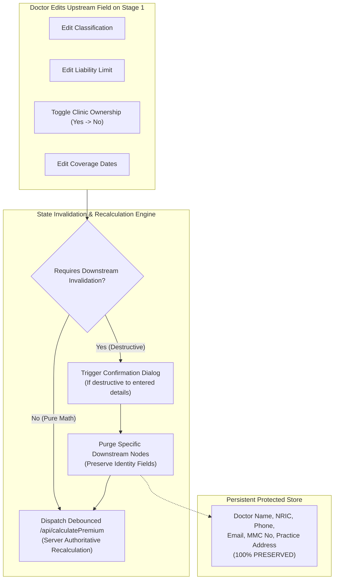

# EDIT, STATE MUTATION & RECALCULATION RULES
## DoctorShield Individual Medical Professional Indemnity Portal Redesign

> **Document ID:** `DOC-ARCH-EDIT-001`  
> **Status:** Authoritative Baseline (Phase 1 Deliverable)  
> **Classification:** [VERIFIED Architecture]  
> **Last Updated:** 2026-10-29  
> **Author:** Principal Product Architect & Senior Solutions Architect  
> **Governing Standards:** State Immutability, Zero Data Loss, Regulatory Non-Repudiation  
> **Traceability Links:** [`PRODUCT_REQUIREMENTS.md`](file:///c:/Users/salee/Downloads/Portal_ds/docs/PRODUCT_REQUIREMENTS.md), [`BUSINESS_RULE_CATALOG.md`](file:///c:/Users/salee/Downloads/Portal_ds/docs/BUSINESS_RULE_CATALOG.md), [`PRICING_AND_TAX_CONTRACT.md`](file:///c:/Users/salee/Downloads/Portal_ds/docs/PRICING_AND_TAX_CONTRACT.md)

---

## 1. Executive Framing: Zero Data Loss vs Invalidation Safety

In legacy multi-page forms, editing an upstream answer frequently produces one of two disastrous outcomes:
1. **Destructive Wiping:** The application clears the entire form back to a blank slate, forcing the doctor to re-type their NRIC, address, and clinic registration.
2. **Silent Corruption:** The application accepts the upstream change but fails to recalculate dependent downstream math, resulting in mismatched premiums or legally invalid policies.

The redesigned DoctorShield portal resolves this with a **Dual-Tier State Architecture**:
- **Tier 1 (Persistent Identity Profile):** Doctor Name, NRIC, Gender, DOB, Phone, Email, MMC Registration Number, and Primary Practice Address. This data is **never cleared** when upstream coverage selections change.
- **Tier 2 (Volatile Coverage & Rating State):** Classification, Liability Tiers, Sub-Specialty Splits, Clinic Endorsements, Branch Counts, and Server Quotation Payloads. These values are governed by explicit **Cascade Invalidation & Recalculation Rules**.



---

## 2. Upstream Invalidation Decision Matrix

The following table formally defines the system behavior when an applicant navigates backward from a later stage and mutates an upstream decision:

```
+------------------------------------------------------------------------------------------------------------------------+
|                                        UPSTREAM EDIT INVALIDATION DECISION MATRIX                                      |
+-------------------+---------------------------+-----------------------------------+------------------------------------+
| Upstream Edit     | Target Downstream State   | System Action & Data Mutation     | User Feedback & Confirmation Guard |
+-------------------+---------------------------+-----------------------------------+------------------------------------+
| **Edit Medical**  | - Liability Tier          | 1. Clear selected liability tier. | Non-destructive warning toast:     |
| **Classification**| - Specialty Allocation    | 2. Reset specialty splits to nil. | "Specialty changed. Please review  |
| (Stage 1)         | - Server Quote Payload    | 3. Query `/api/getSpecialization` | available liability limits."       |
|                   | - Personal Details        | 4. Fetch new approved tiers.      | *Doctor Name, NRIC, MMC preserved.*|
|                   |                           | 5. Mark Stage 2 quote as STALE.   |                                    |
+-------------------+---------------------------+-----------------------------------+------------------------------------+
| **Edit Limit of** | - Gross Base Premium      | 1. Retain classification & dates. | Real-time optimistic update.       |
| **Liability**     | - Clinic Cover Limit      | 2. Align clinic limit 1:1.        | Quotation sidebar updates instantly|
| (Stage 1)         | - SST (8%) & Total        | 3. Trigger debounced recalculation| via `POST /api/calculatePremium`.  |
|                   | - Personal Particulars    | 4. Update breakdown values.       | *Zero personal details touched.*   |
+-------------------+---------------------------+-----------------------------------+------------------------------------+
| **Toggle Clinic** | - Practice Entity Type    | 1. Purge entity selection.        | **Confirmation Modal Required:**   |
| **Ownership from**| - PIC Coverage Flag       | 2. Purge PIC coverage state.      | "Toggling to 'No' will remove all  |
| **'Yes' to 'No'** | - Branch Clinic Counter   | 3. Delete all branch entries.     | clinic endorsements and branch data|
| (Stage 1)         | - Clinic Branch Addresses | 4. Recalculate quote without      | entered on Stage 3. Proceed?"      |
|                   | - Combined Revenue        |    clinic surcharges.             | Options: [Keep Clinic] / [Remove]  |
+-------------------+---------------------------+-----------------------------------+------------------------------------+
| **Reduce Branch** | - Branch Surcharge Total  | 1. Decrement branch surcharge     | Inline banner on Stage 3:          |
| **Clinic Count**  | - Branch Address Cards on |    (RM 100/yr per removed branch).| "Branch count reduced to X. Extra  |
| (e.g. 3 to 1)     |   Stage 3 Particulars     | 2. Recalculate SST (8%) & Total.  | branch address cards removed."     |
|                   |                           | 3. Delete excess branch addresses.|                                    |
+-------------------+---------------------------+-----------------------------------+------------------------------------+
| **Edit Inception**| - Pro-Rata Duration Multi | 1. Re-validate 9-month ceiling.   | Datepicker re-evaluates. If past,  |
| **Date**          | - Clause 6.12 Backdating  | 2. Re-check Clause 6.12 backdate. | triggers Clause 6.12 modal.        |
| (Stage 1)         | - Expiry Date             | 3. Recalculate pro-rata ratio.    | Premium updates to match duration. |
+-------------------+---------------------------+-----------------------------------+------------------------------------+
| **Edit Promo**    | - Discount Amount         | 1. Dispatch `/api/checkPromoCode`.| Green badge if valid discount.     |
| **Code**          | - SST (8%) & Total        | 2. Recalculate net gross & tax.   | Red alert if code is expired/bad;  |
| (Stage 1)         |                           | 3. Update summary figures.        | total reverts to full gross price. |
+-------------------+---------------------------+-----------------------------------+------------------------------------+
| **Edit Claims**   | - Straight-Through Token  | 1. Immediately revoke STP token.  | User redirected to `/referral`.    |
| **Declaration to**| - Checkout Authorization  | 2. Disable `/buy/review` route.   | Back button locked via             |
| **'Adverse'**     | - Referral Trigger        | 3. Route session to `/referral`.  | `history.replaceState`.            |
| (Stage 3)         |                           | 4. Dispatch lead to CRM.          |                                    |
+-------------------+---------------------------+-----------------------------------+------------------------------------+
```

---

## 3. Invalidation Prevention: User Confirmation Dialogs

When an upstream modification would cause permanent loss of entered text (such as deleting previously entered branch clinic addresses or specialty allocations), the application forces an explicit confirmation guard:

### Modal DIAL-CONF-001: Clinic Removal Warning
```
+------------------------------------------------------------------------------------+
|                        Remove Clinic Facility Endorsement?                         |
+------------------------------------------------------------------------------------+
| You are changing your clinic ownership status to "No".                             |
|                                                                                    |
| If you proceed:                                                                    |
| • Clinic entity coverage and Person-In-Charge (PIC) protection will be removed.    |
| • All [X] branch clinic addresses entered on Stage 3 will be permanently deleted.  |
| • Your annual premium will decrease by RM [ClinicSurchargeTotal].                  |
|                                                                                    |
| [ Keep Clinic Protection ]            [ Remove Clinic Endorsement ]                |
+------------------------------------------------------------------------------------+
```
- **Primary Action ("Keep Clinic Protection"):** Cancels the toggle; leaves `own_clinic = "Yes"` intact.
- **Destructive Action ("Remove Clinic Endorsement"):** Purges clinic state; recalculates premium without clinic fees.

---

## 4. Server-Side Recalculation Flow & State Hydration

1. **Trigger Event:** User modifies an authorized input on Stage 1 (e.g. changes liability from RM 1,000,000 to RM 2,000,000).
2. **Debounce Gate:** The client waits **350 ms** for user typing or clicking to stabilize.
3. **Optimistic UI Transition:**
   - Price figures on the sticky summary sidebar display animated loading pulse skeletons.
   - The container is assigned `aria-busy="true"`.
4. **Server Request Dispatch:**
   ```json
   POST /api/calculatePremium
   Content-Type: application/json
   
   {
     "classification_id": "7",
     "liability_id": "3",
     "insurance_start_date": "01/11/2026",
     "insurance_end_date": "31/10/2027",
     "own_clinic": "1",
     "clinic_cover": "1",
     "entity_type": "sole_proprietor",
     "is_pic": "1",
     "branch_count": "2",
     "revenue_amount": "1200000",
     "promo_code": "MMA2026"
   }
   ```
5. **Server Processing:** Chubb/JA Assure rating engine evaluates actuarial base rate, applies affinity discount, adds branch surcharges, computes SST (8.0%) and flat RM 10.00 stamp duty.
6. **State Hydration:**
   - Server returns base64-encoded response (`atob(response.data)`).
   - Client updates the immutable application state:
     `state.quote = { netGross: 950.00, sst: 76.00, stampDuty: 10.00, totalPayable: 1036.00, quoteToken: "QT-88912" }`.
   - Sidebar renders updated values; loading skeletons disappear; `aria-busy="false"`.
   - Screen reader announces: `"Total payable updated to RM 1,036.00"`.

---

## 5. Non-Repudiation & Tampering Prevention Rules

1. **Quote Token Integrity:**
   - The server response includes an encrypted `quoteToken` tied to the exact input parameters and timestamp.
   - When proceeding to checkout (`POST /api/initiatePayment`), the portal transmits `quoteToken` and `quotationNumber`.
   - If a malicious client modifies the DOM total or attempts to post an altered payable amount, the backend detects signature mismatch and rejects the transaction with HTTP 403 Forbidden.
2. **Underwriting Declaration Locking:**
   - Once an applicant selects an adverse response (e.g. prior medical negligence claims or criminal investigation) and lands on `/referral`, the session token is locked to `status: "UNDERWRITING_REFERRAL"`.
   - Re-navigating to `/buy/coverage` or `/buy/underwrite` will not reset this flag. The user cannot untruthfully toggle their answer back to "No" to force straight-through binding.
   - Clearing the adverse flag requires official underwriter intervention via the JA Assure CRM portal.

