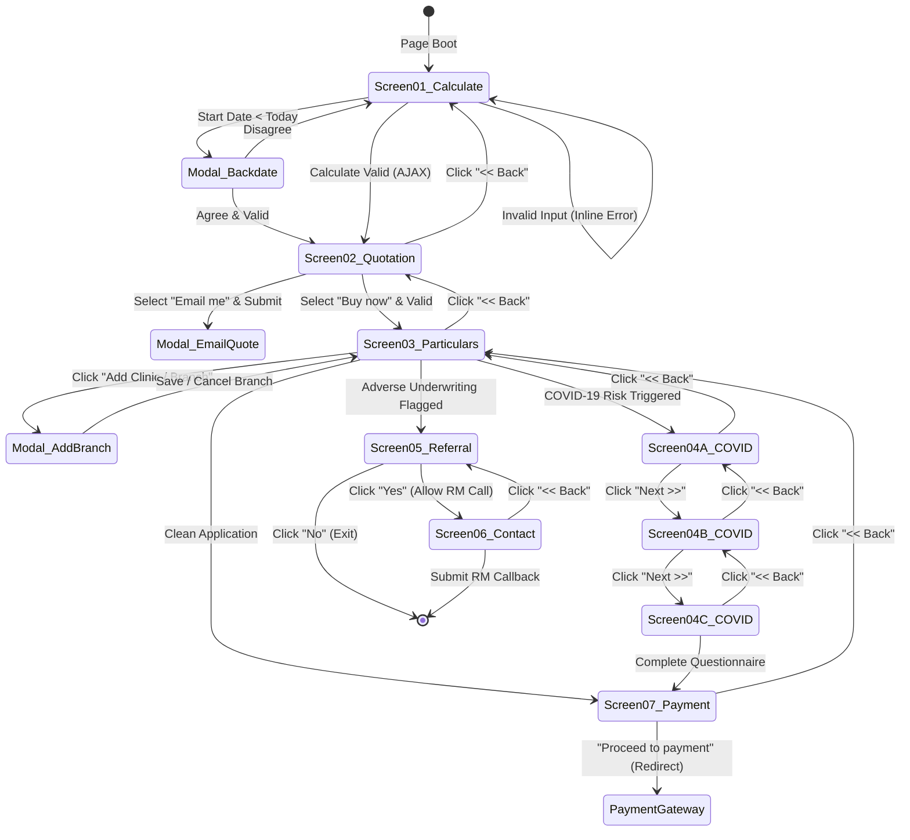

# INTERACTION INVENTORY
## DoctorShield Individual Medical Professional Indemnity Portal — Forensic Audit

> **Document ID:** `DOC-INTERACT-INV-001`  
> **Classification:** [VERIFIED] / [INFERRED]  
> **Date of Observation:** 2026-10-29  
> **Auditor:** Principal Product Architect & Engineering Lead  
> **Scope:** Dynamic state machine, event listeners, conditional rendering rules, validation triggers, and data persistence models across all screens.

---

## 1. Master Interaction Flow & State Machine

The entire portal application operates on a single client-side form state container (`#jsQuoteForm`). State transitions are managed through jQuery event delegation in `home.min.js`.



---

## 2. Interaction Specifications by Feature

---

### IX-01: Dynamic Specialization & Liability Tier Population

| Field | Detail |
|---|---|
| **Trigger Element** | `#classification_id` (`<select>`) |
| **Event** | `change` |
| **API Call** | `POST /api/getSpecialization` |
| **Payload** | `{ classification_id: selectedValue }` |
| **UI State Changes** | 1. Clears current options in `#liability_id`.<br>2. Shows temporary loading spinner/indicator.<br>3. Injects available liability options into `#liability_id` (e.g. RM 500,000 up to RM 10,000,000).<br>4. If classification involves multiple specialties (e.g., Plastic Surgery / Aesthetics), unhides `#specializationModal` to allocate percentage time. |
| **Error Handling** | If API fails, triggers `#jsServerSideErrorModal`. |
| **Evidence Status** | [VERIFIED] (Observed via runtime AJAX capture) |

---

### IX-02: Date Validation & Policy Backdating Protocol

| Field | Detail |
|---|---|
| **Trigger Element** | `#insurance_start_date` (`<input type="tel">`) |
| **Event** | `blur` / `change` |
| **Validation Rules** | 1. Format must strictly match `DD/MM/YYYY`.<br>2. Must not be greater than 9 months in the future. Error: `Please enter a valid date, date should be within nine months from today.`<br>3. If date is earlier than today's local date (Backdating):<br>&nbsp;&nbsp;&nbsp;&nbsp;- Intercepts submission.<br>&nbsp;&nbsp;&nbsp;&nbsp;- Displays `#jsBackDateEnableModel` ("Policy Backdate Agreement").<br>&nbsp;&nbsp;&nbsp;&nbsp;- User must explicitly click "Agree" to accept Clause 6.12 non-continuous retroactive exclusions. |
| **Auto-calculation** | Calculates `#insurance_end_date` based on whether standard 12-month or APC cycle (e.g., fixed Dec 31st) is selected. |
| **Evidence Status** | [VERIFIED] |

---

### IX-03: Promo Code Application & Modification

| Field | Detail |
|---|---|
| **Trigger Element** | `#promo_code` (`<input type="text">`) |
| **Event** | `blur` / `change` / `submit` |
| **Behavior** | 1. If user inputs code on Step 1, it is passed to `/api/calculatePremium`.<br>2. If discount is valid, Step 2 displays `DISCOUNTED INDIVIDUAL PREMIUM` banner and pro-rated figures.<br>3. If user edits promo code after calculation, triggers `#jsNewPromocodeChangeModel` with prompt: changing promo code will recalculate the entire quote. |
| **Evidence Status** | [VERIFIED] |

---

### IX-04: Clinic Ownership & Progressive Disclosure

| Field | Detail |
|---|---|
| **Trigger Element** | `Do you own a clinic?` button group (`Yes` \| `No`) |
| **Event** | `click` on `.q-btn` |
| **Conditional Tree** | - If `No`: Keeps clinic type, locum, and clinic liability inputs hidden. Sets hidden input `do_you_own_clinic_status_value = "0"`.<br>- If `Yes`: Sets `do_you_own_clinic_status_value = "1"`. Progressively reveals:<br>&nbsp;&nbsp;&nbsp;&nbsp;1. `Is it a Sole proprietor or partnership / sdn bhd?` button group.<br>&nbsp;&nbsp;&nbsp;&nbsp;2. `Do you hire locums who sees new patients on their own?` button group.<br>&nbsp;&nbsp;&nbsp;&nbsp;3. Clinic limit of liability dropdown (`#clinic_liability_id`).<br>&nbsp;&nbsp;&nbsp;&nbsp;4. Recommended Clinic Indemnity package card (`#medical_establishment_package`). |
| **Button States** | Active button toggles class from `btn-outline-light` to `btn-light`. |
| **Evidence Status** | [VERIFIED] |

---

### IX-05: PIC (Person-In-Charge) Evaluation

| Field | Detail |
|---|---|
| **Trigger Elements** | 1. `Are you a Person-In-Charge (PIC) for any clinic?`<br>2. `Are you a Person-In-Charge (PIC) with another establishment?` |
| **Event** | `click` on `Yes` / `No` buttons |
| **Behavior** | If either answer is `Yes`, dynamically unhides the **"Buy PIC coverage"** add-on card with helper prompt *"Why is this recommended?"*. Sets hidden field `pic_coverage_enable_status_value`. |
| **Evidence Status** | [VERIFIED] |

---

### IX-06: Fulfillment Path Selection (Buy Now vs. Email Quote)

| Field | Detail |
|---|---|
| **Trigger Element** | Radio group `emailMeOrOnline` (`#emailMe2` vs. `#emailMe1`) |
| **Event** | `change` |
| **Behavior** | - If `#emailMe2` ("Buy now"): Primary button reads `Buy >>` and advances to Step 3 (Personal Particulars).<br>- If `#emailMe1` ("Email me the Indicative Quotation and Policy Wording"): Primary button reads `Submit`. Clicking triggers AJAX `/api/sendIndicativeQuoteMail`, sends quotation summary and PDF to registered email, and presents confirmation modal `#jsReIndicativeQuoteErrorModel`. |
| **Evidence Status** | [VERIFIED] |

---

### IX-07: Clinic Branch Addition Modal

| Field | Detail |
|---|---|
| **Trigger Element** | Button `Add Clinic / Branch` on Step 3 |
| **Event** | `click` |
| **Modal Container** | `#jsBranchModal` |
| **Fields Validated** | - `modal_branch_name` (Required)<br>- `modal_branch_address` (Required)<br>- `modal_branch_phone` (Required) |
| **Persistence** | Clicking `Add Clinic / Branch` validates all 3 fields, creates a visual table row / branch card on Step 3, appends branch object to serialized hidden array `branch_details`, and closes modal. |
| **Evidence Status** | [VERIFIED] |

---

### IX-08: Underwriting Declarations & Adverse Routing

| Field | Detail |
|---|---|
| **Trigger Elements** | Individual Underwriting Declaration button toggles (Claims, Errors, Disciplinary, Criminal) |
| **Event** | `click` on `Agree`/`Disagree` or `Yes`/`No` buttons |
| **Conditional Disclosures** | - `Disagree` to No Claims: reveals textarea `#no_claim_desc` ("Please provide details below").<br>- `Yes` to Errors/Omissions: reveals textarea `#aware_of_errors_desc`.<br>- `Yes` to Disciplinary: reveals textarea `#desciplinary_action_desc`.<br>- `Yes` to Criminal: reveals textarea `#criminal_charges_desc`. |
| **Branch Routing on Step 3 Submit** | - If **ALL** declarations are clean (`Agree` to no claims, `No` to all others): proceeds to Step 7 (Payment).<br>- If **ANY** adverse answer is given (`Disagree` or `Yes`): intercepts checkout, unhides `#jsPage8` ("CONTACT SUPPORT" / Referral interruption). |
| **Evidence Status** | [VERIFIED] |

---

### IX-09: Support Referral Interruption & Callback Capture

| Field | Detail |
|---|---|
| **Trigger Element** | Reaching `#jsPage8` following adverse underwriting declaration |
| **Display** | Shows: *"PLEAESE CALL SUPPORT OFFICE. We need more information to process your application, Will you be ok for our manger to call you at [Customer Phone]?"* |
| **Action** | - Clicking `No`: Form halts, advises applicant to call office directly.<br>- Clicking `Yes`: Transitions to `#jsContact` ("CONTACT DETAIL"), pre-populates name, email, phone, and clinic name. Clicking `Submit` posts to `/api/contactSupport` and confirms relationship manager assignment. |
| **Evidence Status** | [VERIFIED] |

---

### IX-10: Renewal Lookup & OTP Verification

| Field | Detail |
|---|---|
| **Trigger Route / Modal** | `/renew` or `#jsFormRenewModal` |
| **Step 1: Identifier Input** | Input Malaysian mobile number (`#form_phone_number`). Select OTP channel: button `Message OTP` (SMS) or `Whatsapp OTP`. |
| **Step 2: Dispatch** | Clicks `Generate OTP`. Triggers `/api/generateOTP`. Starts 5-minute countdown timer. |
| **Step 3: Verification** | Inputs OTP into `#form_otp_value`. Clicks `Verify`. Triggers `/api/verifyOTP`. |
| **Step 4: Policy Selection** | On success, displays modal `#jsUserPolicyList` listing active/expiring policies tagged to that mobile. Selecting a policy pre-populates the wizard with existing practitioner data and updated renewal quote. |
| **Evidence Status** | [VERIFIED] |

---

### IX-11: Navigation & Back-Button State Management

| Feature | Behavior Observed in Legacy System |
|---|---|
| **Browser Back Button** | **BROKEN / UNSUPPORTED.** Since the wizard is driven by client-side DOM `.hidden` toggles without `window.history.pushState()`, clicking the browser's native Back button causes the browser to navigate away from the portal, causing **total session loss and data discard**. |
| **In-Page Back Buttons** | In-page buttons (`#jsPage2Back`, `#jsPage3Back`, `#jsFinalPageBack`, `#jsContactPrevButton`) successfully toggle DOM visibility back to the prior step, retaining previously entered input values in the DOM. |
| **State Reset on Error** | If session expires or server returns 500, form triggers modal `#jsStartDateValidationErrorModal` or `#jsServerSideErrorModal`, forcing user to re-initiate from Step 1. |
| **Evidence Status** | [VERIFIED] |

---

## 3. Data Persistence Model

All form state is persisted in-memory across screens through the following architecture:

```
HTML Form: #jsQuoteForm (DOM elements remain mounted throughout)
  ├── Step 1 Inputs: classification_id, liability_id, insurance_start_date, insurance_end_date, customer_email, promo_code
  ├── Step 2 Hidden Flags: do_you_own_clinic_status_value, clinic_type_value, employee_locum_status_value, 
  │                       pic_of_own_clinic_or_another_clinic_status_value, are_you_pic_of_any_clinic_status_value,
  │                       clinic_liability_id, medical_establishment_package_value, pic_coverage_enable_status_value, 
  │                       reinstatement_package_value
  ├── Step 3 Inputs: customer_name, dob, nric, clinical_name, income, nationality, country_name, practice_location, 
  │                 customer_phone, branch_details (JSON string)
  ├── Step 4 Declarations: have_claim_ever_been_made, aware_of_errors, have_been_disciplinary_action, had_criminal_charges,
  │                       plus corresponding textareas for narrative explanations
  └── Step 5 Payment: payment_option_type (Personal vs Business Banking)
```

No `localStorage` or `sessionStorage` persistence is utilized. A page refresh completely wipes all entered data.

