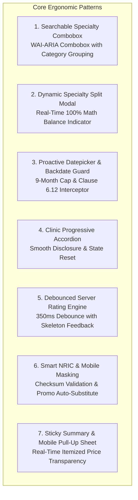

# INTERACTION SPECIFICATIONS & ERGONOMIC PATTERNS
## DoctorShield Individual Medical Professional Indemnity Portal Redesign

> **Document ID:** `DOC-SPEC-INTER-001`  
> **Status:** Authoritative Baseline (Phase 1 Deliverable)  
> **Classification:** [VERIFIED Architecture]  
> **Last Updated:** 2026-10-29  
> **Author:** Principal Product Architect & Senior UI/UX Specialist  
> **Governing Standards:** WAI-ARIA 1.2 Authoring Practices, WCAG 2.1 AA, Touch Ergonomics  
> **Traceability Links:** [`SCREEN_SPECIFICATIONS.md`](file:///c:/Users/salee/Downloads/Portal_ds/docs/SCREEN_SPECIFICATIONS.md), [`PRODUCT_REQUIREMENTS.md`](file:///c:/Users/salee/Downloads/Portal_ds/docs/PRODUCT_REQUIREMENTS.md), [`UX_PRINCIPLES.md`](file:///c:/Users/salee/Downloads/Portal_ds/docs/UX_PRINCIPLES.md)

---

## 1. Overview & Interaction Hierarchy

The DoctorShield redesign establishes a set of **predictable, accessible, and resilient micro-interactions**. Every interaction is designed to eliminate cognitive friction, prevent input errors before submission, provide immediate transparent feedback, and guarantee 100% keyboard accessibility.



---

## 2. Micro-Interaction Specifications

### 2.1 Practitioner Classification Searchable Combobox (`FLD-CALC-CLASS-001`)

- **Objective:** Eliminate the frustration of scrolling through 23 uncategorized select options on mobile and desktop.
- **WAI-ARIA Pattern:** `role="combobox"`, `aria-expanded="false"`, `aria-haspopup="listbox"`, `aria-autocomplete="list"`.
- **Interaction Behaviors:**
  1. **Focus & Search:** Clicking or tabbing into the field opens a floating popover list. Typing filters results instantly by specialty name or category (e.g. typing `"Sur"` immediately filters to General Surgery, Orthopaedic Surgery, Plastic Surgery, etc.).
  2. **Categorical Optgroups:** Options are structured into visually distinct headers:
     - *Primary Care:* General Medical Practitioner, GP with Aesthetics, Locum Doctor.
     - *Surgical:* General Surgery, Obstetrics & Gynaecology, Orthopaedics, Ophthalmology, ENT, etc.
     - *Non-Surgical Specialist:* Cardiology, Dermatology, Paediatrics, Radiology, Psychiatry, etc.
     - *Public Sector:* Government Medical Officer / Dentist.
     - *Dental:* General Dental Practitioner, Orthodontics, Oral Surgery.
  3. **Keyboard Traversal:** `ArrowDown` / `ArrowUp` navigates filtered items; `Enter` selects and closes popover; `Esc` dismisses without selection.
  4. **State Mutation:** Selection immediately triggers `POST /api/getSpecialization` to load liability tiers matching the classification risk category. If multi-specialty, reveals the "Allocate Specialization Percentages" button.

---

### 2.2 Multi-Specialty Split Modal with Dynamic Math (`ACT-SPEC-MODAL-001`)

- **Objective:** Prevent the severe usability failure where users had to calculate fractions manually and encountered jarring errors upon submitting.
- **WAI-ARIA Pattern:** `role="dialog"`, `aria-modal="true"`, `aria-labelledby="spec-modal-title"`.
- **Interaction Behaviors:**
  1. **Modal Trigger:** User clicks *"Allocate Specialization Percentages"*. Focus is moved immediately into the first percentage input (`focus-trap` active).
  2. **Real-Time Balance Display:** Above the percentage inputs, a live indicator displays:
     - When sum $< 100\%$: Amber banner $\rightarrow$ `Remaining to allocate: X.X%` (e.g. entering 70% shows `30.0% remaining`).
     - When sum $> 100\%$: Red banner $\rightarrow$ `Total exceeds 100% by X.X%. Please reduce.`
     - When sum $= 100.0\%$: Green banner with checkmark $\rightarrow$ `Allocation balanced (100.0%).`
  3. **Submit Button State:** The *"Confirm Specialization"* CTA remains **disabled** until the sum is mathematically equal to **exactly 100.0%** and every selected specialty is $> 0\%$.
  4. **Auto-Balance Convenience Action:** A small secondary action *"Distribute Evenly"* automatically divides 100% across all selected specialties.
  5. **Dismissal & Escape:** Pressing `Esc` or clicking *"Cancel"* closes the dialog, restores previous valid state, and returns keyboard focus to the trigger button.

---

### 2.3 Datepicker & Clause 6.12 Backdating Interception (`FLD-CALC-DATE-003`)

- **Objective:** Proactively prevent date boundary errors and explain retroactive exclusions clearly.
- **Interaction Behaviors:**
  1. **Forward Ceiling Constraint:** The calendar UI visually greys out and disables all dates beyond **Current Date + 9 calendar months**. Attempting manual text entry of an invalid date triggers instant field error microcopy: `"Coverage start date cannot exceed 9 months from today."`
  2. **APC Co-Termination Toggle:**
     - Checking the box *"Align coverage expiry with Annual Practicing Certificate (APC) on 31st December"* sets End Date = `31/12/YYYY`.
     - The UI dynamically badges the duration as `"Pro-Rated Term ([X] days)"` and notes: `"Your premium will be pro-rated to co-terminate with your MMC APC cycle."`
  3. **Backdating Interception Guard:**
     - If the user selects a date prior to today's date, the forward navigation is intercepted.
     - An accessible modal dialog (`#jsBackDateEnableModel`) appears with statutory Clause 6.12 text:
       > *"You have selected a backdated inception date. In accordance with Chubb Underwriting Clause 6.12, backdating does not provide continuous coverage for acts occurring prior to the current year inception, unless continuous coverage is proven."*
     - **Option 1 ("Agree"):** Mutates start date to `01/01/YYYY`, recalculates end date to `31/12/YYYY`, binds Clause 6.12 acceptance to payload, and closes modal.
     - **Option 2 ("Disagree"):** Clears the start date input, closes modal, and returns focus to the datepicker.

---

### 2.4 Progressive Disclosure of Clinic & Branch Sections (`FLD-CALC-OWN-004`)

- **Objective:** Keep the primary form lean for solo doctors while expanding smoothly for practice owners.
- **Interaction Behaviors:**
  1. **Segmented Switch:** `Do you own a clinic?` is presented as a high-contrast segmented switch (`No` [default] / `Yes`).
  2. **Smooth Expansion:** When toggled to `Yes`, an accessible animated container expands (`aria-expanded="true"`, `role="region"`), smoothly revealing:
     - Practice Entity Selection Cards (Sole Proprietorship, Partnership, Sdn Bhd).
     - Clinic Facility Cover Toggle.
     - Person-In-Charge (PIC) Selection.
     - Branch Clinics Counter & Combined Revenue Input.
  3. **Reversion Safety Guard:** If the user toggles `own_clinic` from `Yes` back to `No` after entering branch and entity data:
     - An inline warning banner confirms: `"Toggling to No will remove clinic and branch cover from your quotation. Any entered branch details will be cleared."`
     - Upon confirmation, all clinic state is purged from memory and the rating recalculates.

---

### 2.5 Branch Clinics Stepper & Boundary Protection (`FLD-CALC-BRAN-008`)

- **Objective:** Enforce the 4-branch online limit transparently without silent failures.
- **Interaction Behaviors:**
  1. **Accessible Counter Control:** Features `-` and `+` buttons with numeric display (`role="spinbutton"`, `aria-valuemin="0"`, `aria-valuemax="4"`).
  2. **Dynamic Price Indication:** Incrementing branch count from 1 to 2 updates an inline caption: `"+ RM 100.00/yr per additional branch"`.
  3. **5th Branch Limit Modal (`LEG-BRANCH-001`):**
     - Clicking `+` when the counter is at 4 disables the button.
     - A non-destructive modal dialog appears:
       > *"Maximum 4 Branch Clinics Allowed Online. Practices with 5 or more branch locations require an enterprise group healthcare policy. Please contact our support office to bind coverage for your entire clinic network."*
     - Provides a direct link to call support or submit a callback ticket.

---

### 2.6 Asynchronous Debounced Rating Engine & Feedback

- **Objective:** Deliver instant pricing transparency without causing UI flicker or overwhelming the Chubb backend.
- **Interaction Behaviors:**
  1. **350ms Debounce Window:** As the user toggles liability tiers, clinic add-ons, or branch counts, input events are debounced by 350 ms.
  2. **Optimistic Loading Skeletons:**
     - The quotation summary sidebar immediately displays subtle pulsing skeleton blocks across price figures.
     - The container is marked `aria-busy="true"`.
  3. **Asynchronous Dispatch:** Client fires `POST /api/calculatePremium` with serialized form state.
  4. **Smooth Transition:** Base64 JSON response is decoded (`atob`); price figures fade in smoothly without layout shift (CLS = 0).
  5. **Network Failure Fallback:** If the network fails or backend times out, the sidebar displays an accessible retry alert: `"Unable to update pricing. [Tap to Retry]"`, leaving prior form selections intact.

---

### 2.7 Smart Identity Masking & Promo Code Auto-Substitution

- **Objective:** Eliminate typing fatigue and prevent invalid promo code frustration for returning doctors.
- **Interaction Behaviors:**
  1. **NRIC Masking (`FLD-PART-NRIC-014`):**
     - As the user types digits, formatting hyphens are inserted automatically: `850512-14-5533`.
     - Validates 12 numeric digits; validates valid birth date in the first 6 digits (`YYMMDD`); calculates age.
     - Automatically selects Gender radio and populates Date of Birth field.
  2. **Existing Customer Promo Auto-Substitution (`RULE-PROM-02`):**
     - On blur of the NRIC field, the client dispatches a background check: `POST /api/nricPromoCodeCheck`.
     - If the NRIC exists in the Chubb policy database AND the user entered a *new customer promo code* on Stage 1:
       - Modal dialog `#jsNewPromocodeChangeModel` opens politely:
         > *"Welcome back, Dr. [Name]. We noticed you are an existing DoctorShield policyholder. The new customer code has been automatically replaced with your eligible Renewal Discount Code ([RENEWALCODE]), saving you [X]%."*
       - Tapping *"Apply Renewal Discount"* updates the quotation total dynamically.

---

### 2.8 Underwriting Declaration Radio Cards & Context Expanders

- **Objective:** Ensure solemn, legally compliant declarations with zero ambiguous selections.
- **Interaction Behaviors:**
  1. **Large Mutually Exclusive Cards:** Each declaration question features two large cards (`I Agree` / `I Disagree` or `No` / `Yes`).
  2. **High-Contrast Selection:** Selected card displays a 2px teal border (`#08A5B5`) with an active checkmark icon; unselected card remains clean neutral grey.
  3. **Conditional Textarea Expansion:**
     - Selecting `Yes` on disciplinary, criminal, or claims inquiries smoothly expands a mandatory details textarea below the question.
     - Live character counter displays: `Minimum 20 characters required (currently: X)`.
     - Forward navigation button remains disabled until adequate details are entered.

---

### 2.9 Sticky Summary Rail (Desktop) & Pull-Up Sheet (Mobile)

```
+----------------------------------------------------------------------------------------------------+
|                                    QUOTATION SUMMARY BEHAVIOR                                      |
+-------------------+--------------------------------------------------------------------------------+
| Viewport Mode     | Interactive Behavior                                                           |
+-------------------+--------------------------------------------------------------------------------+
| **Desktop**       | Sticky sidebar anchored at `top: 24px`. Tracks viewport scrolling down long   |
| ($\ge 1024\text{ px}$) | forms. Live updates as coverage toggles change. Always visible.                |
+-------------------+--------------------------------------------------------------------------------+
| **Tablet**        | Compact header banner displaying: "Indemnity: RM 1M | Total: RM 442.00"       |
| ($768 - 1023\text{ px}$)| Tapping expands a non-modal dropdown drawer showing full SST & stamp breakdown.|
+-------------------+--------------------------------------------------------------------------------+
| **Mobile**        | Pinned bottom bar: `Total: RM 442.00 (Incl. SST & Stamp Duty) | View Details ^`|
| ($< 768\text{ px}$) | Tapping pulls up an accessible bottom sheet with full itemized breakdown.      |
+-------------------+--------------------------------------------------------------------------------+
```

---

## 3. Comprehensive Accessibility & Focus Trapping Standards

1. **Focus Ring Standard:** Every focusable element (links, buttons, inputs, cards) exhibits a visible, high-contrast focus indicator: `outline: 2px solid #08A5B5; outline-offset: 2px`. Focus outlines are **never suppressed**.
2. **Modal Focus Management:**
   - On open: Focus moves automatically to the first interactive element or dialog title.
   - Background scrolling is locked (`overflow: hidden` on `<body>`).
   - `Tab` and `Shift+Tab` cycle strictly within the modal boundaries (`focus-trap`).
   - `Esc` key closes dialog.
   - On close: Focus returns precisely to the trigger element that launched the modal.
3. **Screen Reader Live Announcements:**
   - Real-time rating updates: `<div role="status" aria-live="polite" class="sr-only">Total payable updated to RM [Amount]</div>`.
   - Field validation errors: `<p id="err-email" role="alert" aria-live="assertive">Please enter a valid email address.</p>`.
   - Stepper milestones: `<span class="sr-only">Step 2 of 4: Quotation Breakdown, current milestone</span>`.

