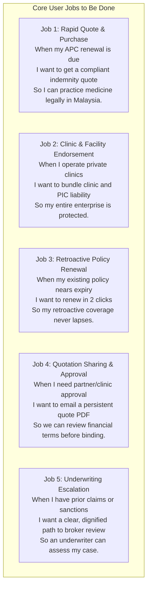
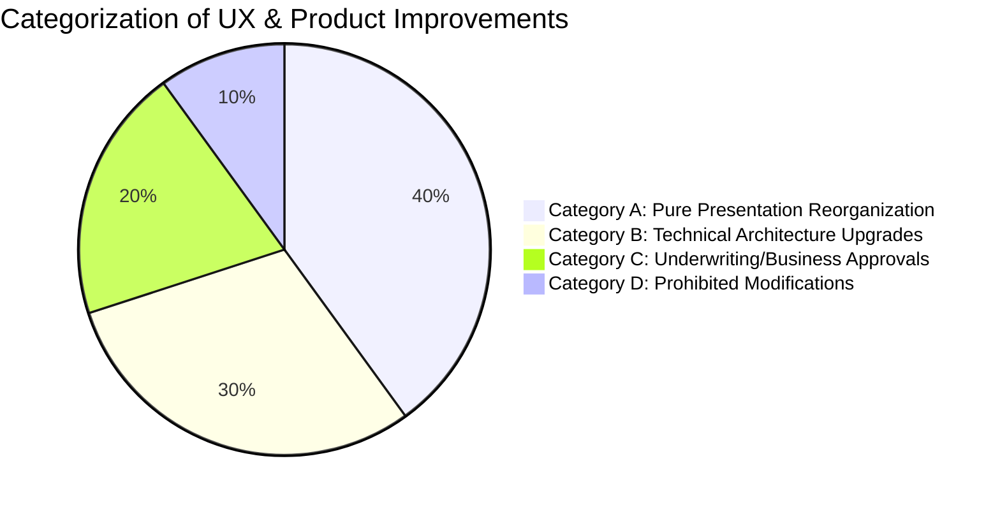

# PRODUCT REQUIREMENTS DOCUMENT (PRD)
## DoctorShield Individual Medical Professional Indemnity Portal Redesign

> **Document ID:** `DOC-PRD-REBUILD-001`  
> **Status:** Draft for Stakeholder Review (Phase 1 Baseline)  
> **Classification:** [VERIFIED] / [INFERRED]  
> **Last Updated:** 2026-10-29  
> **Product Owner:** Principal Product Manager & Senior Insurance UX Strategist  
> **Underwriter:** Chubb Insurance Malaysia Berhad | **Distributor:** JA Assure  
> **Governing Standards:** Absolute Prohibitions P-1 to P-10 (`AGENTS.md`)  
> **Traceability Links:** [`CONTENT_MASTER.md`](file:///c:/Users/salee/Downloads/Portal_ds/docs/CONTENT_MASTER.md), [`FIELD_DICTIONARY.md`](file:///c:/Users/salee/Downloads/Portal_ds/docs/FIELD_DICTIONARY.md), [`BUSINESS_RULE_CATALOG.md`](file:///c:/Users/salee/Downloads/Portal_ds/docs/BUSINESS_RULE_CATALOG.md), [`PRICING_AND_TAX_CONTRACT.md`](file:///c:/Users/salee/Downloads/Portal_ds/docs/PRICING_AND_TAX_CONTRACT.md), [`UNDERWRITING_DECISION_TREE.md`](file:///c:/Users/salee/Downloads/Portal_ds/docs/UNDERWRITING_DECISION_TREE.md)

---

## 1. Executive Summary & Vision Statement

### 1.1 Vision & Mission
DoctorShield Individual Indemnity is Malaysia's premier digital medical professional indemnity insurance scheme, underwritten by **Chubb Insurance Malaysia Berhad** and distributed by **JA Assure**.

The mission of this redesign is to replace the aging, friction-heavy 2018-era legacy portal (`my-individualindemnity.doctorshield.com`) with a modern, accessible, responsive, high-converting digital product that delivers an effortless purchase and renewal experience for Malaysian medical practitioners.

The rebuild must achieve an institutional standard of calm healthcare credibility, eliminate catastrophic UX drop-off traps, and ensure 100% WCAG 2.1 AA accessibility **without altering any approved insurance benefit, underwriting rule, rating formula, or legal notice**.

### 1.2 Core Product Invariants
Every requirement in this document is bound by the 10 Absolute Product Invariants:
1. **Preserve All Content:** Every existing question, field label, option, disclaimer, legal notice, and document link must remain verbatim unless formally changed via an approved Content Change Request (`CCR-NNN`).
2. **Preserve All Underwriting & Rating:** The portal will never compute estimated pricing or alter underwriting logic. Rating remains 100% server-authoritative (`POST /api/calculatePremium`).
3. **Never Invent Products or Rates:** Tiers, surcharges, pro-rations, and taxes are strictly bound to official Chubb actuarial schedules.
4. **Zero Data Loss:** Applicants must never lose typed inputs when navigating backward or encountering validation errors.
5. **Legally Enforceable Straight-Through Binding:** Policies issued online must be fully valid under BNM Financial Services Act 2013 and MMC guidelines.

---

## 2. Primary User Personas & Mental Models

```
+----------------------------------------------------------------------------------------------------+
|                                    TARGET USER PERSONAS & PROFILES                                 |
+-------------------+---------------------------+--------------------------------+-------------------+
| Persona           | Medical Profile           | Primary Job to Be Done         | Key Anxiety/Pain  |
+-------------------+---------------------------+--------------------------------+-------------------+
| 1. Dr. Aisha      | Medical Officer / Locum   | Secure compliant indemnity for | Low insurance     |
|    (Junior MO)    | Govt Hospital + Clinic    | APC renewal fast on mobile     | literacy; fearing |
|                   | Moonlighting              | between shifts.                | under-insurance.  |
+-------------------+---------------------------+--------------------------------+-------------------+
| 2. Dr. Tan        | Senior GP & Clinic Owner  | Protect both individual        | Confused by clinic|
|    (Practice Head)| Sole Proprietor, 2 Branch | practice and clinic facilities | add-on, PIC terms,|
|                   | Locations                 | under one umbrella.            | and branch limits.|
+-------------------+---------------------------+--------------------------------+-------------------+
| 3. Dr. Suresh     | Consultant Orthopaedic    | Secure high indemnity limits   | Multi-specialty   |
|    (Specialist)   | Surgeon (Private Hospital)| (RM 5M) co-terminating with    | split allocation; |
|                   |                           | annual MMC APC certificate.    | complex procedures|
+-------------------+---------------------------+--------------------------------+-------------------+
| 4. Dr. Lim        | Existing DoctorShield     | One-click renew expiring cover | Forgetting promo  |
|    (Renewal Doc)  | Policyholder              | with continuous retroactive    | code; fear of     |
|                   |                           | date protection.               | coverage gap.     |
+-------------------+---------------------------+--------------------------------+-------------------+
| 5. Puan Salmah    | Clinic Practice Manager / | Prepare quote and complete     | Form timeouts;    |
|    (Clinic Admin) | Executive Administrator   | paperwork for 3 partner doctors| losing doctor's   |
|                   |                           | to sign off.                   | entered IC/MMC.   |
+-------------------+---------------------------+--------------------------------+-------------------+
```

### 2.1 Persona Details

#### Persona 1: Dr. Aisha — Junior Medical Officer / Locum Doctor
- **Demographics:** Age 29, Contract MO in public hospital, performs locum shifts at private GP clinics on weekends.
- **Goal:** Needs standard RM 1,000,000 indemnity to satisfy MMC Annual Practicing Certificate (APC) requirements.
- **Context:** Accessing portal late at night on an iPhone after an on-call rotation.
- **Pain Points in Existing Portal:** Overwhelmed by clinic ownership questions; confused by backdating warning when entering today's date; struggled on mobile with un-pinchable select dropdowns.

#### Persona 2: Dr. Tan — General Practitioner & Clinic Owner
- **Demographics:** Age 48, runs a primary care clinic with 2 branch locations (Sole Proprietorship).
- **Goal:** Insure himself, obtain Person-In-Charge (PIC) cover, and cover his 2 branch clinics.
- **Context:** Accessing portal on desktop browser at his clinic reception desk.
- **Pain Points in Existing Portal:** Terrified by the RM 5,000,000 revenue question with zero explanation; couldn't tell why Person-In-Charge was RM 0.00; hit a wall when adding a branch clinic because modal closed without error feedback.

#### Persona 3: Dr. Suresh — Consultant Orthopaedic Surgeon
- **Demographics:** Age 55, private hospital specialist performing spine surgery and non-invasive pain management.
- **Goal:** RM 5,000,000 liability limit, pro-rated to align exactly with his December 31 APC cycle.
- **Context:** High net worth, impatient with clumsy forms, needs an official tax invoice and immediate policy certificate for hospital credentialing.
- **Pain Points in Existing Portal:** Spent 10 minutes in the `#specializationModal` trying to get percentage numbers to total 100%; received zero feedback when numbers totaled 99.9%.

#### Persona 4: Dr. Lim — Existing Policyholder Renewing
- **Demographics:** Age 42, Pediatrician, insured with DoctorShield for 3 consecutive years.
- **Goal:** Renew policy in under 2 minutes with retroactive date preserved (`01/01/2023`).
- **Context:** Received an email/WhatsApp reminder that policy expires in 14 days.
- **Pain Points in Existing Portal:** Accidentally entered new customer promo code, received an error banner, re-typed NRIC, had his start date cleared, lost his previous session.

---

## 3. User Jobs to Be Done (JTBD)



---

## 4. Application Objectives & Success Targets

### 4.1 Business & Product Objectives
1. **Maximize Straight-Through Processing (STP):** Increase straight-through quote-to-issuance conversion from ~42% to $\ge 75\%$ for eligible doctors.
2. **Eliminate Catastrophic Abandonment:** Reduce drop-off on Step 1 (monolithic overload) and Step 5 (declarations) by $\ge 60\%$.
3. **Sub-3 Minute Task Completion:** Reduce median solo GP purchase time from 8.5 minutes to $\le 2.5$ minutes.
4. **Zero Re-Entry on Navigation:** 100% preservation of form data across wizard navigation, step jumps, and modal closures.
5. **Strict Regulatory & Brand Fidelity:** Complete visual alignment with DoctorShield brand tokens (`#08A5B5`, `#132766`, Kanit $\le 500$, Inter) and zero WCAG 2.1 AA violations.

### 4.2 Measurable Quality Targets

| Metric | Current Portal (As-Is) | Target Redesign (To-Be) | Verification Method |
|---|---|---|---|
| **Lighthouse Accessibility Score** | 68 / 100 | **100 / 100** | Automated Lighthouse CI |
| **Axe-Core WCAG Violations** | 81 violations (critical: 12) | **0 violations** | Automated axe-core regression |
| **Largest Contentful Paint (LCP)** | 4.8 seconds (Mobile 3G) | **< 1.8 seconds** | Chrome User Experience / WebPageTest |
| **Interaction to Next Paint (INP)** | 340 ms | **< 100 ms** | Performance profiler |
| **Cumulative Layout Shift (CLS)** | 0.28 (banner pops) | **< 0.05** | Synthetic layout shift monitor |
| **Form Abandonment Rate** | ~58% (inferred) | **< 20%** | Web analytics funnel tracking |
| **Mobile Completion Rate** | ~18% (high friction) | **$\ge 55\%$** | Responsive device analytics |
| **Back-Button Data Loss Rate** | 100% (clears fields) | **0% (Zero loss)** | Automated state test suite |

---

## 5. System Entry Points & Exit Outcomes

### 5.1 System Entry Points
1. **Direct Purchase (`/` or `/buy`):** Clean inception flow for new doctors or practitioners switching from foreign indemnity providers (MDU/MPS).
2. **Direct Renewal (`/renew`):** Dedicated authenticated portal for existing customers using Mobile OTP (SMS or WhatsApp) to retrieve expiring policies.
3. **Quotation Retrieval Link (`/quote/{quotationNumber}`):** Deep-link generated by Step 3 email, restoring serialized quotation state onto Step 2 breakdown.
4. **Affinity Partner Landing Links (`/partner/{partnerCode}`):** Deep-links for MMA, MAAM, and APHM members pre-populating classification and partner promo code.

### 5.2 System Exit Outcomes
1. **Instant Policy Issuance (Success):** Redirect to Step 11 (`#jsPage11`) upon payment authorization; Certificate of Insurance (COI), Tax Invoice, and Chubb Policy Schedule available for immediate PDF download.
2. **Underwriting Referral (Support Office):** Transition to `#jsPage8` upon adverse declaration; callback ticket logged in CRM (`POST /api/contactSupport`); doctor notified that Relationship Manager will reach out within 1 business day.
3. **Payment Interruption / Retry:** Secure return from payment gateway hosted checkout to Step 7 checkout summary with state fully intact and clear retry guidance.
4. **Saved Quotation Email Dispatched:** Step 3 action dispatches quotation summary to doctor's inbox with 30-day rate validity guarantee.

---

## 6. Functional Requirements (FR)

The following requirements trace directly to the [`FIELD_DICTIONARY.md`](file:///c:/Users/salee/Downloads/Portal_ds/docs/FIELD_DICTIONARY.md), [`BUSINESS_RULE_CATALOG.md`](file:///c:/Users/salee/Downloads/Portal_ds/docs/BUSINESS_RULE_CATALOG.md), and [`UNDERWRITING_DECISION_TREE.md`](file:///c:/Users/salee/Downloads/Portal_ds/docs/UNDERWRITING_DECISION_TREE.md).

### 6.1 Practitioner Eligibility, Classification & Specialty (FR-ELIG)

- **`FR-ELIG-001` (Taxonomy Selection):** The portal shall provide selection of practitioner classification across all 23 active approved categories (`RULE-ELIG-01`, `FLD-CALC-CLASS-001`).
- **`FR-ELIG-002` (Taxonomy Search & Filtering):** The UI shall provide an accessible search-as-you-type combobox for classification to eliminate scrolling through 23 unorganized items.
- **`FR-ELIG-003` (Dynamic Liability Tier Binding):** Upon selection of a classification, the client shall query `/api/getSpecialization` and populate `#liability_id` with approved tiers strictly matching the medical risk category (`RULE-LIAB-01`).
- **`FR-ELIG-004` (Specialty Allocation Modal):** If a classification contains multi-specialty sub-categories, the portal shall render an accessible dialog (`#specializationModal`, `RULE-SPEC-01`).
  - The UI shall calculate the total percentage in real time.
  - The UI shall display an active indicator showing remaining percentage needed to reach 100%.
  - The submission button shall be disabled unless the sum equals **exactly 100.0%** and every selected field is $> 0\%$.
- **`FR-ELIG-005` (Geo-Restriction Notice):** If client IP is outside Malaysia, the portal shall display non-blocking modal `#intro_modal` informing the user that coverage is valid for Malaysian jurisdiction only (`RULE-ELIG-02`).

### 6.2 Inception Dates, Pro-Rata & Backdating (FR-DATE)

- **`FR-DATE-001` (Forward Ceiling Validation):** The inception date input (`FLD-CALC-DATE-003`) shall permit dates up to **Current Date + 9 calendar months**. Dates exceeding this boundary shall be disabled in the datepicker and blocked by schema validation (`RULE-DATE-01`).
- **`FR-DATE-002` (APC Co-Termination Expiry):** By default, end date shall calculate to `Inception Date + 1 Year - 1 Day`. The UI shall provide an explicit toggle: *"Align with Annual Practicing Certificate (APC) expiry (31st December)"*.
- **`FR-DATE-003` (Server-Authoritative Pro-Rata):** If the policy duration is $< 365$ days, the quote request shall pass `is_prorata: true` and display the pro-rata calculation returned by Chubb's engine (`RULE-PROR-01`).
- **`FR-DATE-004` (Backdating Interception & Clause 6.12):** If `insurance_start_date < Current Date`, the UI shall intercept forward progression and trigger `#jsBackDateEnableModel` displaying the statutory Clause 6.12 retroactive exclusion notice (`RULE-DATE-02`).
  - Clicking **Agree** mutates the start date to `01/01/YYYY` and binds retroactive exclusion for prior acts.
  - Clicking **Disagree** clears the date input and keeps the user on Step 1.

### 6.3 Clinic Ownership, PIC & Branch Add-Ons (FR-CLIN)

- **`FR-CLIN-001` (Progressive Clinic Disclosure):** Clinic questions (`FLD-CALC-OWN-004` to `FLD-CALC-REVN-008`) shall remain hidden until `own_clinic` is toggled to "Yes" (`RULE-CLIN-01`).
- **`FR-CLIN-002` (Entity Type Binding):** When `own_clinic = "Yes"`, the UI shall expose 3 mutually exclusive choices: Sole Proprietorship, Partnership, and Sdn Bhd (`FLD-CALC-ENTY-005`).
- **`FR-CLIN-003` (Complimentary Sole Proprietor PIC):** If entity is Sole Proprietorship and branch count = 0, Person-In-Charge (PIC) cover shall be marked as **Complimentary (RM 0.00)** in the quotation breakdown (`RULE-PIC-01`).
- **`FR-CLIN-004` (Partnership Multi-Doctor Surcharge):** If entity is Partnership or Sdn Bhd, the UI shall collect partner doctor count and query the server rating engine for applicable PIC surcharges.
- **`FR-CLIN-005` (Branch Clinic Limit Ceiling):** The UI shall permit up to 4 branch clinic entries (`FLD-CALC-BRAN-007`). Attempting to add a 5th branch shall trigger modal `#jsBranchLimitExceededModal` and direct the user to support for enterprise group rating (`LEG-BRANCH-001`).
- **`FR-CLIN-006` (Combined Revenue Ceiling):** Combined clinic revenue input (`FLD-CALC-REVN-008`) shall validate $\le \text{RM } 5,000,000$. Exceeding RM 5,000,000 shall trigger mandatory referral routing to `#jsPage8`.
- **`FR-CLIN-007` (Clinic Add-On Reset):** Toggling `own_clinic` from "Yes" to "No" shall immediately purge all dependent clinic, PIC, and branch data from state and trigger rating recalculation.

### 6.4 Promotional Codes & Affinity Partnerships (FR-PROM)

- **`FR-PROM-001` (Promo Code Validation):** The portal shall validate entered promo codes via `POST /api/checkPromoCode` (`RULE-PROM-01`).
- **`FR-PROM-002` (Existing Customer Code Auto-Substitution):** When an existing customer enters their NRIC on Step 4 after applying a new-customer promo code on Step 1, the backend check `POST /api/nricPromoCodeCheck` shall trigger modal `#jsNewPromocodeChangeModel`, informing the user and automatically applying the eligible renewal discount code (`RULE-PROM-02`).
- **`FR-PROM-003` (Whitespace & Case Normalization):** Promo code inputs shall automatically trim leading/trailing whitespace and uppercase strings prior to dispatch.

### 6.5 Personal Particulars & Clinic Details (FR-PART)

- **`FR-PART-001` (Identity Verification Inputs):** Step 4 shall capture Doctor Title, Full Name as per IC, NRIC / Passport Number, Date of Birth, Gender, Mobile Phone, Email, MMC Registration Number, and Primary Clinic Practice Address (`FLD-PART-012` to `FLD-PART-025`).
- **`FR-PART-002` (NRIC Formatting & DOB Extraction):** Entering a 12-digit Malaysian NRIC (`YYMMDD-PB-###G`) shall automatically validate checksum, format with hyphens, and infer Date of Birth and Gender, while allowing manual override if required.
- **`FR-PART-003` (Mobile Phone Validation):** Phone input shall enforce Malaysian mobile format (`+60 1X-XXX XXXX` or `+60 11-XXXX XXXX`).
- **`FR-PART-004` (MMC Number Verification):** MMC Registration Number shall enforce numerical format and validate against registered council formats.
- **`FR-PART-005` (Branch Clinic Particulars):** If branch clinics were selected on Step 1, Step 4 shall render branch address and registration input cards matching the selected branch count.

### 6.6 Underwriting Declarations & Referral Routing (FR-UW)

- **`FR-UW-001` (Clean Claims Statement Agreement):** Step 5 shall present the statutory 5-year claims and disciplinary declaration (`FLD-DECL-040` to `FLD-DECL-044`, `RULE-DECL-01`).
- **`FR-UW-002` (Adverse Declaration Referral Gate):** Answering "Yes" to prior claims, disciplinary inquiries, or criminal proceedings, or selecting "I Disagree" to the clean declaration, shall immediately halt straight-through checkout and route to Support Office screen `#jsPage8` (`RULE-REF-01`).
- **`FR-UW-003` (Conditional Explanation Capture):** If a user selects "Yes" to disciplinary or investigation questions, the UI shall expand a mandatory detail textarea requiring minimum 20 characters before referral submission.
- **`FR-UW-004` (Disabling Back Navigation on Referral):** Once routed to `#jsPage8`, browser back navigation shall be intercepted to prevent applicants from altering answers to bypass underwriting review (`RULE-REF-01`).
- **`FR-UW-005` (Relationship Manager Callback Lead):** On `#jsPage8`, the user shall have access to a callback request form dispatching contact details to JA Assure CRM (`POST /api/contactSupport`).
- **`FR-UW-006` (COVID-19 Questionnaire Conditional Display):** Step 6 (`#jsPage6`) shall only render if server flag `is_active_supplementarty_covid_questions = true` (`RULE-COV-01`). Adverse responses shall route to `#jsPage8`.

### 6.7 Quotation Summary, Tax & Statutory Disclosures (FR-SUM)

- **`FR-SUM-001` (Penny-Perfect Breakdown):** Step 2 and Step 7 shall display an itemized breakdown:
  - Gross Base Indemnity Premium
  - Promotional / Affinity Discount (if applicable)
  - Clinic Entity Cover Add-On (if applicable)
  - Branch Clinic Surcharges (if applicable)
  - Person-In-Charge Cover (Complimentary RM 0.00 or rated)
  - **Net Gross Premium**
  - **Sales & Service Tax (SST @ 8.0%)** (`RULE-TAX-01`)
  - **Statutory Stamp Duty (Flat RM 10.00)**
  - **Total Payable Amount (RM)**
- **`FR-SUM-002` (Half-Up Fractional Sen Rounding):** SST calculation shall strictly apply standard commercial half-up rounding (`Round(NetGross * 0.08, 2)`).
- **`FR-SUM-003` (Statutory PIDM & Disclosure Notices):** Step 7 shall display verbatim statutory disclosures:
  - PIDM Protection Statement (Takaful and Insurance Benefits Protection System up to RM 500,000)
  - Duty of Disclosure notice under Schedule 9 of the Financial Services Act 2013
  - Chubb Privacy Notice and JA Assure PDPA Consent Statement
  - Subrogation and Direct Right of Action disclaimers
- **`FR-SUM-004` (Mandatory Consent Checkboxes):** Proceeding to payment shall require explicit affirmative opt-in checkboxes for Terms & Conditions, Duty of Disclosure, and PDPA Consent.

### 6.8 Payment Gateway Hand-Off & Policy Issuance (FR-PAY)

- **`FR-PAY-001` (Payment Method Selection):** Step 7 shall provide two payment channels (`FLD-PAY-OPTION-074`):
  1. Personal Credit / Debit Card & FPX Individual Banking (`channel = "B2C_FPX_AND_CARD"`).
  2. Business Banking / Corporate FPX (`channel = "B2B_CORPORATE_INTERNET_BANKING"`).
- **`FR-PAY-002` (Secure Gateway Hand-Off):** Submitting payment shall dispatch `POST /api/initiatePayment` with quotation token and redirect the browser to the hosted PCI-DSS gateway checkout (`RULE-PAY-01`).
- **`FR-PAY-003` (Transaction Failure & Recovery):** If payment is declined, cancelled, or times out, the gateway shall return the user to Step 7 with an accessible error notification, preserving all entered data and allowing immediate re-attempt.
- **`FR-PAY-004` (Instant Policy Issuance):** Upon successful authorization, the portal shall land on Step 11 (`#jsPage11`), displaying:
  - Policy Number & Inception/Expiry Dates
  - Certificate of Insurance (COI) Download (PDF)
  - Statutory Tax Invoice Download (PDF)
  - Master Policy Wording & Schedule Link

### 6.9 Renewal Engine (`/renew`) (FR-RNW)

- **`FR-RNW-001` (Dual OTP Authentication):** The renewal portal shall authenticate doctors using registered mobile numbers via either **SMS OTP** or **WhatsApp OTP** (`RULE-CUST-02`).
- **`FR-RNW-002` (Active Policy Inspection):** Upon authentication, `/api/getUserPolicies` shall retrieve active policies and render an inspection card displaying Policy ID, Specialty, Limit, Inception, Expiry, and Renewal Status.
- **`FR-RNW-003` (Retroactive Continuity Invariant):** Generating a renewal quote shall automatically set Inception Date = `Prior Expiry Date + 1 Day 00:00:00` and preserve the original historical **Retroactive Date** verbatim.

---

## 7. Non-Functional Requirements (NFR)

### 7.1 Accessibility (WCAG 2.1 AA Strict)
- **`NFR-A11Y-001` (Zero Axe-Core Violations):** The application shall have 0 critical, serious, or moderate violations under `axe-core`.
- **`NFR-A11Y-002` (Full Keyboard Navigability):** All interactive elements (inputs, radios, checkboxes, steppers, modals) must be 100% operable via keyboard (`Tab`, `Shift+Tab`, `Space`, `Enter`, `Esc`, Arrow keys). Focus rings must be visible (`outline: 2px solid #08A5B5`).
- **`NFR-A11Y-003` (Screen Reader Semantics):** All form controls must have associated `<label>` elements with matching `for`/`id` attributes. Error states must link via `aria-describedby` and announce via `aria-live="polite"`.
- **`NFR-A11Y-004` (Contrast Ratios):** Normal text must achieve $\ge 4.5:1$ contrast against backgrounds; large text and UI components/borders must achieve $\ge 3.0:1$. The primary teal (`#08A5B5`) must be paired with appropriate dark typography or adjusted for accessible contrast on white backgrounds.

### 7.2 Performance & Core Web Vitals
- **`NFR-PERF-001` (Core Web Vitals Thresholds):**
  - **Largest Contentful Paint (LCP):** $\le 1.8 \text{ s}$ on 4G mobile.
  - **Interaction to Next Paint (INP):** $\le 100 \text{ ms}$.
  - **Cumulative Layout Shift (CLS):** $\le 0.05$.
- **`NFR-PERF-002` (Client Bundle Budget):** Total JavaScript payload must not exceed **180 KB gzipped** for the initial route.
- **`NFR-PERF-003` (Debounced Rating Calls):** Form field changes triggering quote recalculation must be debounced by **350 ms** to eliminate server strain and UI flicker.

### 7.3 Security, Privacy & Compliance
- **`NFR-SEC-001` (Zero Customer PII Logging):** Customer NRIC, mobile numbers, emails, and medical claims data must never be logged in client console, analytics trackers, or unencrypted local storage.
- **`NFR-SEC-002` (PCI-DSS SAQ-A Compliance):** Payment card data must never touch the DoctorShield server; card entry occurs entirely within the hosted gateway domain.
- **`NFR-SEC-003` (Content Security Policy):** Production headers must enforce strict CSP Level 3 (`script-src 'self'`, `object-src 'none'`, `frame-ancestors 'none'`).
- **`NFR-SEC-004` (Session Token Security):** Authentication and quotation session cookies must be `httpOnly`, `Secure`, and `SameSite=Strict`.

### 7.4 Data Persistence & Session Resilience
- **`NFR-SESS-001` (Zero Data Loss on Navigation):** The application state machine must preserve all entered fields in client memory / encrypted sessionStorage across forward and backward wizard navigation.
- **`NFR-SESS-002` (Session Expiry Warning):** At 25 minutes of inactivity, a non-destructive warning modal shall notify the user of pending rate expiration with a 1-click *"Extend Session"* button.

---

## 8. Categorization of UX & Architectural Changes

In strict accordance with the project rules, all proposed enhancements are divided into four clear operational categories:



### Category A: Pure Presentation Reorganizations (Zero Business Impact)
*These improvements reorganize existing content, reduce cognitive overload, and improve usability without altering any questions, rules, or APIs:*
1. **Milestone Stepper:** Replace the deceptive 7-step jQuery DOM indicator with a true 4-stage milestone tracker (1. Coverage, 2. Profile, 3. Declarations, 4. Payment).
2. **Progressive Disclosure of Clinic Fields:** Hide organization type, PIC, branch clinics, and revenue inputs until the doctor explicitly selects `own_clinic = "Yes"`.
3. **Sticky Quotation Summary Card:** Display an ergonomic, real-time sticky summary sidebar on desktop showing selected coverage, liability limits, and running price breakdown.
4. **Accessible Searchable Dropdowns:** Wrap long 23-specialty lists into accessible searchable comboboxes.
5. **Contextual Inline Explanations:** Surface existing tooltip content directly beside complex fields (e.g. explaining what Person-In-Charge means under the PHCFS Act 1998).

### Category B: Technical & Architectural Improvements
*These improvements upgrade client reliability, validation, and performance without changing backend endpoints:*
1. **Strict TypeScript State Machine:** Replace jQuery DOM mutation with an immutable, typed state machine (Zod schema validation).
2. **Real-Time Specialization Split Calculator:** Provide automatic percentage summation and balance remaining indicators in `#specializationModal`.
3. **Accessible Form Feedback:** Replace blocking `alert()` popups and raw Bootstrap modals with accessible inline form validation.
4. **Encrypted Session Persistence:** Protect doctor form drafts in `sessionStorage` against accidental tab closure or back-button clicks.
5. **Automated End-to-End Regression Harness:** Implement Playwright automated test scripts for all 71 edge cases specified in [`EDGE_CASE_TEST_MATRIX.md`](file:///c:/Users/salee/Downloads/Portal_ds/docs/EDGE_CASE_TEST_MATRIX.md).

### Category C: Business / Underwriting Approvals Required
*These improvements require formal sign-off from named business, legal, or underwriting stakeholders:*
1. **`CCR-001` (Retire COVID Questionnaire):** Formal approval to retire or conditionally suppress Step 6 COVID-19 risk questions for standard medical practitioners.
2. **`CCR-002` (Modernize Cookie Notice):** Formal approval to update the 2021/2022 timestamp in the privacy/cookie notice to the current 2026 PDPA standard.
3. **`CCR-003` (Correct Referral Screen Typo):** Formal approval to correct `#jsPage8` title from `"PLEAESE CALL SUPPORT OFFICE"` to `"PLEASE CALL SUPPORT OFFICE"`.
4. **`CCR-004` (Harmonize Validation Copy):** Formal approval to replace awkward phrasing (`"Please select Person In Charge (PIC)"`) with professional microcopy.
5. **`UNVER-RATE-002` (Actuarial Pro-Rata Divisor & Floor):** Underwriter confirmation of leap-year divisor (365 vs 366) and minimum pro-rata premium threshold.

### Category D: Explicitly Prohibited Changes (Absolute Invariants)
*These changes are strictly forbidden under `AGENTS.md` and project invariants:*
1. **Never alter approved liability tiers:** E.g., cannot add an arbitrary RM 4,000,000 limit or change the RM 250k floor for Government Doctors.
2. **Never alter statutory legal notices:** Duty of Disclosure, PIDM statements, and Clause 6.12 backdating wordings must remain verbatim.
3. **Never calculate pricing client-side:** Never build client-side rating multipliers or guess unverified discounts.
4. **Never bypass underwriting referral gates:** Never allow doctors with active claims or disciplinary sanctions to complete straight-through payment.
5. **Never omit required questions:** E.g., cannot remove clinic registration number, branch revenue, or tax residency questions.

---

## 9. Requirement Traceability Matrix & Acceptance Criteria

| Req ID | Traceability Source | Core Acceptance Criteria (Given / When / Then) | Priority |
|---|---|---|---|
| **`FR-ELIG-001`** | `RULE-ELIG-01`, `FLD-CALC-CLASS-001` | **Given** user on Step 1, **When** clicking classification, **Then** all 23 approved practitioner types are selectable. | 🔴 P1 |
| **`FR-ELIG-003`** | `RULE-LIAB-01`, `FLD-CALC-LIAB-002` | **Given** Class 20 selected, **When** liability loads, **Then** lowest available tier is strictly RM 1,000,000. | 🔴 P1 |
| **`FR-DATE-001`** | `RULE-DATE-01`, `FLD-CALC-DATE-003` | **Given** date $> \text{today} + 9 \text{ months}$, **When** input submitted, **Then** client and server block progression with date error. | 🔴 P1 |
| **`FR-DATE-004`** | `RULE-DATE-02`, `#jsBackDateEnableModel` | **Given** date $< \text{today}$, **When** navigating forward, **Then** Clause 6.12 modal appears; Agree sets date to `01/01/YYYY`. | 🔴 P1 |
| **`FR-CLIN-003`** | `RULE-PIC-01`, `FLD-CALC-PIC-006` | **Given** Sole Proprietor clinic with 0 branches, **When** quote calculates, **Then** PIC is priced at exactly RM 0.00 (Complimentary). | 🔴 P1 |
| **`FR-CLIN-005`** | `LEG-BRANCH-001`, `FLD-CALC-BRAN-007` | **Given** 4 branches added, **When** attempting to add 5th branch, **Then** action blocked with `#jsBranchLimitExceededModal`. | 🔴 P1 |
| **`FR-SPEC-004`** | `RULE-SPEC-01`, `#specializationModal` | **Given** multi-specialty split, **When** sum $= 99.9\%$, **Then** submit button is disabled and real-time deficit shown. | 🔴 P1 |
| **`FR-UW-002`** | `RULE-DECL-01`, `#jsPage8` | **Given** user selects "Yes" to prior claim, **When** submitting Step 5, **Then** straight-through halted; routed to Support Office screen. | 🔴 P1 |
| **`FR-SUM-001`** | `RULE-TAX-01`, `PRICING_AND_TAX_CONTRACT.md` | **Given** net gross quote, **When** summary renders, **Then** SST is exactly 8.0%, Stamp Duty is RM 10.00, rounded half-up. | 🔴 P1 |
| **`FR-PAY-002`** | `RULE-PAY-01`, `#jsFinalPageSubmit` | **Given** checkout completed, **When** clicking proceed, **Then** browser redirects to PCI-DSS payment gateway with valid token. | 🔴 P1 |
| **`FR-RNW-003`** | `RULE-CUST-02`, `/renew` | **Given** authenticated renewal, **When** quote generated, **Then** inception starts immediately after prior expiry with retroactive date locked. | 🔴 P1 |
| **`NFR-A11Y-001`**| WCAG 2.1 AA | **Given** complete application, **When** scanned with `axe-core`, **Then** 0 violations are detected. | 🔴 P1 |
| **`NFR-PERF-001`**| Core Web Vitals | **Given** 4G mobile emulation, **When** initial page loads, **Then** LCP $\le 1.8\text{ s}$ and CLS $\le 0.05$. | 🟠 P2 |
| **`NFR-SESS-001`**| Zero Data Loss | **Given** user on Step 4, **When** user clicks browser back button, **Then** all previously entered data is 100% preserved. | 🔴 P1 |

