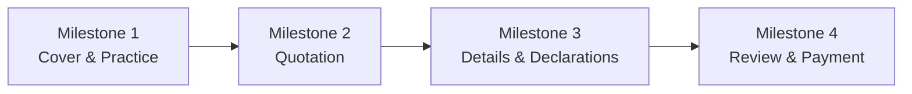
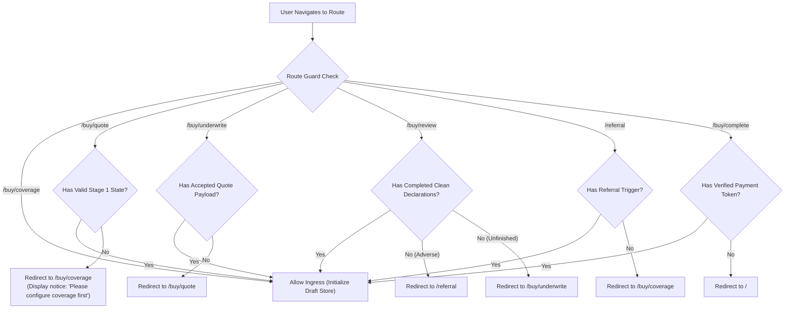

# ROUTE AND STEP MAP
## DoctorShield Individual Medical Professional Indemnity Portal Redesign

> **Document ID:** `DOC-ARCH-ROUTE-001`  
> **Status:** Authoritative Baseline (Phase 1 Deliverable)  
> **Classification:** [VERIFIED Architecture]  
> **Last Updated:** 2026-10-29  
> **Author:** Principal Product Architect & Senior Solutions Architect  
> **Traceability Links:** [`TO_BE_USER_FLOW.md`](file:///c:/Users/salee/Downloads/Portal_ds/docs/TO_BE_USER_FLOW.md), [`PRODUCT_REQUIREMENTS.md`](file:///c:/Users/salee/Downloads/Portal_ds/docs/PRODUCT_REQUIREMENTS.md)

---

## 1. Application Route Topology

The redesigned portal replaces the arbitrary jQuery DOM manipulation (`.show()` / `.hide()`) with a **standard, URL-backed, single-page application router** supporting deep-linking, browser history synchronization, and strict route guards.

```
+----------------------------------------------------------------------------------------------------+
|                                    APPLICATION ROUTE TAXONOMY                                      |
+-------------------+-----------------------+-----------------------+--------------------------------+
| Route Path        | Milestone Stage       | Purpose               | Route Guard / Precondition     |
+-------------------+-----------------------+-----------------------+--------------------------------+
| `/`               | Gateway / Ingress     | Root landing & channel| Public access                  |
|                   |                       | selector (Buy vs Renew|                                |
+-------------------+-----------------------+-----------------------+--------------------------------+
| `/buy/coverage`   | **Stage 1: Coverage** | Specialty, Limits,    | None (Starts new session)      |
|                   |                       | Dates, Clinic Add-ons |                                |
+-------------------+-----------------------+-----------------------+--------------------------------+
| `/buy/quote`      | **Stage 2: Quotation**| Indicative breakdown, | Requires valid Stage 1 payload |
|                   |                       | Save quote, PDF email | Redirects to `/buy/coverage`   |
+-------------------+-----------------------+-----------------------+--------------------------------+
| `/buy/underwrite` | **Stage 3: Details**  | Personal & clinic info| Requires Stage 2 quote acceptance|
|                   |                       | Underwriting questions| Redirects to `/buy/quote`      |
+-------------------+-----------------------+-----------------------+--------------------------------+
| `/buy/review`     | **Stage 4: Checkout** | Disclosures, Consents,| Requires clean Stage 3 UW      |
|                   |                       | Payment selection     | Redirects to `/buy/underwrite` |
+-------------------+-----------------------+-----------------------+--------------------------------+
| `/buy/complete`   | **Completion**        | Policy issued, COI &  | Requires verified payment token|
|                   |                       | Tax Invoice download  | Redirects to `/` if invalid    |
+-------------------+-----------------------+-----------------------+--------------------------------+
| `/renew`          | **Renewal Gateway**   | Standalone renewal OTP| Public access                  |
|                   |                       | & policy picker       |                                |
+-------------------+-----------------------+-----------------------+--------------------------------+
| `/quote/:quoteId` | **Quotation Resume**  | Restore saved quote   | Valid `:quoteId` token in DB   |
+-------------------+-----------------------+-----------------------+--------------------------------+
| `/referral`       | **Underwriting Desk** | Adverse risk referral | Requires adverse declaration   |
|                   |                       | Callback request lead | Redirects to `/` if empty      |
+-------------------+-----------------------+-----------------------+--------------------------------+
| `/payment/return` | **Gateway Return**    | Callback processing   | Gateway signature payload      |
+-------------------+-----------------------+-----------------------+--------------------------------+
| `/payment/cancel` | **Gateway Return**    | Payment retry handler | Restores Stage 4 with error    |
+-------------------+-----------------------+-----------------------+--------------------------------+
```

---

## 2. Milestone Stepper & Progress Model

The customer-facing progress indicator represents a **4-Milestone Mental Model**. Substeps within stages do not cause jarring jumps or increment misleading counters.



### Milestone State Specifications

| Stage Index | Route Path | Customer Display Label | Internal Substeps | Desktop Stepper UI | Mobile Stepper UI |
|---|---|---|---|---|---|
| **Stage 1** | `/buy/coverage` | **1. Coverage** | 1A: Practice & Limits<br/>1B: Clinic & Branches<br/>1C: Promo Code | Horizontal Step 1 active; Steps 2–4 locked | `Stage 1 of 4: Coverage (25%)` with progress bar |
| **Stage 2** | `/buy/quote` | **2. Quotation** | 2A: Breakdown Review<br/>2B: Email Quote Modal | Step 1 checkmark; Step 2 active; Steps 3–4 locked | `Stage 2 of 4: Quotation (50%)` with progress bar |
| **Stage 3** | `/buy/underwrite`| **3. Details & Underwriting**| 3A: Doctor & Clinic Particulars<br/>3B: Statutory Declarations<br/>3C: Supplementary COVID | Steps 1–2 checkmarks; Step 3 active; Step 4 locked | `Stage 3 of 4: Details (75%)` with progress bar |
| **Stage 4** | `/buy/review` | **4. Review & Payment** | 4A: Summary & Consent<br/>4B: Payment Channel Hand-off | Steps 1–3 checkmarks; Step 4 active | `Stage 4 of 4: Payment (100%)` with progress bar |

### Stepper Interaction & Accessibility Rules:
- **Clickable Past Milestones:** Users can click on previously completed milestones (e.g. jumping from Stage 3 back to Stage 1 or Stage 2).
- **Disabled Future Milestones:** Clicking on future locked milestones is blocked until prerequisites are validated.
- **ARIA Stepper Pattern:**
  - `<nav aria-label="Purchase Progress">`
  - `<ol role="list">`
  - Completed items carry `<li aria-current="false"><span class="sr-only">Completed: </span>...</li>`
  - Active item carries `<li aria-current="step">...</li>`
  - Future items carry `<li aria-disabled="true">...</li>`

---

## 3. Route Guard Specifications & State Prerequisites



---

## 4. Browser History Synchronization Strategy

The application router manages browser history state deliberately to prevent the destructive behavior observed in the legacy portal:

### 1. Forward Navigation (`pushState`):
- When a user successfully validates a stage and clicks *"Proceed / Next"*, the router executes `history.pushState(null, '', nextRoute)`.
- This ensures the browser back button enables returning to the prior stage.

### 2. Backward Navigation (`popstate` Event):
- When the user presses the browser Back button:
  - The router intercepts the `popstate` event.
  - The current form draft is synced to `sessionStorage`.
  - The previous route renders with all previously entered fields intact.
  - No data is wiped; no unexpected full-page reloads occur.

### 3. Critical Exit Exceptions (`replaceState`):
- **On Referral Screen (`/referral`):**
  - When adverse declarations route the user to `/referral`, the router executes `history.replaceState(null, '', '/referral')`.
  - The router traps the back button and displays an informational modal: *"Your application has been referred for underwriting review. You cannot edit declarations online. Please submit a callback request or contact support."*
  - This prevents applicants from fraudulently changing claims answers after seeing an underwriting referral.
- **On Payment Success (`/buy/complete`):**
  - After payment verification, the router executes `history.replaceState(null, '', '/buy/complete')`.
  - Hitting browser Back will not resubmit payments or enter checkout; it redirects gracefully to the home portal `/`.

---

## 5. Responsive Device Adaptation (Desktop, Tablet & Mobile)

```
+----------------------------------------------------------------------------------------------------+
|                                    RESPONSIVE NAVIGATION PATTERNS                                  |
+-------------------+-------------------------------+------------------------------------------------+
| Viewport          | Stepper Pattern               | Summary Rail / Drawer Pattern                  |
+-------------------+-------------------------------+------------------------------------------------+
| **Desktop**       | Full horizontal 4-step bar    | Persistent sticky right-hand rail (360px width)|
| ($\ge 1024\text{ px}$) | with numbered circles & labels| continuously displaying live breakdown & total |
+-------------------+-------------------------------+------------------------------------------------+
| **Tablet**        | Compact horizontal step bar   | Collapsible summary bar at top of screen with  |
| ($768 - 1023\text{ px}$)| with condensed step titles    | 1-tap expandable breakdown drawer              |
+-------------------+-------------------------------+------------------------------------------------+
| **Mobile**        | Minimalist milestone tracker: | Fixed bottom bar displaying: "Total: RM XXX"   |
| ($< 768\text{ px}$) | `Step 2 of 4: Quotation (50%)`| with a "View Breakdown" pull-up bottom sheet   |
+-------------------+-------------------------------+------------------------------------------------+
```

### Mobile Viewport Considerations:
1. **Zero Pinch/Zoom:** All inputs enforce `font-size: 16px` minimum to prevent iOS Safari auto-zooming.
2. **Bottom-Anchored Sticky Actions:** Primary CTAs (`Proceed to Application`, `Continue to Payment`) remain fixed to the bottom viewport on mobile with `padding-bottom: env(safe-area-inset-bottom)` to support modern bezel-less devices.
3. **Pull-Up Breakdown Sheet:** Tapping the bottom summary bar expands an accessible modal sheet showing full itemized SST (8%), Stamp Duty (RM 10), and discount calculations without navigating away from the form.

