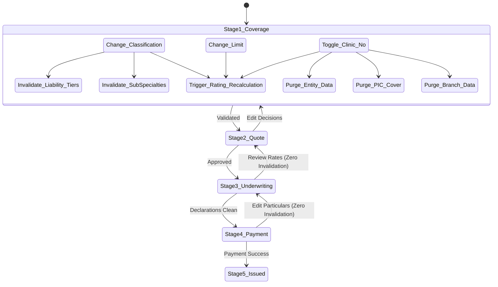

# FUTURE-STATE USER JOURNEY ARCHITECTURE (TO-BE)
## DoctorShield Individual Medical Professional Indemnity Portal Redesign

> **Document ID:** `DOC-ARCH-FLOW-001`  
> **Status:** Authoritative Baseline (Phase 1 Deliverable)  
> **Classification:** [VERIFIED Architecture]  
> **Last Updated:** 2026-10-29  
> **Author:** Principal Product Architect & Senior Insurance UX Strategist  
> **Underwriter:** Chubb Insurance Malaysia Berhad | **Distributor:** JA Assure  
> **Governing Documents:** [`PRODUCT_REQUIREMENTS.md`](file:///c:/Users/salee/Downloads/Portal_ds/docs/PRODUCT_REQUIREMENTS.md), [`BUSINESS_RULE_CATALOG.md`](file:///c:/Users/salee/Downloads/Portal_ds/docs/BUSINESS_RULE_CATALOG.md), [`PRICING_AND_TAX_CONTRACT.md`](file:///c:/Users/salee/Downloads/Portal_ds/docs/PRICING_AND_TAX_CONTRACT.md)

---

## 1. Executive Summary & Journey Model

The redesigned DoctorShield Individual Indemnity experience replaces the legacy 11-div monolithic jQuery wizard with a **cohesive 4-Stage Progressive Milestone Architecture**. 

This structure respects the natural cognitive progression of a medical professional:
1. **Stage 1: Cover & Practice Profile** — What protection do I need for my specialty and practice?
2. **Stage 2: Quotation Review & Options** — What does it cost, what is included, and can I save/share it?
3. **Stage 3: Identity & Underwriting Declarations** — Who am I, where do I practice, and what is my risk history?
4. **Stage 4: Review, Statutory Consent & Payment** — Confirm all statutory terms, disclosures, and execute payment.
5. **Completion: Policy Issuance** — Instant policy issuance, schedule download, and Certificate of Insurance (COI).

Additionally, the architecture defines dedicated high-efficiency paths for **Authenticated Renewals (`/renew`)**, **Quotation Recovery (`/quote/:id`)**, and **Support-Assisted Underwriting Referrals (`/referral`)**.

```mermaid
flowchart TD
    START(["Doctor Enters Portal"]) --> ENTRY{User Intent}

    %% Entry Branching
    ENTRY --> |"New Purchase / Switching"| S1["Stage 1: Cover & Practice Profile<br/>(/buy/coverage)"]
    ENTRY --> |"Expiring Policyholder"| RNW["Dedicated Renewal Portal<br/>(/renew)"]
    ENTRY --> |"Saved Quote Email Link"| REC["Quotation Recovery<br/>(/quote/:id)"]

    %% Renewal Flow
    RNW --> RNW_AUTH["Mobile OTP Auth<br/>(SMS / WhatsApp)"]
    RNW_AUTH --> RNW_SEL["Select Expiring Policy<br/>(Lock Retroactive Date)"]
    RNW_SEL --> S2

    %% Recovery Flow
    REC --> REC_RESTORE["Restore State from DB<br/>(Validate Inception Freshness)"]
    REC_RESTORE --> S2

    %% Stage 1 -> Stage 2
    S1 --> S1_DATE{"Start Date < Today?"}
    S1_DATE -- Yes --> S1_BACKDATE["Clause 6.12 Modal<br/>Mutate start date to 01/01/YYYY"]
    S1_DATE -- No --> S2["Stage 2: Quotation Review & Options<br/>(/buy/quote)"]
    S1_BACKDATE --> S2

    %% Stage 2 Options
    S2 --> S2_ACT{User Action}
    S2_ACT --> |"Email Quotation"| S2_EMAIL["Dispatch Quote PDF<br/>(30-Day Rate Lock)"]
    S2_ACT --> |"Proceed to Application"| S3["Stage 3: Identity & Underwriting<br/>(/buy/underwriting)"]

    %% Stage 3 & Substeps
    S3 --> S3_PART["Substep 3A: Personal & Clinic Particulars<br/>(NRIC, MMC, Address, Branches)"]
    S3_PART --> S3_NRIC{"NRIC Matches Existing Customer?"}
    S3_NRIC -- Yes --> S3_PROMO["Auto-Substitute Renewal Promo Code<br/>(#jsNewPromocodeChangeModel)"]
    S3_NRIC -- No --> S3_DECL
    S3_PROMO --> S3_DECL

    S3_DECL["Substep 3B: Statutory Declarations<br/>(5-Yr Claims, Disciplinary, Criminal)"]
    S3_DECL --> S3_UW_CHECK{"Clean Declaration?"}
    
    %% Adverse Referral Branch
    S3_UW_CHECK -- "Adverse (Claims/Sanctions/Disagree)" --> REF["Support-Assisted Referral<br/>(/referral)"]
    REF --> REF_TICKET["Log CRM Callback Ticket<br/>(Relationship Manager Outreach)"]
    
    %% Clean Path
    S3_UW_CHECK -- "Clean Agreement" --> S3_COV_CHECK{"is_active_supplementarty_covid_questions?"}
    S3_COV_CHECK -- True --> S3_COVID["Substep 3C: COVID Questionnaire"]
    S3_COV_CHECK -- False --> S4["Stage 4: Review, Consent & Payment<br/>(/buy/review)"]
    S3_COVID --> S4

    %% Stage 4 & Payment
    S4 --> S4_CONSENT["Statutory Disclosures & Consents<br/>(Duty of Disclosure, PIDM, PDPA)"]
    S4_CONSENT --> S4_PAY_METHOD{"Payment Channel"}
    S4_PAY_METHOD --> |"Personal Credit Card / FPX"| GATEWAY["Hosted Payment Gateway<br/>(PCI-DSS SAQ-A Hand-Off)"]
    S4_PAY_METHOD --> |"Corporate B2B Banking"| GATEWAY

    %% Payment Outcomes
    GATEWAY --> GATEWAY_OUT{Gateway Response}
    GATEWAY_OUT -- "Success / Approved" --> S5["Stage 5: Policy Issuance<br/>(/buy/complete)"]
    GATEWAY_OUT -- "Cancelled / Failed" --> S4_RETRY["Return to Stage 4<br/>(Preserve Data + Inline Error)"]
    S4_RETRY --> S4

    S5 --> S5_DOCS["Instant COI & Invoice Downloads<br/>(Certificate of Insurance PDF)"]
```

---

## 2. Core Journey Walk-Throughs

### Journey 1: Standard First-Time Applicant (Solo GP or Specialist)
1. **Landing:** Doctor arrives at `/buy/coverage`.
2. **Stage 1 (Cover):**
   - Selects medical classification (e.g. `Class 7: General Medical Practitioner`).
   - Liability tier options populate dynamically; doctor selects `RM 1,000,000`.
   - Inception date defaults to tomorrow; doctor selects standard 1-year term (or toggles co-termination to 31st December APC expiry).
   - Doctor leaves `own_clinic = "No"` (no extraneous clinic fields displayed).
   - Enters affinity promo code (e.g. `MMA2026`).
   - Clicks *"Generate Quotation"*. Server evaluates `POST /api/calculatePremium`.
3. **Stage 2 (Quote Review):**
   - Doctor inspects itemized quote breakdown: Base Gross Premium, MMA Discount, Complimentary 1x Automatic Reinstatement (RM 0.00), SST (8%), Stamp Duty (RM 10.00), Total Payable.
   - Doctor clicks *"Proceed to Application"*.
4. **Stage 3 (Identity & Underwriting):**
   - Substep 3A: Doctor enters Name, NRIC (`YYMMDD-PB-###G`), Mobile, Email, MMC Registration No, Practice Address. NRIC checksum automatically validates and confirms DOB.
   - Substep 3B: Doctor reviews 5-year claims statement and selects *"I Agree"*; answers *"No"* to disciplinary/criminal questions.
   - Substep 3C: If active, completes brief COVID risk declarations; otherwise skips directly forward.
5. **Stage 4 (Review & Payment):**
   - Doctor reviews full policy summary, verifies insured details, reads PIDM protection statement, and checks mandatory T&C, Duty of Disclosure, and PDPA consent checkboxes.
   - Selects *"Credit / Debit Card & FPX Individual Banking"*.
   - Clicks *"Proceed to Payment"*; portal redirects to hosted payment gateway.
6. **Completion:**
   - Transaction authorized. Doctor is redirected to `/buy/complete`.
   - Immediately downloads official **Certificate of Insurance (COI)** for MMC APC submission and Tax Invoice.

---

### Journey 2: Clinic Owner with Branches & Person-In-Charge (PIC)
1. **Stage 1 (Cover & Clinic Add-Ons):**
   - Doctor selects `Class 7: General Medical Practitioner` and `RM 2,000,000` limit.
   - Toggles `Do you own a clinic? = "Yes"`.
   - Progressive disclosure reveals Organization Type: selects `Sole Proprietorship`.
   - Selects `Include Clinic Entity Cover = "Yes"`.
   - Selects `Person-In-Charge (PIC) Cover = "Yes"` $\rightarrow$ Marked as **Complimentary (RM 0.00)**.
   - Adds 2 branch clinics (Branches 1 and 2, adding RM 200/year gross).
   - Enters combined annual revenue: `RM 1,800,000` (validates $< \text{RM } 5,000,000$).
   - Clicks *"Generate Quotation"*.
2. **Stage 2 (Quote Review):**
   - Quote breakdown details Individual Indemnity, Clinic Facility Indemnity, Branch Clinic Surcharges (RM 200), Complimentary PIC (RM 0.00), SST (8%), Stamp Duty (RM 10.00).
3. **Stage 3 (Particulars):**
   - Enters personal particulars.
   - Enters primary clinic name, registration number, and address.
   - Enters branch clinic names and addresses for Branch 1 and Branch 2.
   - Completes clean underwriting declarations.
4. **Stage 4 & Completion:**
   - Selects *"Business Banking / Corporate FPX"*.
   - Completes payment; downloads COI with Clinic Endorsement and PIC statutory schedule.

---

### Journey 3: Existing Customer Policy Renewal (`/renew`)
1. **Entry:** Doctor clicks link in renewal email/SMS or navigates to `/renew`.
2. **Authentication:** Enters registered mobile number; selects SMS or WhatsApp OTP. Verifies 6-digit token.
3. **Policy Selection:** Portal queries `/api/getUserPolicies`; displays expiring policy details.
4. **Locked Continuity:** Inception date is automatically locked to `Expiring Date + 1 Day 00:00:00`; original **Retroactive Date** is locked and displayed with a green "Continuous Protection" badge.
5. **Fast-Path Staging:**
   - Advances to Stage 2 Quote Review with renewal discount code auto-applied.
   - Advances to Stage 3 with personal particulars and clinic details pre-populated from Chubb policy records.
   - Doctor confirms declarations are still clean.
   - Moves to Stage 4 checkout and completes payment in $< 2$ minutes.

---

### Journey 4: Support-Assisted Underwriting Referral (`/referral`)
1. **Adverse Event Triggered:**
   - On Stage 3B, doctor selects *"I Disagree"* to clean claims statement, or selects *"Yes"* to prior disciplinary proceedings with MMC.
2. **Conditional Context Capture:**
   - Conditional detail field expands: doctor enters brief explanation (e.g. *"Inquiry dismissed by MMC Preliminary Investigation Committee in 2024"*).
3. **Graceful Routing to Support Office:**
   - Clicking *"Continue"* halts automated straight-through checkout.
   - Doctor is routed to `/referral` (replacing legacy `#jsPage8`).
   - Copy provides clear, reassuring guidance: *"Your application requires personal review by our Chubb medical underwriting specialists. You have not been rejected."*
4. **Relationship Manager Callback Request:**
   - Doctor confirms preferred contact phone, email, and callback time.
   - Clicks *"Request Specialist Callback"*.
   - AJAX dispatches payload to JA Assure CRM (`POST /api/contactSupport`).
   - Confirmation displayed: *"Thank you Dr. [Name]. Relationship Manager [Assigned Broker] will contact you within 1 business day."*
   - Browser back navigation is locked to prevent retrospective answer tampering.

---

### Journey 5: Interrupted Session & Recovery
1. **Quotation Save:** On Stage 2, doctor enters email address and clicks *"Email Quotation"*.
2. **Delivery:** System dispatches quotation PDF containing a unique secure link: `https://my-individualindemnity.doctorshield.com/quote/DS-2026-88391`.
3. **Resumption:** Doctor opens link on mobile 4 days later.
4. **Reconstitution:** Portal restores serialized state into local session. It verifies that inception date is still in the future.
5. **Continuation:** Doctor lands directly on Stage 2 and proceeds to Stage 3 without re-entering coverage details.

---

## 3. Data Invalidation & Cascading Edit Architecture

A major flaw of the legacy portal was state corruption when users clicked back to edit prior inputs. The new architecture enforces an **Authoritative Invalidation Matrix**:

### Specific Invalidation Rules:
1. **Classification Edit:** If doctor changes classification on Stage 1 after visiting Stage 3:
   - *Preserved:* Doctor Name, NRIC, Phone, Email, MMC Number, Practice Address.
   - *Purged / Re-evaluated:* Liability tier (reset to lowest valid tier for new classification), Specialty splits (cleared), Server quote payload (marked stale).
   - *UI Notice:* Banner warns: *"Specialty changed. Please verify your liability limit and quote before proceeding."*
2. **Clinic Ownership Toggle (`Yes` $\rightarrow$ `No`):**
   - *Purged:* Organization type, PIC coverage flag, branch count, branch clinic addresses, and revenue.
   - *Recalculation:* Rating engine strips clinic and branch surcharges; recalculates net gross and SST.
3. **Inception Date Edit:**
   - *Re-evaluated:* Pro-rata duration factor; backdating Clause 6.12 check.
4. **Declaration Edit (`Clean` $\rightarrow$ `Adverse`):**
   - Straight-through token revoked immediately; checkout disabled; user routed to `/referral`.

