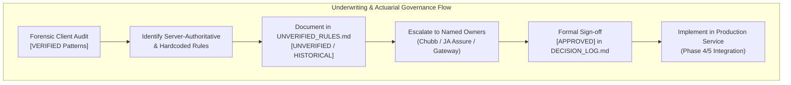

# UNVERIFIED RULES AND UNDERWRITING GOVERNANCE REGISTER
## DoctorShield Individual Medical Professional Indemnity Portal

> **Document ID:** `DOC-REG-UNVER-001`  
> **Status:** Authoritative Baseline (Phase 1)  
> **Classification:** [UNVERIFIED] / [HISTORICAL_HARDCODED] / [ASSUMED]  
> **Last Updated:** 2026-10-29  
> **Owner:** Principal Product Architect & Senior Solutions Architect  
> **Governing Rules:** Absolute Prohibitions P-1, P-2, P-4, P-7 (`AGENTS.md`)  
> **Scope:** Formal inventory of server-authoritative calculations, underwriting thresholds, affinity partnership schedules, legacy hardcoded anomalies, and integration contracts that require official underwriter/product owner confirmation before production release.

---

## 1. Executive Summary & Governance Invariant

Per **Absolute Prohibition P-1** and **Product Invariant 3**, the engineering team will **never invent, estimate, or guess** any insurance benefit, coverage limit, premium rating formula, eligibility threshold, exclusion, or API endpoint.

While the forensic audit and client bundle analysis (`home.min.js`, `common-frontend.min.js`) revealed the full client-side state machine, validation boundaries, and UI workflows, all financial rating computations, base schedules, and final underwriting acceptance decisions are **strictly server-authoritative**.

This register catalogs every calculation, schedule, and rule requiring formal business, actuarial, legal, or technical sign-off prior to Phase 2 architecture finalization and Phase 4 API integration.



---

## 2. Server-Authoritative Calculations & Rating Schedules

The portal frontend acts as a presentation and data collection layer; it serializes form inputs to `POST /api/calculatePremium` and renders base64-decoded JSON responses (`atob(response.data)`). The underlying rating engine tables reside in the backend database.

### UNVER-RATE-001: Master Specialty Base Rate Schedule
- **Category:** Actuarial Rating / Pricing Schedule
- **Current Classification:** [UNVERIFIED Server-Authoritative]
- **Observed Behavior:** Calling `POST /api/getSpecialization` loads liability tiers for 23 active medical classifications, but the actuarial base rates per specialty tier are maintained server-side.
- **Required Confirmation:**
  - Authoritative base rate table for all 23 approved classifications across all liability tiers (RM 250,000 to RM 10,000,000).
  - Risk multiplier factors applied for aesthetic procedures (e.g. Class 20 GP with Aesthetics vs Class 7 GP).
  - Risk factors for high-acuity surgical classifications (Obstetrics & Gynaecology, Neurosurgery, Orthopaedics).
- **Responsible Owner:** Chubb Insurance Malaysia Berhad (Chief Underwriter / Actuarial Lead).
- **Blocking Impact:** Blocks Phase 4 synthetic pricing engine mock and integration testing; does not block Phase 2 frontend design system.

---

### UNVER-RATE-002: Pro-Rata Divisor & Minimum Premium Floor
- **Category:** Actuarial Rating Formula
- **Current Classification:** [INFERRED / UNVERIFIED]
- **Observed Behavior:** Pro-rated coverage is supported when doctors align their policy expiry with their Annual Practicing Certificate (APC) date (`31/12/YYYY`). The formula observed is approximately `ProRata = BasePremium * (ActiveDays / YearDays)`.
- **Required Confirmation:**
  - Does the backend divide by a fixed `365` days or `366` days during leap years (e.g. 2028)?
  - Is there an absolute **Minimum Premium Floor** (e.g. statutory minimum RM 100.00 or RM 200.00 gross) below which a pro-rated policy will not be issued, regardless of short duration?
  - What is the minimum allowable policy term (e.g. minimum 30 days or minimum 3 months)?
- **Responsible Owner:** Chubb Underwriting & JA Assure Actuarial.
- **Blocking Impact:** Required for edge case test validation `TC-PROR-003` and `TC-PROR-004`.

---

### UNVER-RATE-003: Affinity Partnership Discount Matrix
- **Category:** Commercial / Brokerage Partnership
- **Current Classification:** [UNVERIFIED Commercial Schedule]
- **Observed Behavior:** Promo code input `#promo_code` accepts partner promotional codes (e.g. Malaysian Medical Association MMA, Malaysian Aesthetic Associates Medicine MAAM, Association of Private Hospitals Malaysia APHM).
- **Required Confirmation:**
  - Authoritative list of active promo codes, eligible partner organizations, and discount percentages.
  - Whether affinity discounts apply to gross indemnity premium only, or also apply to clinic add-ons and branch surcharges.
  - Are promotional codes strictly mutually exclusive, or can partner discounts stack with renewal discounts?
  - Promo code expiry dates and renewal code substitution rules (`POST /api/nricPromoCodeCheck`).
- **Responsible Owner:** JA Assure Commercial Director & Product Owner.
- **Blocking Impact:** Required for promo code automated test suite (`TC-PROM-001`–`TC-PROM-005`).

---

### UNVER-RATE-004: Person-In-Charge (PIC) Multi-Doctor Surcharge Schedule
- **Category:** Underwriting Rating Formula
- **Current Classification:** [VERIFIED for Sole Proprietor / UNVERIFIED for Partnerships]
- **Observed Behavior:** For Sole Proprietorship with 1 clinic, PIC coverage is verified as **complimentary (RM 0.00)**. For Partnerships and Sdn Bhd entities, additional partner doctor counts scale the PIC surcharge.
- **Required Confirmation:**
  - Exact formula or rate table for calculating PIC surcharge when doctor count > 1.
  - Maximum allowable partner doctor count eligible for online automated binding before referral to support office.
  - Verification whether all named partner doctors must hold separate active DoctorShield individual indemnity policies.
- **Responsible Owner:** Chubb Underwriting Lead.
- **Blocking Impact:** Required for PIC rating validation (`TC-PIC-002`).

---

## 3. Underwriting Rules & Referral Triggers Requiring Sign-Off

### UNVER-UW-001: COVID-19 Supplementary Questionnaire Status
- **Category:** Underwriting Compliance / Questionnaire Lifecycle
- **Current Classification:** [HISTORICAL_SUSPECT / UNVERIFIED]
- **Observed Behavior:** Step 6 (`#jsPage6`) contains an extensive COVID-19 risk assessment questionnaire conditionally controlled by backend flag `is_active_supplementarty_covid_questions`.
- **Underwriting Context:** The questionnaire was originally instituted in 2020–2021 during the peak of the pandemic emergency declaration.
- **Required Confirmation:**
  - Is the COVID-19 supplementary questionnaire still mandatory for Chubb medical indemnity policy issuance in 2026?
  - If retained, what precise criteria or specialty triggers activate the `is_active_supplementarty_covid_questions` flag?
  - If obsolete, can Step 6 be formally retired via an approved Content Change Request (`CCR-001`) in `DECISION_LOG.md`?
- **Responsible Owner:** Chubb Chief Underwriter & JA Assure Compliance.
- **Blocking Impact:** Affects Step 6 UX flow architecture and screen transition logic.

---

### UNVER-UW-002: High-Risk Procedure Referral Guidelines
- **Category:** Underwriting Referral Matrix
- **Current Classification:** [INFERRED from Support Office Routing]
- **Observed Behavior:** Answering "Yes" to disciplinary actions, criminal investigations, or prior claims immediately routes the applicant to `#jsPage8` ("PLEAESE CALL SUPPORT OFFICE").
- **Required Confirmation:**
  - Are there specific high-risk clinical procedures (e.g. invasive cosmetic surgery performed by GPs, bariatric surgery, unapproved experimental stem cell therapies) that mandate referral even if declarations are clean?
  - What are the precise risk triggers that cause the server to return an underwriting referral status instead of a priced quote?
- **Responsible Owner:** Chubb Chief Underwriter.
- **Blocking Impact:** Underwriting decision tree boundary precision (`UNDERWRITING_DECISION_TREE.md`).

---

### UNVER-UW-003: Retroactive Inception Continuity Verification
- **Category:** Policy Wording / Claims-Made Retroactive Date
- **Current Classification:** [VERIFIED Clause 6.12 / UNVERIFIED Backend Matching]
- **Observed Behavior:** Clause 6.12 enforces that backdated policies must have their start date mutated to `01/01/YYYY` with retroactive exclusion for non-continuous prior acts.
- **Required Confirmation:**
  - When an existing policyholder renews via `/renew`, what backend validation checks verify that the doctor has had uninterrupted continuous coverage since their original retroactive date?
  - Does the portal check the Malaysian Medical Council (MMC) Medical Register API or Chubb claims database directly?
- **Responsible Owner:** Chubb Operations & JA Assure Integration Lead.
- **Blocking Impact:** Integration architecture for renewal state engine.

---

### UNVER-UW-004: Maximum Clinic Branch Revenue Ceiling
- **Category:** SME Commercial Eligibility Rule
- **Current Classification:** [VERIFIED DOM Rule `LEG-BRANCH-001` / UNVERIFIED Actuarial Threshold]
- **Observed Behavior:** The clinic add-on allows up to 4 branch clinics with a combined annual revenue limit of RM 5,000,000. Exceeding this ceiling blocks straight-through binding.
- **Required Confirmation:**
  - Is the RM 5,000,000 threshold strictly enforced across all clinic types, or does it vary based on medical specialty (e.g. GP clinic vs Specialist Day Care Surgical Centre)?
  - Is revenue verified by declaration only, or is supporting financial documentation (e.g. audited accounts / tax returns) required offline?
- **Responsible Owner:** Chubb Commercial Underwriting.
- **Blocking Impact:** Clinic endorsement workflow validation.

---

## 4. Legacy Hardcoded Artifacts Requiring Official Decommissioning

The forensic audit revealed several historical hardcoded strings, outdated notices, and typographical defects in the existing portal codebase (`home.min.js`, DOM templates). Per **Content Preservation Rule 3**, these cannot be altered silently without explicit written approval.

```
+----------------------------------------------------------------------------------------------------+
|                                    HISTORICAL ARTIFACT REGISTER                                    |
+-------------------+-----------------------------------+--------------------------------------------+
| Artifact ID       | Current Existing Wording          | Proposed Correction / Action               |
+-------------------+-----------------------------------+--------------------------------------------+
| LEG-NOTICE-001    | "effective 1st November 2021...   | Update to current 2026 PDPA Privacy Notice |
|                   |  update 1st March 2022" (Cookie)  | and regulatory disclosures.                |
+-------------------+-----------------------------------+--------------------------------------------+
| LEG-TYPO-001      | "PLEAESE CALL SUPPORT OFFICE"     | Correct spelling to "PLEASE CALL SUPPORT   |
|                   | (#jsPage8 screen header)          | OFFICE".                                   |
+-------------------+-----------------------------------+--------------------------------------------+
| LEG-TYPO-002      | "Please select Person In Charge   | Correct grammar to "Please select whether  |
|                   | (PIC)" (#jsPicErrorMessageModel)  | you are the Person In Charge (PIC)."       |
+-------------------+-----------------------------------+--------------------------------------------+
| LEG-TYPO-003      | "Please enter proper email"       | Replace with standard accessible message:  |
|                   | (Client validation alert)         | "Please enter a valid email address."      |
+-------------------+-----------------------------------+--------------------------------------------+
| LEG-TYPO-004      | "Fill Up Form"                    | Standardize action label to "Complete      |
|                   | (Quotation email CTA)             | Application" or "Proceed to Details".      |
+-------------------+-----------------------------------+--------------------------------------------+
| LEG-TYPO-005      | Missing apostrophe in "Doctors    | Standardize brand casing to "DoctorShield" |
|                   | Shield" vs "DoctorShield"         | across all copy elements.                  |
+-------------------+-----------------------------------+--------------------------------------------+
```

### Detailed Review of Flagged Historical Items

1. **`LEG-NOTICE-001` (Outdated Cookie Notice):**
   - *Current Text:* "We use cookies to personalise content... effective 1st November 2021 and update 1st March 2022."
   - *Issue:* Dated timestamps from 4–5 years ago undermine customer credibility and institutional trust.
   - *Required Action:* Business/legal sign-off via `CCR-002` to update privacy statement to 2026 regulatory baseline.
2. **`LEG-TYPO-001` (Header Misspelling on Referral Screen):**
   - *Current Text:* `<h3 class="panel-title">PLEAESE CALL SUPPORT OFFICE</h3>`
   - *Issue:* Severe typographical error ("PLEAESE") on a critical customer support touchpoint.
   - *Required Action:* Business sign-off via `CCR-003` to correct spelling.
3. **`LEG-TYPO-002` through `LEG-TYPO-005` (Form Feedback Copy):**
   - *Current Text:* Inconsistent phrasing, blunt commands, and brand casing variations.
   - *Required Action:* Formal approval to harmonize with the DoctorShield Design System tone of voice in Phase 2.

---

## 5. Payment Gateway & Security Integration Contracts

### UNVER-SEC-001: Gateway Webhook Signature Verification Algorithm
- **Category:** Security / Payment Integrity
- **Current Classification:** [UNVERIFIED Integration Contract]
- **Observed Behavior:** Step 7 hand-off redirects to payment gateway (`#jsFinalPageSubmit`); gateway returns asynchronous webhook callback on transaction completion.
- **Required Confirmation:**
  - Exact signature hashing algorithm (e.g. `HMAC-SHA256` or `SHA-512`).
  - Secret key exchange mechanism and environment variable naming conventions (`GATEWAY_SECRET_KEY`).
  - Webhook payload signature parameter name (e.g. `X-Signature` header vs `signature` body attribute).
  - Webhook retry policy and replay attack prevention (timestamp freshness window, nonce validation).
- **Responsible Owner:** Payment Gateway Technical Representative & JA Assure Security Lead.
- **Blocking Impact:** Production payment authorization security (Phase 4 integration).

---

### UNVER-SEC-002: Idempotent Policy Issuance Protocol
- **Category:** Transaction Processing / Data Integrity
- **Current Classification:** [INFERRED / UNVERIFIED]
- **Observed Behavior:** Gateway callbacks mark policies as paid and issue certificates.
- **Required Confirmation:**
  - Idempotency key handling for duplicate webhook delivery to prevent multiple policy certificates being created for a single transaction.
  - Payment refund and cancellation event callback handling.
- **Responsible Owner:** JA Assure Backend Integration Lead.
- **Blocking Impact:** Payment reconciliation integrity.

---

## 6. Formal Sign-Off & Resolution Tracking Register

The following register tracks each unverified rule, assigned stakeholder, escalation priority, target phase for resolution, and blocking status:

| Item ID | Category | Summary Description | Assigned Approver | Priority | Target Phase | Status |
|---|---|---|---|---|---|---|
| `UNVER-RATE-001` | Actuarial Schedule | Specialty Base Rate Table (23 classes) | Chubb Underwriting Lead | 🔴 P1 | Phase 2 Gate | ⏳ Pending Esc |
| `UNVER-RATE-002` | Actuarial Formula | Pro-Rata Divisor & Min Premium Floor | Chubb Actuarial Lead | 🟠 P2 | Phase 3 Gate | ⏳ Pending Esc |
| `UNVER-RATE-003` | Commercial Promo | Affinity Partner Promo Code Matrix | JA Assure Commercial Owner | 🟠 P2 | Phase 3 Gate | ⏳ Pending Esc |
| `UNVER-RATE-004` | Rating Algorithm | Multi-Doctor Partnership PIC Surcharge | Chubb Underwriting Lead | 🟠 P2 | Phase 3 Gate | ⏳ Pending Esc |
| `UNVER-UW-001` | UW Lifecycle | COVID-19 Questionnaire Mandate/Retire | Chubb Chief Underwriter | 🔴 P1 | Phase 2 Gate | ⏳ Pending Esc |
| `UNVER-UW-002` | UW Referral | High-Risk Clinical Procedure Triggers | Chubb Chief Underwriter | 🟠 P2 | Phase 3 Gate | ⏳ Pending Esc |
| `UNVER-UW-003` | Inception Rule | Continuous Retroactive Date Matching | Chubb Operations | 🟠 P2 | Phase 3 Gate | ⏳ Pending Esc |
| `UNVER-UW-004` | SME Threshold | RM 5M Branch Revenue Enforcement | Chubb Commercial Lead | 🟡 P3 | Phase 4 Gate | ⏳ Pending Esc |
| `LEG-NOTICE-001` | Legal Notice | 2021/2022 Cookie Notice Modernization | JA Assure Legal / Compliance | 🔴 P1 | Phase 2 Gate | ⏳ Pending Esc |
| `LEG-TYPO-001` | Content Correction | "PLEAESE CALL SUPPORT" Typo Fix | JA Assure Product Owner | 🔴 P1 | Phase 2 Gate | ⏳ Pending Esc |
| `LEG-TYPO-002` | Content Correction | PIC Modal Grammar Harmonization | JA Assure Product Owner | 🔴 P1 | Phase 2 Gate | ⏳ Pending Esc |
| `UNVER-SEC-001` | Payment Security | Gateway Webhook HMAC-SHA256 Spec | Payment Gateway Tech Lead | 🟠 P2 | Phase 4 Gate | ⏳ Pending Esc |
| `UNVER-SEC-002` | Data Integrity | Idempotent Policy Issuance Protocol | JA Assure Tech Lead | 🟠 P2 | Phase 4 Gate | ⏳ Pending Esc |

---

## 7. Escalation & Phase Gate Governance Protocol

1. **Pre-Phase 2 Governance Gate:**
   - Items `UNVER-RATE-001`, `UNVER-UW-001`, `LEG-NOTICE-001`, and `LEG-TYPO-001` are classified as **Priority P1**.
   - These items must be formally escalated to the named approvers before starting Phase 2 design system and screen layout architecture.
   - Any approved content changes will be recorded in [`DECISION_LOG.md`](file:///c:/Users/salee/Downloads/Portal_ds/docs/DECISION_LOG.md) under formal Content Change Requests (`CCR-001`–`CCR-004`).
2. **Phase 4 Pre-Integration Gate:**
   - Technical contracts (`UNVER-SEC-001`, `UNVER-SEC-002`) and rating schedules (`UNVER-RATE-002`, `UNVER-RATE-004`) must have formal sandbox credentials and API specifications before live gateway and underwriting integrations are built.
3. **Audit Trail Mandate:**
   - No assumed values will ever be hardcoded into production business logic. All resolved items will transition to `[APPROVED]` status with date, approver name, and document reference.

