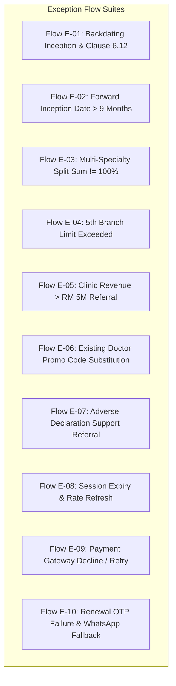

# UX EXCEPTION FLOWS & EDGE RECOVERY SPECIFICATIONS
## DoctorShield Individual Medical Professional Indemnity Portal Redesign

> **Document ID:** `DOC-SPEC-EXCEPT-001`  
> **Status:** Authoritative Baseline (Phase 1 Deliverable)  
> **Classification:** [VERIFIED Architecture]  
> **Last Updated:** 2026-10-29  
> **Author:** Principal Product Architect & Senior UX Strategist  
> **Governing Standards:** WCAG 2.1 AA, Graceful Degradation, Error Prevention Heuristics  
> **Traceability Links:** [`PRODUCT_REQUIREMENTS.md`](file:///c:/Users/salee/Downloads/Portal_ds/docs/PRODUCT_REQUIREMENTS.md), [`BUSINESS_RULE_CATALOG.md`](file:///c:/Users/salee/Downloads/Portal_ds/docs/BUSINESS_RULE_CATALOG.md), [`EDGE_CASE_TEST_MATRIX.md`](file:///c:/Users/salee/Downloads/Portal_ds/docs/EDGE_CASE_TEST_MATRIX.md)

---

## 1. Overview & Exception Philosophy

In complex financial and healthcare portals, exceptions are not rare edge anomalies; they represent **critical moments of customer anxiety and regulatory vulnerability**. 

Our exception architecture guarantees:
1. **No Dead Ends:** The user is never trapped on a screen without a clear, constructive forward path or direct support escalation.
2. **Dignified Medical Tone:** Eliminates blunt, accusatory error copy (e.g. *"Invalid inputs"* or *"PLEAESE CALL SUPPORT OFFICE"*). Replaces them with calm, institutional, professional medical guidance.
3. **Zero Data Destruction:** Correcting an exception never wipes unrelated personal particulars.
4. **Accessible Error Announcements:** All error dialogs, inline validation banners, and referral notices announce cleanly to screen readers via `role="alert"` or `aria-live="polite"`.

---

## 2. Comprehensive Exception Flow Specifications

---

### Flow E-01: Backdating Inception & Clause 6.12 Disclosure

- **Trigger Condition:** User selects `insurance_start_date < Current Date` on Stage 1 (`RULE-DATE-02`).
- **User Mental Model:** Doctor forgot to renew coverage 2 months ago and is anxious about being uninsured for past procedures.
- **System Response:** Forward progression is intercepted; accessible modal `#jsBackDateEnableModel` appears (`role="dialog"`, `aria-modal="true"`).
- **Exact Customer-Facing Copy:**
  > **Statutory Notice on Backdated Coverage (Clause 6.12)**  
  > *"You have selected a coverage start date that falls before today. Please be advised that in accordance with Chubb Policy Clause 6.12, backdating coverage does not provide retroactive protection for claims arising from acts, errors, or omissions committed prior to the inception date of this policy, unless continuous prior indemnity is formally validated.*  
  > *If you agree, your coverage inception will be standardized to 01/01/[CurrentYear]. If you disagree, please select a current or future inception date."*
- **User Actions & Outcomes:**
  - **Action A ("I Agree to Clause 6.12 Terms"):** Mutates start date to `01/01/YYYY`, sets end date to `31/12/YYYY`, binds `clause_6_12_accepted: true`, closes modal, and proceeds.
  - **Action B ("I Disagree"):** Clears the start date field (`""`), closes modal, returns focus to datepicker, and requires selection of a valid current date.

---

### Flow E-02: Forward Inception Date Ceiling Exceeded (> 9 Months)

- **Trigger Condition:** User attempts to input an inception date $> \text{Current Date} + 9 \text{ calendar months}$ (`RULE-DATE-01`).
- **User Mental Model:** Doctor planning ahead for next year's APC renewal.
- **System Response:** Datepicker disables dates $> 9$ months; manual entry triggers inline error microcopy below the date input.
- **Copy:** `"Coverage start date cannot exceed 9 months in advance. The latest available start date is [MaxDate]."`
- **Resolution:** Datepicker automatically snaps to the maximum allowable date or prompts user to pick an eligible date.

---

### Flow E-03: Multi-Specialty Split Sum Misalignment ($< 100\%$ or $> 100\%$)

- **Trigger Condition:** Sub-specialty percentages in `#specializationModal` do not sum to exactly 100.0% (`RULE-SPEC-01`).
- **User Mental Model:** Surgeon trying to calculate percentage splits between General Surgery and Cosmetic Procedures.
- **System Response:** Submit CTA remains disabled (`aria-disabled="true"`). Dynamic live balance indicator updates on every keystroke.
- **Real-Time Feedback States:**
  - *Sum $< 100\%$ (e.g. 70% + 20% = 90%):* Amber banner: `"Remaining to allocate: 10.0%."`
  - *Sum $> 100\%$ (e.g. 70% + 35% = 105%):* Red alert: `"Total exceeds 100% by 5.0%. Please reduce percentage allocations."`
  - *Individual Field $= 0\%$:* Red alert: `"Every selected specialty must be greater than 0%."`
- **One-Click Resolver:** Button *"Auto-Balance"* divides remaining deficit across open specialties automatically.

---

### Flow E-04: 5th Branch Limit Exceeded (`LEG-BRANCH-001`)

- **Trigger Condition:** User attempts to increment additional branch clinics counter beyond 4 (`LEG-BRANCH-001`).
- **System Response:** The `+` stepper button disables at 4; clicking triggers non-destructive modal `#jsBranchLimitExceededModal`.
- **Copy:**
  > **Maximum 4 Branch Clinics Allowed for Online Purchase**  
  > *"Under Chubb SME Underwriting guidelines, medical practices with 5 or more branch locations require custom enterprise group indemnity rating.*  
  > *To ensure comprehensive protection for your full clinic network, our healthcare brokerage team will prepare a tailored proposal for your practice.*  
  > *Direct Support Line: +60 3-XXXX XXXX | Email: clinics@doctorshield.com"*
- **Exit Paths:**
  - Button *"Continue with 4 Branches Online"* (Retains 4 branches).
  - Button *"Request Enterprise Group Quote"* (Transfers entered details to broker support queue).

---

### Flow E-05: Combined Clinic Revenue $> \text{RM } 5,000,000$ Referral

- **Trigger Condition:** Total annual clinic revenue input exceeds RM 5,000,000 (`RULE-CLIN-01`).
- **System Response:** Field displays an informative amber warning icon and badge: `"Enterprise Risk Assessment Required"`.
- **Behavior:** The user is permitted to complete Stage 1 and Stage 2 to view indicative rates, but upon submitting Stage 3, the case is routed to `/referral` for underwriter confirmation of facility risk limits.
- **Copy:** `"Combined clinic revenue exceeding RM 5,000,000 requires Chubb corporate underwriting sign-off. Our team will verify your turnover schedule within 1 business day."`

---

### Flow E-06: Existing Customer New Promo Code Auto-Substitution

- **Trigger Condition:** Existing policyholder (identified by NRIC on Stage 3) enters a new-customer promo code on Stage 1 (`RULE-PROM-02`).
- **User Mental Model:** Returning doctor remembers a promo code from a colleague or advertisement, unaware it is restricted to new customers.
- **System Response:** Modal dialog `#jsNewPromocodeChangeModel` opens smoothly (`role="dialog"`).
- **Copy:**
  > **Renewal Discount Automatically Applied**  
  > *"Welcome back, Dr. [Name]. We identified your active DoctorShield policy records. The promotional code you entered is reserved for first-time applicants.*  
  > *We have automatically upgraded your quotation with your eligible **DoctorShield Renewal Privilege Discount ([RENEWALCODE])**, saving you [X]% on your renewal premium."*
- **Outcome:** Tapping *"Accept Renewal Discount"* recalculates the total payable amount dynamically without wiping any form state.

---

### Flow E-07: Adverse Underwriting Declaration & Support Referral

- **Trigger Condition:** User selects *"I Disagree"* to clean claims statement, or selects *"Yes"* to disciplinary/criminal proceedings (`RULE-DECL-01`, `RULE-REF-01`).
- **User Mental Model:** High anxiety, fears immediate policy rejection or loss of medical license.
- **System Response:** Straight-through payment is halted. User is gracefully routed to `/referral` (replacing legacy `#jsPage8` and correcting the misspelling `"PLEAESE"`).
- **Copy:**
  > **Specialist Underwriting Review Required**  
  > *"Thank you for your candid disclosure, Dr. [Name]. Because of the clinical circumstances or inquiry disclosed, your application cannot be bound automatically online.*  
  > *Your proposal has been assigned to our senior medical indemnity underwriting team at Chubb. A dedicated relationship manager will reach out to you personally to review your details and arrange coverage terms.*  
  > *You have not been declined coverage."*
- **Callback Lead Capture:** Doctor submits preferred phone and contact window. Case is dispatched to CRM (`POST /api/contactSupport`).
- **Security Guard:** `history.replaceState` locks the URL; back button cannot be used to untruthfully change answers back to "No".

---

### Flow E-08: Idle Session Timeout & Rate Refresh

- **Trigger Condition:** User remains inactive on a form stage for 25 minutes (`RULE-SES-01`).
- **User Mental Model:** Doctor was called into emergency surgery or patient consult mid-application.
- **System Response:**
  - *At 25 Minutes:* Non-modal floating banner displays: `"Your quote session will expire in 5 minutes to protect rate validity. [Extend Session]"`
  - *At 30 Minutes:* Modal dialog `#jsStartDateValidationErrorModal` appears:
    > **Session Expired for Rate Protection**  
    > *"Your quote session has expired to ensure compliance with updated Chubb rating schedules. Your practice details have been preserved. Please confirm your coverage start date to refresh your quote."*
  - Tapping *"Refresh Quotation"* keeps all personal details, recalculates premium against current timestamp, and returns user to Stage 1.

---

### Flow E-09: Payment Gateway Decline, Cancellation & Recovery

- **Trigger Condition:** Payment transaction fails, card is declined, or user clicks *"Cancel and Return to DoctorShield"* on the hosted payment gateway (`RULE-PAY-01`).
- **System Response:** Gateway redirects user back to `/buy/review?payment=failed`.
- **UI State:**
  - Red accessible alert banner at top of review card (`role="alert"`):
    `"Payment Unsuccessful: Your transaction could not be authorized by your financial institution. Your application details and quotation remain active. Please select another payment method or retry."`
  - All form fields, consents, and quotation breakdowns remain **100% intact**.
  - Payment method selector is re-enabled for immediate re-attempt (switching from Credit Card to FPX Individual Banking or Corporate Banking).

---

### Flow E-10: Renewal Mobile OTP Failure & WhatsApp Fallback

- **Trigger Condition:** User enters incorrect OTP on `/renew` or fails to receive SMS due to telco network congestion (`RULE-CUST-02`).
- **System Response:**
  - *Attempt 1 & 2 Failed:* Inline error: `"Invalid verification code. Please check your SMS and re-enter. (X attempts remaining)."`
  - *Resend Timer Expired (60s):* UI exposes high-visibility fallback action:  
    `"Didn't receive SMS? [Send Verification Code via WhatsApp]"`
  - *WhatsApp Dispatch:* Fires WhatsApp Business API endpoint; code is delivered immediately with DoctorShield brand checkmark.

