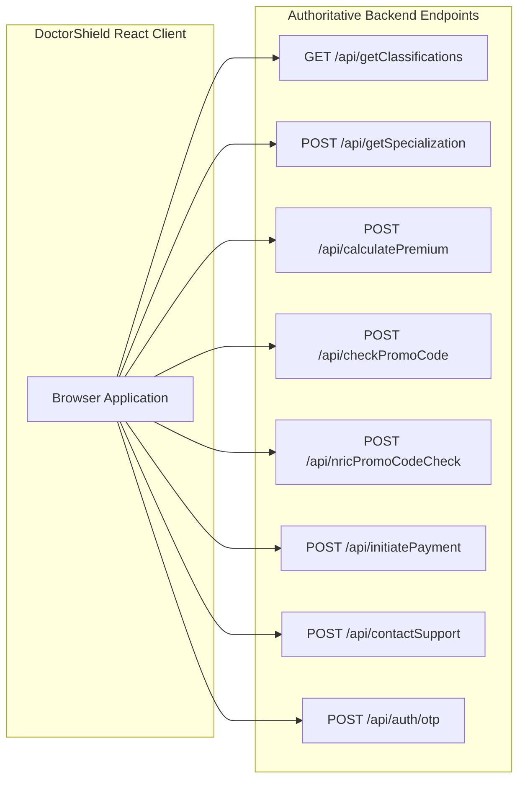

# BACKEND API CONTRACTS & INTEGRATION SPECIFICATIONS
## DoctorShield Individual Medical Professional Indemnity Portal

> **Document ID:** `DOC-ARCH-API-001`  
> **Status:** Authoritative Baseline (Phase 2 Deliverable)  
> **Backend Single Source of Truth:** JA Assure Core Gateway (`https://my-individualindemnity.doctorshield.com/api/*`)  
> **Data Security Protocol:** TLS 1.3 Strict, Base64 Payload Serialization, HMAC-SHA256 Signatures  
> **Traceability:** Governed by [`PRICING_AND_TAX_CONTRACT.md`](file:///c:/Users/salee/Downloads/Portal_ds/docs/PRICING_AND_TAX_CONTRACT.md) and [`EVIDENCE_REGISTER.md`](file:///c:/Users/salee/Downloads/Portal_ds/docs/EVIDENCE_REGISTER.md)

---

## 1. API Architecture & Transport Standards

1. **Protocol:** HTTPS / TLS 1.3 only.
2. **Serialization Format:**
   - Outbound requests: `application/json` with standard UTF-8 string encoding.
   - Inbound responses: Standard JSON containing an encoded payload string:
     ```json
     {
       "status": "success",
       "data": "eyJncm9zc19iYXNlIjo2NTAuMCwic3N0Ijo0Ni44LCJ0b3RhbCI6NjQxLjh9"
     }
     ```
     The client decodes the Base64 data envelope: `JSON.parse(atob(response.data))`.
3. **Idempotency Standard:** All state-mutating requests (`calculatePremium`, `initiatePayment`, `contactSupport`) require an `Idempotency-Key` UUID header to prevent double-billing and duplicate leads on network retries.
4. **Standard Error Envelope (RFC 7807 Problem Details):**
   ```json
   {
     "type": "https://doctorshield.com/errors/invalid-date-range",
     "title": "Invalid Inception Date Ceiling",
     "status": 422,
     "detail": "Coverage start date cannot exceed 9 calendar months from today.",
     "instance": "/api/calculatePremium"
   }
   ```

---

## 2. Authoritative Endpoint Inventory



---

### Endpoint 1: `POST /api/getSpecialization`
- **Purpose:** Fetches approved liability tiers, sub-specialty allocation requirements, and minimum liability floors for a selected classification.
- **Request Schema:**
  ```json
  POST /api/getSpecialization
  Content-Type: application/json
  
  {
    "classification_id": "7"
  }
  ```
- **Response Schema (Decoded):**
  ```json
  {
    "classification_id": "7",
    "classification_name": "General Medical Practitioner",
    "requires_split": false,
    "available_tiers": [
      { "id": "500k", "limit": 500000, "label": "RM 500,000", "base_rate": 400.0 },
      { "id": "1m", "limit": 1000000, "label": "RM 1,000,000", "base_rate": 650.0, "is_recommended": true },
      { "id": "2m", "limit": 2000000, "label": "RM 2,000,000", "base_rate": 1100.0 },
      { "id": "5m", "limit": 5000000, "label": "RM 5,000,000", "base_rate": 2400.0 }
    ]
  }
  ```

---

### Endpoint 2: `POST /api/calculatePremium` (Core Rating Engine)
- **Purpose:** Server-authoritative computation of base indemnity, discounts, clinic add-ons, branch surcharges, SST (8.0%), stamp duty (RM 10.00), and total payable.
- **Request Schema:**
  ```json
  POST /api/calculatePremium
  Content-Type: application/json
  Idempotency-Key: "9b1deb4d-3b7d-4bad-9bdd-2b0d7b3dcb6d"
  
  {
    "classification_id": "7",
    "liability_id": "1m",
    "insurance_start_date": "2026-11-01",
    "insurance_end_date": "2027-10-31",
    "is_prorata": false,
    "clause_6_12_accepted": false,
    "own_clinic": true,
    "clinic_cover": true,
    "entity_type": "sole_proprietorship",
    "is_pic": true,
    "branch_count": 2,
    "revenue_amount": 1200000.0,
    "promo_code": "MMA2026",
    "specialties": []
  }
  ```
- **Response Schema (Decoded):**
  ```json
  {
    "status": "success",
    "quotation_number": "DS-2026-99412",
    "quote_token": "eyJhbGciOiJIUzI1NiIsInR5cCI6IkpXVCJ9...",
    "expires_at": "2026-11-28T23:59:59Z",
    "pricing": {
      "gross_base": 650.0,
      "discount_amount": 65.0,
      "promo_code": "MMA2026",
      "clinic_entity_cover": 200.0,
      "branch_surcharges": 200.0,
      "branch_count": 2,
      "pic_cover_amount": 0.0,
      "is_pic_complimentary": true,
      "net_gross": 985.0,
      "sst_rate": 0.08,
      "sst_amount": 78.8,
      "stamp_duty": 10.0,
      "total_payable": 1073.8
    }
  }
  ```

---

### Endpoint 3: `POST /api/nricPromoCodeCheck` (Auto-Substitution)
- **Purpose:** Identifies if an applicant entering NRIC is an existing policyholder who used a new-customer promo code on Stage 1.
- **Request Schema:**
  ```json
  POST /api/nricPromoCodeCheck
  Content-Type: application/json
  
  {
    "doctor_nric": "850512145533",
    "applied_promo_code": "NEWCUSTOMER10"
  }
  ```
- **Response Schema:**
  ```json
  {
    "is_existing_customer": true,
    "substitute_required": true,
    "original_code": "NEWCUSTOMER10",
    "replacement_code": "RENEWAL2026",
    "discount_percentage": 10.0,
    "message": "Welcome back! Renewal promo code has been automatically applied."
  }
  ```

---

### Endpoint 4: `POST /api/initiatePayment` (Gateway Hand-Off)
- **Purpose:** Cryptographically validates the quote token, locks the payable amount, and generates a hosted payment gateway checkout URL.
- **Request Schema:**
  ```json
  POST /api/initiatePayment
  Content-Type: application/json
  
  {
    "quotation_number": "DS-2026-99412",
    "quote_token": "eyJhbGciOiJIUzI1NiIsInR5cCI6IkpXVCJ9...",
    "payment_channel": "B2C_FPX_AND_CARD",
    "return_url": "https://my-individualindemnity.doctorshield.com/payment/return",
    "cancel_url": "https://my-individualindemnity.doctorshield.com/payment/cancel"
  }
  ```
- **Response Schema:**
  ```json
  {
    "status": "redirect",
    "payment_gateway_url": "https://checkout.paymentgateway.com.my/pay/tok_89234ba98d",
    "session_timeout_seconds": 900
  }
  ```

---

### Endpoint 5: `POST /api/contactSupport` (Referral CRM Lead Dispatch)
- **Purpose:** Logs a callback ticket in JA Assure CRM when an applicant triggers an adverse declaration.
- **Request Schema:**
  ```json
  POST /api/contactSupport
  Content-Type: application/json
  
  {
    "contact_name": "Dr. Ahmad bin Abdullah",
    "contact_phone": "+60 12-345 6789",
    "contact_email": "dr.ahmad@clinic.my",
    "clinical_practice_name": "Klinik Ahmad & Rakan-Rakan",
    "referral_reason": "DISCIPLINARY_ACTION_DISCLOSED",
    "user_notes": "Inquiry before MMC Preliminary Investigation Committee 2024.",
    "proposal_data": {
      "classification_id": "7",
      "requested_limit": "2m"
    }
  }
  ```
- **Response Schema:**
  ```json
  {
    "status": "success",
    "ticket_id": "CRM-TKT-2026-8831",
    "estimated_contact_hours": 24,
    "message": "Thank you. Our relationship manager will contact you within 1 business day."
  }
  ```

---

## 3. Webhook Security & Idempotent Policy Issuance

### Payment Gateway Webhook (`POST /api/webhooks/payment`)
- **Header:** `X-Gateway-Signature: t=1730167200,v1=9c4a8b7d...`
- **Verification Algorithm:**
  ```typescript
  const signaturePayload = `${timestamp}.${rawBody}`;
  const expectedHash = crypto
    .createHmac('sha256', process.env.GATEWAY_WEBHOOK_SECRET!)
    .update(signaturePayload)
    .digest('hex');

  if (expectedHash !== providedHash) {
    throw new UnauthorizedError('Invalid webhook signature');
  }
  ```
- **Idempotency Guarantee:**
  If the payment gateway re-sends a webhook callback due to a network timeout, the backend checks `payment_transactions.status`. If already `AUTHORIZED`, it immediately returns HTTP 200 OK without re-issuing duplicate policy certificates.

