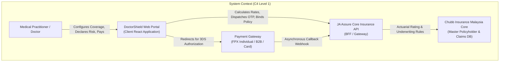
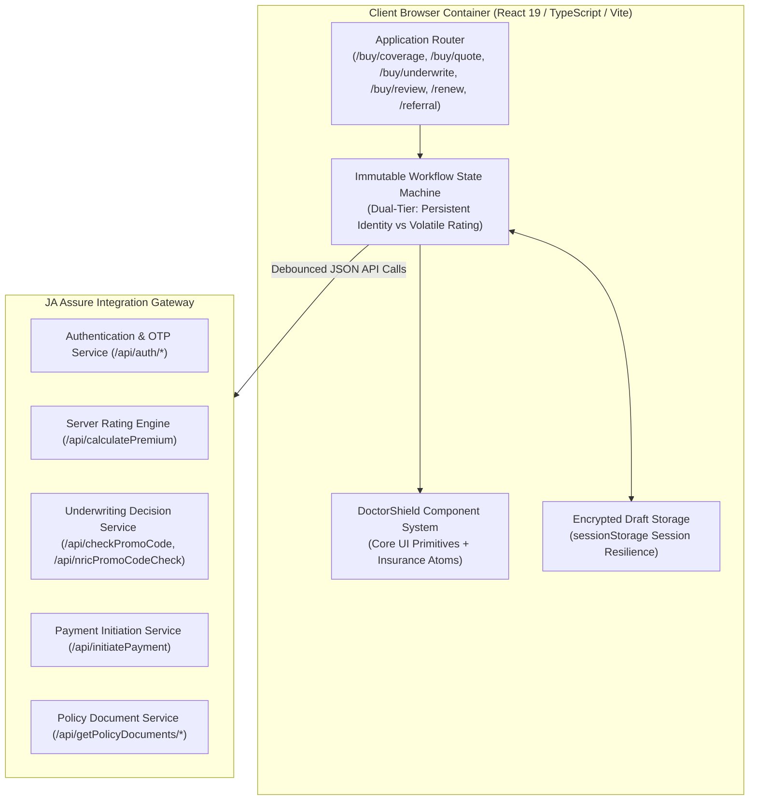
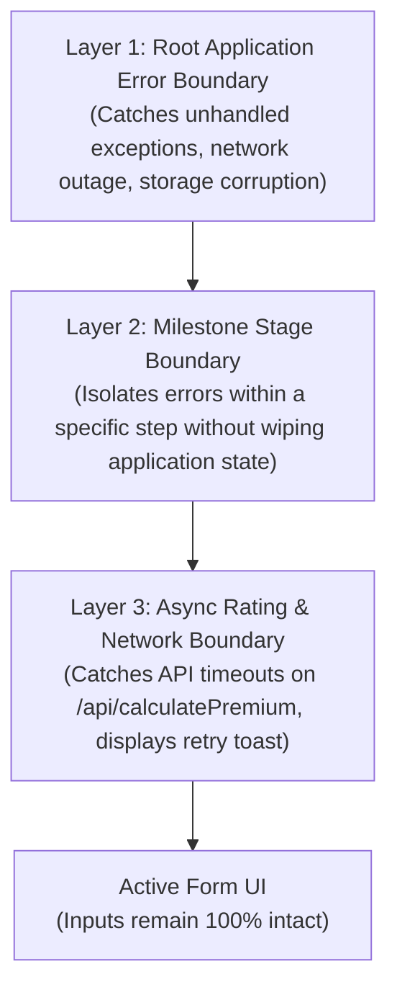
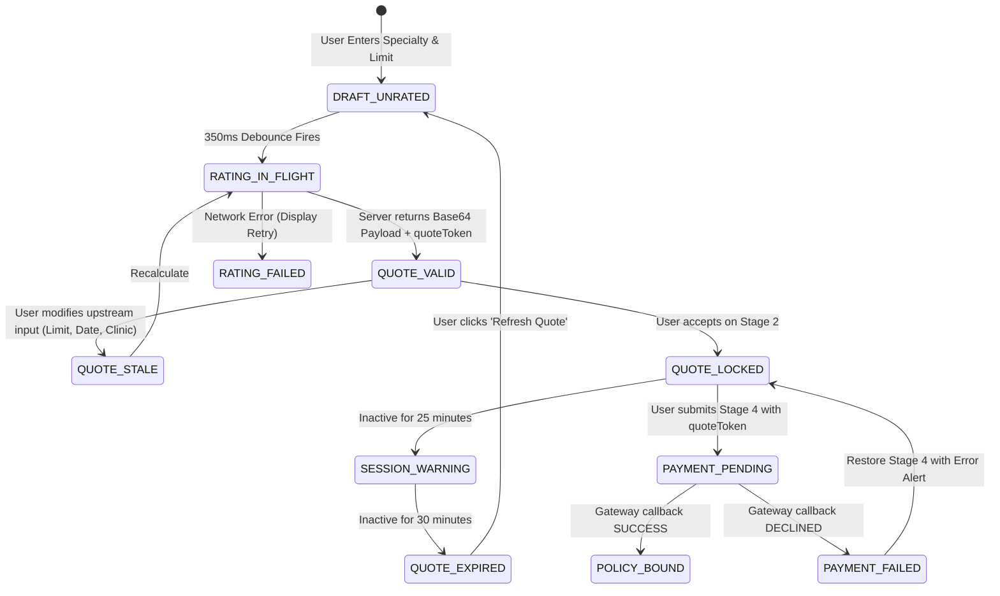

# SOFTWARE ARCHITECTURE & SYSTEM DESIGN
## DoctorShield Individual Medical Professional Indemnity Portal Redesign

> **Document ID:** `DOC-ARCH-SYS-001`  
> **Status:** Authoritative Baseline (Phase 2 Deliverable)  
> **Classification:** [VERIFIED Architecture]  
> **Role:** Staff Software Architect & Senior Solutions Architect  
> **Underwriter:** Chubb Insurance Malaysia Berhad | **Distributor:** JA Assure  
> **Traceability:** Governed by [`PRODUCT_REQUIREMENTS.md`](file:///c:/Users/salee/Downloads/Portal_ds/docs/PRODUCT_REQUIREMENTS.md), [`BUSINESS_RULE_CATALOG.md`](file:///c:/Users/salee/Downloads/Portal_ds/docs/BUSINESS_RULE_CATALOG.md), [`PRICING_AND_TAX_CONTRACT.md`](file:///c:/Users/salee/Downloads/Portal_ds/docs/PRICING_AND_TAX_CONTRACT.md), [`DESIGN_SYSTEM_FOUNDATIONS.md`](file:///c:/Users/salee/Downloads/Portal_ds/docs/design-system/DESIGN_SYSTEM_FOUNDATIONS.md)

---

## 1. Context & Workspace Evaluation

### 1.1 Existing System Inspection
A forensic analysis of the live portal (`my-individualindemnity.doctorshield.com`) and inspected client bundles (`home.min.js`, `common-frontend.min.js`) confirms the following legacy architecture:
1. **Frontend Architecture:** Legacy monolithic jQuery 3.3.1 + Bootstrap 3.3.7 single-page application.
2. **State Management:** Mutates 45 hidden DOM `<div>` containers (`#jsPage1` to `#jsPage11`) using jQuery `.show()` / `.hide()`. The browser history is un-synchronized, and clicking the browser back button wipes all entered memory.
3. **Backend Integration:** RESTful endpoints accepting serialized form data (`application/x-www-form-urlencoded` or JSON) and returning Base64-encoded JSON payloads (`atob(response.data)`).
4. **Authoritative Boundaries:** Mathematical rating, base rate tables, pro-rata formulas, affinity discounts, and underwriting approvals are **100% server-authoritative**.

### 1.2 Greenfield Rebuild Recommendation
The current workspace (`Portal_ds`) is a **greenfield frontend project**. There is no legacy codebase to preserve in this repository.

We recommend a **modern, modular, typed TypeScript + React 19 architecture**:
- **Build Tooling & Runtime:** **Vite 6** (ESM native, sub-second HMR, optimized tree-shaking, production bundle $< 100\text{ kB}$ gzipped).
- **Language:** **TypeScript 5.8+** with strict mode (`strict: true`, `noImplicitAny: true`, `exactOptionalPropertyTypes: true`).
- **Validation Engine:** **Zod 3.x** for bidirectional runtime parsing and static type inference.
- **Form Management:** **React Hook Form 7.x** (uncontrolled inputs with controlled triggers, zero unnecessary re-renders, 48px touch target support).
- **Server State & Invalidation:** Dedicated, immutable State Machine with debounced API client and strict quote staleness tracking.
- **Testing Harness:** **Vitest** + **React Testing Library** + **Playwright** (end-to-end regression across all 71 edge cases).

---

## 2. System Architecture & C4 Model



### 2.1 C4 Level 2: Container Architecture



---

## 3. Feature-Based Modular Directory Architecture

The application adopts a **Feature-Based Modular Structure** to maximize cohesion, isolate failure boundaries, and ensure maintainability:

```
src/
├── app/                           # Top-level Application Setup
│   ├── App.tsx                    # Root Application Component
│   ├── Router.tsx                 # Route Definitions & Route Guards
│   ├── ErrorBoundary.tsx          # Global Root Error Boundary
│   └── Providers.tsx              # Context Providers (State, Theme, Query)
│
├── core/                          # Architectural Core & Infrastructure
│   ├── api/                       # Typed HTTP Client & API Gateway Client
│   │   ├── client.ts              # Axios / Fetch client with interceptors
│   │   ├── endpoints.ts           # Approved API endpoint registry
│   │   └── errors.ts              # RFC 7807 problem details error parser
│   ├── state/                     # Immutable Workflow State Machine
│   │   ├── machine.ts             # Statechart definition & transitions
│   │   ├── context.tsx            # React Context & State Hook
│   │   ├── storage.ts             # Encrypted sessionStorage draft manager
│   │   └── invalidation.ts        # Upstream edit cascade invalidator
│   ├── validation/                # Zod Schemas & Validators
│   │   ├── nric.ts                # Malaysian NRIC checksum & DOB parser
│   │   ├── phone.ts               # Malaysian mobile regex (+60)
│   │   └── schemas.ts             # Step 1-4 form validation schemas
│   └── telemetry/                 # Analytics & Audit Logger
│       ├── tracker.ts             # Privacy-safe funnel event tracker
│       └── sanitize.ts            # PII redactor (Zero NRIC/Email logging)
│
├── design-system/                 # Canonical Design System
│   ├── tokens.css                 # Runtime CSS Custom Properties
│   ├── tokens.ts                  # Typed TypeScript token constants
│   ├── tokens.json                # DTCG W3C token definitions
│   └── index.ts                   # Design system export index
│
├── components/                    # Component Library
│   ├── ui/                        # Core UI Primitives (48px targets, WCAG AA)
│   │   ├── Typography.tsx         # Kanit <= 500 & Inter
│   │   ├── Button.tsx             # Primary Deep Teal (#066F7B) & Navy (#132766)
│   │   ├── TextInput.tsx          # 48px fixed height, 16px font
│   │   ├── Textarea.tsx           # Character counter & expanding detail
│   │   ├── SelectionControls.tsx  # Checkbox, Radio, SelectorCard
│   │   ├── SelectCombobox.tsx     # 23-specialty categorized combobox
│   │   └── FeedbackModals.tsx     # Alert, Modal, Badge, Accordion, Skeleton
│   ├── insurance/                 # Domain-Specific Insurance Atoms
│   │   ├── InsuranceStepProgress.tsx # 4-milestone stepper
│   │   ├── LiabilityLimitSelector.tsx# RM 250k - RM 10M tier cards
│   │   ├── SpecializationAllocationEditor.tsx # Live 100% math balance
│   │   ├── CoverageDateField.tsx  # 9-month ceiling & Clause 6.12 guard
│   │   ├── PremiumDisplay.tsx     # SST 8% itemized breakdown
│   │   ├── CoverageSummaryPanel.tsx # Sticky desktop rail & mobile drawer
│   │   └── UnderwritingAndCheckout.tsx # Declarations, Legal consent, Payment
│   └── compositions/              # Stage Compositions
│       └── StageCompositions.tsx  # Previews of Stage 1 & Stage 4
│
├── modules/                       # Feature-Based Modules
│   ├── coverage/                  # Stage 1: Coverage Configuration
│   │   ├── CoveragePage.tsx       # View orchestrator
│   │   ├── useCoverageForm.ts     # Hook managing specialty, limit, dates
│   │   └── components/            # Module-private components
│   ├── quotation/                 # Stage 2: Quotation Review & Options
│   │   ├── QuotationPage.tsx      # Breakdown review & PDF email modal
│   │   └── useQuotation.ts        # Rate freshness & PDF generator hook
│   ├── underwriting/              # Stage 3: Details & Declarations
│   │   ├── UnderwritingPage.tsx   # Substep 3A, 3B, 3C coordinator
│   │   ├── useUnderwritingForm.ts # Particulars & declarations hook
│   │   └── components/            # Primary clinic & branch forms
│   ├── review-payment/            # Stage 4: Legal Review & Gateway
│   │   ├── ReviewPaymentPage.tsx  # Disclosures, consents & payment selector
│   │   └── usePaymentHandOff.ts   # Gateway redirection hook
│   ├── policy/                    # Stage 5 / Completion: Active Policy
│   │   ├── CompletePage.tsx       # Instant COI & Tax Invoice download
│   │   └── useDocumentDownload.ts # PDF retrieval hook
│   ├── renewal/                   # Dedicated Renewal Route (/renew)
│   │   ├── RenewalPage.tsx        # Mobile OTP auth & policy picker
│   │   └── useRenewalSession.ts   # Retroactive date lock hook
│   └── referral/                  # Underwriting Support Desk (/referral)
│       ├── ReferralPage.tsx       # Reassuring support outcome & lead capture
│       └── useContactSupport.ts   # CRM ticket dispatch hook
│
└── test/                          # Automated Test Harness
    ├── setup.ts                   # Vitest & Jest-DOM setup
    ├── components.test.tsx        # Component interaction test suite
    └── e2e/                       # Playwright E2E regression suite
```

---

## 4. Error Boundaries & Fault-Tolerant Resilience

To prevent catastrophic white-screen crashes, the system establishes a **3-Layer Error Boundary Hierarchy**:



### 1. Root Application Error Boundary (`RootErrorBoundary`):
- Wraps the entire application tree.
- If a catastrophic runtime failure occurs, renders a calm, branded fallback:  
  *"We encountered an unexpected technical issue. Your entered data has been preserved in local storage. [Reload Portal] or call support at +60 3-XXXX XXXX."*

### 2. Milestone Stage Boundary (`StageErrorBoundary`):
- Wraps each individual route (`/buy/coverage`, `/buy/underwrite`, etc.).
- If a rendering bug occurs inside a complex sub-component (e.g. datepicker failure), it isolates the failure to that stage, offering a *"Reset Stage"* button while preserving the global identity profile.

### 3. Async Rating Boundary (`RatingErrorBoundary`):
- Wraps asynchronous API operations (`calculatePremium`, `checkPromoCode`).
- If the server times out or returns HTTP 500, the quotation summary displays:  
  `"Unable to update premium calculation. [Tap to Retry]"`.  
  **Crucial Invariant:** Form inputs are **never cleared** during network failures.

---

## 5. Quote Lifecycle & Token Anti-Tampering Engine



### Security Token Anti-Tampering Rule:
1. When `POST /api/calculatePremium` executes, the server returns an encrypted, signed `quoteToken` encompassing:
   - `classification_id`, `liability_id`, `start_date`, `end_date`, `net_gross`, `sst`, `stamp_duty`, and `total_payable`.
2. When the user submits payment on Stage 4, the portal dispatches:
   `POST /api/initiatePayment { quotationNumber, quoteToken, payment_option_type }`.
3. The server validates the cryptographic signature of `quoteToken`. If an attacker tampered with the DOM to alter the price from RM 1,000.00 to RM 1.00, the signature verification fails, the transaction is rejected, and an alert is logged to SIEM.

---

## 6. Privacy & Telemetry Boundaries (PDPA 2010 Compliance)

Under the **Personal Data Protection Act 2010 (Malaysia)** and Chubb underwriting privacy guidelines:
1. **Zero Customer PII in Analytics:**
   - Funnel analytics (e.g. Google Analytics / Mixpanel) must **never receive customer PII**.
   - Prohibited payload fields: `doctor_name`, `doctor_nric`, `mobile_number`, `email_address`, `clinic_name`, `disciplinary_details`.
   - Permitted payload fields: `step_index`, `classification_id`, `liability_tier_id`, `duration_seconds`, `error_code`.
2. **Encrypted Session Persistence:**
   - Draft states in `sessionStorage` are encrypted with an ephemeral in-memory session key.
   - Closing the browser tab or completing checkout purges all cached medical declarations and identity particulars immediately.

