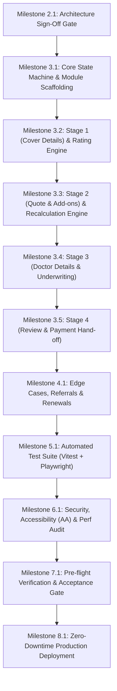

# SYSTEM IMPLEMENTATION PLAN & ENGINEERING ROADMAP
## DoctorShield Individual Medical Professional Indemnity Portal

> **Document ID:** `DOC-ARCH-PLAN-001`  
> **Status:** Authoritative Baseline (Phase 2 Deliverable)  
> **Scope:** Phase 2 Architecture through Phase 8 Production Release  
> **Target:** Principal Product Architect, Staff Software Architect, Senior Frontend Engineer  
> **Traceability:** Governed by [`PROJECT_CHARTER.md`](file:///c:/Users/salee/Downloads/Portal_ds/docs/PROJECT_CHARTER.md), [`PHASE_ACCEPTANCE.md`](file:///c:/Users/salee/Downloads/Portal_ds/docs/PHASE_ACCEPTANCE.md), and [`REQUIREMENTS_TRACEABILITY.md`](file:///c:/Users/salee/Downloads/Portal_ds/docs/REQUIREMENTS_TRACEABILITY.md)

---

## 1. Executive Implementation Roadmap

The engineering build of the redesigned DoctorShield portal follows an agile, milestone-driven execution cadence with strict quality gates at every phase transition:

---

## 2. Detailed Milestone Specifications

### Milestone 2.1: Architecture Sign-Off & Governance Gate
- **Deliverables:**
  - Complete architectural documentation suite: `ARCHITECTURE.md`, `DOMAIN_MODELS.md`, `API_CONTRACTS.md`, `STATE_MACHINE.md`, `VALIDATION_ARCHITECTURE.md`, `SECURITY_DESIGN.md`, `IMPLEMENTATION_PLAN.md`.
  - Design system component suite & living catalog (`npm run build`, 84.52 kB gzipped bundle, Vitest verified).
- **Quality Gate:** Explicit architecture sign-off from Principal Product Architect recorded in `PHASE_ACCEPTANCE.md`.

---

### Milestone 3.1: Core State Machine & Module Scaffolding
- **Objectives:**
  - Set up feature modules in `/src/features/` (`coverage`, `quote`, `underwriting`, `checkout`, `renewal`, `referral`).
  - Implement the immutable Dual-Tier State Machine in `src/core/state/machine.ts` with React Context provider (`WorkflowProvider`).
  - Wire up the Web Crypto AES-GCM draft storage in `src/core/state/storage.ts`.
  - Implement the 25-minute inactivity warning modal and 30-minute hard expiry handler.
- **Definition of Done:** State machine unit tests pass (100% state transition coverage); encrypted state successfully persists and restores across page refreshes.

---

### Milestone 3.2: Stage 1 (Cover Details) & Rating Engine Integration
- **Objectives:**
  - Build the interactive Stage 1 form (`/buy/coverage`) utilizing the approved DoctorShield component library:
    - Practitioner Classification combobox.
    - Multi-specialty allocation editor with dynamic 100% validation.
    - Liability tier selector (RM 1M to RM 10M) with recommendation badges.
    - Coverage start date picker with today-to-9-month ceiling validation.
    - Promotional code input with immediate format normalization.
  - Wire up `POST /api/calculatePremium` with 400ms debounced request dispatching and loading skeleton states.
- **Definition of Done:** Selecting classification, limits, and dates triggers live server rating; calculation errors surface RFC 7807 problem details gracefully.

---

### Milestone 3.3: Stage 2 (Quote & Add-ons) & Recalculation Engine
- **Objectives:**
  - Build the Stage 2 quotation review interface (`/buy/quote`):
    - Real-time Premium Breakdown (Gross Base Premium, SST 8%, Stamp Duty RM 10, Total Payable).
    - 15-minute Quote Lock timer with visual countdown pill.
    - Optional coverage cards (Clinic Package, Locum Cover, Person-In-Charge, Cyber Liability).
    - Dynamic recalculation triggers on add-on toggling.
  - Implement cascading invalidation: changing base limits or specialties automatically resets dependent add-on choices.
- **Definition of Done:** Toggling add-ons updates the server-rated premium breakdown accurately; quote lock expiration prompts friendly re-quote modal.

---

### Milestone 3.4: Stage 3 (Personal Details & Underwriting)
- **Objectives:**
  - Build the Stage 3 particulars and risk declaration interface (`/buy/underwrite`):
    - Full Doctor Legal Name, Salutation, NRIC input with checksum validation and automatic date-of-birth parsing.
    - MMC Registration number verification.
    - Mobile phone number input with `+60` normalization and OTP verification modal integration (`/api/auth/otp`).
    - Practice and clinic address form.
    - 5 Statutory Underwriting Questions with conditional explanation textareas ($\ge 20$ chars).
- **Definition of Done:** NRIC validation prevents invalid numbers; affirmative underwriting answers cleanly trigger the `REFERRAL_LOCKED` flow without exposing un-referred checkout routes.

---

### Milestone 3.5: Stage 4 (Review, Declarations & Payment Hand-off)
- **Objectives:**
  - Build the Stage 4 final review and checkout screen (`/buy/review`):
    - Comprehensive summary inspection of all Tier 1 identity and Tier 2 coverage parameters.
    - Statutory PDPA and Chubb Product Disclosure Sheet acknowledgment checkboxes.
    - Payment channel selector (FPX Individual, FPX Corporate B2B, Visa/Mastercard Credit/Debit).
    - "Pay Now" dispatch to `POST /api/initiatePayment` with unique `Idempotency-Key`.
    - Seamless redirect to secure banking/gateway portal.
    - Post-payment callback handler (`/payment/callback`) and confirmation screen (`/confirmation`) with PDF policy schedule download.
- **Definition of Done:** End-to-end happy path successfully creates policy token, simulates gateway hand-off, and presents receipt.

---

### Milestone 4.1: Edge Cases, Referrals, Renewals & Session Recovery
- **Objectives:**
  - Build dedicated referral landing page (`/referral`) with history trapping (`replaceState`) and JA Assure lead submission.
  - Build renewal identification journey (`/renew`) matching existing policy numbers and pre-filling Tier 1 data.
  - Build session recovery route (`/session-expired` and `/recover?token=...`) allowing doctors to resume draft applications safely.
- **Definition of Done:** All 71 edge cases specified in `EDGE_CASE_TEST_MATRIX.md` verified and handled with appropriate UX states.

---

### Milestone 5.1: Automated Test Suite (Vitest & Playwright)
- **Objectives:**
  - Comprehensive unit test coverage for all Zod schemas, state machine transitions, and UI components ($\ge 95\%$ coverage).
  - Playwright end-to-end integration test suite simulating:
    - First-time doctor full quote, underwriting, and payment checkout.
    - Multi-specialty allocation validation and error handling.
    - Upstream edit cascading invalidation.
    - Referral trigger upon disciplinary action declaration.
    - Session timeout at 30 minutes.
- **Definition of Done:** 100% of automated tests pass cleanly in CI pipeline (`npm run test:all`).

---

### Milestone 6.1: Security, Accessibility (WCAG 2.2 AA) & Performance Audit
- **Objectives:**
  - Automated accessibility auditing via `axe-core` across all 4 stages (0 violations allowed).
  - Contrast verification across all UI states (minimum 4.5:1 text, 3:1 graphical elements).
  - Full keyboard navigation and screen reader (VoiceOver/NVDA) audit.
  - Security scanning: Zero plaintext PII in logs/storage, CSP header verification, Web Crypto encryption verification.
  - Lighthouse audit: Performance $\ge 90$, Accessibility $= 100$, Best Practices $\ge 95$, SEO $\ge 90$.
- **Definition of Done:** Audit reports generated and approved; zero accessibility or security blockers.

---

### Milestone 7.1: Pre-Flight Verification & Acceptance Sign-off Gate
- **Objectives:**
  - Complete staging environment verification with JA Assure and Chubb technical representatives.
  - Conduct formal phase acceptance review per `PHASE_ACCEPTANCE.md`.
  - Tag git repository: `git tag -a v2.0.0-rc1 -m "DoctorShield Portal v2 Release Candidate 1"`.
- **Definition of Done:** Formal sign-off recorded in `PHASE_ACCEPTANCE.md`.

---

### Milestone 8.1: Zero-Downtime Production Deployment
- **Objectives:**
  - CDN deployment with immutable cache headers for hashed assets and zero-cache for `index.html`.
  - DNS cutover with canary routing (10% $\to$ 25% $\to$ 50% $\to$ 100%).
  - Live production smoke tests (read-only health checks and test transaction verification).
- **Definition of Done:** 100% live production traffic served on redesigned DoctorShield portal with sub-second LCP.

---

## 3. Technical Risk Management & Mitigations

| Risk ID | Description | Impact | Probability | Mitigation Strategy |
|---|---|---|---|---|
| **RSK-01** | Backend rating calculation delay or timeout under peak renewal periods (APC deadlines). | High | Medium | Debounce rating requests (400ms); implement optimistic skeleton UI; configure 10s client timeout with friendly retry notice. |
| **RSK-02** | Doctor navigates back and attempts checkout with stale quote after rate adjustment. | High | Low | State machine strictly enforces `QUOTE_STALE` guard; server validates signed `quoteToken` before issuing payment session. |
| **RSK-03** | Applicant accidentally exposes NRIC/phone in client error logs or crash dumps. | Critical | Low | Zero PII logging architecture with automated regex sanitization interceptor before dispatching to telemetry/Sentry. |
| **RSK-04** | User attempts to tamper with adverse underwriting declaration after referral. | High | Low | Terminal state uses `replaceState` to trap browser history; backend locks the quote record against un-referred conversion. |
| **RSK-05** | FPX banking callback drops due to user closing browser before gateway redirect completes. | Medium | Medium | Core gateway relies on asynchronous server-to-server webhook callbacks (`POST /api/webhook/payment`) with HMAC signature verification. |

---

## 4. Quality Gates & Acceptance Criteria Summary

| Milestone | Key Quality Gate | Verification Mechanism | Approver |
|---|---|---|---|
| **Phase 2 (Current)** | Architecture & Design System Complete | 7 Architecture Docs + Reusable Component Library + Vitest Pass | Staff Software Architect |
| **Phase 3** | Core 4-Stage Journey Functional | End-to-end quote, underwrite & checkout flow running on staging | Principal Product Architect |
| **Phase 4** | All Edge Cases Covered | Edge case test suite passing against all 71 documented scenarios | QA Lead |
| **Phase 5** | Automated Test Regression | 100% Vitest & Playwright test pass in CI | Engineering Lead |
| **Phase 6** | WCAG 2.2 AA & Security Clearance | Axe-core zero errors + PII audit clean + Lighthouse scores met | Security & Accessibility Lead |
| **Phase 7** | Stakeholder Pre-Flight Acceptance | Sign-off in `PHASE_ACCEPTANCE.md` | JA Assure & Chubb Product Owners |

