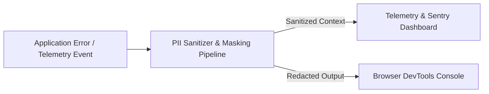
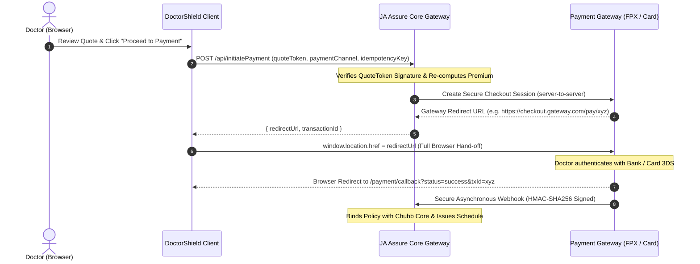

# SECURITY, PRIVACY & COMPLIANCE ARCHITECTURE
## DoctorShield Individual Medical Professional Indemnity Portal

> **Document ID:** `DOC-ARCH-SEC-001`  
> **Status:** Authoritative Baseline (Phase 2 Deliverable)  
> **Regulatory Frameworks:** Malaysian PDPA 2010 | BNM Risk Management in Technology (RMiT) | PCI-DSS SAQ-A  
> **Underwriter:** Chubb Insurance Malaysia Berhad | **Distributor:** JA Assure  
> **Traceability:** Governed by [`PROJECT_CHARTER.md`](file:///c:/Users/salee/Downloads/Portal_ds/docs/PROJECT_CHARTER.md) and [`PRODUCT_REQUIREMENTS.md`](file:///c:/Users/salee/Downloads/Portal_ds/docs/PRODUCT_REQUIREMENTS.md)

---

## 1. Regulatory Context & Compliance Posture

DoctorShield operates in a strictly regulated insurance and healthcare domain in Malaysia:
1. **Bank Negara Malaysia (BNM) RMiT Guidelines:**
   - Strict standards on data privacy, encryption in transit and at rest, application resilience, and secure development lifecycles.
2. **Personal Data Protection Act 2010 (PDPA):**
   - Applies to the collection, processing, and retention of personal data of registered medical practitioners in Malaysia.
3. **Payment Card Industry Data Security Standard (PCI-DSS):**
   - Qualified under **PCI-DSS SAQ-A** (the web client and backend never handle, store, or transmit raw credit card PANs or CVVs; all payment entry is delegated to a PCI-DSS Level 1 certified gateway).

---

## 2. Malaysian PDPA 2010 Compliance Engine

The architecture operationalizes the **7 PDPA Principles**:

| PDPA Principle | Architectural Implementation | Verification Check |
|---|---|---|
| **1. General Principle** | Explicit consent checkboxes before payment; processing strictly limited to underwriting and policy issuance. | Consent timestamp recorded in backend policy record. |
| **2. Notice & Choice** | Dual-language (EN/BM) PDPA Notice linked at Stage 3 & 4; un-bundled consent checkboxes. | Disclosures un-checked by default; form submission blocked without consent. |
| **3. Disclosure** | Third-party disclosures restricted strictly to Chubb Insurance Malaysia Berhad and JA Assure. | Network egress audit confirms zero third-party advertising or non-approved tracking pixels. |
| **4. Security** | TLS 1.3 in transit, client-side draft AES-GCM encryption, ephemeral sessionStorage, zero PII logging. | Code scanning confirms zero plaintext PII in logs or storage. |
| **5. Retention** | Session drafts purged after 30 minutes of inactivity; finalized policy records retained per Chubb regulatory schedule. | Client state automatically purges on tab closure or expiry. |
| **6. Data Integrity** | Exact NRIC checksum, MMC registration verification, and verified phone OTP handshakes. | Two-tier Zod validation engine prevents corrupted records. |
| **7. Access** | Customers access their policy schedules and certificates via authenticated email links or direct download. | Signed, time-expiring document download URLs. |

---

## 3. Zero PII Logging Standard

To prevent accidental exposure of Personally Identifiable Information (PII) in logging services, browser consoles, network monitoring, or error telemetry (e.g. Sentry/Datadog):



### 3.1 Masking Specifications
- **Malaysian NRIC:** All characters except the birth year and last digit are masked: `90****-**-***5`.
- **Mobile Phone Number:** All except country code and last 3 digits masked: `+6012-***-**89`.
- **Email Address:** First 2 characters of local-part preserved, remainder masked: `dr****@hospital.com.my`.
- **Doctor Legal Name:** Preserved only as initials in logs: `D. K. L.`.
- **MMC Registration Number:** First 2 digits masked: `**5678`.

### 3.2 Automated Sanitization Interceptor

```typescript
export function sanitizeLogData(data: Record<string, any>): Record<string, any> {
  const SENSITIVE_KEYS = ['nric', 'icNumber', 'phone', 'mobile', 'email', 'fullName', 'name', 'address', 'card', 'cvv'];
  const sanitized: Record<string, any> = {};

  for (const [key, value] of Object.entries(data)) {
    if (value === null || value === undefined) {
      sanitized[key] = value;
      continue;
    }

    if (typeof value === 'object' && !Array.isArray(value)) {
      sanitized[key] = sanitizeLogData(value);
      continue;
    }

    const lowerKey = key.toLowerCase();
    const isSensitive = SENSITIVE_KEYS.some((k) => lowerKey.includes(k));

    if (isSensitive && typeof value === 'string') {
      if (lowerKey.includes('nric') || lowerKey.includes('ic')) {
        sanitized[key] = value.replace(/^(\d{2})\d{4}-?\d{2}-?\d{3}(\d)$/, '$1****-**-***$2');
      } else if (lowerKey.includes('phone') || lowerKey.includes('mobile')) {
        sanitized[key] = value.replace(/^(\+?60\d{2})\d{4,5}(\d{3})$/, '$1-****-$2');
      } else if (lowerKey.includes('email')) {
        sanitized[key] = value.replace(/^(.{2})[^@]+(@.+)$/, '$1****$2');
      } else {
        sanitized[key] = '[REDACTED_PII]';
      }
    } else {
      sanitized[key] = value;
    }
  }

  return sanitized;
}
```

---

## 4. Ephemeral Storage & Client-Side Encryption

DoctorShield does not store customer application drafts in unencrypted `localStorage` (which persists indefinitely across sessions and is susceptible to XSS). 

### 4.1 Storage Architecture
1. **Target:** `sessionStorage` only (scoped exclusively to the current browser tab; destroyed automatically when the tab is closed).
2. **Encryption:** All draft state is encrypted client-side using **Web Crypto API (AES-GCM 256-bit)** before being written to `sessionStorage`.
3. **Key Derivation:** The encryption key is generated ephemerally upon session initialization (`crypto.subtle.generateKey`) and held solely in Javascript heap memory. If the tab or session closes, the in-memory key vanishes, rendering any remaining encrypted disk bytes unrecoverable.

```typescript
export class EncryptedDraftStorage {
  private static key: CryptoKey | null = null;

  private static async getKey(): Promise<CryptoKey> {
    if (!this.key) {
      this.key = await window.crypto.subtle.generateKey(
        { name: 'AES-GCM', length: 256 },
        false,
        ['encrypt', 'decrypt']
      );
    }
    return this.key;
  }

  static async saveDraft(draft: any): Promise<void> {
    const key = await this.getKey();
    const iv = window.crypto.getRandomValues(new Uint8Array(12));
    const encoded = new TextEncoder().encode(JSON.stringify(draft));

    const ciphertext = await window.crypto.subtle.encrypt(
      { name: 'AES-GCM', iv },
      key,
      encoded
    );

    const payload = {
      iv: Array.from(iv),
      data: Array.from(new Uint8Array(ciphertext)),
    };

    window.sessionStorage.setItem('ds_draft_v2', JSON.stringify(payload));
  }

  static async loadDraft(): Promise<any | null> {
    const item = window.sessionStorage.getItem('ds_draft_v2');
    if (!item) return null;

    try {
      const { iv, data } = JSON.parse(item);
      const key = await this.getKey();

      const decrypted = await window.crypto.subtle.decrypt(
        { name: 'AES-GCM', iv: new Uint8Array(iv) },
        key,
        new Uint8Array(data)
      );

      return JSON.parse(new TextDecoder().decode(decrypted));
    } catch {
      // Key mismatch or corrupted session: clear safely
      window.sessionStorage.removeItem('ds_draft_v2');
      return null;
    }
  }

  static clearDraft(): void {
    window.sessionStorage.removeItem('ds_draft_v2');
    this.key = null;
  }
}
```

---

## 5. Payment Security & PCI-DSS SAQ-A Compliance

DoctorShield adopts a **Hosted Gateway Redirect Architecture**:



### 5.1 PCI-DSS SAQ-A Criteria Adherence
- **Zero Cardholder Data Storage:** The client application does not render any `<input>` fields capturing Credit Card PAN, CVV, or Expiry.
- **Hosted Redirect:** All payment transactions occur on bank-hosted or PCI-certified gateway portals.
- **Tamper-Proofing:** The client transmits only the `quoteToken`. It does not transmit the Ringgit payable amount. The backend retrieves the exact payable sum from the signed quote record, preventing client-side DOM price manipulation.

---

## 6. Content Security Policy (CSP Level 3)

The production DoctorShield portal enforces strict CSP Level 3 HTTP response headers:

```http
Content-Security-Policy: 
    default-src 'none';
    script-src 'self' 'nonce-{RANDOM_NONCE}';
    style-src 'self' 'unsafe-inline' https://fonts.googleapis.com;
    font-src 'self' https://fonts.gstatic.com;
    img-src 'self' data: https://my-individualindemnity.doctorshield.com;
    connect-src 'self' https://my-individualindemnity.doctorshield.com https://*.chubb.com;
    frame-src https://*.curlec.com https://*.paynet.my;
    form-action 'self' https://*.curlec.com https://*.paynet.my;
    base-uri 'none';
    frame-ancestors 'none';
    upgrade-insecure-requests;
    block-all-mixed-content;
```

---

## 7. Webhook Signature Verification & Anti-Replay Engine

Payment confirmation callbacks from the gateway are validated using HMAC-SHA256 signatures and timestamp checks:

```typescript
export function verifyWebhookSignature(
  rawBody: string,
  signatureHeader: string,
  timestampHeader: string,
  secret: string
): boolean {
  // 1. Replay Protection: Timestamp drift cannot exceed 300 seconds (5 minutes)
  const webhookTime = parseInt(timestampHeader, 10);
  const now = Math.floor(Date.now() / 1000);
  if (Math.abs(now - webhookTime) > 300) {
    return false; // Stale or replayed webhook
  }

  // 2. Compute Expected HMAC-SHA256
  const payloadToSign = `${timestampHeader}.${rawBody}`;
  const hmac = crypto.createHmac('sha256', secret);
  const expectedSignature = hmac.update(payloadToSign).digest('hex');

  // 3. Timing-Safe Comparison
  return crypto.timingSafeEqual(
    Buffer.from(signatureHeader, 'hex'),
    Buffer.from(expectedSignature, 'hex')
  );
}
```

