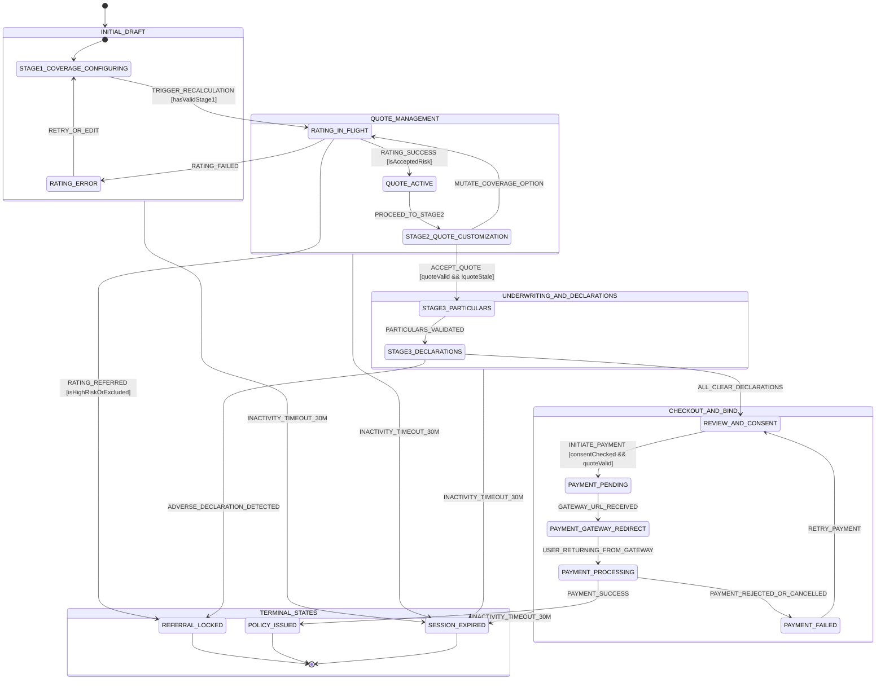
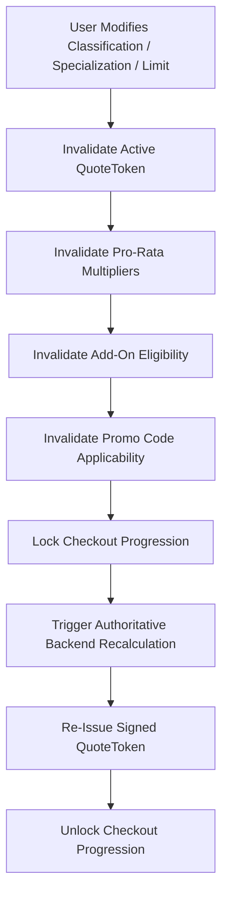

# APPLICATION WORKFLOW STATE MACHINE
## DoctorShield Individual Medical Professional Indemnity Portal

> **Document ID:** `DOC-ARCH-STATE-001`  
> **Status:** Authoritative Baseline (Phase 2 Deliverable)  
> **Architecture Pattern:** Dual-Tier Hierarchical Finite State Machine (HFSM)  
> **Traceability:** Governed by [`APPLICATION_STATE_MODEL.md`](file:///c:/Users/salee/Downloads/Portal_ds/docs/APPLICATION_STATE_MODEL.md), [`EDIT_AND_RECALCULATION_RULES.md`](file:///c:/Users/salee/Downloads/Portal_ds/docs/EDIT_AND_RECALCULATION_RULES.md), and [`PRICING_AND_TAX_CONTRACT.md`](file:///c:/Users/salee/Downloads/Portal_ds/docs/PRICING_AND_TAX_CONTRACT.md)

---

## 1. Architectural Philosophy & Dual-Tier State

In medical professional indemnity insurance, customer data falls into two fundamentally distinct cognitive and transactional categories:

1. **Tier 1 — Persistent Identity & Practice Profile (Immutable across rating adjustments):**
   - Applicant Legal Name, NRIC / Passport, MMC Registration Number, Practice Address, Mobile Phone, Email, Tax Information.
   - *Rule:* Navigating backwards from Stage 3 or 4 to adjust coverage **must never wipe Tier 1 identity data**. Doctors find re-entering NRIC, phone verification, and addresses an egregious source of abandonment.
2. **Tier 2 — Volatile Rating & Risk Factors (Strict Cascade Invalidation):**
   - Practitioner Classification, Specialization Allocations, Inception/Expiry Dates, Limit of Liability, Add-on Coverages (LOC, AAR, PIC, Clinic Packages), Branch Counts, Promo Codes.
   - *Rule:* Any mutation to Tier 2 inputs **immediately invalidates the active quotation token (`quoteToken`)**. The state machine must transition to `QUOTE_STALE` and lock checkout until authoritative recalculation occurs.

---

## 2. Global Statechart Diagram



---

## 3. Finite State Machine Definitions

### 3.1 Primary States

| State Identifier | Route Mapping | Tier 1 Status | Tier 2 Status | User Capabilities & System Constraints |
|---|---|---|---|---|
| `INITIAL_DRAFT` | `/buy/coverage` | Empty / Initialized | Incomplete | Selecting medical classification, specialty split, and dates. Recalculation disabled until minimum inputs met. |
| `STAGE1_COVERAGE_CONFIGURING` | `/buy/coverage` | Editable | Interactive | Editing base liability limit, medical category, coverage dates. Live rating triggers debounced backend request. |
| `RATING_IN_FLIGHT` | Any (Overlay/Skeleton) | Preserved | Freezing | Rating request dispatched to `/api/calculatePremium`. Action buttons disabled, skeleton loaders displayed. |
| `QUOTE_ACTIVE` | `/buy/quote` | Preserved | Locked (Valid) | Valid `quoteToken` issued with 15-minute price lock guarantee. Summary card and breakdown displayed. |
| `QUOTE_STALE` | Any | Preserved | Invalidated | Triggered whenever any Tier 2 attribute is mutated after quote issuance. Checkout disabled until re-rated. |
| `STAGE2_QUOTE_CUSTOMIZATION` | `/buy/quote` | Preserved | Interactive | Selecting add-ons: Cyber Liability, Clinic Package, Locum Cover, PIC. Mutations trigger recalculation. |
| `STAGE3_PARTICULARS` | `/buy/underwrite` | Active Entry | Locked | Inputting Doctor Legal Name, NRIC, MMC Registration, Clinic Practice Address, Contact Information. |
| `STAGE3_DECLARATIONS` | `/buy/underwrite#declarations` | Preserved | Locked | Answering 5 statutory underwriting questions. Any "Yes" requires conditional narrative text. |
| `REFERRAL_LOCKED` | `/referral` | Preserved | Read-Only Frozen | Reached via adverse declaration ("Yes" to disciplinary/criminal) or out-of-scope risk. **History trapped**. |
| `REVIEW_AND_CONSENT` | `/buy/review` | Read-Only | Read-Only | Full summary inspection, PDPA consent, Chubb Product Disclosure Sheet download confirmation. |
| `PAYMENT_PENDING` | `/buy/review` | Read-Only | Read-Only | Selecting payment channel (FPX Individual, FPX Corporate B2B, Credit/Debit Card). Idempotency key generated. |
| `PAYMENT_GATEWAY_REDIRECT` | External Gateway | Read-Only | Read-Only | External navigation to banking gateway for 3D-Secure authentication. |
| `PAYMENT_PROCESSING` | `/payment/callback` | Read-Only | Read-Only | Validating callback signature and polling backend policy issuance confirmation. |
| `PAYMENT_FAILED` | `/buy/review?error=payment_failed` | Preserved | Preserved | Gateway rejected transaction. Friendly error displayed with non-destructive payment retry. |
| `POLICY_ISSUED` | `/confirmation` | Finalized | Finalized | Policy bound, Chubb policy schedule generated, welcome email dispatched, receipt download enabled. |
| `SESSION_EXPIRED` | `/session-expired` | Encrypted/Purged | Cleared | Triggered after 30 minutes of inactivity. Allows resumption via secure one-time recovery token. |

---

## 4. State Transition Matrix & Guard Conditions

```typescript
export interface StateMachineContext {
  // Session & Security
  sessionId: string;
  sessionStartedAt: number;
  lastActivityAt: number;
  idempotencyKey?: string;
  
  // Tier 1: Persistent Identity Data
  doctorProfile: DoctorParticularsDraft;
  
  // Tier 2: Volatile Rating & Coverage Data
  coverageConfig: CoverageConfiguration;
  activeQuote: ActiveQuotation | null;
  quoteHash: string | null;
  
  // Underwriting & Declarations
  underwritingResponses: UnderwritingResponses;
  isReferralRequired: boolean;
  referralReason?: string;
  
  // Checkout & Payment
  selectedPaymentMethod?: PaymentMethod;
  paymentTransactionId?: string;
}
```

### 4.1 Transitions, Events & Guards

| Source State | Event | Target State | Guard Condition | Actions Executed |
|---|---|---|---|---|
| `STAGE1_COVERAGE_CONFIGURING` | `MUTATE_TIER2_FIELD` | `STAGE1_COVERAGE_CONFIGURING` | - | Invalidate `activeQuote`, update `coverageConfig`, debounce rating dispatch (400ms). |
| `STAGE1_COVERAGE_CONFIGURING` | `SUBMIT_STAGE1` | `RATING_IN_FLIGHT` | `guardIsValidStage1(context)` | Dispatch `POST /api/calculatePremium`. |
| `RATING_IN_FLIGHT` | `API_RATING_SUCCESS` | `QUOTE_ACTIVE` | `!response.isReferred` | Store `activeQuote`, compute `quoteHash`, set quote lock timer (15m). |
| `RATING_IN_FLIGHT` | `API_RATING_REFERRED` | `REFERRAL_LOCKED` | `response.isReferred` | Set `isReferralRequired = true`, record reason, history trap to `/referral`. |
| `RATING_IN_FLIGHT` | `API_RATING_ERROR` | `STAGE1_COVERAGE_CONFIGURING` | - | Render RFC 7807 problem toast, restore prior interactive state. |
| `QUOTE_ACTIVE` | `MUTATE_ADDON` | `RATING_IN_FLIGHT` | - | Mark `QUOTE_STALE`, dispatch rating recalculation with add-on payload. |
| `QUOTE_ACTIVE` | `PROCEED_TO_PARTICULARS`| `STAGE3_PARTICULARS` | `guardIsQuoteValidAndFresh(context)` | Navigate to `/buy/underwrite`, pre-fill Tier 1 if returning applicant. |
| `STAGE3_PARTICULARS` | `SUBMIT_PARTICULARS` | `STAGE3_DECLARATIONS` | `guardIsValidDoctorProfile(context)` | Validate NRIC checksum, MMC format, mobile number; scroll to declarations. |
| `STAGE3_DECLARATIONS` | `SUBMIT_DECLARATIONS` | `REVIEW_AND_CONSENT` | `guardAllDeclarationsNegative(context)` | Verify all 5 statutory questions are answered "No"; proceed to review. |
| `STAGE3_DECLARATIONS` | `SUBMIT_DECLARATIONS` | `REFERRAL_LOCKED` | `guardHasAffirmativeDeclaration(context)` | Trigger support referral flow; dispatch lead to underwriting team. |
| `REVIEW_AND_CONSENT` | `SUBMIT_PAYMENT` | `PAYMENT_PENDING` | `guardConsentChecked(context) && guardIsQuoteFresh(context)` | Generate `idempotencyKey`, dispatch `POST /api/initiatePayment`. |
| `PAYMENT_PENDING` | `PAYMENT_SUCCESS` | `POLICY_ISSUED` | `guardSignatureVerified(response)` | Finalize policy, trigger PDF generation, display confirmation screen. |
| `PAYMENT_PENDING` | `PAYMENT_FAILURE` | `PAYMENT_FAILED` | - | Log failure code (non-PII), unlock review screen for alternate payment method. |
| `ANY_ACTIVE_STATE` | `INACTIVITY_WARN` | `ANY_ACTIVE_STATE` | `elapsedTime >= 25 minutes` | Display accessible 5-minute countdown modal (`Keep Session Active` button). |
| `ANY_ACTIVE_STATE` | `INACTIVITY_TIMEOUT` | `SESSION_EXPIRED` | `elapsedTime >= 30 minutes` | Encrypt draft state, clear plaintext memory, redirect to `/session-expired`. |

---

## 5. Cascading Invalidation Engine

When a customer uses the breadcrumbs or back button to edit an upstream field, the state machine executes deterministic cascading invalidations:



### 5.1 Invalidation Rules Matrix

```typescript
export function cascadeInvalidate(
  mutatedField: string,
  draft: ApplicationDraft
): ApplicationDraft {
  const updated = { ...draft };

  // Tier 2 Invalidation Trigger
  if (isTier2Field(mutatedField)) {
    // 1. Invalidate Quote
    updated.activeQuote = null;
    updated.quoteHash = null;
    updated.isQuoteStale = true;

    // 2. Specialty mutations invalidate clinic and PIC eligibility
    if (mutatedField === 'classification' || mutatedField === 'specialties') {
      updated.coverageConfig.addons.clinicPackage = false;
      updated.coverageConfig.addons.personInCharge = false;
      updated.coverageConfig.clinicBranches = [];
      updated.promoCode = undefined; // Promo discounts depend on specialty category
    }

    // 3. Limit mutations invalidate promotional codes
    if (mutatedField === 'limitOfLiability') {
      if (updated.promoCode && !isPromoValidForLimit(updated.promoCode, updated.coverageConfig.limitOfLiability)) {
        updated.promoCode = undefined;
      }
    }
  }

  // Tier 1 Identity attributes NEVER invalidate Tier 2 quotes!
  return updated;
}
```

---

## 6. Quote Staleness & Anti-Tampering Rules

To prevent price exploitation or race conditions:
1. **Hash Fingerprint:** Every quote calculation returns a deterministic hash:
   $$\text{hash} = \text{HMAC-SHA256}(\text{Specialties} + \text{Limit} + \text{Dates} + \text{Addons} + \text{GrossPremium}, \text{Secret})$$
2. **Checkout Guard:** Before `/api/initiatePayment` is invoked, the client submits the active `quoteToken` and current `coverageConfig`. The server re-computes the hash. If any parameter was modified client-side or if the 15-minute validity window expired, the transaction is rejected with `409 Conflict (QUOTE_STALE)`.
3. **Automatic Re-sync:** On `409 Conflict`, the state machine prompts the user: *"Your quote has expired or requires updating due to changes. We have recalculated your premium with current rates."* The new rate is displayed and must be re-confirmed.

---

## 7. History Trapping & Terminal State Handling

### 7.1 Referral Terminal State (`REFERRAL_LOCKED`)
When a doctor answers "Yes" to prior disciplinary action or claims, Chubb underwriting guidelines mandate human review:
- The state machine immediately performs `window.history.replaceState(null, '', '/referral')`.
- Clicking the browser back button will **not** restore the questionnaire or allow changing the answer to "No".
- The referral screen displays a read-only summary, an official JA Assure referral reference (`REF-XXXXX`), and clear expectations on next steps (underwriter contact within 1 business day).

### 7.2 Policy Issued State (`POLICY_ISSUED`)
- Once payment is confirmed, the state machine purges the session draft from `sessionStorage`.
- History is trapped on `/confirmation`. Clicking back redirects to `https://doctorshield.com/` to prevent duplicate payment attempts.

