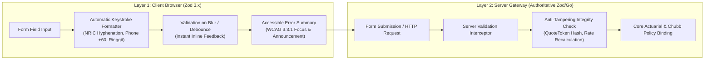

# VALIDATION ARCHITECTURE & DATA GOVERNANCE
## DoctorShield Individual Medical Professional Indemnity Portal

> **Document ID:** `DOC-ARCH-VAL-001`  
> **Status:** Authoritative Baseline (Phase 2 Deliverable)  
> **Classification:** [VERIFIED Architecture]  
> **Target Framework:** Zod 3.x + Custom Malaysian Actuarial & Identity Validators  
> **Traceability:** Governed by [`FIELD_DICTIONARY.md`](file:///c:/Users/salee/Downloads/Portal_ds/docs/FIELD_DICTIONARY.md), [`BUSINESS_RULE_CATALOG.md`](file:///c:/Users/salee/Downloads/Portal_ds/docs/BUSINESS_RULE_CATALOG.md), and [`EDGE_CASE_TEST_MATRIX.md`](file:///c:/Users/salee/Downloads/Portal_ds/docs/EDGE_CASE_TEST_MATRIX.md)

---

## 1. Two-Tier Validation Strategy



1. **Layer 1 — Client UX Validation (Optimistic & Accessible):**
   - Immediate feedback upon field blur (`onBlur`) to prevent cognitive disruption during keystrokes.
   - Live keystroke formatting (e.g., auto-inserting hyphens into `900101-14-5555`, forcing uppercase for promo codes).
   - Dynamic error summary at the top of the form with anchor links directly focusing failing inputs.
2. **Layer 2 — Server-Authoritative Validation (Zero Trust):**
   - The client validation is purely advisory for user experience.
   - The backend validates all payloads against identical Zod schemas before actuarial evaluation.
   - Any pricing, discount, tax, or eligibility computation transmitted by the client is discarded in favor of authoritative backend math.

---

## 2. Core Validation Algorithms

### 2.1 Malaysian National Identity Card (NRIC) Algorithm
- **Format:** `YYMMDD-PB-###G` (12 numeric digits with optional hyphen delimiters: `^\d{6}-\d{2}-\d{4}$|^\d{12}$`).
- **Date of Birth & Century Resolution:**
  - `YYMMDD` extracted.
  - Century rule: If $YY > \text{currentYear} \pmod{100}$, century is $1900 + YY$; otherwise, century is $2000 + YY$.
  - Leap year and calendar day validity strictly verified (e.g., `900229` rejected since 1990 was not a leap year).
  - Age ceiling/floor: Applicant must be between 21 and 85 years old on policy inception date.
- **State / Place of Birth (`PB`):**
  - Must be a valid Malaysian State Code or Valid Foreign Birth Code:
    - Johor: 01, 21, 22, 23, 24
    - Kedah: 02, 25, 26, 27
    - Kelantan: 03, 28, 29
    - Melaka: 04, 30
    - Negeri Sembilan: 05, 31, 59
    - Pahang: 06, 32, 33
    - Pulau Pinang: 07, 34, 35
    - Perak: 08, 36, 37, 38, 39
    - Perlis: 09, 40
    - Selangor: 10, 41, 42, 43, 44
    - Terengganu: 11, 45, 46
    - Sabah: 12, 47, 48, 49
    - Sarawak: 13, 50, 51, 52, 53
    - Wilayah Persekutuan Kuala Lumpur: 14, 54, 55, 56, 57
    - Wilayah Persekutuan Labuan: 15, 58
    - Wilayah Persekutuan Putrajaya: 16
    - Abroad / Unknown: 60–99
- **Gender Parity:**
  - $G$ (last digit): Odd number = Male, Even number = Female.

```typescript
export function validateMalaysianNric(val: string): { isValid: boolean; error?: string; parsed?: { dob: string; gender: 'M' | 'F'; state: string } } {
  const clean = val.replace(/\D/g, '');
  if (clean.length !== 12) {
    return { isValid: false, error: 'NRIC must be exactly 12 numeric digits (e.g. 850101-14-5555)' };
  }

  const yy = parseInt(clean.substring(0, 2), 10);
  const mm = parseInt(clean.substring(2, 4), 10);
  const dd = parseInt(clean.substring(4, 6), 10);
  const pb = clean.substring(6, 8);
  const lastDigit = parseInt(clean.substring(11, 12), 10);

  const currentYearTwoDigits = new Date().getFullYear() % 100;
  const fullYear = yy > currentYearTwoDigits ? 1900 + yy : 2000 + yy;

  const dateObj = new Date(fullYear, mm - 1, dd);
  if (
    dateObj.getFullYear() !== fullYear ||
    dateObj.getMonth() !== mm - 1 ||
    dateObj.getDate() !== dd
  ) {
    return { isValid: false, error: 'NRIC contains an invalid date of birth' };
  }

  // Age restriction: 21 to 85
  const today = new Date();
  let age = today.getFullYear() - fullYear;
  if (today.getMonth() < mm - 1 || (today.getMonth() === mm - 1 && today.getDate() < dd)) {
    age--;
  }
  if (age < 21 || age > 85) {
    return { isValid: false, error: `Applicant age (${age} years) is outside eligible indemnity underwriting limits (21-85 years)` };
  }

  return {
    isValid: true,
    parsed: {
      dob: `${fullYear}-${String(mm).padStart(2, '0')}-${String(dd).padStart(2, '0')}`,
      gender: lastDigit % 2 === 1 ? 'M' : 'F',
      state: pb,
    },
  };
}
```

---

### 2.2 Malaysian Mobile Telephone Normalization & Validation
- **Accepted Formats:**
  - `+60123456789`, `+601112345678`
  - `0123456789`, `01112345678`
  - `6012-345 6789`
- **Normalization Rule:**
  - Strip spaces, hyphens, and brackets.
  - If starts with `0`, replace leading `0` with `+60`.
  - If starts with `60`, prefix with `+`.
- **Carrier Prefix Verification:**
  - Valid prefixes: `10`, `11`, `12`, `13`, `14`, `16`, `17`, `18`, `19`.
  - Length: `+6011` allows 10–11 digits total (excluding country code); `+6012` through `+6019` require exactly 9–10 digits.

```typescript
export const MalaysianPhoneSchema = z
  .string()
  .transform((val) => {
    let clean = val.replace(/[\s\-()]/g, '');
    if (clean.startsWith('0')) clean = '+60' + clean.slice(1);
    else if (clean.startsWith('60')) clean = '+' + clean;
    return clean;
  })
  .refine((val) => /^\+601[0-46-9]\d{7,8}$/.test(val), {
    message: 'Please enter a valid Malaysian mobile number (e.g. +6012 345 6789 or 0123456789)',
  });
```

---

### 2.3 Malaysian Medical Council (MMC) Registration Number
- **Format:** Pure numeric string, 4 to 6 digits (e.g., `45678`, `102944`).
- **Validation:** Must be non-zero and non-empty.
- **Future Integration:** Reserved for real-time MMC Medical Register verification via JA Assure Core Gateway.

---

### 2.4 Coverage Inception & Term Date Boundaries
- **Earliest Inception Date:** Today ($D_0$) or any future date within the allowable window. *Backdating is strictly prohibited by Chubb underwriting guidelines.*
- **Inception Date Ceiling:** Exactly 9 calendar months from today ($D_0 + 9\text{ months}$).
- **Policy Term Duration:** Default term is 12 calendar months (365/366 days).
- **Pro-Rata Anchor Date:** For renewals or mid-term adjustments, pro-rated terms cannot be shorter than 30 days nor exceed 366 days.

```typescript
export function validateInceptionDate(startDateStr: string): { isValid: boolean; error?: string } {
  const start = new Date(startDateStr);
  const today = new Date();
  today.setHours(0, 0, 0, 0);

  if (isNaN(start.getTime())) {
    return { isValid: false, error: 'Please enter a valid coverage start date (YYYY-MM-DD)' };
  }

  if (start < today) {
    return { isValid: false, error: 'Coverage start date cannot be backdated. Select today or a future date.' };
  }

  const nineMonthsAhead = new Date(today);
  nineMonthsAhead.setMonth(nineMonthsAhead.getMonth() + 9);

  if (start > nineMonthsAhead) {
    return { isValid: false, error: 'Coverage start date cannot exceed 9 calendar months from today' };
  }

  return { isValid: true };
}
```

---

### 2.5 Multi-Specialty Percentage Allocation Rules
- When a practitioner classification requires multi-specialty allocation (e.g. General Medical Practitioner with Aesthetic Procedures or Surgical Assist):
  1. **Sum Constraint:** The exact sum of all specialty percentage allocations must equal **100.0%**.
  2. **Primary Specialization Floor:** The dominant specialty must represent at least **50.0%** of the practice.
  3. **Maximum Specialties:** Maximum of 4 distinct specializations allowed per individual indemnity policy.
  4. **Granularity:** Allocations must be multiples of 5% (e.g., 70%, 15%, 15%).

```typescript
export const SpecialtyAllocationSchema = z
  .array(
    z.object({
      specialtyId: z.string().min(1, 'Specialty selection required'),
      specialtyName: z.string(),
      percentage: z.number().min(5, 'Minimum allocation per specialty is 5%').max(100),
    })
  )
  .min(1, 'At least one specialization must be selected')
  .max(4, 'Maximum of 4 specializations permitted')
  .refine(
    (items) => {
      const sum = items.reduce((acc, curr) => acc + curr.percentage, 0);
      return Math.abs(sum - 100.0) < 0.001;
    },
    { message: 'The sum of all specialization allocations must equal exactly 100%' }
  )
  .refine(
    (items) => {
      const maxPercentage = Math.max(...items.map((i) => i.percentage));
      return maxPercentage >= 50.0;
    },
    { message: 'Your primary specialization must represent at least 50% of your practice' }
  );
```

---

### 2.6 Clinic Ownership, Branches & Revenue Ceilings
- **Sole Proprietor / Partnership:** Clinic package addon is only available if practitioner confirms legal ownership (Sole Proprietor or Partner in registered private medical clinic).
- **Branch Limit:** Up to 4 branches maximum (1 principal location + up to 3 additional branches).
- **Annual Turnover / Revenue Ceiling:** Total clinic gross revenue must not exceed **RM 5,000,000**. If revenue exceeds RM 5M, the state machine transitions to `REFERRAL_LOCKED` for corporate underwriting.

```typescript
export const ClinicAddonSchema = z.object({
  isOwner: z.boolean(),
  organizationType: z.enum(['sole_proprietor', 'partnership', 'none']),
  annualRevenue: z.number().max(5000000, {
    message: 'Clinics with gross annual turnover exceeding RM 5,000,000 require bespoke commercial underwriting. Please contact our support team.',
  }),
  branches: z
    .array(
      z.object({
        branchName: z.string().min(3, 'Branch name required'),
        address: z.string().min(10, 'Complete branch address required'),
        postcode: z.string().regex(/^\d{5}$/, 'Valid 5-digit Malaysian postcode required'),
        state: z.string().min(2, 'State required'),
      })
    )
    .max(4, 'Maximum of 4 clinic branches allowed under individual indemnity add-on'),
});
```

---

### 2.7 Underwriting Declarations & Conditional Narrative
- **5 Statutory Questions:**
  1. Prior claims or allegations of malpractice in the last 5 years?
  2. Awareness of circumstances that could give rise to a claim?
  3. Disciplinary inquiry, MMC censure, or suspension?
  4. Criminal investigation or conviction?
  5. Refusal of indemnity insurance or special terms imposed by prior insurers?
- **Rule:**
  - If any answer is `"Yes"`, an explanation is mandatory with a **minimum of 20 characters** describing dates, nature of inquiry, and outcome.
  - An affirmative answer triggers a support referral review state (`REFERRAL_LOCKED`).

---

## 3. Comprehensive Step Form Schemas

### 3.1 Stage 1 Schema (`CoverDetailsSchema`)
```typescript
export const Stage1CoverDetailsSchema = z.object({
  classificationId: z.string().min(1, 'Please select your medical practitioner classification'),
  specialties: SpecialtyAllocationSchema,
  limitOfLiability: z.enum(['1m', '2m', '3m', '5m', '10m'], {
    errorMap: () => ({ message: 'Please select a limit of liability' }),
  }),
  startDate: z.string().refine((val) => validateInceptionDate(val).isValid, {
    message: 'Invalid coverage inception date',
  }),
  promoCode: z.string().trim().toUpperCase().optional(),
});
```

### 3.2 Stage 3 Schema (`PersonalParticularsSchema`)
```typescript
export const Stage3ParticularsSchema = z.object({
  salutation: z.enum(['Dr', 'Prof', 'Dato', 'Datin', 'Tan Sri', 'Datuk']),
  fullName: z.string().min(3, 'Full name as per NRIC is required').max(100),
  nric: z.string().refine((val) => validateMalaysianNric(val).isValid, {
    message: 'Invalid Malaysian NRIC number',
  }),
  mmcNumber: z.string().regex(/^\d{4,6}$/, 'MMC number must be 4 to 6 digits'),
  email: z.string().email('Please enter a valid email address for policy delivery'),
  mobilePhone: MalaysianPhoneSchema,
  practiceAddress: z.object({
    addressLine1: z.string().min(5, 'Address line 1 is required'),
    addressLine2: z.string().optional(),
    postcode: z.string().regex(/^\d{5}$/, 'Postcode must be exactly 5 digits'),
    city: z.string().min(2, 'City is required'),
    state: z.string().min(2, 'State is required'),
  }),
  underwritingDeclarations: z.object({
    hasPriorClaims: z.boolean(),
    priorClaimsDetails: z.string().optional(),
    hasDisciplinaryInquiry: z.boolean(),
    disciplinaryDetails: z.string().optional(),
    hasCriminalInvestigation: z.boolean(),
    criminalDetails: z.string().optional(),
  }).refine((data) => {
    if (data.hasPriorClaims && (!data.priorClaimsDetails || data.priorClaimsDetails.length < 20)) return false;
    if (data.hasDisciplinaryInquiry && (!data.disciplinaryDetails || data.disciplinaryDetails.length < 20)) return false;
    if (data.hasCriminalInvestigation && (!data.criminalDetails || data.criminalDetails.length < 20)) return false;
    return true;
  }, {
    message: 'Please provide a detailed explanation (minimum 20 characters) for any affirmative declaration',
    path: ['priorClaimsDetails'],
  }),
});
```

---

## 4. Accessible Error Summaries & Focus Management

Per WCAG 2.2 AA Criteria 3.3.1 (Error Identification) and 3.3.3 (Error Suggestion):
1. **Error Summary Banner:**
   - Rendered at top of form container with `role="alert"` and `aria-live="assertive"`.
   - Contains an unordered list of clickable error anchors: `<a href="#field-nric">NRIC contains an invalid date of birth</a>`.
2. **Focus Management:**
   - On failed submission, programmatic keyboard focus moves directly to the `ErrorSummary` container.
   - Activating an error link programmatically sets focus to the invalid `<input>` element and scrolls it smoothly into view.
3. **Inline Accessibility:**
   - Form fields link errors via `aria-describedby="{fieldId}-error"`.
   - Invalid fields feature `aria-invalid="true"`.

