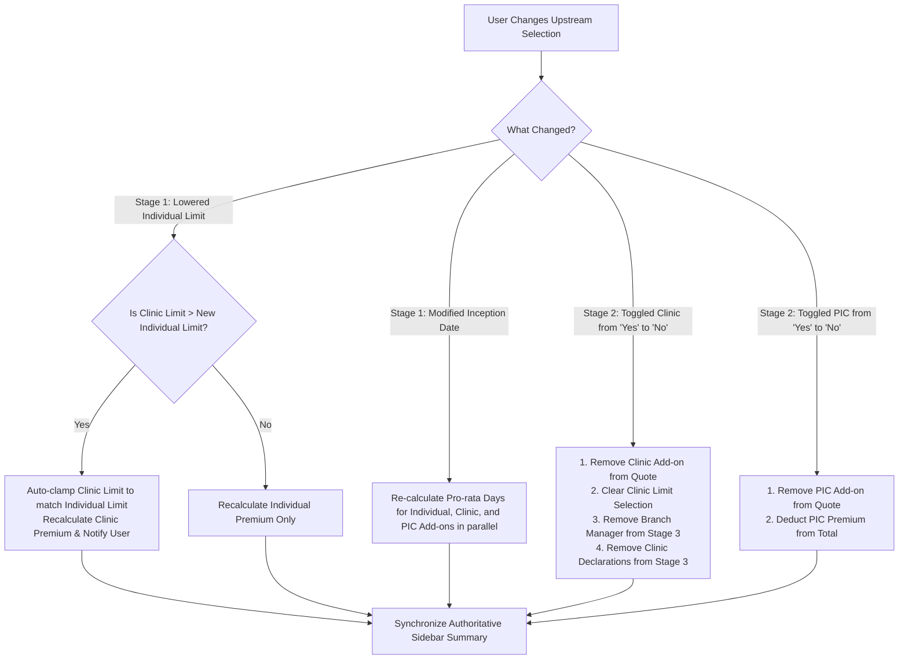

# DoctorShield Individual Indemnity — Add-on Selection & Eligibility Architecture

> **Document Reference:** `DOC-ARCH-ADDON-BEHAVIOR-2026-10-29`  
> **Status:** Product Architecture & Selection Behavior Baseline  
> **Author:** Principal UX Architect & Underwriting Systems Lead  
> **Mandate:** Establish an "Eligibility-First" interaction pattern for optional coverage extensions. Ineligible add-ons must never appear as selectable products. All selection, removal, and limit changes must synchronize instantly with the authoritative live quotation.

---

## 1. The "Eligibility-First" Architectural Pattern

### 1.1 The Anti-Pattern in Legacy Insurance UX
In traditional or unrefined insurance flows, optional riders and endorsements are presented as a raw catalogue of checkboxes before the system knows anything about the applicant's clinical practice. This creates three critical failures:
1. **Accidental Mis-selling / Ineligible Selection:** A hospital-employed medical officer who does not own a clinic mistakenly selects "Clinic Entity Protection", paying an unnecessary surcharge for coverage they cannot claim under.
2. **Cognitive Fatigue:** Practitioners are forced to read descriptions and evaluate prices for products that have zero applicability to their professional profile.
3. **Underwriting Conflicts:** Users select high add-on limits that exceed their primary individual indemnity limit, triggering unexpected backend validation errors during final checkout.

### 1.2 The DoctorShield Invariant
```
+─────────────────────────────────────────────────────────────────────────────────────────+
|                           THE ELIGIBILITY-FIRST INVARIANT                               |
+─────────────────────────────────────────────────────────────────────────────────────────+
|  STEP 1: QUALIFYING PRACTICE GATE                                                       |
|  Determine whether the applicant's practice structure gives rise to the exposure.       |
|  (e.g., "Do you own a clinic?" / "Are you a Person-In-Charge?")                         |
|                                                                                         |
|  STEP 2: PROGRESSIVE UNLOCK                                                             |
|  IF AND ONLY IF qualified -> Unlock and display the corresponding Add-on Card.          |
|  IF NOT qualified -> The add-on remains 100% invisible.                                 |
|                                                                                         |
|  STEP 3: TRANSPARENT DYNAMIC RATING                                                     |
|  Surfacing selectable limit tiers and exact pro-rated premium additions in real time.   |
|                                                                                         |
|  STEP 4: INSTANT SIDEBAR SYNCHRONIZATION                                                |
|  Checking or unchecking an add-on instantly updates the authoritative sidebar breakdown.|
+─────────────────────────────────────────────────────────────────────────────────────────+
```

---

## 2. Product Add-on Behavioral Specifications

---

### 2.1 Add-on 1: Clinic Entity Protection

#### Underwriting Context
Under Malaysian tort law, when a patient alleges medical malpractice in a private healthcare facility, legal counsel routinely names both the individual attending doctor AND the clinic corporate entity (Sdn Bhd or Partnership) as co-defendants. Standard individual indemnity protects the doctor personally, but leaves the clinic entity's assets exposed to separate liability judgments and legal defense costs.

#### Eligibility Prerequisite Gate
- **Controlling Question:** `Do you own a clinic?` (`QST-QUOT-008`).
- **Eligibility Rule:**
  - `No`: Clinic Entity Protection is **ineligible**. The add-on card, business structure question (`Sole Proprietor` vs `Partnership`), locum question, and clinic limit selector are **completely suppressed**.
  - `Yes`: The user is eligible. The Clinic Entity Protection Add-on Card is rendered as a clean, selectable option.

#### Limit Selection & Individual Limit Clamping Rule
- **Available Clinic Limit Options:**
  - `RM 1,000,000`
  - `RM 2,000,000`
  - `RM 5,000,000`
- **Strict Clamping Invariant:** Under Chubb underwriting guidelines, a clinic entity cannot carry a higher limit of liability than the primary insured practitioner.
  $$\text{Clinic Limit} \le \text{Individual Indemnity Limit}$$
  *Behavior:* If the user selected an individual limit of `RM 1,000,000` in Stage 1, the clinic limit selector **automatically restricts choices to RM 1,000,000**. Options for RM 2,000,000 and RM 5,000,000 are disabled or omitted with a clear helper note: *"Clinic limit cannot exceed primary individual coverage limit."*

#### Dynamic Pricing Formula & Live Recalculation
- **Base Annual Clinic Premium ($P_{\text{clinic\_ann}}$):** Determined by legal entity structure, locum status, and clinic limit tier:
  - Sole Proprietor (No locums, RM 1M limit): `RM 650.00 / yr`
  - Sole Proprietor (With locums, RM 1M limit): `RM 850.00 / yr`
  - Partnership / Sdn Bhd (RM 1M limit): `RM 1,100.00 / yr`
- **Pro-rated Premium Added to Quote ($P_{\text{clinic\_pro}}$):**
  $$P_{\text{clinic\_pro}} = P_{\text{clinic\_ann}} \times \frac{\text{Active Days in Period}}{\text{Total Days in Year (365)}}$$
- **Instant Live Update:** Selecting the card immediately appends a distinct row to the sticky sidebar: `Clinic Protection: +RM [Amount]` and increments `taxSst` (8%) and `totalPayable`.

#### Removal & Deselection
- Deselecting the checkbox immediately:
  1. Removes the `Clinic Protection` line item from the sidebar.
  2. Recalculates SST and Total Payable.
  3. Reverts Stage 3 underwriting declarations so that Clinic Underwriting Questions 1–4 are bypassed.

---

### 2.2 Add-on 2: Person-In-Charge (PIC) Extension

#### Underwriting Context
Under the **Private Healthcare Facilities and Services Act 1998 (Act 586)**, every licensed private healthcare facility must appoint a registered medical practitioner as the Person-In-Charge (PIC). The PIC carries personal statutory liability for facility compliance, staff conduct, healthcare standard operating procedures, and medical records management.

#### Eligibility Prerequisite Gate
- **Controlling Question:** `Are you a Person-In-Charge (PIC) for any clinic?` (`QST-QUOT-011`).
- **Eligibility Rule:**
  - `No`: PIC Add-on is **ineligible and completely hidden**.
  - `Yes`: The PIC Add-on Card is surfaced. Prompts for secondary confirmation: `Are you a Person-In-Charge (PIC) with another establishment?` (`QST-QUOT-012`).

#### Pricing & Rating Specification
- **Base Annual PIC Premium:** Flat rate of `RM 300.00 / yr`.
- **Pro-rated Premium Added to Quote:**
  $$P_{\text{pic\_pro}} = \text{RM } 300.00 \times \frac{\text{Active Days in Period}}{365}$$
- **Sidebar Integration:** Renders dedicated row: `PIC Extension: +RM [Amount]`.

---

### 2.3 Add-on 3: Complimentary Automatic Reinstatement

#### Underwriting Context
If a claim exhausts an insured practitioner's aggregate indemnity limit during the policy period, automatic reinstatement restores the full original limit of liability for subsequent, unrelated claims occurring in the same period without requiring additional premium payment.

#### Presentation & Pricing Transparency Rule
- **Eligibility:** Automatically granted to all DoctorShield individual policyholders underwritten by Chubb.
- **Behavior:** This is **not a paid add-on** and must not be presented as a checkbox requiring opt-in or payment.
- **Minimal UI Presentation:** Rendered as an unboxed, elegant benefit badge:
  `✓ Complimentary Automatic Reinstatement Included (RM 0.00)`
- **Sidebar Representation:** Listed in the policy summary with zero surcharge.

---

## 3. Upstream Mutation Handling (Cascading Add-on Invalidation)

When a user modifies upstream parameters in Stage 1 or Stage 2, the interaction architecture enforces strict cascading integrity:



---

## 4. Rationale Modals for Add-ons

To satisfy compliance while eliminating inline reading friction, detailed technical rationales are housed in lightweight, accessible modal dialogues triggered via secondary links:

| Add-on | Trigger Link Label | Modal Content Summary | Preserved Source Identifiers |
|---|---|---|---|
| **Clinic Entity Protection** | `Why is this recommended?` | Explains vicarious liability, Private Healthcare Facilities Act 1998 entity naming, and defense cost coverage. | `#jsPage2` (`ACT-QUOT-004`) |
| **Person-In-Charge Extension** | `Why is this recommended?` | Explains statutory duties of the PIC under Act 586 and personal administrative exposure. | `#jsPage2` (`ACT-QUOT-005`) |
| **Automatic Reinstatement** | `View Reinstatement Terms` | Details Clause 6.1 reinstatement mechanics and exclusion of interrelated claims. | Policy Wording Schedule |

---

*This document establishes the authoritative add-on selection model for implementation.*

