# DoctorShield Individual Indemnity — Conditional Flow & Branching Model

> **Document Reference:** `DOC-ARCH-COND-FLOW-2026-10-29`  
> **Status:** Conditional Logic & State Machine Specification  
> **Author:** Principal UX Architect & Systems Modeler  
> **Mandate:** Ensure simple user journeys remain entirely frictionless (zero irrelevant fields) while complex clinical profiles reveal requirements progressively without jarring jumps or data loss.

---

## 1. Master Conditional State Machine Architecture

The conditional flow model isolates complex branches into **12 explicit decision gates**. Each gate evaluates specific user choices and dynamically updates visibility, rating calculations, and downstream routing:

```mermaid
stateDiagram-v2
    [*] --> Stage1_Coverage

    %% Gate 1: Specialization
    state Stage1_Coverage {
        [*] --> Select_Classification
        Select_Classification --> Check_Specialty: Class Selected
        state Check_Specialty <<choice>>
        Check_Specialty --> Standard_Limits: Standard (e.g. GP #7)
        Check_Specialty --> Specialization_Modal: Aesthetics (#20 / RULE-SPC-01)
        Specialization_Modal --> Standard_Limits: Balanced (100%)
        
        Standard_Limits --> Select_Dates
        Select_Dates --> Check_Backdate: Date Selected
        state Check_Backdate <<choice>>
        Check_Backdate --> Standard_Period: Date >= Today
        Check_Backdate --> Backdate_Agreement: Date < Today (Clause 6.12)
        Backdate_Agreement --> Standard_Period: I Agree
        Backdate_Agreement --> Select_Dates: Disagree (Reset to Today)
    }

    Stage1_Coverage --> Stage2_Quote: Generate Quotation

    %% Gate 2 & 3: Clinic & PIC Options
    state Stage2_Quote {
        [*] --> Individual_Quote_Displayed
        Individual_Quote_Displayed --> Clinic_Gate: Review Rate
        
        state Clinic_Gate <<choice>>
        Clinic_Gate --> Clinic_Questions_Hidden: Own Clinic == No
        Clinic_Gate --> Reveal_Clinic_Options: Own Clinic == Yes
        
        state Reveal_Clinic_Options {
            [*] --> Entity_Structure
            Entity_Structure --> Locum_Question
            Locum_Question --> Optional_Clinic_Addon
            Optional_Clinic_Addon --> Clinic_Limit_Select: Addon Checked
        }

        Clinic_Questions_Hidden --> PIC_Gate
        Reveal_Clinic_Options --> PIC_Gate

        state PIC_Gate <<choice>>
        PIC_Gate --> PIC_Addon_Hidden: PIC == No
        PIC_Gate --> Reveal_PIC_Addon: PIC == Yes
    }

    Stage2_Quote --> Stage3_Particulars: Proceed to Personal Details
    Stage2_Quote --> Email_Dispatched: Email Quote (PDF)

    %% Gate 4: Branches & Underwriting Triage
    state Stage3_Particulars {
        [*] --> Identity_Particulars
        Identity_Particulars --> Practice_Particulars
        
        Practice_Particulars --> Branch_Manager: Clinic Addon Active
        Practice_Particulars --> Underwriting_Declarations: Clinic Addon Inactive
        Branch_Manager --> Underwriting_Declarations: Up to 4 Branches

        state Underwriting_Declarations {
            [*] --> Individual_Declarations
            Individual_Declarations --> Reveal_Explanation: Answer == Disagree / Yes
            Individual_Declarations --> Clinic_Declarations: Clinic Addon Active
            Clinic_Declarations --> COVID_Module: Supplementary Active
            Individual_Declarations --> COVID_Module: Clinic Addon Inactive
        }
    }

    Stage3_Particulars --> Triage_Gate: Proceed to Review

    state Triage_Gate <<choice>>
    Triage_Gate --> Stage4_Checkout: All Declarations Clean
    Triage_Gate --> Referral_Desk: Any Adverse Declaration

    %% Gate 5: Checkout & Gateway
    state Stage4_Checkout {
        [*] --> Select_Payment_Method
        Select_Payment_Method --> Launch_Gateway: Pay RM [Total]
    }

    state Gateway_Result <<choice>>
    Launch_Gateway --> Gateway_Result
    Gateway_Result --> Stage5_Complete: Payment Authorized
    Gateway_Result --> Stage4_Checkout: Payment Failed / Retry Preserved
    Gateway_Result --> Stage4_Checkout: Payment Cancelled

    Stage5_Complete --> [*]
    Referral_Desk --> [*]
    Email_Dispatched --> [*]
```

---

## 2. Detailed Conditional Branch Inventory

---

### Branch 1: Aesthetic Specialization Allocation (RULE-SPC-01)
- **Trigger Condition:** User selects Classification `20` (`"General Medical Practitioner with Cosmetic and Aesthetic"`).
- **Default State:** Inactive. Standard classifications proceed directly to liability tier selection.
- **Active State Behavior:**
  - Displays inline banner: `Specialization Allocation Required (RULE-SPC-01)`.
  - Blocks `Generate Quotation` submission until allocation is confirmed.
  - Clicking `Allocate Specialization Percentages` opens `SpecializationModal`.
  - Requires user to allocate percentages across aesthetic procedures (Fillers, Botox, Laser, etc.) summing exactly to 100%.
  - Supports 1-click `Distribute Evenly` utility.
- **Exit Condition:** Allocation sum == 100.0%. Validates and unlocks Stage 1 progression.

---

### Branch 2: Policy Backdate Agreement & Clause 6.12 Protocol
- **Trigger Condition:** User selects `Coverage Inception Date` < `Current System Date`.
- **Default State:** Future or current date -> standard prospective policy period.
- **Active State Behavior:**
  - Automatically intercepts date input change and opens `BackdateAgreementModal`.
  - Displays verbatim Clause 6.12 legal text: *"Pursuant to Clause 6.12 Licensing of Medical Professionals & Maintenance of Records under this Policy, I hereby acknowledge that Chubb shall not be liable for any Loss... from [Calculated Start Date] until [Current Date]."*
- **Exit Actions:**
  - `I Agree to Clause 6.12 Terms`: Confirms backdated inception date; flags policy record as retroactive; renders retroactive notice in Stage 4.
  - `Disagree`: Reverts inception date to `Current System Date` and closes modal without penalty.

---

### Branch 3: Clinic Ownership & Entity Structure Disclosure
- **Trigger Condition:** Stage 2 Question: `Do you own a clinic?`
- **Default State:** `No`.
- **Branch Behavior:**
  - **Path A (`No`):** 
    - Completely hides:
      1. `Is it a Sole proprietor or partnership / sdn bhd?`
      2. `Do you hire locums who sees new patients on their own?`
      3. `Clinic Entity Protection Add-on Card`
      4. `Clinic Limit Of Liability` dropdown
    - Automatically removes any clinic add-on surcharge from the live quotation breakdown.
  - **Path B (`Yes`):**
    - Smoothly expands the clinic entity questionnaire inline.
    - Prompts user to select legal structure (`Sole Proprietorship` vs `Partnership / Sdn Bhd`).
    - Prompts user regarding locum employment (`Yes` / `No`).
    - Surfaces the **Clinic Entity Protection Add-on Card** as an eligible, selectable coverage.

---

### Branch 4: Clinic Entity Protection Limit & Pricing Dependencies
- **Trigger Condition:** User checks `Add This Recommended Coverage` for Clinic Entity Protection.
- **Rating Dependencies:**
  - Inception and expiry dates align with individual policy.
  - Maximum selectable clinic limit is **clamped to the user's selected individual indemnity limit** (e.g. if individual limit is RM 1,000,000, clinic limit options cannot exceed RM 1,000,000).
  - Actuarial base rate is computed based on clinic structure, locum status, and annual revenue tier.
  - Updating the clinic limit dynamically triggers a non-destructive quote recalculation, updating `addonsTotal`, `taxSst`, and `totalPayable` in the sticky sidebar in real time.

---

### Branch 5: Person-In-Charge (PIC) Extension Eligibility
- **Trigger Condition:** Stage 2 Question: `Are you a Person-In-Charge (PIC) for any clinic?`
- **Branch Behavior:**
  - **Path A (`No`):** PIC Add-on is completely suppressed.
  - **Path B (`Yes`):**
    - Displays secondary question: `Are you a Person-In-Charge (PIC) with another establishment?` (`Yes` / `No`).
    - Reveals the **PIC Coverage Add-on Card** with clear premium display (`RM 300.00/yr` base pro-rated).
    - Checking the box binds the PIC coverage to the policy quotation.

---

### Branch 6: Additional Branches Management & Revenue Ceiling Gate
- **Trigger Condition:** Rendered on Stage 3 *only* if the applicant selected Clinic Entity Protection in Stage 2.
- **Eligibility Constraints:**
  - Maximum branch limit: **4 branches** (enforced by `maxBranches` guard). When 4 branches are added, the "+ Add Branch" button is automatically disabled.
  - Combined revenue limitation: Total clinic and branch revenue must remain under **RM 5,000,000 per annum** (`LEG-BRANCH-001`).
- **Modal Sub-Flow:**
  - Clicking `+ Add Another Clinic / Branch` opens the lightweight `BranchModal`.
  - Captures: `Branch Name`, `Branch Address`, `Phone Number`, `Branch PIC Name`, and `Branch MMC Number`.
  - Real-time client-side validation ensures all fields are non-empty before appending to the persistent branch table.
  - Table provides 1-click `Edit` and `Delete` actions with immediate state reconciliation.

---

### Branch 7: Underwriting Declarations Triage (Clean vs Referral)
- **Trigger Condition:** Submission of Stage 3 (`Proceed to Review`).
- **Evaluation Matrix:**
  1. `QST-DECL-001` (Prior Claims): `Agree` is clean; `Disagree` is adverse.
  2. `QST-DECL-002` (Circumstances): `No` is clean; `Yes` is adverse.
  3. `QST-DECL-003` (Disciplinary): `No` is clean; `Yes` is adverse.
  4. `QST-DECL-004` (Criminal): `No` is clean; `Yes` is adverse.
  5. Clinic Declarations (if clinic active): Questions 1–4 all require `No` for clean pass.
  6. Sanctions & AML Blocklist Gate: Customer NRIC checked against designated sanctions list.
- **Branch Outcomes:**
  - **Outcome 1 (100% Clean):** Straight-Through Binding unlocked. Advances directly to Stage 4 Review & Payment.
  - **Outcome 2 (Any Adverse Answer or Sanctions Hit):** Underwriting Referral triggered. Intercepts checkout and navigates user to `/referral` (Support Referral Desk).

---

### Branch 8: Support Referral & Relationship Manager Callback
- **Trigger Condition:** Active upon entering `/referral`.
- **Branch Options:**
  - Prompt: *"We require additional information to process your application. May our relationship manager contact you at the mobile number provided?"*
  - **Action `Yes`:** Expands the Callback Contact Form (`Name`, `Clinic Name`, `Phone`, `Email`), pre-filled from earlier stages. Submitting dispatches `/api/contactSupport` and renders a calm confirmation: *"Callback Request Submitted. Our medical underwriting manager will contact you within 1 business day."*
  - **Action `No`:** Renders secondary exit link returning to portal root (`/`).

---

### Branch 9: Payment Gateway Failure & Non-Destructive Retry
- **Trigger Condition:** User attempts payment in Stage 4 checkout modal and the payment gateway returns a `FAILED` or `DECLINED` status.
- **Handling Protocol:**
  - Never discard applicant particulars, underwriting declarations, or selected add-ons.
  - Closes gateway modal and renders a prominent, non-punitive alert at the top of Stage 4: *"Payment was declined by your financial institution. Your application and quotation details have been preserved. Please select another payment method or try again."*
  - Re-enables the primary `Pay RM [Total]` CTA.

---

### Branch 10: Existing Customer NRIC & Promo Code Substitution Gate
- **Trigger Condition:** In Stage 3, the user enters an NRIC that belongs to an existing renewing customer, but in Stage 1 they entered a new-customer introductory promo code.
- **Handling Protocol:**
  - The API identifies promo ineligibility (`MSG-008`).
  - Automatically triggers the `NricPromoSubstitutionModal`: *"Kindly note that the promo code you have used is ineligible for you as you are an existing client. Nevertheless, we have replaced it with the right promo code that still ensures you enjoy the discounted premium."*
  - User clicks `Acknowledge & Continue`, the rating service seamlessly updates the discount code, and checkout continues without interruption.

---

## 3. Upstream Edit & Recalculation Dependency Matrix

The following matrix defines the cascading invalidation and revalidation behavior across stages:

| Changed Parameter | Trigger Location | Fields Automatically Re-evaluated | Invalidation / Recalculation Action |
|---|---|---|---|
| **Professional Classification** | Stage 1 | Base Rate, Specialty Rules, Liability Tiers | Recalculates quote; clamps tier; invalidates Stage 2 draft; wipes incompatible clinic ratings. |
| **Limit of Liability** | Stage 1 | Base Rate, Clinic Limit Ceiling | Recalculates individual quote; clamps active clinic limit if higher than new individual limit. |
| **Inception Date** | Stage 1 | Pro-rata Days, Retroactive Clause | Recalculates pro-rated premium; updates pro-rata text; prompts Clause 6.12 modal if backdated. |
| **Clinic Ownership (`Yes` -> `No`)** | Stage 2 | Clinic Addon, Clinic Limit, Branches | Removes clinic premium from quote; hides clinic underwriting; preserves branch data in draft. |
| **PIC Status (`Yes` -> `No`)** | Stage 2 | PIC Addon, PIC Surcharge | Removes PIC premium from quote; updates total payable immediately. |
| **Adverse Answer Toggled to Clean** | Stage 3 | Underwriting Destination Gate | Clears referral lock; restores direct path to Stage 4 Review & Payment. |
| **Clean Answer Toggled to Adverse** | Stage 3 | Underwriting Destination Gate | Arms referral intercept; locks Stage 4 until underwriter clearance. |

