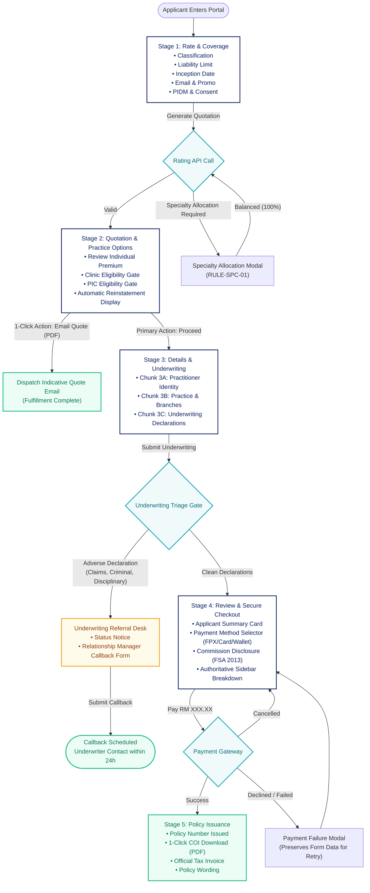

# DoctorShield Individual Indemnity — Simplified User Flow & Interaction Architecture

> **Document Reference:** `DOC-ARCH-SIMP-FLOW-2026-10-29`  
> **Status:** Architecture Blueprint Baseline  
> **Author:** Principal UX Architect & Insurance Interaction Specialist  
> **Mandate:** Redesign the complete DoctorShield interaction flow for minimum cognitive load, maximum clarity, and zero loss of existing business logic or underwriting rules.

---

## 1. Architectural Diagnosis & Core Reorganization Principles

### 1.1 The Current Interaction Failure Mode
In the current implementation, users are subjected to **unnecessary simultaneous decisions, jarring screen transitions, and inverted dependency ordering**:
1. **Inverted Add-on Logic:** Stage 2 asks users if they want to buy "Clinic Entity Protection" and "PIC Coverage" before establishing whether they own a clinic, hire locums, or serve as a Person-In-Charge. Ineligible add-ons are displayed alongside eligible ones.
2. **Double Decision on Fulfillment:** Stage 2 forces users to choose between "Buy Online" and "Email Quotation" via a card selector in the middle of the screen, which then redundantly changes the action button at the bottom of the screen.
3. **Monolithic Stage 3:** Stage 3 dumps 25+ identity and address fields, an interactive branch manager, and 8 high-stakes statutory underwriting declarations onto a single continuous canvas.
4. **Desktop Information Duplication:** Stage 4 forces the user to review a 10-line calculation summary table in the main column that directly mirrors the sticky sidebar 150 pixels to the right.

### 1.2 Core Flow Principles Applied

```
+─────────────────────────────────────────────────────────────────────────────────────────+
|                           CORE FLOW REORGANIZATION PRINCIPLES                           |
+──────────────────────────────+──────────────────────────────────────────────────────────+
| 1. SINGLE PURPOSE PER STAGE  | Each stage accomplishes one logical milestone.           |
|                              | Rate -> Options -> Details & Declarations -> Checkout.   |
+──────────────────────────────+──────────────────────────────────────────────────────────+
| 2. ELIGIBILITY BEFORE CHOICE | Never ask a user to select an add-on before confirming   |
|                              | that their clinical practice qualifies for that coverage.|
+──────────────────────────────+──────────────────────────────────────────────────────────+
| 3. NATURAL PROGRESSION       | Simple applications stay simple (3 clicks to quote).     |
|                              | Complex applications reveal requirements progressively.  |
+──────────────────────────────+──────────────────────────────────────────────────────────+
| 4. REVERSIBLE STATE MACHINE  | Editing an earlier answer cleanly resets downstream      |
|                              | dependent ratings without wiping unrelated valid data.   |
+──────────────────────────────+──────────────────────────────────────────────────────────+
| 5. THREE CLEAR OUTCOMES      | Distinct, unambiguous handling for:                      |
|                              | A) Direct Straight-Through Bind                          |
|                              | B) Underwriting Referral (Adverse Declaration Callback)   |
|                              | C) Indicative Quotation Email Delivery                   |
+──────────────────────────────+──────────────────────────────────────────────────────────+
```

---

## 2. Master End-to-End User Flow

The redesigned architecture organizes the purchasing lifecycle into **4 streamlined operational stages**, preserving full parity with existing backend endpoints and routes (`/buy/coverage`, `/buy/quote`, `/buy/underwrite`, `/buy/review`):



---

## 3. Stage-by-Stage Interaction Specifications

---

### Stage 1: Rate & Coverage Discovery (`/buy/coverage`)
- **Single Purpose:** Enable medical practitioners to discover their exact individual indemnity premium in under 60 seconds with minimal data entry.
- **Natural Sequence:**
  1. `Classification` (Select input, 23 approved MMC/MDC categories).
  2. `Limit of Liability` (Horizontal segmented radio group, RM 250k to RM 10M).
  3. `Coverage Inception Date` (Date picker, default today) and `Coverage Expiry Date` (fixed 31/12).
  4. `Practitioner Email Address` (Text input).
  5. `Promotional Code` (Collapsed link: `+ Add promotional code`).
  6. Statutory Block: Verbatim PIDM protection text (`LEG-PIDM-001`) and mandatory practice consent checkbox (`LEG-CONSENT-001`).
- **Interaction Transitions:**
  - Selecting an aesthetic classification triggers the existing `SpecializationModal` inline.
  - Selecting an inception date in the past triggers the existing Clause 6.12 backdating agreement modal.
  - Clicking `Generate Quotation` validates fields, executes `/api/calculatePremium`, and advances smoothly to Stage 2.
- **Cognitive Debt Eliminated:** Purged 140 words of redundant helper text and eliminated 4 nested pricing cards.

---

### Stage 2: Quotation & Practice Options (`/buy/quote`)
- **Single Purpose:** Review calculated indicative individual premium and configure optional clinic or PIC practice extensions.
- **Natural Sequence:**
  1. **Authoritative Premium Header:** Calculated net premium displayed prominently with pro-rata coverage dates and standard 12-month annual equivalent rate. Calm validity statement: `Quote valid until 31 Dec [Year]`.
  2. **Clinic Practice Gate (Eligibility Before Add-on):**
     - Initial prompt: `Do you own a clinic?` (`Yes` / `No`).
     - *If No:* Clinic add-on and locum questions remain completely invisible.
     - *If Yes:* Progressively reveals:
       - Business structure (`Sole Proprietor` / `Partnership / Sdn Bhd`).
       - Locum doctor employment (`Yes` / `No`).
       - Optional **Clinic Entity Protection Add-on Card** with limit selectors (`RM 1M`, `RM 2M`, `RM 5M`) and incremental premium.
  3. **Person-In-Charge (PIC) Gate:**
     - Initial prompt: `Are you a Person-In-Charge (PIC) for any clinic?` (`Yes` / `No`).
     - *If No:* PIC add-on remains invisible.
     - *If Yes:* Reveals secondary establishment question and optional **PIC Coverage Add-on Card**.
  4. **Complimentary Automatic Reinstatement:** Clean benefit row: `✓ Complimentary Automatic Reinstatement Included`.
  5. **Clear Fulfillment Path:**
     - Primary Action: `Proceed to Personal Details` (solid brand button).
     - Secondary Action: `Email Quotation (PDF)` (clean outline button).
- **Cognitive Debt Eliminated:** Eliminated 4-layer nested cards and purged didactic marketing lectures on private clinic liability.

---

### Stage 3: Practitioner Details & Underwriting (`/buy/underwrite`)
- **Single Purpose:** Capture verified applicant identity, clinical premises, and legally binding statutory underwriting declarations.
- **Natural Sequence (Chunked Visual Progression):**
  - **Chunk 3A: Practitioner Identity:**
    - Salutation, Full Name as per IC, NRIC Number (auto-formats and auto-populates DOB and Gender), Nationality, MMC/MDC Registration Number, Mobile Number, Email.
  - **Chunk 3B: Practice Premises & Branch Manager:**
    - Primary Practice Name, Address Lines 1 & 2, Postcode, City, State, Annual Revenue Tier.
    - If Clinic Owner: Clean unboxed branch table with "+ Add Branch" trigger (max 4 branches, RM 5M revenue ceiling).
  - **Chunk 3C: Statutory Underwriting Declarations:**
    - 4 individual declarations (Claims, Circumstances, Disciplinary, Criminal).
    - If Clinic Add-on selected: 4 clinic entity declarations.
    - If adverse answer given: Clean inline slate explanation field expands smoothly.
    - Collapsible COVID module: `COVID-19 Declarations ▾` (collapsed by default).
    - Statutory Schedule 9 declaration (`LEG-CONSENT-002`) and duty of disclosure link.
- **Interaction Transitions:**
  - Clicking `Proceed to Review`: Evaluates underwriting rules. If all answers clean -> advances to Stage 4. If any answer adverse -> branches to `/referral` (Support Referral).
- **Cognitive Debt Eliminated:** Transformed 35-field scrolling monolith into 3 digestible visual sections without nested cards.

---

### Stage 4: Review, Declarations & Checkout (`/buy/review`)
- **Single Purpose:** Review consolidated application, select payment channel, and execute binding transaction.
- **Natural Sequence:**
  1. **Applicant & Policy Summary Card (Left Column):** Name, NRIC, MMC Number, Coverage Inception & Expiry, Limits, and Selected Add-ons.
  2. **Payment Channel Selection:** Sleek horizontal segmented radio tabs:
     - `Online Banking (FPX)`
     - `Credit / Debit Card`
     - `E-Wallet (Boost, GrabPay)`
  3. **Statutory Footnotes:** Section 130 FSA 2013 commission disclosure and Clause 6.12 retroactive notice (if backdated).
  4. **Sticky Sidebar (Right Column):** Single authoritative financial breakdown: Gross Premium, Discount, Nett Premium, SST (8%), Stamp Duty (RM 10.00), and Total Payable. Primary CTA: `Pay RM [Total]`.
- **Interaction Transitions:**
  - Clicking `Pay RM [Total]` initiates the secure payment gateway modal.
  - On payment authorization: Redirects to Stage 5.
  - On cancellation or failure: Returns smoothly to Stage 4 with a clear retry banner and zero data loss.
- **Cognitive Debt Eliminated:** Completely removed the duplicate 10-line calculation table from the main column.

---

### Stage 5: Policy Issuance & Confirmation (`/buy/complete`)
- **Single Purpose:** Provide immediate legal proof of coverage, document downloads, and next-step APC instructions.
- **Natural Sequence:**
  1. Header: `Policy Issued Successfully` in Kanit 500 (`#132766`).
  2. Policy Reference Banner: `Policy Number: DS-2026-XXXXXX` with 1-click copy action.
  3. 1-Click Document Download Row:
     - `Certificate of Insurance (PDF)` (`data-testid="download-coi-btn"`)
     - `Official Tax Invoice` (`data-testid="download-invoice-btn"`)
     - `Policy Wording` (`data-testid="download-schedule-btn"`)
  4. Concise Next Steps: MMC Annual Practising Certificate (APC) submission guidelines.
  5. Action: `Return to Home`.

---

## 4. Reversible State Machine & Upstream Recalculation Rules

When a user navigates backward using the browser back button or stepper navigation to modify an earlier parameter, the interaction state machine handles recalculations transparently without data corruption:

| Upstream Change | Downstream Impact & System Handling |
|---|---|
| **Change Classification in Stage 1** | Invalidates Stage 2 quote. Resets base rate. If new specialty has different liability limits, clamps selected tier to valid range. Re-calculates quote on proceed. Clears any incompatible clinic add-on pricing. |
| **Change Limit of Liability in Stage 1** | Recalculates individual premium. If Clinic Add-on is active and has a higher limit than the new individual limit, automatically clamps Clinic limit to match individual limit. |
| **Change Start Date in Stage 1** | Recalculates pro-rata period days and pro-rated premium factor. If date changed from retroactive to future, dismisses Clause 6.12 notice. |
| **Toggle Clinic Ownership from Yes to No in Stage 2** | Automatically removes Clinic Entity Protection add-on from quote breakdown. Hides clinic fields and removes Clinic Underwriting Declarations from Stage 3. Preserves entered clinic text in draft memory in case user toggles back. |
| **Toggle PIC from Yes to No in Stage 2** | Automatically removes PIC add-on from quote breakdown. |
| **Adverse Underwriting Answer in Stage 3** | Intercepts checkout; transitions destination of Stage 3 CTA from `/buy/review` to `/referral`. Displays calm guidance. |

---

*This document establishes the simplified flow baseline. No application code shall be modified until this interaction model is reviewed.*

