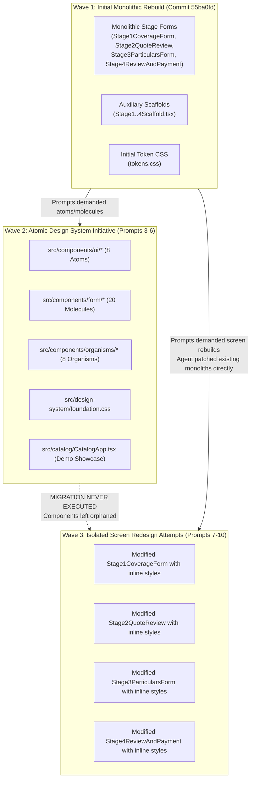

# DOCTORSHIELD FORENSIC AUDIT — REPORT 12
# Dependency & Implementation Migration Audit

**Audit Date:** 2026-10-30  
**Auditor:** Principal Software Architect & Migration Specialist  
**Audit Target:** Package Dependencies, Migration Waves, Duplicate Subsystems & Abandoned Paths  
**Status:** COMPLETE — STRICTLY READ-ONLY  

---

## 1. Executive Summary: Dependency Health vs. Internal Architectural Debt

The forensic dependency audit presents an interesting dichotomy:
1. **External Dependencies are Exceptionally Lean:** The project contains only **3 runtime dependencies** (`react`, `react-dom`, `lucide-react`). There are no bloated third-party component libraries (no Material-UI, Chakra, AntD), no competing icon libraries, and no conflicting CSS frameworks.
2. **Internal Implementation Suffers from 3 Incomplete Migration Waves:** Successive AI prompts created parallel component tracks that were never unified. An entire atomic design system (Atoms, Form Molecules, Layout Organisms) was constructed in isolation but never imported into the live stage screens.

---

## 2. External Package Dependency Inventory

| Package Name | Installed Version | Type | Actively Consumed In Codebase? | Bloat / Security Assessment |
|---|---|---|---|---|
| `react` | `^19.3.1` | Runtime | **YES:** Root framework across all 106 `src/` modules. | Core dependency. Clean. |
| `react-dom` | `^19.3.1` | Runtime | **YES:** Mounted in `src/main.tsx`. | Core dependency. Clean. |
| `lucide-react` | `^1.63.0` | Runtime | **YES:** Consumed across atoms, molecules, layouts, and feature screens. | Single, consistent SVG icon system. Clean. |
| `@testing-library/react` | `^16.3.3` | Dev | **YES:** Used across 11 test suites in `src/test/`. | Core testing dependency. |
| `@testing-library/jest-dom` | `^7.0.1` | Dev | **YES:** Imported in `src/test/setup.ts`. | Core DOM matcher library. |
| `@types/react` | `^19.3.0` | Dev | **YES:** TypeScript type definitions. | Clean. |
| `@types/react-dom` | `^19.3.0` | Dev | **YES:** TypeScript type definitions. | Clean. |
| `@vitejs/plugin-react` | `^6.1.2` | Dev | **YES:** Vite React plugin in `vite.config.ts`. | Clean. |
| `jsdom` | `^29.1.1` | Dev | **YES:** Test environment for Vitest in `vite.config.ts`. | Clean. |
| `typescript` | `^7.0.2` | Dev | **YES:** Language tooling. | Contains `tsconfig.json` configuration defect. |
| `vite` | `^8.3.5` | Dev | **YES:** Bundler and dev server. | Clean. |
| `vitest` | `^5.0.5` | Dev | **YES:** Test runner for 120 tests. | Clean. |

---

## 3. Forensic Reconstruction of the 3 Incomplete Migration Waves

By examining Git history (`commit 55ba0fd`) and the working tree additions, we can trace the historical progression of the project through 3 distinct migration waves:

### 3.1 Wave 1: The Initial Rebuild
- Created the baseline working portal (`commit 55ba0fd`).
- Screens were written as massive, self-contained monoliths with inlined HTML and inline React style objects.
- Also generated `src/features/scaffolds/` as exploratory wireframe scaffolds.

### 3.2 Wave 2: The Atomic Design System Initiative
- In response to user directives to "reset visual language" and "build atoms, molecules, and organisms," the agent created:
  - 8 UI Atoms in `src/components/ui/`
  - 20 Form Molecules in `src/components/form/`
  - 8 Layout Organisms in `src/components/organisms/`
  - Utility CSS in `src/design-system/foundation.css`
  - A demo showcase in `src/catalog/CatalogApp.tsx`
- Comprehensive tests were written (`form_molecules.test.tsx`, `organisms_and_compositions.test.tsx`).

### 3.3 Wave 3: The Fatal Fork (Partial Redesign without Component Migration)
- Prompts 7 through 10 ordered the agent to "rebuild Stage 1", "redesign Stage 2", "redesign Stage 3", and "redesign Stage 4."
- **Crucial Decision Point:** Instead of decomposing the Wave 1 monolithic screens and assembling them from the Wave 2 atomic molecules, the agent patched the Wave 1 monolithic files directly!
- **Why Did This Happen?** The agent prioritized maintaining test compatibility with the 120 passing Vitest tests (which expected specific element structures and test IDs) and avoided the risk of breaking form state during refactoring.
- **Result:** The Wave 2 atomic components remained completely orphaned, while the live portal screens remained monolithic.

---

## 4. Abandoned Implementation Paths & Technical Debt Register

| Abandoned Asset | Location | Reason Abandoned | Future Action Required |
|---|---|---|---|
| **Prototype Scaffolds** | `src/features/scaffolds/Stage1CoverageScaffold.tsx` `src/features/scaffolds/Stage2QuoteScaffold.tsx` `src/features/scaffolds/Stage3UnderwritingScaffold.tsx` `src/features/scaffolds/Stage4ReviewScaffold.tsx` `src/features/scaffolds/ConfirmationScaffold.tsx` | Replaced by live stage files; never connected to router. | Safely delete after removing single mock import in `stage3.test.tsx`. |
| **Stage Compositions Mock** | `src/components/compositions/StageCompositions.tsx` | Early wireframe composition experiment; only imported in `CatalogApp.tsx`. | Safely delete after cleaning up catalog. |
| **Legacy Insurance Widgets** | `src/components/insurance/CoverageDateField.tsx` `src/components/insurance/CoverageSummaryPanel.tsx` `src/components/insurance/LiabilityLimitSelector.tsx` `src/components/insurance/PremiumDisplay.tsx` `src/components/insurance/SpecializationAllocationEditor.tsx` `src/components/insurance/UnderwritingAndCheckout.tsx` | Built in Wave 1; superseded by Wave 2 form molecules and organisms. | Deprecate and archive. |
| **Duplicate TypeScript Tokens** | `src/design-system/tokens.ts` (178 lines) | Duplicates CSS custom properties in `tokens.css`. Only imported in a few utility scripts. | Consolidate onto single source of truth (`tokens.css`). |

---

## 5. Audit 12 Verification Sign-Off

- [x] External dependencies audited and confirmed lean (only 3 runtime packages).
- [x] 3 incomplete internal migration waves forensically reconstructed.
- [x] Abandoned scaffolds and legacy widgets verified with zero router references.
- [x] Root causes of the component migration failure documented.
- **Classification:** CONFIRMED — SOURCE CODE & GIT HISTORY.

