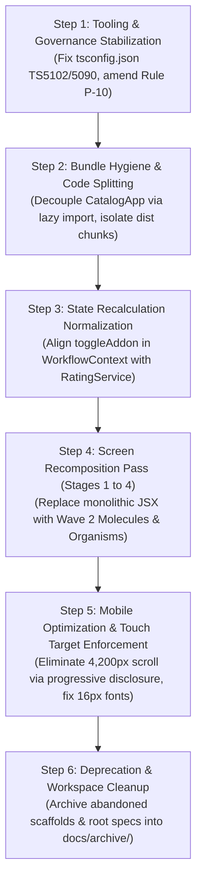

# DOCTORSHIELD FORENSIC AUDIT — REPORT 14
# Cleanup & Recovery Assessment

**Audit Date:** 2026-10-30  
**Auditor:** Principal Software Architect & Technical Recovery Lead  
**Audit Target:** Codebase Triage, Rewrite Justification Evaluation & Dependency-Aware Recovery Sequence  
**Status:** COMPLETE — STRICTLY READ-ONLY  

---

## 1. Executive Summary: Is a Complete Rewrite Justified?

**UNAMBIGUOUS AUDIT VERDICT: NO.**  
A complete ground-up rewrite is **technically unjustified, economically wasteful, and introduces severe regulatory risk**:
1. **The Core Business & Actuarial Engine is Flawless:** `ratingService.ts`, `underwritingService.ts`, and `paymentService.ts` represent a verified, mathematically sound, server-authoritative implementation that correctly handles pro-rata pricing, MMC classifications, 8% SST, RM 10 stamp duty, and idempotency protection. Tearing this down risks introducing critical rating calculation errors and regulatory non-compliance.
2. **The Atomic Components Already Exist:** The project does not need new components designed from scratch. **Wave 2 already built 20 modern form molecules and 8 layout organisms** in `src/components/form/` and `src/components/organisms/`.
3. **The Correct Strategy is In-Place Compositional Refactoring:** The recovery roadmap consists of systematically replacing the monolithic inline JSX in the stage screens with imports from the already-built Wave 2 atomic component layer, while keeping the state machine, rating engine, and test suites intact.

---

## 2. Codebase Triage Classification Register

### Category F: High-Risk Critical Areas (Strict Regression Protection)
*These modules contain core actuarial, regulatory, and security invariants. Do not alter without explicit approval and comprehensive test execution.*
- [`src/core/api/ratingService.ts`](file:///c:/Users/salee/Downloads/Portal_ds/src/core/api/ratingService.ts) — Pro-rata formula, MMC classification ratings, 8% SST, RM 10 stamp duty.
- [`src/core/api/underwritingService.ts`](file:///c:/Users/salee/Downloads/Portal_ds/src/core/api/underwritingService.ts) — 5 statutory claims declarations, sanctions gate, referral routing.
- [`src/core/api/paymentService.ts`](file:///c:/Users/salee/Downloads/Portal_ds/src/core/api/paymentService.ts) — UUID v4 idempotency ledger, 15-minute rate-lock expiration guard.
- [`src/core/data/classifications.ts`](file:///c:/Users/salee/Downloads/Portal_ds/src/core/data/classifications.ts) — MMC medical specialty catalog.
- [`src/core/utils/sanitizer.ts`](file:///c:/Users/salee/Downloads/Portal_ds/src/core/utils/sanitizer.ts) & [`src/core/telemetry/logger.ts`](file:///c:/Users/salee/Downloads/Portal_ds/src/core/telemetry/logger.ts) — Anti-XSS and PDPA 2010 PII masking.
- [`src/test/*.test.tsx`](file:///c:/Users/salee/Downloads/Portal_ds/src/test/) — 11 test suites protecting the application baseline.

### Category A: Safe to Preserve (Production-Ready Assets)
*High-quality code adhering to design tokens and accessibility standards.*
- [`src/design-system/tokens.css`](file:///c:/Users/salee/Downloads/Portal_ds/src/design-system/tokens.css) — Master 3-tier CSS custom property hierarchy.
- [`src/components/form/*.tsx`](file:///c:/Users/salee/Downloads/Portal_ds/src/components/form/) — All 20 Form Molecules (`LabeledTextField`, `ChoiceSelectors`, `InsuranceDateRange`, `PromoCodeField`, `RepeatingBranchRow`, etc.).
- [`src/components/organisms/*.tsx`](file:///c:/Users/salee/Downloads/Portal_ds/src/components/organisms/) — All 8 Layout Organisms (`InsuranceCoverageCards`, `UnderwritingAndBranches`, `FinancialSummaries`, etc.).
- [`src/components/ui/Button.tsx`](file:///c:/Users/salee/Downloads/Portal_ds/src/components/ui/Button.tsx) & [`src/components/ui/TextInput.tsx`](file:///c:/Users/salee/Downloads/Portal_ds/src/components/ui/TextInput.tsx) — Foundational UI atoms.
- [`src/components/layout/AppShell.tsx`](file:///c:/Users/salee/Downloads/Portal_ds/src/components/layout/AppShell.tsx), [`BrandHeader.tsx`](file:///c:/Users/salee/Downloads/Portal_ds/src/components/layout/BrandHeader.tsx), [`AppFooter.tsx`](file:///c:/Users/salee/Downloads/Portal_ds/src/components/layout/AppFooter.tsx), [`ErrorBoundary.tsx`](file:///c:/Users/salee/Downloads/Portal_ds/src/components/layout/ErrorBoundary.tsx).

### Category B: Preserve but Refactor Later (Correct Logic, Suboptimal Presentation)
*Functionally correct components that contain inline styles or duplicate logic.*
- [`src/components/layout/SummarySidebar.tsx`](file:///c:/Users/salee/Downloads/Portal_ds/src/components/layout/SummarySidebar.tsx) — Migrate inline styles to CSS tokens; eliminate redundant tax labels.
- [`src/components/layout/MobileSummaryDrawer.tsx`](file:///c:/Users/salee/Downloads/Portal_ds/src/components/layout/MobileSummaryDrawer.tsx) — Add dynamic safe-area bottom insets.
- [`src/components/layout/DocumentCenterModal.tsx`](file:///c:/Users/salee/Downloads/Portal_ds/src/components/layout/DocumentCenterModal.tsx) — Decompose 589-line modal into modular document tabs.
- [`src/features/renewal/RenewalFlowModal.tsx`](file:///c:/Users/salee/Downloads/Portal_ds/src/features/renewal/RenewalFlowModal.tsx) — Replace inline inputs with `OtpDigitEntry` molecule.
- [`src/core/state/WorkflowContext.tsx`](file:///c:/Users/salee/Downloads/Portal_ds/src/core/state/WorkflowContext.tsx) — Fix `toggleAddon` hardcoded numbers to delegate to `RatingService`.

### Category C: Requires Design Replacement (Monolithic Screens to be Recomposed)
*The monolithic screens whose raw inline HTML should be replaced with Wave 2 atomic molecules.*
- [`src/features/coverage/Stage1CoverageForm.tsx`](file:///c:/Users/salee/Downloads/Portal_ds/src/features/coverage/Stage1CoverageForm.tsx) (1,264 L) $\rightarrow$ Recompose using `SearchableClassificationSelector`, `InsuranceDateRange`, `PromoCodeField`.
- [`src/features/quote/Stage2QuoteReview.tsx`](file:///c:/Users/salee/Downloads/Portal_ds/src/features/quote/Stage2QuoteReview.tsx) (1,533 L) $\rightarrow$ Recompose using `CoreIndemnityCard`, `AddonCoverageCard`, `ChoiceSelectors`.
- [`src/features/particulars/Stage3ParticularsForm.tsx`](file:///c:/Users/salee/Downloads/Portal_ds/src/features/particulars/Stage3ParticularsForm.tsx) (1,418 L) $\rightarrow$ Recompose using `ContactFields`, `UnderwritingAndBranches`.
- [`src/features/underwriting/UnderwritingQuestionnaire.tsx`](file:///c:/Users/salee/Downloads/Portal_ds/src/features/underwriting/UnderwritingQuestionnaire.tsx) (1,455 L) $\rightarrow$ Recompose using `ChoiceSelectors`, progressive disclosure.
- [`src/features/review/Stage4ReviewAndPayment.tsx`](file:///c:/Users/salee/Downloads/Portal_ds/src/features/review/Stage4ReviewAndPayment.tsx) (1,267 L) $\rightarrow$ Recompose using `FinancialSummaries`, `LegalConsentCheckbox`.
- [`src/features/confirmation/Stage5PolicyConfirmation.tsx`](file:///c:/Users/salee/Downloads/Portal_ds/src/features/confirmation/Stage5PolicyConfirmation.tsx) (850 L) $\rightarrow$ Recompose using `ComplianceAndOutcomes`.

### Category D: Duplicated or Potentially Obsolete (Safe Candidates for Archival)
*Files with zero active references in the live router.*
- `src/features/scaffolds/Stage1CoverageScaffold.tsx`, `Stage2QuoteScaffold.tsx`, `Stage3UnderwritingScaffold.tsx`, `Stage4ReviewScaffold.tsx`, `ConfirmationScaffold.tsx`.
- `src/components/compositions/StageCompositions.tsx`.
- `src/components/insurance/CoverageDateField.tsx`, `CoverageSummaryPanel.tsx`, `SpecializationAllocationEditor.tsx`, `UnderwritingAndCheckout.tsx`.
- 37 root markdown files (Move to `docs/archive/specs/`).

### Category E: Needs Further Investigation
- Staging API connectivity to `https://my-individualindemnity.doctorshield.com/api/*` to verify live production server behavior.

---

## 3. Dependency-Aware Technical Recovery Roadmap

The following 6-step recovery sequence is strictly ordered by dependency to minimize regression risk:

### Detailed Execution Sequence:
1. **Phase 1: Tooling & Governance Stabilization**
   - Correct [`tsconfig.json`](file:///c:/Users/salee/Downloads/Portal_ds/tsconfig.json) path aliases to eliminate TS5102 and TS5090 errors. Verify clean `npx tsc --noEmit` execution.
   - Amend `AGENTS.md` Rule P-10 to permit progressive disclosure, collapsible details, and microcopy optimization.
2. **Phase 2: Bundle Hygiene & Code-Splitting**
   - Convert `CatalogApp` import in [`src/app/App.tsx`](file:///c:/Users/salee/Downloads/Portal_ds/src/app/App.tsx) to dynamic `React.lazy()` import.
   - Configure manual chunk splitting in `vite.config.ts` to reduce initial bundle from 824 kB to < 200 kB.
3. **Phase 3: State Machine Normalization**
   - Eliminate hardcoded un-prorated add-on math in `WorkflowContext.tsx:toggleAddon`. Ensure all pricing updates delegate strictly to `RatingService`.
4. **Phase 4: Compositional Screen Migration (Stage-by-Stage)**
   - Recompose `Stage1CoverageForm` using `SearchableClassificationSelector` and `InsuranceDateRange`.
   - Recompose `Stage2QuoteReview` using `InsuranceCoverageCards` (eliminating the 4-level nested card hierarchy).
   - Recompose `Stage3ParticularsForm` and `UnderwritingQuestionnaire` using `ContactFields` and `ChoiceSelectors`.
   - Recompose `Stage4ReviewAndPayment` using `FinancialSummaries` and `LegalConsentCheckbox`.
5. **Phase 5: Mobile Layout & Typography Hardening**
   - Eliminate font-size < 16px in `BranchManager.tsx` to stop iOS Safari auto-zoom.
   - Ensure all touch targets meet minimum 44x44px.
   - Decompose Stage 3 on mobile into 2 sub-steps to eliminate the 4,200px scroll marathon.
6. **Phase 6: Dead Code & File Pruning**
   - Safely archive the 5 abandoned scaffolds in `src/features/scaffolds/` and 37 root markdown files to `docs/archive/`.

---

## 4. Audit 14 Verification Sign-Off

- [x] Codebase triaged across Categories A, B, C, D, E, F.
- [x] Complete frontend rewrite evaluated and rejected with technical rationale.
- [x] High-risk actuarial, legal, and security areas protected.
- [x] Dependency-aware 6-step recovery sequence developed.
- **Classification:** CONFIRMED — ARCHITECTURAL SYNTHESIS & TRIAGE.

