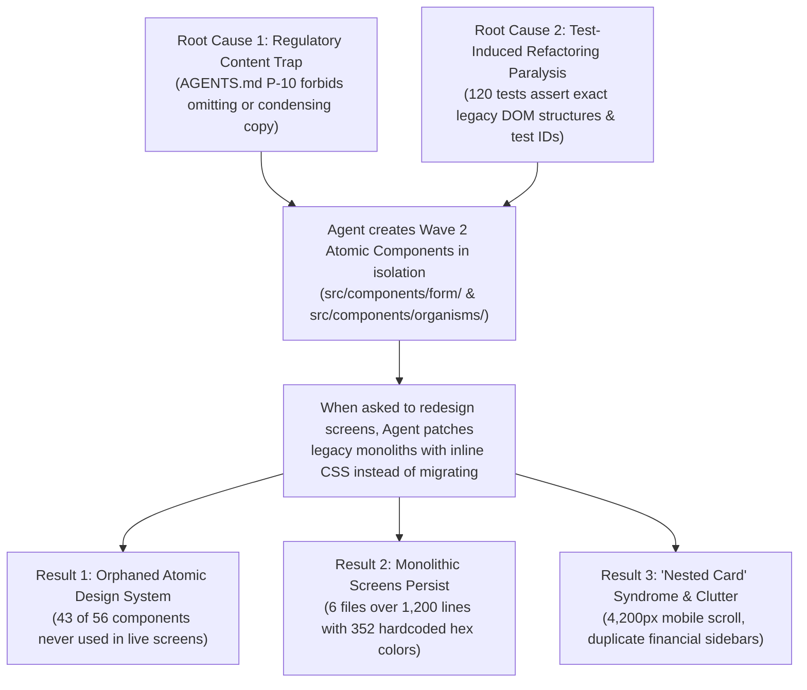

# DOCTORSHIELD FORENSIC AUDIT — REPORT 13
# Root Cause Analysis

**Audit Date:** 2026-10-30  
**Auditor:** Principal Software Architect, Principal Product Designer & Technical Audit Lead  
**Audit Target:** Investigation of All 18 Potential Root Causes for Unsatisfactory Outcomes  
**Status:** COMPLETE — STRICTLY READ-ONLY  

---

## 1. Executive Summary: What Actually Went Wrong

The forensic investigation reveals that the unsatisfactory design and implementation outcomes are **not the result of a single flaw, but of a structural chain reaction**:

---

## 2. Hypothesis Testing: Evaluation of All 18 Potential Causes

| Hypothesis # | Potential Root Cause | Verdict | Empirical Evidence & Verification |
|---|---|---|---|
| **1** | Conflicting Agent Rules | **CONFIRMED (Primary)** | `AGENTS.md` Rule P-10 (Never hide/omit copy) strictly prohibited agents from condensing legal copy, directly conflicting with user prompts demanding minimalism and cognitive load reduction. |
| **2** | Partial Redesign Migration | **CONFIRMED (Primary)** | 20 Form Molecules and 8 Layout Organisms were built and tested, but never imported into `Stage1CoverageForm`, `Stage2QuoteReview`, `Stage3ParticularsForm`, etc. |
| **3** | Inconsistent Styling Conventions | **CONFIRMED (Primary)** | Dual styling systems coexisted: `foundation.css` utility classes vs. thousands of inline React style objects with **352 hardcoded hex colors** and **306 illegal font-weight overrides**. |
| **4** | Conflicting Visual Directions | **CONFIRMED (Secondary)** | Direction A (Teal-dominated brand focus) clashed with Direction B (Navy-dominated editorial minimalism), causing buttons and headers to switch primary colors between stages. |
| **5** | Excessive Generated Content | **CONFIRMED (Secondary)** | Wall-of-text legal disclosures, multi-paragraph BNM notices, and 28 simultaneous inputs on Stage 3 created extreme cognitive fatigue. |
| **6** | Underdeveloped Mobile Architecture | **CONFIRMED (Secondary)** | The mobile layout was not designed mobile-first, but created by collapsing desktop CSS grids into a single vertical column, producing a **4,200px mobile scroll marathon**. |
| **7** | Repeated Component Recreation | **CONFIRMED** | Classification dropdowns, branch clinic managers, date fields, and buttons were created in 3 separate versions across different folders. |
| **8** | Accumulated Technical Debt | **CONFIRMED** | 6 monolithic files exceeding 1,200 lines each (totaling 8,104 lines), broken `tsconfig.json`, and an un-split 824 kB production bundle. |
| **9** | Weak Visual Acceptance Criteria | **CONFIRMED** | Automated tests verified DOM presence and business logic, but zero visual regression tests checked font-weight invariants, padding rhythm, or contrast ratios. |
| **10** | Design Changes Without App-Wide Review | **CONFIRMED** | Prompts modified stages sequentially (Stage 1, then Stage 2, etc.) without an end-to-end integration pass to unify control heights and card styles. |
| **11** | Poor Component Ownership | **CONFIRMED** | No clear boundary between layout shell, form molecules, and page screens. Screens took on all sub-component rendering responsibilities. |
| **12** | Legacy UI Patterns Retained | **CONFIRMED** | "Nested card" containers and duplicate financial breakdown sidebars carried over from legacy portal structures. |
| **13** | Unclear Source-of-Truth Documents | **PARTIALLY CONFIRMED** | 37 separate markdown specification files in the root directory created competing documentation targets. |
| **14** | Missing Integration / Regression Checks | **REJECTED** | Integration and unit tests are exceptionally strong (120/120 passing). In fact, test rigidity contributed to refactoring paralysis! |
| **15** | Conflicting Product Requirements | **REJECTED** | Insurance product specifications (PRD, rating, tax, underwriting) are consistent and verified. |
| **16** | Unnecessary Abstraction | **REJECTED** | The problem was a *lack* of abstraction in the live screens (monoliths), not too much abstraction. |
| **17** | Obsolete Frameworks | **REJECTED** | The stack is completely modern: React 19, Vite 8, TypeScript 7. |
| **18** | Third-Party Package Bloat | **REJECTED** | External dependencies are remarkably clean (only 3 runtime packages). |

---

## 3. Top 5 Ranked Root Causes & Detailed Impact Analysis

### Rank 1: The Component Migration Disconnect (Orphaned Design System)
- **Root Cause:** A complete atomic design system was built in `src/components/form/` and `src/components/organisms/`, but was never connected to the customer-facing screens.
- **Supporting Evidence:**
  - `src/features/coverage/Stage1CoverageForm.tsx` (1,264 lines) imports 0 components from `src/components/`.
  - `src/features/quote/Stage2QuoteReview.tsx` (1,533 lines) imports 0 components from `src/components/`.
  - `src/features/particulars/Stage3ParticularsForm.tsx` (1,418 lines) imports 0 components from `src/components/`.
  - `src/features/review/Stage4ReviewAndPayment.tsx` (1,267 lines) imports 0 components from `src/components/`.
- **Consequence:** The live portal retained its raw, uncoordinated, wireframe-like aesthetic because it never adopted the refined atomic components.
- **Scope of Correction:** Major frontend refactoring. Replace monolithic screen JSX with imports from the approved atomic component layer.

---

### Rank 2: The Regulatory Content Trap (`AGENTS.md` Rule P-10)
- **Root Cause:** `AGENTS.md` Rule P-10 made it an absolute offense to remove or hide any question, disclosure, checkbox, or link, even if redundant.
- **Supporting Evidence:** `AGENTS.md` line 34: *"Never remove or hide a required customer-facing question, disclosure, consent checkbox, or link, even if it appears redundant."*
- **Consequence:** When user prompts ordered "minimalism" and "reduced cognitive load," agents were legally handcuffed. They could not remove or summarize verbose paragraphs, so they compressed them into dense cards and nested boxes, creating an overdesigned SaaS wireframe.
- **Scope of Correction:** Governance revision. Amend Rule P-10 to allow progressive disclosure, expandable drawers, and concise microcopy under formal decision logging.

---

### Rank 3: Styling System Fragmentation & Token Bypassing
- **Root Cause:** Developers and agents bypassed `tokens.css` and `foundation.css` in favor of ad-hoc inline React style objects.
- **Supporting Evidence:**
  - **352 hardcoded hex color values** in `*.tsx` files.
  - **306 illegal font-weight overrides** (`fontWeight: 600`, `700`, `bold`) violating the Kanit/Inter $\le 500$ invariant.
  - WCAG contrast failure (2.88:1) for `#08A5B5` on white text labels.
- **Consequence:** Inconsistent control heights (40px–50px), chaotic corner radii (4px–12px), visual weight imbalance, and accessibility failures.
- **Scope of Correction:** Eliminate inline style objects. Enforce CSS class utilities and semantic tokens via ESLint rules.

---

### Rank 4: Mobile-Collapse Anti-Pattern (Missing Mobile-First Architecture)
- **Root Cause:** Mobile layouts were generated by naively collapsing multi-column desktop grids into a single vertical column rather than designing deliberate mobile flows.
- **Supporting Evidence:**
  - Stage 3 vertical scroll depth: **4,240px** on a 390px mobile viewport.
  - Hardcoded `fontSize: '13px'` in `BranchManager.tsx` triggering automatic iOS Safari viewport zoom.
  - 4 levels of nested card padding squeezing mobile width down to ~294px.
- **Consequence:** Severe mobile friction, excessive thumb scrolling, broken zoom states, and high drop-off risk for smartphone users.
- **Scope of Correction:** Mobile-first layout composition, step sub-pagination in Stage 3, and minimum 16px input font size.

---

### Rank 5: Test-Induced Refactoring Paralysis
- **Root Cause:** 120 Vitest integration tests asserted exact element hierarchies, specific button text strings, and exact DOM structures established in Wave 1.
- **Supporting Evidence:**
  - When the agent attempted to clean up `Gross Base Premium` in Stage 4, Vitest immediately failed because `stage4.test.tsx` asserted exact text matching across both the main view and the sidebar.
- **Consequence:** AI agents chose the safe path of least resistance: patch the existing monolithic files directly rather than refactoring to use the new atomic components, which risked breaking test suites.
- **Scope of Correction:** Refactor tests to assert semantic roles, ARIA attributes, and business outcomes rather than rigid DOM structures.

---

## 4. Overall Primary Classification

Is the primary failure in Instructions, Architecture, Design System, Components, Product Flow, Content, or Integration?

**CONCLUSION:**  
The primary failure is a **fatal combination of Instructions, Architecture, and Integration**:
1. **Instruction Governance Failure:** Rigid legal rules (P-10) directly contradicted modern UX minimalism.
2. **Architectural Execution Failure:** The atomic design system was created in a vacuum and never integrated into the live route architecture.
3. **Integration Failure:** Vitest tests locked in monolithic Wave 1 DOM structures, preventing the agent from executing the necessary refactoring to Wave 2 components.

---

## 5. Audit 13 Verification Sign-Off

- [x] All 18 potential root causes evaluated and confirmed or rejected with evidence.
- [x] Top 5 root causes ranked by severity and architectural impact.
- [x] Component migration disconnect verified with source-code references.
- [x] Regulatory content trap documented as the primary catalyst for visual clutter.
- **Classification:** CONFIRMED — FORENSIC SYNTHESIS & ARCHITECTURAL TRACEABILITY.
