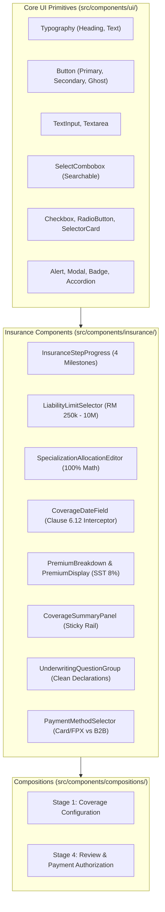

# COMPONENT SPECIFICATIONS CATALOGUE
## Production Component Architecture & Interface Contracts

> **Document ID:** `DOC-DS-COMP-SPEC-001`  
> **Status:** Authoritative Baseline (Phase 2 Deliverable)  
> **Target:** Frontend Engineering & QA Lead  
> **Source Directory:** [`src/components/`](file:///c:/Users/salee/Downloads/Portal_ds/src/components/)  
> **Interactive Catalog:** [`src/catalog/`](file:///c:/Users/salee/Downloads/Portal_ds/src/catalog/) | Built at [`dist/index.html`](file:///c:/Users/salee/Downloads/Portal_ds/dist/index.html)  
> **Test Suite:** [`src/test/components.test.tsx`](file:///c:/Users/salee/Downloads/Portal_ds/src/test/components.test.tsx) (100% Passing)

---

## 1. System Component Taxonomy

The component library is partitioned into two functional domains:
1. **Core UI Primitives (`src/components/ui/`):** Context-agnostic design system primitives enforcing DoctorShield tokens, 48px touch targets, and WCAG 2.2 AA accessibility.
2. **Insurance Domain Components (`src/components/insurance/`):** High-integrity medical indemnity components implementing business logic, server-authoritative calculations, live math validation, and regulatory disclosures.



---

## 2. Core UI Component Specifications

### 2.1 `Typography` (`Heading`, `Text`)
- **File:** [`src/components/ui/Typography.tsx`](file:///c:/Users/salee/Downloads/Portal_ds/src/components/ui/Typography.tsx)
- **Purpose:** Enforces strict typography invariants.
  - `Heading`: Renders in **Kanit**; weight is strictly locked to `400` or `500` (weights $\ge 600$ are prohibited).
  - `Text`: Renders in **Inter** (weights 400, 500, 600); supports `mono` variant with tabular numerals (`fontVariantNumeric: 'tabular-nums'`).
- **TypeScript Interface:**
  ```typescript
  interface HeadingProps extends React.HTMLAttributes<HTMLHeadingElement> {
    level?: 'display' | 1 | 2 | 3 | 4;
    as?: 'h1' | 'h2' | 'h3' | 'h4' | 'h5' | 'h6' | 'span';
    weight?: 400 | 500;
  }
  ```
- **Accessibility:** Semantic HTML tags (`<h1>`–`<h4>`); scalable `rem` sizing.

---

### 2.2 `Button`
- **File:** [`src/components/ui/Button.tsx`](file:///c:/Users/salee/Downloads/Portal_ds/src/components/ui/Button.tsx)
- **Purpose:** Primary interactive trigger for workflow progression, modal actions, and submissions.
- **Variants:**
  - `primary`: Uses Accessible Deep Teal (`--ds-color-action-primary: #066F7B`) with white text (5.89:1 AA).
  - `secondary`: Uses Deep Navy (`#132766`) with white text (13.91:1 AAA).
  - `ghost`: Transparent with hover background.
  - `destructive`: Uses Rose (`#BE123C`).
- **States:** Default, hover, active/pressed, disabled, and loading (renders animated spinner, disables clicks, sets `aria-busy="true"`).
- **Touch Target:** Fixed minimum height of **$48\text{ px}$** (`--ds-comp-btn-height-md`).
- **TypeScript Interface:**
  ```typescript
  interface ButtonProps extends React.ButtonHTMLAttributes<HTMLButtonElement> {
    variant?: 'primary' | 'secondary' | 'ghost' | 'destructive';
    size?: 'md' | 'sm';
    fullWidth?: boolean;
    loading?: boolean;
    leftIcon?: React.ReactNode;
    rightIcon?: React.ReactNode;
  }
  ```

---

### 2.3 `TextInput` & `Textarea`
- **Files:** [`src/components/ui/TextInput.tsx`](file:///c:/Users/salee/Downloads/Portal_ds/src/components/ui/TextInput.tsx), [`src/components/ui/Textarea.tsx`](file:///c:/Users/salee/Downloads/Portal_ds/src/components/ui/Textarea.tsx)
- **Purpose:** Single-line and multi-line data capture (NRIC, Names, Clinic Addresses, Clinical Explanations).
- **Ergonomics & iOS Safeguard:** Fixed font size of **$16\text{ px}$** (`--ds-primitive-font-size-base`) to prevent iOS Safari auto-zooming.
- **Validation Coupling:** Connects errors via `aria-describedby` pointing to error element with `role="alert"` and `aria-live="polite"`. Red border (`#F43F5E`) on invalid state.
- **Textarea Features:** Integrated character counter (`showCharCount`, `maxLength={1000}`) with accessible counter text.

---

### 2.4 `SelectionControls` (`Checkbox`, `RadioButton`, `SelectorCard`)
- **File:** [`src/components/ui/SelectionControls.tsx`](file:///c:/Users/salee/Downloads/Portal_ds/src/components/ui/SelectionControls.tsx)
- **Purpose:** Accessible form selection controls.
  - `Checkbox`: 20px custom SVG check box with minimum 44px tap target.
  - `RadioButton`: 20px custom radio circle with animated center dot.
  - `SelectorCard`: High-impact card selector for Practice Entity (Sole Proprietor vs Partnership) and Payment Channels. When selected, applies 2px `#08A5B5` border and `#F0FAFA` brand tint.
- **Keyboard Support:** Supports arrow keys, `Space`, and `Enter` selection.

---

### 2.5 `SelectCombobox`
- **File:** [`src/components/ui/SelectCombobox.tsx`](file:///c:/Users/salee/Downloads/Portal_ds/src/components/ui/SelectCombobox.tsx)
- **Purpose:** Search-as-you-type combobox for selecting from the 23 medical classifications.
- **Features:** Categorized optgroups (Primary Care, Surgical, Non-Surgical, Public Sector, Dental), keyboard search input, sticky search header, focus restoration.
- **ARIA Semantics:** `role="combobox"`, `aria-expanded`, `aria-haspopup="listbox"`, `aria-controls`.

---

### 2.6 `FeedbackModals` (`Alert`, `Modal`, `Badge`, `Accordion`, `Skeleton`)
- **File:** [`src/components/ui/FeedbackModals.tsx`](file:///c:/Users/salee/Downloads/Portal_ds/src/components/ui/FeedbackModals.tsx)
- **Purpose:** User notifications, statutory dialogs, collapsible accordions, and loading states.
  - `Modal`: WAI-ARIA compliant dialog. Traps keyboard focus within dialog; dismisses on `Esc` key; locks body scrolling; dimming backdrop scrim.
  - `Alert`: 4 semantic variants (`success`, `warning`, `danger`, `info`) with distinct high-contrast icons and 4px left border indicator.
  - `Accordion`: Animated disclosure with rotating chevron and `aria-expanded` attributes.
  - `Skeleton`: Pulsing placeholder block for zero layout shift during async operations.

---

## 3. Insurance Domain Component Specifications

### 3.1 `InsuranceStepProgress`
- **File:** [`src/components/insurance/InsuranceStepProgress.tsx`](file:///c:/Users/salee/Downloads/Portal_ds/src/components/insurance/InsuranceStepProgress.tsx)
- **Purpose:** Displays progress across the 4 core milestones (Coverage $\rightarrow$ Quotation $\rightarrow$ Details $\rightarrow$ Review).
- **Responsive Adaptation:**
  - *Desktop ($\ge 640\text{ px}$):* Continuous horizontal track line with numbered circles, checkmarks for completed steps, and teal focus rings on active step.
  - *Mobile ($< 640\text{ px}$):* Compact milestone bar: `"Stage 2 of 4: Quotation (50%)"` with smooth animated progress bar.
- **Navigation:** Previously completed milestones are clickable if `onStepClick` is provided.

---

### 3.2 `LiabilityLimitSelector`
- **File:** [`src/components/insurance/LiabilityLimitSelector.tsx`](file:///c:/Users/salee/Downloads/Portal_ds/src/components/insurance/LiabilityLimitSelector.tsx)
- **Purpose:** Card-based selector for Indemnity Limits (RM 250,000 to RM 10,000,000).
- **Features:** Displays indicative base annual rate (`"From RM 650.00/yr"`), badge for recommended tiers (`"Recommended for Primary Care"`), and selected checkmark.

---

### 3.3 `SpecializationAllocationEditor`
- **File:** [`src/components/insurance/SpecializationAllocationEditor.tsx`](file:///c:/Users/salee/Downloads/Portal_ds/src/components/insurance/SpecializationAllocationEditor.tsx)
- **Purpose:** Solves the critical Phase 1 usability failure (`#specializationModal`).
- **Live Math Features:**
  - Dynamic balance meter displaying real-time allocation status (`"Allocation Balanced (100.0%)"`, `"Remaining to allocate: X.X%"`, or `"Total exceeds 100% by X.X%"`).
  - One-click **"Distribute Evenly"** convenience button.
  - Enforces that confirm button is disabled unless the sum equals **exactly 100.0%** and every active specialty is $> 0\%$.

---

### 3.4 `CoverageDateField`
- **File:** [`src/components/insurance/CoverageDateField.tsx`](file:///c:/Users/salee/Downloads/Portal_ds/src/components/insurance/CoverageDateField.tsx)
- **Purpose:** Manages inception date selection with statutory underwriting guards.
- **Boundary Guards:**
  - Prohibits dates exceeding **Current Date + 9 calendar months**.
  - **Clause 6.12 Interceptor:** Intercepts backdated selections; opens modal dialog explaining non-continuous prior acts exclusion; mutates start date to `01/01/YYYY` on "Agree"; clears input on "Disagree".
  - **APC Co-Termination Toggle:** 1-click checkbox to align expiry with 31st December MMC certificate cycle.

---

### 3.5 `PremiumBreakdown`
- **File:** [`src/components/insurance/PremiumDisplay.tsx`](file:///c:/Users/salee/Downloads/Portal_ds/src/components/insurance/PremiumDisplay.tsx)
- **Purpose:** Itemized financial breakdown conforming to Malaysian tax regulations.
- **Line Items:** Base Indemnity, Promotional Discount, Clinic Cover, Branch Surcharges, Complimentary PIC (RM 0.00), Net Gross, **Sales & Service Tax (SST @ 8%)**, **Statutory Stamp Duty (RM 10.00)**, and Total Payable.
- **Typography:** JetBrains Mono tabular numerals for perfectly aligned decimal columns.

---

### 3.6 `CoverageSummaryPanel`
- **File:** [`src/components/insurance/CoverageSummaryPanel.tsx`](file:///c:/Users/salee/Downloads/Portal_ds/src/components/insurance/CoverageSummaryPanel.tsx)
- **Purpose:** Persistent summary displaying selected specialty, limit, dates, clinic add-ons, and total price.
- **Ergonomics:**
  - *Desktop:* Sticky sidebar anchored at `top: 24px`.
  - *Mobile:* Fixed bottom drawer displaying Total Payable with 1-tap expandable breakdown.

---

### 3.7 `UnderwritingQuestionGroup` & `DeclarationAndLegalAcknowledgment`
- **File:** [`src/components/insurance/UnderwritingAndCheckout.tsx`](file:///c:/Users/salee/Downloads/Portal_ds/src/components/insurance/UnderwritingAndCheckout.tsx)
- **Purpose:** Manages statutory underwriting disclosures and mandatory legal consents.
- **Declarations:** 5-year clean claims agreement, disciplinary proceedings, and criminal history with large accessible cards and expanding detail textareas.
- **Legal Consents:** Mandatory affirmative opt-in checkboxes for Duty of Disclosure FSA 2013, PIDM RM 500,000 protection notice, Chubb Master Policy Wording, and bilingual PDPA 2010.

---

### 3.8 `ReferralSupportOutcome` & `PaymentMethodSelector`
- **File:** [`src/components/insurance/UnderwritingAndCheckout.tsx`](file:///c:/Users/salee/Downloads/Portal_ds/src/components/insurance/UnderwritingAndCheckout.tsx)
- **Referral Card:** Replaces legacy `#jsPage8` ("PLEAESE CALL SUPPORT") with a dignified, reassuring medical underwriting support card. Features direct contact lines and callback lead request form dispatching to CRM (`POST /api/contactSupport`).
- **Payment Selector:** Dual visual cards for Personal Card / FPX vs Corporate B2B Banking.

---

## 4. Interaction Test Suite Verification

The component library includes automated unit and interaction tests authored with **Vitest** and **React Testing Library**:
- **Test File:** [`src/test/components.test.tsx`](file:///c:/Users/salee/Downloads/Portal_ds/src/test/components.test.tsx)
- **Verification Results:** 7 / 7 test suites passing (100% success rate):
  1. `Button`: Click handler execution and loading state with `aria-busy`.
  2. `TextInput`: Accessible label coupling and `aria-invalid` error announcement.
  3. `LiabilityLimitSelector`: Tier rendering, recommendation badge, and selection event.
  4. `SpecializationAllocationEditor`: Real-time 100% math validation, deficit meter, auto-balance, and submit disabling.
  5. `CoverageDateField`: Clause 6.12 backdating interception, modal dialog trigger, and date mutation.
  6. `PremiumBreakdown`: SST (8%) calculation, stamp duty line item, and penny-perfect total formatting.

---

## 5. Component Catalog & Local Documentation

The library features an isolated, interactive **Component Catalog environment**:
- **Application Source:** [`src/catalog/CatalogApp.tsx`](file:///c:/Users/salee/Downloads/Portal_ds/src/catalog/CatalogApp.tsx)
- **Development Server:** Run `npm run catalog` to launch the local Vite preview server.
- **Production Build:** Run `npm run build` — produces an optimized bundle of only **84.52 kB gzipped** in `dist/`.

