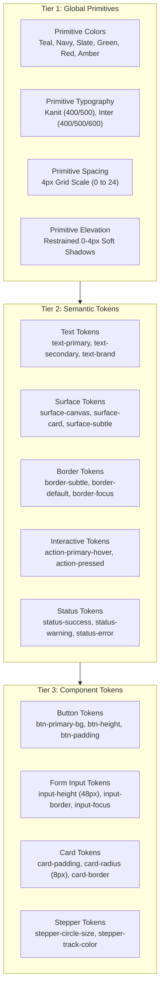

# DOCTORSHIELD DESIGN SYSTEM FOUNDATIONS
## Production-Grade Design Token & Architectural System

> **Document ID:** `DOC-DS-FOUND-001`  
> **Version:** 1.0.0 (Production Candidate)  
> **Status:** Authoritative Baseline (Phase 2 Deliverable)  
> **Brand Foundations:** Primary `#08A5B5` | Secondary `#132766` | Kanit ($\le 500$) | Inter  
> **Accessibility Standard:** WCAG 2.2 Level AA Strict (Targeting AAA for core text)  
> **Source Files:** [`src/design-system/tokens.css`](file:///c:/Users/salee/Downloads/Portal_ds/src/design-system/tokens.css), [`src/design-system/tokens.ts`](file:///c:/Users/salee/Downloads/Portal_ds/src/design-system/tokens.ts), [`src/design-system/tokens.json`](file:///c:/Users/salee/Downloads/Portal_ds/src/design-system/tokens.json)

---

## 1. System Vision & Architecture

The DoctorShield Design System is a **tailored, institutional healthcare design architecture**. It purposefully rejects generic UI library defaults in favor of a bespoke visual language that embodies:
1. **Calm Healthcare Credibility:** Medical indemnity is serious financial protection. Visual styling must be light, refined, uncluttered, and trustworthy.
2. **Mathematical Accessibility (WCAG 2.2 AA):** Every color combination, focus state, touch target, and typographic hierarchy is mathematically verified for contrast and ergonomics.
3. **Strict 3-Tier Token Hierarchy:** Clean separation of concerns between raw primitives, contextual semantic meanings, and component-specific variables.



---

## 2. The 3-Tier Token Architecture

1. **Primitive Tokens (`--ds-primitive-*`):**
   - Context-agnostic raw values (e.g. `--ds-primitive-color-teal-500: #08A5B5;`, `--ds-primitive-space-4: 16px;`).
   - Defined once. Never referenced directly in component source code.
2. **Semantic Tokens (`--ds-color-*`, `--ds-space-*`, `--ds-font-*`):**
   - Assign design purpose to primitives (e.g. `--ds-color-text-primary: var(--ds-primitive-color-slate-900);`, `--ds-color-action-primary: var(--ds-primitive-color-teal-600);`).
   - The primary API consumed by layout containers and common styling.
3. **Component Tokens (`--ds-comp-*`):**
   - Scoped strictly to specific component atoms (e.g. `--ds-comp-input-height: 48px;`, `--ds-comp-btn-primary-bg: var(--ds-color-action-primary);`).
   - Enables fine-grained local overrides without polluting the global token namespace.

---

## 3. Brand Foundations & Derived Palette

### 3.1 Official Brand Values
- **`brand.primary` = `#08A5B5`** (Vibrant Malaysian Healthcare Teal)
- **`brand.secondary` = `#132766`** (Institutional Deep Navy)

### 3.2 The Contrast Reality & Derived Interaction Tiers
Per **WCAG 2.2 AA**, `#08A5B5` on `#FFFFFF` yields a contrast ratio of **2.97:1**.
- **Rule 1 (Large Components & Decorative Elements Only):** `#08A5B5` is reserved for large UI borders, icons, progress meters, selected card outlines, and focus rings (meeting the 3.0:1 non-text requirement).
- **Rule 2 (Primary Interactive Teal - Text & Buttons):** For filled primary buttons with white text, or for interactive teal text on white backgrounds, the system uses derived **Deep Teal (`#066F7B`)** and **Accessible Teal (`#055C66`)**, achieving **5.89:1** and **7.69:1** contrast respectively.
- **Rule 3 (Deep Navy as Dominant Content Authority):** `#132766` achieves an extraordinary **13.91:1** contrast on pure white, serving as the primary anchor for headers, key financial totals, and high-emphasis labels.

---

## 4. Spacing System (4px Base Grid)

The system strictly adheres to an integer 4px baseline grid. Arbitrary pixel offsets (e.g. 7px, 13px, 22px) are strictly forbidden.

| Token Name | Rem Value | Pixel Value | Common Spatial Intent |
|---|---|---|---|
| `--ds-space-0` | `0` | `0px` | Reset |
| `--ds-space-1` | `0.25rem` | `4px` | Micro-gap, input focus offset, badge inner padding |
| `--ds-space-2` | `0.5rem` | `8px` | Icon-to-text spacing, compact list item gap |
| `--ds-space-3` | `0.75rem` | `12px` | Compact component padding, helper text margin |
| `--ds-space-4` | `1.0rem` | `16px` | Standard base spacing, input horizontal padding |
| `--ds-space-5` | `1.25rem` | `20px` | Card internal content gap, fieldset separator |
| `--ds-space-6` | `1.5rem` | `24px` | Standard card padding (desktop), stack spacing |
| `--ds-space-8` | `2.0rem` | `32px` | Major section divider, modal body padding |
| `--ds-space-10`| `2.5rem` | `40px` | Milestone stage gap, page title top margin |
| `--ds-space-12`| `3.0rem` | `48px` | Hero section padding, stage footer margin |
| `--ds-space-16`| `4.0rem` | `64px` | Top-level layout container vertical padding |

---

## 5. Responsive Layout Grids & Containers

The layout is built on a responsive 12-column grid with strict max-width boundaries to prevent reading fatigue on ultra-wide desktop monitors:

```
+----------------------------------------------------------------------------------------------------+
|                                    BREAKPOINTS & CONTAINER ARCHITECTURE                            |
+-------------------+-----------------------+---------------+---------------+------------------------+
| Device Category   | Viewport Range        | Container W   | Columns       | Gutter / Padding       |
+-------------------+-----------------------+---------------+---------------+------------------------+
| **Mobile (sm)**   | `320px - 639px`       | `100%`        | 4 columns     | 16px gutter / 16px pad |
+-------------------+-----------------------+---------------+---------------+------------------------+
| **Tablet (md)**   | `640px - 1023px`      | `100% max 768`| 8 columns     | 24px gutter / 24px pad |
+-------------------+-----------------------+---------------+---------------+------------------------+
| **Desktop (lg)**  | `1024px - 1279px`     | `1024px`      | 12 columns    | 32px gutter / 32px pad |
+-------------------+-----------------------+---------------+---------------+------------------------+
| **Wide Desktop**  | `1280px+`             | `1200px max`  | 12 columns    | 32px gutter / 40px pad |
+-------------------+-----------------------+---------------+---------------+------------------------+
```

### Desktop Split-Grid Layout Pattern:
- **Main Form Workflow Area:** 8 columns (`col-span-8`, width ~66.6%).
- **Sticky Quotation Summary Rail:** 4 columns (`col-span-4`, width ~33.3%, anchored at `top: 24px`).

---

## 6. Component Dimensions & Touch Ergonomics

Per WCAG 2.2 Success Criterion 2.5.8 (Target Size Minimum) and mobile ergonomics:
- **Minimum Interactive Hit Area:** All buttons, selectors, tabs, and toggles must have a minimum bounding box of **$48 \times 48\text{ px}$** on mobile viewports.
- **Form Input Height:** Standard input fields enforce a fixed height of **$48\text{ px}$** (`--ds-comp-input-height: 3rem;`).
- **Button Heights:**
  - `Default / Primary Button`: **$48\text{ px}$** (`min-height: 3rem;`).
  - `Compact / Secondary Button`: **$40\text{ px}$** (`min-height: 2.5rem;`).
  - `Large Action CTA (Mobile)`: **$52\text{ px}$** (`min-height: 3.25rem;`).

---

## 7. Border Radius & Border Weight Policy

- **Radius Scale:**
  - `--ds-radius-none`: `0px` (Square elements)
  - `--ds-radius-sm`: `4px` (Tags, micro-badges, tooltips)
  - `--ds-radius-md`: `6px` (Form inputs, select dropdowns, buttons)
  - `--ds-radius-lg`: `8px` (Standard cards, selection panels)
  - `--ds-radius-xl`: `12px` (Modal dialogs, quotation summary rail)
  - `--ds-radius-full`: `9999px` (Pills, avatar badges, stepper circles)
- **Border Weights:**
  - `--ds-border-width-hairline`: `1px` (Default card and input borders)
  - `--ds-border-width-active`: `2px` (Selected card outlines, focused inputs)
  - `--ds-border-width-focus`: `2px` (High-contrast focus ring)

---

## 8. Elevation & Shadow Policies

DoctorShield strictly bans heavy, dramatic, colorful drop-shadows. Shadows are restrained, cool-toned, and used exclusively to establish structural hierarchy:

- `--ds-shadow-none`: `none`
- `--ds-shadow-sm`: `0 1px 2px 0 rgba(19, 39, 102, 0.05);` (Form inputs, subtle card resting state)
- `--ds-shadow-md`: `0 4px 6px -1px rgba(19, 39, 102, 0.07), 0 2px 4px -2px rgba(19, 39, 102, 0.04);` (Hovered cards, dropdown popovers)
- `--ds-shadow-lg`: `0 10px 15px -3px rgba(19, 39, 102, 0.08), 0 4px 6px -4px rgba(19, 39, 102, 0.03);` (Sticky summary rail, floating bottom mobile sheet)
- `--ds-shadow-modal`: `0 20px 25px -5px rgba(19, 39, 102, 0.12), 0 8px 10px -6px rgba(19, 39, 102, 0.06);` (Modal dialogs)

---

## 9. Focus Indicator Architecture (WCAG 2.2 Strict)

- **Focus Ring Standard:**
  - Ring Outline: `2px solid var(--ds-color-focus-ring);` (`#08A5B5`)
  - Ring Offset: `2px` (`outline-offset: 2px;`)
  - Ring Offset Color: `var(--ds-color-surface-canvas);` (`#FFFFFF`)
- **Strict Prohibition:** `outline: none;` or `outline: 0;` is forbidden across the entire codebase unless immediately paired with an accessible custom focus ring.

---

## 10. Motion, Transitions & Reduced-Motion Policy

- **Transition Durations:**
  - `--ds-motion-duration-fast`: `150ms` (Color shifts, hover states, button presses)
  - `--ds-motion-duration-normal`: `250ms` (Accordion expansion, tab switching, dropdowns)
  - `--ds-motion-duration-slow`: `350ms` (Modal backdrop fade, drawer slide)
- **Easing Curves:**
  - Standard Ease: `cubic-bezier(0.4, 0, 0.2, 1)` (Material standard)
  - Ease-Out: `cubic-bezier(0, 0, 0.2, 1)` (Entrances)
  - Ease-In: `cubic-bezier(0.4, 0, 1, 1)` (Exits)
- **Motion Reduction Policy:**
  ```css
  @media (prefers-reduced-motion: reduce) {
    *, *::before, *::after {
      animation-duration: 0.01ms !important;
      animation-iteration-count: 1 !important;
      transition-duration: 0.01ms !important;
      scroll-behavior: auto !important;
    }
  }
  ```

---

## 11. Z-Index Layering Scale

To prevent arbitrary z-index conflicts (`z-index: 999999`):

- `--ds-z-deep`: `-1` (Background decorative layers)
- `--ds-z-base`: `0` (Standard content flow)
- `--ds-z-card-active`: `2` (Active/focused card in a stacked grid)
- `--ds-z-sticky`: `10` (Sticky summary rail, desktop header)
- `--ds-z-drawer`: `20` (Mobile bottom summary drawer)
- `--ds-z-dropdown`: `30` (Combobox listboxes, popovers)
- `--ds-z-modal-backdrop`: `40` (Backdrop scrim)
- `--ds-z-modal`: `50` (Modal dialog surface)
- `--ds-z-toast`: `60` (Global notifications, floating rate expiration alert)

