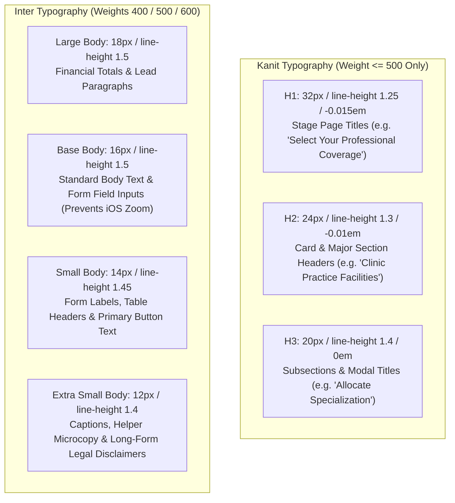

# TYPOGRAPHY AND COLOR USAGE GUIDELINES
## DoctorShield Design System Visual Implementation Standards

> **Document ID:** `DOC-DS-USAGE-001`  
> **Status:** Authoritative Baseline (Phase 2 Deliverable)  
> **Brand Invariants:** Kanit (Headings $\le 500$ only) | Inter (Body & UI) | Primary `#08A5B5` | Secondary `#132766`  
> **Governing Standards:** [`DESIGN_TOKENS.md`](file:///c:/Users/salee/Downloads/Portal_ds/docs/design-system/DESIGN_TOKENS.md), [`ACCESSIBILITY_CONTRAST_AUDIT.md`](file:///c:/Users/salee/Downloads/Portal_ds/docs/design-system/ACCESSIBILITY_CONTRAST_AUDIT.md)

---

## 1. Typographic Hierarchy & Font Family Rules



### The Kanit Weight Invariant Rule:
> [!IMPORTANT]
> **Kanit must never be rendered in weights $\ge 600$ (Semi-Bold or Bold).**  
> Kanit is a condensed, geometric, modern display typeface. At bold weights (600+), its letterforms become aggressive, claustrophobic, and clash with the light, calm healthcare atmosphere.  
> All Kanit headings are strictly restricted to:
> - `font-weight: 400` (`font-normal`)
> - `font-weight: 500` (`font-medium`)

---

## 2. Long-Form Legal & Regulatory Typography

The DoctorShield portal contains mandatory statutory disclosures under the **Financial Services Act 2013**, **PDPA 2010**, and **PIDM Regulations**. These sections must remain readable without causing visual exhaustion:

### Standard Legal Container Styling (`.legal-disclosure-card`):
```css
.legal-disclosure-card {
  padding: var(--ds-primitive-space-4);           /* 16px */
  background-color: var(--ds-primitive-color-navy-50); /* #F1F4FA */
  border: 1px solid var(--ds-color-border-subtle);
  border-radius: var(--ds-primitive-radius-lg);   /* 8px */
  max-height: 220px;
  overflow-y: auto;
  font-family: var(--ds-primitive-font-body);     /* Inter */
  font-size: var(--ds-primitive-font-size-xs);    /* 12px */
  line-height: var(--ds-primitive-line-height-relaxed); /* 1.65 */
  color: var(--ds-color-text-secondary);          /* #475569 (7.58:1 contrast) */
}

.legal-disclosure-card h4 {
  font-family: var(--ds-primitive-font-heading);  /* Kanit */
  font-size: var(--ds-primitive-font-size-sm);    /* 14px */
  font-weight: var(--ds-primitive-font-weight-medium); /* 500 */
  color: var(--ds-color-text-heading);            /* #132766 */
  margin-bottom: var(--ds-primitive-space-2);
}
```

---

## 3. Approved Color Pairing Matrix

The table below defines which foreground text and icon colors are **permitted** on specific background surfaces:

```
+----------------------------------------------------------------------------------------------------+
|                                    APPROVED COLOR PAIRING MATRIX                                   |
+-------------------+-------------------------------+------------------------------------------------+
| Surface Token     | Background Hex                | Approved Foreground Tokens                     |
+-------------------+-------------------------------+------------------------------------------------+
| `surface-canvas`  | `#F1F4FA` (Very Light Navy)   | • `text-heading` (`#132766`, 13.91:1)          |
|                   |                               | • `text-primary` (`#0F172A`, 17.80:1)          |
|                   |                               | • `text-secondary` (`#475569`, 7.58:1)         |
+-------------------+-------------------------------+------------------------------------------------+
| `surface-card`    | `#FFFFFF` (Pure White)        | • `text-heading` (`#132766`, 13.91:1)          |
|                   |                               | • `text-primary` (`#0F172A`, 17.80:1)          |
|                   |                               | • `text-secondary` (`#475569`, 7.58:1)         |
|                   |                               | • `text-muted` (`#64748B`, 4.76:1)             |
|                   |                               | • `text-link` (`#055C66`, 7.69:1)              |
|                   |                               | • `text-error` (`#BE123C`, 6.15:1)             |
+-------------------+-------------------------------+------------------------------------------------+
| `surface-brand-`  | `#F0FAFA` (Very Light Teal)   | • `text-heading` (`#132766`, 13.50:1)          |
| `tint`            |                               | • `text-primary` (`#0F172A`, 17.00:1)          |
|                   |                               | • `text-link` (`#055C66`, 7.45:1)              |
+-------------------+-------------------------------+------------------------------------------------+
| `action-primary`  | `#066F7B` (Deep Teal Button)  | • `text-inverse` (`#FFFFFF`, 5.89:1)           |
+-------------------+-------------------------------+------------------------------------------------+
| `action-secondary`| `#132766` (Navy Button)       | • `text-inverse` (`#FFFFFF`, 13.91:1)          |
+-------------------+-------------------------------+------------------------------------------------+
| `stepper-active`  | `#08A5B5` (Brand Primary Teal)| • `primitive-color-navy-900` (`#132766`, 4.68:1|
+-------------------+-------------------------------+------------------------------------------------+
| `feedback-error-bg`| `#FFF1F2` (Light Rose)       | • `text-error` (`#BE123C`, 5.98:1)             |
+-------------------+-------------------------------+------------------------------------------------+
| `feedback-success-bg`| `#ECFDF5` (Light Emerald)   | • `text-success` (`#047857`, 5.16:1)           |
+-------------------+-------------------------------+------------------------------------------------+
```

---

## 4. Visual Anti-Patterns (What Never to Do)

1. **Never use `#08A5B5` as body text or label color:**
   - *Anti-Pattern:* `<label style="color: #08A5B5">NRIC Number</label>` (Fails WCAG 2.2 AA at 2.97:1).
   - *Correct:* `<label style="color: var(--ds-color-text-secondary)">NRIC Number</label>` (`#475569`, 7.58:1).
2. **Never set Kanit font weight to 600 or 700:**
   - *Anti-Pattern:* `<h2 class="font-kanit font-bold">Quotation Summary</h2>`
   - *Correct:* `<h2 class="font-kanit font-medium">Quotation Summary</h2>`
3. **Never use pure black (`#000000`):**
   - Pure black text is jarring on white screens. The system uses `--ds-primitive-color-slate-900` (`#0F172A`) for maximum contrast without harsh optical glare.
4. **Never use saturated neon warning or danger colors:**
   - Generic bootstrap red (`#dc3545`) and yellow (`#ffc107`) look alarming and cheap. The system uses calibrated Rose (`#BE123C`) and Amber (`#92400E`) tones that convey serious clinical gravity.

