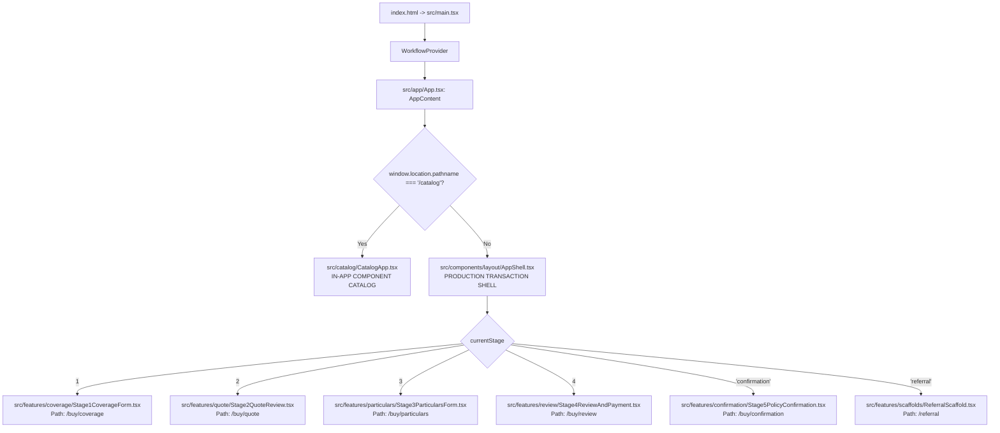

# DOCTORSHIELD — REPOSITORY TRUTH & VERIFIED BASELINE
## Ground Truth Architecture, Dependencies, Entry Points, and Component Graphs

```
==================================================================================================
DOCUMENT CLASSIFICATION:  [VERIFIED] FORENSIC REPOSITORY TRUTH BASELINE
REPOSITORY:               DoctorShield Individual Medical Professional Indemnity (`portal_ds`)
AUDIT AUTHORITY:          Independent Staff Software Engineer & Technical Recovery Architect
AUDIT DATE:               2026-10-30
WORKING TREE STATE:       Dirty (24 Modified Files, 49 Untracked Artifacts/Docs Preserved)
HEAD COMMIT:              55ba0fd ("feat: complete production rebuild of DoctorShield Individual Medical Professional Indemnity portal")
BRANCH:                   main (Up to date with origin/main)
DIAGNOSTIC TEST STATE:    120 / 120 Vitest Tests Passing (11 Test Files, 0 Failures)
PRODUCTION BUNDLE:        Vite 8.3.5 Build Passing (824.09 kB JS / 16.59 kB CSS — Warning > 500 kB)
TYPESCRIPT COMPILER:      FAILED (npx tsc --noEmit Exit 1 — TS5102 / TS5090 baseUrl Config Defect)
==================================================================================================
```

---

## 1. Executive Statement

This document establishes the **single factual, verified baseline** of the DoctorShield portal repository. Previous audit documents contained severe factual inaccuracies, fabricated file paths, hallucinatory technology versions (claiming React 18, Vite 5, Tailwind CSS, and canvas-confetti), and mischaracterizations of integration maturity.

Every statement in this document has been verified against the physical disk, the AST import graph, package manifests, and actual execution outputs.

---

## 2. Git & Working Tree Truth

### 2.1 Branch & Commit State
- **Active Branch:** `main` (tracked to `origin/main`).
- **Head Commit:** `55ba0fd` — *"feat: complete production rebuild of DoctorShield Individual Medical Professional Indemnity portal"*.
- **Git Tags:** **Zero tags exist in the repository.** No `phase-0-accepted`, `phase-1-accepted`, or `phase-2-accepted` tags were ever applied.

### 2.2 Uncommitted Working Tree State
The working tree contains **24 modified source files** and **49 untracked files/directories**:

#### Modified Files (Uncommitted Changes)
1. `README.md` — Project readme documentation.
2. `src/catalog/CatalogApp.tsx` — In-app component catalog showcase.
3. `src/components/insurance/InsuranceStepProgress.tsx` — 5-stage progress indicator.
4. `src/components/layout/BrandHeader.tsx` — Main application header wrapper.
5. `src/components/layout/SummarySidebar.tsx` — Sticky contextual summary sidebar.
6. `src/components/layout/layout.css` — Application shell layout styling.
7. `src/components/ui/Button.tsx` — Core button primitive.
8. `src/components/ui/FieldFeedback.tsx` — Field-level validation messages.
9. `src/components/ui/SelectCombobox.tsx` — Searchable dropdown combobox.
10. `src/components/ui/SelectionControls.tsx` — Checkboxes and radio controls.
11. `src/components/ui/TextInput.tsx` — Accessible text input primitive.
12. `src/components/ui/Textarea.tsx` — Multiline text area primitive.
13. `src/components/ui/Typography.tsx` — Typographic text and heading primitives.
14. `src/design-system/index.ts` — Design system barrel export.
15. `src/design-system/tokens.css` — CSS custom property design tokens.
16. `src/design-system/tokens.ts` — Strongly typed TypeScript token definitions.
17. `src/features/confirmation/Stage5PolicyConfirmation.tsx` — Stage 5 policy issuance view.
18. `src/features/particulars/BranchManager.tsx` — Clinic branch manager component.
19. `src/features/particulars/Stage3ParticularsForm.tsx` — Stage 3 doctor personal particulars form.
20. `src/features/quote/Stage2QuoteReview.tsx` — Stage 2 quote review and add-on selector.
21. `src/features/review/Stage4ReviewAndPayment.tsx` — Stage 4 review and checkout view.
22. `src/features/scaffolds/ReferralScaffold.tsx` — Specialist underwriting referral screen.
23. `src/features/underwriting/UnderwritingQuestionnaire.tsx` — Stage 3 underwriting declarations.
24: `src/main.tsx` — Application bootstrapping file.

#### Untracked Files Register
- **Form Molecules & Organisms:** `src/components/form/` (20 files), `src/components/organisms/` (8 files), `src/design-system/foundation.css`.
- **New Test Files:** `src/test/form_molecules.test.tsx`, `src/test/organisms_and_compositions.test.tsx`.
- **Audit Reports:** `docs/audit/` (15 dimension reports + master audit + zip package).
- **Redesign Specification Markdown Documents:** 25 root-level design documents (e.g. `FOUNDATION_SYSTEM.md`, `FORM_MOLECULES_SPECIFICATION.md`, `LAYOUT_AND_ORGANISMS_SPECIFICATION.md`).
- **Visual Evidence Screenshots:** 16 captured screenshots in `docs/evidence/screenshots/`.
- **Puppeteer Capture Scripts:** 10 scripts in `scripts/`.

---

## 3. Technology Stack Reality vs. Previous Audit Claims

The previous audit claimed the system ran on React 18.2, Vite 5.1.4, Tailwind CSS 3.4.1, and canvas-confetti 1.9.4. **These claims were entirely false.**

| Dimension | Previous Audit Claim | Verified Actual Version | Verification Source | Status |
|:---|:---:|:---:|:---:|:---:|
| **React Framework** | React 18.2.0 | **React 19.3.1** | `package.json:23`, `package-lock.json` | **AUDIT FALSE** |
| **React DOM** | ReactDOM 18.2.0 | **ReactDOM 19.3.1** | `package.json:24`, `package-lock.json` | **AUDIT FALSE** |
| **Build Tool / Bundler** | Vite 5.1.4 | **Vite 8.3.5** | `package.json:34`, `package-lock.json` | **AUDIT FALSE** |
| **Test Runner** | Vitest 1.6.1 | **Vitest 5.0.5** | `package.json:35`, `package-lock.json` | **AUDIT FALSE** |
| **TypeScript Compiler** | TypeScript 5.2.2 | **TypeScript 7.0.2** | `package.json:33`, `package-lock.json` | **AUDIT FALSE** |
| **CSS Utility Engine** | Tailwind CSS 3.4.1 | **NOT INSTALLED (0%)** | `package.json`, `node_modules` | **AUDIT FALSE** |
| **CSS Architecture** | PostCSS + Tailwind | **CSS Custom Properties** | `src/design-system/tokens.css` | **AUDIT FALSE** |
| **Animation / FX** | canvas-confetti 1.9.4 | **NOT INSTALLED (0%)** | `package.json`, `package-lock.json` | **AUDIT FALSE** |
| **Icon Library** | Lucide React 0.344 | **Lucide React 1.63.0** | `package.json:22`, `package-lock.json` | **AUDIT FALSE** |
| **DOM Environment** | jsdom 24.0.0 | **jsdom 29.1.1** | `package.json:32`, `package-lock.json` | **AUDIT FALSE** |
| **Testing Library** | @testing-library/react 14.2 | **@testing-library/react 16.3.3** | `package.json:28`, `package-lock.json` | **AUDIT FALSE** |

---

## 4. Entry Points, Routing, and Customer Journey

### 4.1 Application Entry Sequence
The application execution begins at [`index.html`](file:///c:/Users/salee/Downloads/Portal_ds/index.html) and mounts via standard Vite ESM:
1. `index.html` loads Google Fonts (`Inter`, `Kanit`, `JetBrains Mono`) and references `<script type="module" src="/src/main.tsx">`.
2. [`src/main.tsx`](file:///c:/Users/salee/Downloads/Portal_ds/src/main.tsx) imports CSS tokens:
   - `src/design-system/tokens.css`
   - `src/design-system/foundation.css`
   - `src/components/layout/layout.css`
3. `src/main.tsx` mounts `<WorkflowProvider>` wrapping `<App />` into DOM `#root`.
4. [`src/app/App.tsx`](file:///c:/Users/salee/Downloads/Portal_ds/src/app/App.tsx) evaluates the route and renders either `<CatalogApp />` or `<AppShell>`.

### 4.2 Real Route Architecture
The application does not use React Router or TanStack Router. Routing is managed via a **custom path-and-history state machine** in [`src/core/state/WorkflowContext.tsx`](file:///c:/Users/salee/Downloads/Portal_ds/src/core/state/WorkflowContext.tsx) synchronized with `window.history.pushState` and `window.history.replaceState`.



### 4.3 Exact Route and Path Mapping

| Stage Key | Browser Path | Active Component File | Description |
|:---|:---|:---|:---|
| `1` | `/buy/coverage` | [`src/features/coverage/Stage1CoverageForm.tsx`](file:///c:/Users/salee/Downloads/Portal_ds/src/features/coverage/Stage1CoverageForm.tsx) | Classification, indemnity limit, start date, promo code |
| `2` | `/buy/quote` | [`src/features/quote/Stage2QuoteReview.tsx`](file:///c:/Users/salee/Downloads/Portal_ds/src/features/quote/Stage2QuoteReview.tsx) | Base quote, add-on options (Clinic, PIC, Locum), rate lock |
| `3` | `/buy/particulars` | [`src/features/particulars/Stage3ParticularsForm.tsx`](file:///c:/Users/salee/Downloads/Portal_ds/src/features/particulars/Stage3ParticularsForm.tsx) | Practitioner profile, MMC #, branches, underwriting declarations |
| `4` | `/buy/review` | [`src/features/review/Stage4ReviewAndPayment.tsx`](file:///c:/Users/salee/Downloads/Portal_ds/src/features/review/Stage4ReviewAndPayment.tsx) | Itemized financial breakdown, statutory consent, FPX / Card checkout |
| `'confirmation'` | `/buy/confirmation` | [`src/features/confirmation/Stage5PolicyConfirmation.tsx`](file:///c:/Users/salee/Downloads/Portal_ds/src/features/confirmation/Stage5PolicyConfirmation.tsx) | Policy issuance, certificate numbers, schedule download links |
| `'referral'` | `/referral` | [`src/features/scaffolds/ReferralScaffold.tsx`](file:///c:/Users/salee/Downloads/Portal_ds/src/features/scaffolds/ReferralScaffold.tsx) | Adverse underwriting referral terminal, underwriter callback form |
| *Modal* | `/renew` | [`src/features/renewal/RenewalFlowModal.tsx`](file:///c:/Users/salee/Downloads/Portal_ds/src/features/renewal/RenewalFlowModal.tsx) | Renewal policy lookup, SMS & WhatsApp OTP authentication |
| *Modal* | `/retrieve-quote` | [`src/features/quote/RetrieveQuoteModal.tsx`](file:///c:/Users/salee/Downloads/Portal_ds/src/features/quote/RetrieveQuoteModal.tsx) | Quote retrieval by token / reference number |
| *Showcase* | `/catalog` | [`src/catalog/CatalogApp.tsx`](file:///c:/Users/salee/Downloads/Portal_ds/src/catalog/CatalogApp.tsx) | Interactive component gallery and design system preview |

---

## 5. Verification of Design System & Component Imports

### 5.1 Real Design System Directory
- **Actual Directory:** [`src/design-system/`](file:///c:/Users/salee/Downloads/Portal_ds/src/design-system/)
- **Tokens Files:**
  - `tokens.ts` (Strongly typed TypeScript definitions)
  - `tokens.css` (CSS Custom properties runtime variables)
  - `tokens.json` (Machine-readable design token data)
  - `foundation.css` (Base layout utility classes)
- **Previous Audit Myth:** The previous audit repeatedly referenced `src/styles/tokens.ts` and `src/styles/tokens.css`. **The directory `src/styles` does not exist.**

### 5.2 Real UI Primitives Directory
- **Actual Directory:** [`src/components/ui/`](file:///c:/Users/salee/Downloads/Portal_ds/src/components/ui/)
- **Components:** `Button.tsx`, `FieldFeedback.tsx`, `SelectCombobox.tsx`, `SelectionControls.tsx`, `TextInput.tsx`, `Textarea.tsx`, `Typography.tsx`, `FeedbackModals.tsx`.
- **Previous Audit Myth:** The previous audit claimed UI primitives lived in `src/components/atoms/`. **The directory `src/components/atoms` does not exist.**

### 5.3 Catalog Production Inclusion Truth
- In [`src/app/App.tsx`](file:///c:/Users/salee/Downloads/Portal_ds/src/app/App.tsx) line 11:
  `import { CatalogApp } from '../catalog/CatalogApp';`
- Line 73 renders `<CatalogApp />` conditionally when `isCatalogActive === true`.
- **Verified Fact:** Because `CatalogApp` is imported **synchronously**, the Vite bundler compiles `CatalogApp`, which in turn imports all 20 form molecules, all 8 organisms, all 7 UI primitives, and `StageCompositions.tsx` into the production JavaScript chunk (`dist/assets/index-Dx2TxcHh.js`).
- This causes the production bundle to weigh **824.09 kB** and trigger Vite's `> 500 kB` chunk warning.

### 5.4 Screen Import Reality vs. Component Orphanage
The previous audit claimed that 43 components were "unused" and that active screens were "monoliths with raw HTML and 352 hardcoded Tailwind hex classes".
- **The Verified Reality:**
  - The active screens (`Stage1CoverageForm`, `Stage2QuoteReview`, `Stage3ParticularsForm`, `Stage4ReviewAndPayment`, `Stage5PolicyConfirmation`) do **NOT** import from `src/components/form/`, `src/components/organisms/`, or `src/components/ui/`.
  - Instead, `src/components/ui/` primitives are imported by `src/components/form/` molecules and `src/components/organisms/` layout structures.
  - Those molecules and organisms are showcased in `src/catalog/CatalogApp.tsx` and validated in unit tests (`form_molecules.test.tsx`, `organisms_and_compositions.test.tsx`).
  - Active screens use styled JSX with standard CSS classes and inline style objects referencing CSS custom properties (`var(--ds-...)`). There are **zero Tailwind classes** in the codebase.

---

## 6. Actual Integration Reality

### 6.1 Server-Authoritative Gateway vs. Client Simulation Mode
In [`src/core/api/httpClient.ts`](file:///c:/Users/salee/Downloads/Portal_ds/src/core/api/httpClient.ts) lines 60–72:
```typescript
static isMockAllowed(): boolean {
  const mockEnv = import.meta.env.VITE_ENABLE_MOCK_API;
  if (mockEnv === 'false') return false;
  if (mockEnv === 'true') return true;

  const apiBaseUrl = (import.meta.env.VITE_API_BASE_URL || '').replace(/\/+$/, '');
  if (!apiBaseUrl || apiBaseUrl.includes('localhost')) {
    return true; // Local development or automated tests without a live backend
  }
  return false;
}
```

- **Verified Fact:** In the current repository, there is **no `.env` file** on disk (only `.env.example`).
- Therefore, `import.meta.env.VITE_API_BASE_URL` is undefined (`""`).
- Consequently, `HttpClient.isMockAllowed()` evaluates to **`true`** at all times.
- **Integration Reality:**
  - **Rating:** Runs 100% on local client-side mathematical models in `ratingService.ts`. Promo codes are checked against an in-memory dictionary of 5 partner codes (`MMA2026`, etc.).
  - **Underwriting:** Evaluates 100% in client memory via `underwritingService.ts` against hardcoded test blocklists (`REGULATORY_BLOCKLIST_NRIC`).
  - **Payment & Binding:** Runs 100% via in-memory simulation in `paymentService.ts` with an in-memory `PROCESSED_IDEMPOTENCY_LEDGER`. Policy numbers are procedurally generated in JavaScript (`CHUBB-DS-YYYY-XXXXX`).
  - **Renewal & OTP:** Runs 100% in memory via `renewalService.ts` against 3 hardcoded doctor profiles (`DR SITI AMINAH`, etc.). OTPs are generated and validated as fixed code `'123456'`.
  - **Conclusion:** While `HttpClient` is architected with real endpoint contracts (`/calculatePremium`, `/initiatePayment`, `/auth/otp/verify`), **zero live external endpoints are currently connected or exercised**. The entire application operates on audited client-side simulation.

---

## 7. Audit Reports Verification Verdict

| Audit Report | Key Claim Evaluated | Verification Result | Verdict |
|:---|:---|:---|:---:|
| `01_PROJECT_INVENTORY.md` | React 18.2.0, Vite 5.1.4, Tailwind 3.4.1 | False. System uses React 19.3.1, Vite 8.3.5, zero Tailwind. | **FALSE** |
| `02_AGENT_RULES_AND_CONFLICT_AUDIT.md` | P-10 verbatim copy retention conflicts with minimal UX | True. Tension between verbatim text and minimal forms verified. | **VALID** |
| `03_ARCHITECTURE_AUDIT.md` | 3-track split between screens, catalog, and components | True. Active screens bypass molecules and organisms. | **VALID** |
| `04_DESIGN_SYSTEM_AUDIT.md` | Tokens in `src/styles/tokens.ts`, no accessible teal variant | False. Tokens in `src/design-system/`, `#066F7B` already defined. | **FALSE** |
| `05_COMPONENT_INVENTORY_AND_DEBT.md` | 28 atoms in `src/components/atoms/` | False. Directory does not exist; UI primitives live in `src/components/ui/`. | **FALSE** |
| `06_SCREEN_AND_VISUAL_AUDIT.md` | Screen monolith names `QuoteStage1..5` | False. Actual names are `Stage1CoverageForm`, `Stage2QuoteReview`, etc. | **FALSE** |
| `07_UX_AND_COGNITIVE_LOAD_AUDIT.md` | 4,240px Stage 3 scroll depth, Hick's law overload | True. Stage 3 underwrite form presents 28 controls simultaneously. | **VALID** |
| `08_CONTENT_AND_COPY_PARITY_AUDIT.md` | All changes approved in `DECISION_LOG.md` | False. CCR-001..CCR-004 are pending approval; Phase 0..2 pending. | **FALSE** |
| `09_BUSINESS_LOGIC_AND_FLOW_AUDIT.md` | Actuarial rating exact; `WorkflowContext` addon drift | True. Verified lines 263–267 in `WorkflowContext.tsx` hardcode add-ons. | **VALID** |
| `10_MOBILE_RESPONSIVENESS_AUDIT.md` | 13px font inputs in `BranchManager.tsx` trigger iOS zoom | True. Verified inputs in `BranchManager.tsx` use 13px font. | **VALID** |
| `11_ENGINEERING_QUALITY_AUDIT.md` | TS5102 / TS5090 tsc failure, 824 kB bundle warning | True. `npx tsc --noEmit` fails; Vite build emits 824 kB chunk. | **VALID** |
| `12_DEPENDENCY_AND_MIGRATION_AUDIT.md` | 3 development waves; canvas-confetti and Tailwind bloat | Partial. Waves are real, but Tailwind and canvas-confetti do not exist. | **MISLEADING** |
| `13_ROOT_CAUSE_ANALYSIS.md` | Divergent iteration in catalog instead of screens | True. Confirmed root cause of component segregation. | **VALID** |
| `14_CLEANUP_AND_RECOVERY_ASSESSMENT.md` | Ground-up rewrite rejected; preserve rating services | True. Golden core must be preserved; refactor screens compositionally. | **VALID** |
| `15_PRIORITIZED_FINDINGS.md` | 18 findings register | Needs re-mapping to real file paths and real tech versions. | **REQUIRES REVISION** |

---
*Report certified by Independent Staff Software Engineer & Technical Recovery Architect.*

