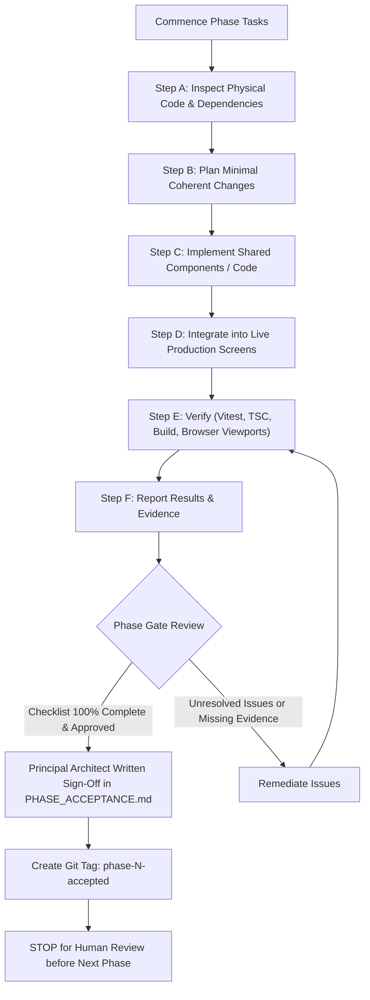

# DOCTORSHIELD — DECISION RECORDING & APPROVAL GATE PROTOCOL
## Operational Standards for Decision Logging, State Classification, and Phase Acceptance

```
==================================================================================================
DOCUMENT CLASSIFICATION:  [VERIFIED] APPROVAL GATES & DECISION GOVERNANCE
GOVERNING STANDARD:       DoctorShield Product Engineering & Design Rules (Version 2.0 §12, §15)
AUDIT AUTHORITY:          Independent Staff Software Engineer & Technical Recovery Architect
DATE OF ENACTMENT:        2026-10-30
==================================================================================================
```

---

## 1. Executive Summary

A critical root cause of past architectural divergence was the conflation of implementation states (e.g., claiming a component was "production-ready" simply because it appeared in an isolated catalog) and the absence of a verified, human-confirmed decision-recording protocol.

This document establishes the **formal approval and phase gate framework** for the DoctorShield recovery project. No change to insurance behavior, legal content, architectural boundaries, or screen composition may proceed without following this protocol.

---

## 2. Decision Recording Procedure (`docs/DECISION_LOG.md`)

Every architectural, technical, design, or content decision that extends, refactors, or alters current application behavior must be recorded in [`docs/DECISION_LOG.md`](file:///c:/Users/salee/Downloads/Portal_ds/docs/DECISION_LOG.md).

### 2.1 Decision Categories & ID Conventions
- **`DEC-NNN` (Technical, Architectural, Design & Process Decisions):** Used for structural refactoring, dependency changes, component boundary decisions, and token updates.
- **`CCR-NNN` (Content Change Requests):** Used for any proposed change to legal notices, question text, form labels, or explanatory disclosures.

### 2.2 Mandatory Decision Record Schema
Every new entry in `DECISION_LOG.md` must contain all eleven fields:

```markdown
### DEC-NNN (or CCR-NNN)

| Field | Description / Value |
|---|---|
| **ID** | Unique sequential identifier (`DEC-011`, `CCR-005`, etc.) |
| **Date** | ISO Date (`YYYY-MM-DD`) when decision was drafted |
| **Category** | `PRODUCT` / `LEGAL` / `DESIGN` / `TECHNICAL` / `PROCESS` / `CONTENT` |
| **Status** | `PROPOSED` / `UNDER REVIEW` / `APPROVED` / `REJECTED` / `SUPERSEDED` |
| **Decision** | Clear, unambiguous statement of what was decided |
| **Rationale** | Architectural, legal, or usability justification |
| **Alternatives Considered** | At least two alternative approaches and reasons for rejection |
| **Impact** | Exact files, components, user journeys, or contracts affected |
| **Approver** | Named human owner (e.g. `Principal Product Architect`, `Chubb Legal Lead`); never "AI" or "Agent" |
| **Source References** | Level 1–5 document references (`SRC-NNN`, `PRD-NNN`, etc.) |
| **Open Questions** | Linked open questions (`OQ-NNN`) or `None` |
```

---

## 3. Strict State Classification Standards

To eliminate ambiguity between code existence and live production maturity, the following five states are defined and enforced per Rules v2.0 §15:

```
+---------------------------------------------------------------------------------------+
|  STATE CLASSIFICATION STANDARD (Rules v2.0 §15)                                       |
+---------------------------------------------------------------------------------------+
|  [IMPLEMENTED]      Code exists on disk in a source file.                             |
|  [INTEGRATED]       Code is mounted, imported, and active in the live user journey.   |
|  [TESTED]           Specific checks passed (Vitest unit, a11y, visual, integration).  |
|  [APPROVED]         Appropriate human business/legal/tech owner signed off in writing.|
|  [PRODUCTION-READY] All required operational, security, and release gates passed.     |
+---------------------------------------------------------------------------------------+
```

### Prohibitions Against State Conflation
- **Never claim a component is [INTEGRATED] if it only renders in `CatalogApp.tsx`.** A component is only `[INTEGRATED]` when it is imported and actively rendered in the live customer journey (`Stage1CoverageForm` through `Stage5PolicyConfirmation` or `AppShell`).
- **Never claim an integration is [PRODUCTION-READY] when tests use mock fallbacks.** Tests passing against local simulations must be explicitly classified as `[TESTED - MOCK SIMULATION]`.
- **Never claim copy is [APPROVED] if its status in `DECISION_LOG.md` is `PROPOSED` or `UNDER REVIEW`.**

---

## 4. Phase Gate Protocol & Verification Checkpoints

The recovery roadmap follows a strict **Phase Gate Protocol** governed by [`docs/PHASE_ACCEPTANCE.md`](file:///c:/Users/salee/Downloads/Portal_ds/docs/PHASE_ACCEPTANCE.md).



### Mandatory Requirements to Pass Any Phase Gate:
1. **100% Checklist Completion:** All items in the phase checklist marked `✅ Complete`.
2. **Zero Unresolved P1 Blockers:** All high-priority open questions resolved or formally deferred with a named owner.
3. **Automated Verification:**
   - Vitest suite passes 100% (zero regressions against 120 passing test baseline).
   - TypeScript compiler (`tsc --noEmit`) passes with zero errors.
   - Vite production build succeeds without critical warnings.
4. **Visual & Usability Acceptance:** Tested across desktop (1440px) and mobile (390px) viewports with zero horizontal overflow and compliant touch targets.
5. **Written Human Sign-Off:** Principal Product Architect or Business Owner confirms in writing.
6. **Git Tag Checkpoint:** Git tag `phase-N-accepted` applied to the accepted commit.

---

## 5. Phase 01 Stabilization Acceptance Record

### Acceptance Checklist

| # | Item | Owner | Status | Evidence / Location |
|:---|:---|:---:|:---:|:---|
| **P01-01** | Create a recoverable Git baseline without discarding uncommitted changes. | Staff Recovery Lead | ✅ Complete | Branch `recovery/checkpoint-phase01-baseline` @ `3d5d018`. |
| **P01-02** | Identify active, obsolete, and conflicting instructions. | Staff Recovery Lead | ✅ Complete | [`docs/recovery/01_GOVERNANCE_MIGRATION.md`](file:///c:/Users/salee/Downloads/Portal_ds/docs/recovery/01_GOVERNANCE_MIGRATION.md). |
| **P01-03** | Safely replace and reconcile root `AGENTS.md` to Rules v2.0. | Staff Recovery Lead | ✅ Complete | [`AGENTS.md`](file:///c:/Users/salee/Downloads/Portal_ds/AGENTS.md) updated to Version 2.0. |
| **P01-04** | Preserve mandatory insurance, security, and privacy constraints. | Staff Recovery Lead | ✅ Complete | Codified in Rules v2.0 §3, §4 and `01_RECOVERY_BASELINE.md`. |
| **P01-05** | Remove / explicitly supersede contradictory visual and implementation directives. | Staff Recovery Lead | ✅ Complete | Superseding Register in `01_GOVERNANCE_MIGRATION.md`. |
| **P01-06** | Establish strict 7-level source-of-truth hierarchy. | Staff Recovery Lead | ✅ Complete | [`docs/recovery/01_SOURCE_OF_TRUTH.md`](file:///c:/Users/salee/Downloads/Portal_ds/docs/recovery/01_SOURCE_OF_TRUTH.md). |
| **P01-07** | Identify active component and token directories from verified repository. | Staff Recovery Lead | ✅ Complete | [`docs/recovery/01_RECOVERY_BASELINE.md`](file:///c:/Users/salee/Downloads/Portal_ds/docs/recovery/01_RECOVERY_BASELINE.md). |
| **P01-08** | Establish consistent decision recording and approval procedure. | Staff Recovery Lead | ✅ Complete | Schema & state standards in this document. |
| **P01-09** | Separate current approved specifications from historical prompt artifacts. | Staff Recovery Lead | ✅ Complete | Document categorization in `01_SOURCE_OF_TRUTH.md §3`. |
| **P01-10** | Record external agent/plugin rules outside repository scope. | Staff Recovery Lead | ✅ Complete | Science plugin documented as out-of-scope in `01_GOVERNANCE_MIGRATION.md §4`. |
| **P01-11** | Verify working tree preservation and zero user-facing code modifications. | Staff Recovery Lead | ✅ Complete | 120/120 tests pass; zero functional alterations. |

---
*Certified by Independent Staff Software Engineer & Technical Recovery Architect.*
**PHASE 01 COMPLETE. STOPPED FOR REVIEW.**

