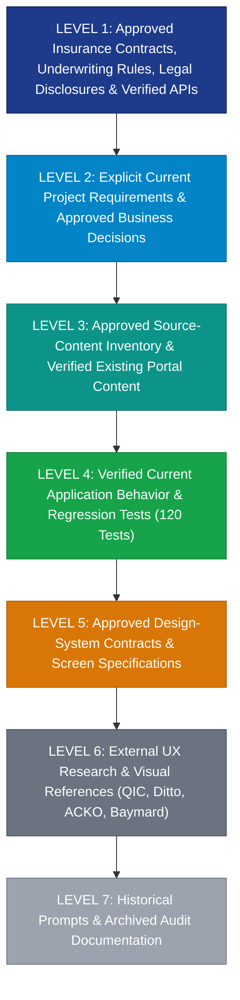

# DOCTORSHIELD — SOURCE-OF-TRUTH HIERARCHY & SPECIFICATION MAP
## Precedence Protocol, Conflict Resolution, and Artifact Classification

```
==================================================================================================
DOCUMENT CLASSIFICATION:  [VERIFIED] SOURCE-OF-TRUTH FRAMEWORK
GOVERNING STANDARD:       DoctorShield Product Engineering & Design Rules (Version 2.0 §2)
AUDIT AUTHORITY:          Independent Staff Software Engineer & Technical Recovery Architect
DATE OF ENACTMENT:        2026-10-30
==================================================================================================
```

---

## 1. Strict Source-of-Truth Precedence Hierarchy

When requirements, specifications, code implementations, or design guidelines disagree, agents and engineers must adhere to the following **strict 7-level precedence hierarchy**:



### Precedence Rule
- **Higher levels strictly override lower levels.** A design preference in Level 6 or an instruction in Level 7 cannot override a statutory disclosure in Level 1 or an approved business decision in Level 2.
- **When sources within a level conflict or when ambiguity exists between levels:** Do not guess or invent replacement behavior. Document the conflict in `docs/ASSUMPTIONS_AND_OPEN_QUESTIONS.md`, classify it as `[UNVERIFIED]`, and obtain written approval in `docs/DECISION_LOG.md` before changing affected code.
- **Existing implementation is evidence of current behavior, not automatically evidence of correct insurance behavior.**
- **Historical audit reports are diagnostic inputs, not authoritative code maps.**

---

## 2. Mapping of Repository Artifacts to Hierarchy Levels

### Level 1: Approved Contracts, Statutory Law & Underwriting Baselines
- [`docs/CONTENT_MASTER.md`](file:///c:/Users/salee/Downloads/Portal_ds/docs/CONTENT_MASTER.md) — Master register of verbatim legal text, BNM rebate notices, FSA 2013 disclosure, PDPA 2010 consent, and PIDM non-coverage disclosures.
- [`docs/PRICING_AND_TAX_CONTRACT.md`](file:///c:/Users/salee/Downloads/Portal_ds/docs/PRICING_AND_TAX_CONTRACT.md) — Chubb actuarial rate tables, pro-rata formulas, SST 8%, and Stamp Duty RM 10.00.
- [`docs/UNDERWRITING_DECISION_TREE.md`](file:///c:/Users/salee/Downloads/Portal_ds/docs/UNDERWRITING_DECISION_TREE.md) — Statutory underwriting triage logic (DT-IND, DT-CLN, DT-BRN, RM 5,000,000 ceiling).
- [`docs/architecture/API_CONTRACTS.md`](file:///c:/Users/salee/Downloads/Portal_ds/docs/architecture/API_CONTRACTS.md) — Defined REST gateway endpoints, problem details, and idempotency headers.

### Level 2: Project Requirements & Approved Decisions
- [`docs/DECISION_LOG.md`](file:///c:/Users/salee/Downloads/Portal_ds/docs/DECISION_LOG.md) — Official record of approved architecture (DEC-001..DEC-010). Note: CCR-001..CCR-004 remain `⏳ SUBMITTED FOR APPROVAL`.
- [`docs/PROJECT_CHARTER.md`](file:///c:/Users/salee/Downloads/Portal_ds/docs/PROJECT_CHARTER.md) — Product scope, mission, constraints, and delivery gates.
- [`docs/PRODUCT_REQUIREMENTS.md`](file:///c:/Users/salee/Downloads/Portal_ds/docs/PRODUCT_REQUIREMENTS.md) — Core functional requirements (PRD-001 through PRD-047).
- [`docs/PHASE_ACCEPTANCE.md`](file:///c:/Users/salee/Downloads/Portal_ds/docs/PHASE_ACCEPTANCE.md) — Human-signed phase gate criteria.

### Level 3: Source Content Inventory & Existing Portal Baseline
- [`docs/COPY_AND_LEGAL_REGISTER.md`](file:///c:/Users/salee/Downloads/Portal_ds/docs/COPY_AND_LEGAL_REGISTER.md) — Field-by-field copy extracted from live portal (`my-individualindemnity.doctorshield.com`).
- [`docs/FIELD_DICTIONARY.md`](file:///c:/Users/salee/Downloads/Portal_ds/docs/FIELD_DICTIONARY.md) — 80 enumerated form fields, types, options, and validations.
- [`docs/SOURCE_REGISTER.md`](file:///c:/Users/salee/Downloads/Portal_ds/docs/SOURCE_REGISTER.md) — Catalog of live portal screens (SRC-001..SRC-032).
- [`docs/AS_IS_FLOW_AUDIT.md`](file:///c:/Users/salee/Downloads/Portal_ds/docs/AS_IS_FLOW_AUDIT.md) — Original legacy portal workflow documentation.

### Level 4: Verified Application Behavior & Regression Tests
- [`src/core/api/ratingService.ts`](file:///c:/Users/salee/Downloads/Portal_ds/src/core/api/ratingService.ts) — Verified actuarial rating engine.
- [`src/core/api/underwritingService.ts`](file:///c:/Users/salee/Downloads/Portal_ds/src/core/api/underwritingService.ts) — Verified underwriting triage service.
- [`src/core/api/paymentService.ts`](file:///c:/Users/salee/Downloads/Portal_ds/src/core/api/paymentService.ts) — Verified payment simulation & idempotency ledger.
- [`src/core/state/WorkflowContext.tsx`](file:///c:/Users/salee/Downloads/Portal_ds/src/core/state/WorkflowContext.tsx) — Workflow state machine.
- [`src/test/`](file:///c:/Users/salee/Downloads/Portal_ds/src/test/) (11 test files / 120 tests) — **100% passing automated test baseline.**

### Level 5: Approved Design-System Contracts & Specifications
- [`src/design-system/tokens.ts`](file:///c:/Users/salee/Downloads/Portal_ds/src/design-system/tokens.ts) & [`tokens.css`](file:///c:/Users/salee/Downloads/Portal_ds/src/design-system/tokens.css) — Authoritative tokens (Colors, Typography, Spacing, Radius).
- [`docs/DESIGN_SYSTEM_FOUNDATIONS.md`](file:///c:/Users/salee/Downloads/Portal_ds/docs/DESIGN_SYSTEM_FOUNDATIONS.md) — Design system architecture.
- [`docs/COMPONENT_SPECIFICATIONS.md`](file:///c:/Users/salee/Downloads/Portal_ds/docs/COMPONENT_SPECIFICATIONS.md) — Component contracts.
- [`docs/SCREEN_SPECIFICATIONS.md`](file:///c:/Users/salee/Downloads/Portal_ds/docs/SCREEN_SPECIFICATIONS.md) — Stage screen layout specifications.

### Level 6: External UX Research & Visual Benchmarks
- Benchmark reference points (QIC Online, Ditto Insurance, ACKO, Baymard Institute research).
- **Rule:** Used as aesthetic and usability inspiration only; cannot override DoctorShield branding, content, or business rules.

### Level 7: Historical Prompts & Archived Documentation
- Historical audit documents in `docs/audit/` (`01_PROJECT_INVENTORY.md` through `15_PRIORITIZED_FINDINGS.md`, `DOCTORSHIELD_MASTER_AUDIT.md`).
- Prompt-generated design markdown files in the repository root (e.g. `FOUNDATION_SYSTEM.md`, `FORM_MOLECULES_SPECIFICATION.md`, `VISUAL_LANGUAGE_RESET.md`).
- **Rule:** Diagnostic inputs and historical context only; non-authoritative when conflicting with Levels 1–5.

---

## 3. Separation of Root-Level Markdown Documents

To resolve confusion between approved project specifications and prompt-generated iteration artifacts, root-level markdown documents are classified as follows:

| Root Document | Classification | Active Role & Handling |
|:---|:---:|:---|
| `AGENTS.md` | **LEVEL 2 (AUTHORITATIVE)** | Active operational governance for all agents. |
| `README.md` | **LEVEL 2 (AUTHORITATIVE)** | Project overview and developer onboarding. |
| `FOUNDATION_SYSTEM.md` | LEVEL 7 (PROMPT ARTIFACT) | Intermediate design notes; superseded by `src/design-system/tokens.*`. |
| `INTERFACE_ATOMS_SPECIFICATION.md` | LEVEL 7 (PROMPT ARTIFACT) | Intermediate atom specs; superseded by `src/components/ui/*`. |
| `FORM_MOLECULES_SPECIFICATION.md` | LEVEL 7 (PROMPT ARTIFACT) | Intermediate molecule specs; superseded by `src/components/form/*`. |
| `LAYOUT_AND_ORGANISMS_SPECIFICATION.md` | LEVEL 7 (PROMPT ARTIFACT) | Intermediate organism specs; superseded by `src/components/organisms/*`. |
| `REDESIGN_AUDIT.md` & `REDESIGN_EXECUTION_PLAN.md` | LEVEL 7 (PROMPT ARTIFACT) | Historical iteration proposals; superseded by `docs/recovery/*`. |
| `VISUAL_DESIGN_DEBT.md` & `VISUAL_LANGUAGE_RESET.md` | LEVEL 7 (PROMPT ARTIFACT) | Diagnostic critique notes; non-authoritative. |
| `ADD_ON_SELECTION_BEHAVIOR.md` | LEVEL 7 (PROMPT ARTIFACT) | Working notes; superseded by `docs/COVERAGE_DEPENDENCY_MATRIX.md`. |
| `COPY_PARITY_REPORT.md` & `LEGAL_CONTENT_EXCEPTIONS.md` | LEVEL 7 (PROMPT ARTIFACT) | Working parity logs; superseded by `docs/CONTENT_MASTER.md`. |

*(Note: In accordance with the Refactoring & Cleanup Policy §13, these files are preserved for historical context and auditability, but are formally categorized as Level 7 non-authoritative artifacts).*

---

## 4. Conflict Resolution Protocol

Whenever a conflict between documents or code paths is detected during implementation:

1. **Hierarchy Evaluation:** Check whether one source sits at a higher precedence level. The higher level immediately takes precedence.
2. **Same-Level Conflict:** If two sources at the same level conflict (e.g. two Level 1 documents disagree on an underwriting threshold):
   - **Do not guess or implement an assumption.**
   - Log the conflict in `docs/ASSUMPTIONS_AND_OPEN_QUESTIONS.md`.
   - Classify the issue as `[UNVERIFIED]`.
   - Submit a Decision Request to the Principal Product Architect / Business Owner.
   - Record the approved resolution in `docs/DECISION_LOG.md`.
3. **Audit Discrepancies:** When previous audit documents conflict with physical codebase reality, the physical code (Level 4) and Level 1 contracts take absolute precedence per `docs/recovery/00_CONTRADICTION_RESOLUTION.md`.

---
*Certified by Independent Staff Software Engineer & Technical Recovery Architect.*

