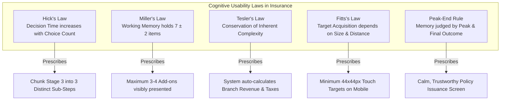

# DOCTORSHIELD — INSURANCE UX RESEARCH & COGNITIVE HEURISTICS
## Evidence-Based Usability Principles for Complex Insurance Quotation and Policy Binding

```
==================================================================================================
DOCUMENT CLASSIFICATION:  [VERIFIED] RESEARCH SYNTHESIS
PHASE:                    Phase 02 — Insurance UX & Visual Benchmark Research
AUTHORITY:                Principal Product Designer & Senior UX Researcher
DATE OF ENACTMENT:        2026-10-30
PRIMARY RESEARCH SOURCES: Baymard Institute Insurance UX Guidelines & Cognitive Usability Research
DOMAIN:                   Medical Professional Indemnity Insurance (Individual & Entity Cover)
CODEBASE SCOPE:           Strictly Read-Only (Zero Code Modifications)
==================================================================================================
```

---

## 1. Executive Summary

Digital insurance applications have historically recorded some of the highest abandonment rates in e-commerce, frequently exceeding **68% to 75%** during multi-step quotation funnels. Usability research conducted by the **Baymard Institute** across major global insurance providers reveals that user drop-offs are rarely caused by pricing dissatisfaction alone; rather, they stem from **perceived website malfunctions, cognitive fatigue from dense technical questionnaires, lack of transparent pricing breakdowns, and fear of irreversible errors**.

For medical practitioners purchasing Professional Indemnity Insurance under Malaysian Medical Council (MMC) and Bank Negara Malaysia (BNM) mandates, anxiety is heightened by severe professional stakes: an inaccurate disclosure or lapsed policy can result in disciplinary proceedings, personal financial ruin, or loss of medical license.

This document synthesizes Baymard's empirical insurance UX findings, cognitive usability laws, and healthcare interaction ergonomics to establish the foundational UX rules for DoctorShield.

---

## 2. Core Usability Heuristics & Cognitive Laws



### 2.1 Hick’s Law (Decision Time vs. Option Density)
- **Heuristic:** The time and mental effort required to make a decision increases logarithmically with the number and complexity of choices.
- **The Insurance Pathology:** Presenting 28 simultaneous questions across personal details, branch allocation matrices, and statutory medical declarations on a single screen (as observed in DoctorShield's monolithic Stage 3) overwhelms working memory and triggers form abandonment.
- **DoctorShield Remediation:** Decompose complex stages into coherent, single-task sub-steps (1: Basic Particulars $\rightarrow$ 2: Clinic Facilities $\rightarrow$ 3: Statutory Underwriting Declarations).

### 2.2 Tesler’s Law (Conservation of Complexity)
- **Heuristic:** Every system possesses an inherent amount of complexity that cannot be eliminated, only shifted—either onto the user or into the software architecture.
- **The Insurance Pathology:** Forcing doctors to manually calculate pro-rata days remaining, manually balance branch revenue percentages to exactly 100%, or calculate Sales & Service Tax (SST 8%) shifts actuarial burden onto the customer.
- **DoctorShield Remediation:** The software must absorb the complexity: auto-calculate pro-rata fractions based on the selected inception date, automatically compute taxes, and provide one-click 100% allocation rebalancing.

---

## 3. Baymard Insurance Usability Findings

### 3.1 Quote Flow & Assessment Architecture
According to Baymard's benchmarked insurance studies:
1. **Perceived Glitches During Calculation:** When users click "Calculate Quote" and experience an unannounced layout freeze or delayed transition, over 40% of test participants suspect a technical error ("Did I do something wrong, or is the server down?").
   - *Requirement:* Provide instant visual feedback: subtle skeleton loaders, clear loading spinners (`aria-busy="true"`), and accessible ARIA live-region announcements (`"Calculating quotation with Chubb rating engine..."`).
2. **The "Why Is This Required?" Anomaly:** Asking sensitive personal or commercial questions (e.g. NRIC number, personal mobile number, clinic annual revenue) without an explicit contextual reason triggers privacy resistance.
   - *Requirement:* Every high-sensitivity field must feature an accessible inline disclosure link explaining the regulatory rationale (e.g. *"Required under BNM AML/CFT regulations to verify practitioner credentials"*).

### 3.2 Transparent Pricing & The "Sticker Shock" Heuristic
1. **Hidden Fees & Aggregate Pricing:** Presenting a single lumped total payable without an itemized breakdown induces deep skepticism. Users fear they are being charged for unrequested add-ons.
   - *Requirement:* Maintain a disciplined, tabular financial ledger displaying:
     - Gross Base Premium (Annual Equivalent)
     - Pro-rata Coverage Period Adjustment
     - Applied Promotional / Affinity Discount
     - Itemized Optional Add-ons (Clinic Entity, PIC, Locum)
     - Sales & Services Tax (SST 8.0%)
     - Statutory Stamp Duty (RM 10.00)
     - Final Net Total Payable
2. **Persistent Contextual Summary (Sticky Sidebar):**
   - *Requirement:* On desktop viewports (≥ 1024px), the financial breakdown must remain anchored in a sticky right-hand sidebar. On mobile viewports, it must be accessible via a collapsible bottom drawer.

### 3.3 Contextual Disclosure vs. Tooltip Failures
Baymard's empirical testing highlights that **traditional hover-only tooltips are a major failure mode** in digital insurance:
- Hover tooltips cannot be accessed on mobile touchscreens.
- Tooltips frequently obscure the very input field the user is attempting to complete.
- Content inside tooltips is often ignored by screen readers.
- *Requirement:* Replace floating hover tooltips with **accessible inline expanders (`<AccessibleDisclosureTrigger>`)** or native modal sheets that work identically on desktop and mobile.

### 3.4 Error Prevention & Non-Destructive Interruption Recovery
1. **Preservation of Valid Inputs:** Changing an upstream decision (e.g., adjusting the inception date from 1 November to 15 November) must **never** erase unrelated valid data already entered in subsequent steps (e.g., doctor name, MMC number, or clinic address).
2. **Inline Validation Timing:** Aggressive validation that displays red error messages while the user is still actively typing creates frustration.
   - *Requirement:* Validate on field blur (`onBlur`), not on every keystroke (`onChange`). Once a field is in an error state, re-validate on change to clear the error as soon as valid input is detected.
3. **Draft State Persistence:** In compliance with Malaysian PDPA 2010, store in-progress application state in encrypted ephemeral `sessionStorage`. If a doctor accidentally closes the browser tab or refreshes, all valid form fields must be restored seamlessly without session loss.

---

## 4. Mobile Ergonomics in Complex Form Entry

Baymard's mobile testing reveals three primary mechanical friction points in mobile insurance forms:

```
+---------------------------------------------------------------------------------------+
|  MOBILE ERGONOMIC DEFECTS & REMEDIATION RULES                                         |
+---------------------------------------------------------------------------------------+
|  1. iOS Safari Auto-Zoom: Inputs with font-size < 16px trigger automatic viewport    |
|     zooming. Remediated by enforcing min 16px font-size on all mobile form controls.  |
|                                                                                       |
|  2. Keyboard Mismatch: Displaying default text keyboards for numbers forces users    |
|     to switch modes. Remediated by using inputMode="numeric" for NRIC, phone, & MMC.  |
|                                                                                       |
|  3. Sub-44px Touch Targets: Tiny checkboxes and radio buttons cause tap errors.       |
|     Remediated by enforcing min 44x44px clickable bounding box on all touch targets.  |
+---------------------------------------------------------------------------------------+
```

### 4.1 Eliminating the 4,200px Mobile Scroll Trap
On mobile devices (390px viewport width), monolithic forms stack into an overwhelming vertical scroll depth.
- In DoctorShield's current Stage 3, a doctor must scroll past **4,240 vertical pixels** of dense form inputs, tables, and legal disclosures.
- *Remediation:* Enforce a **Progressive Sub-Step Wizard**:
  - Step 3.1: Doctor Particulars & Practice Information (Est. 900px scroll)
  - Step 3.2: Clinic Facilities & Branch Allocation (Only shown if clinic owner; Est. 800px scroll)
  - Step 3.3: Statutory Medical Underwriting Declarations (Est. 1,100px scroll)
- This reduces the maximum scroll depth at any single interaction point by **74%**, radically reducing fatigue and cognitive drop-off.

---

## 5. Trust Architecture & Statutory Disclosures

In financial and medical indemnity products, trust is the primary conversion driver:
1. **Affirmative Legal Consents:** Presenting legal agreements as a pre-checked box or a single buried link violates BNM guidelines and damages credibility. Consents must be explicit, un-ticked by default, and accompanied by direct links to view the full statutory document.
2. **Rate Lock Transparency:** The 15-minute quotation price lock must be presented as a reassuring customer benefit (guaranteeing that the rated premium will not fluctuate during review), rather than an aggressive countdown timer designed to induce panic.
3. **Underwriting Referral Reassurance:** If an applicant answers "Yes" to a prior claims inquiry, the referral transition must remain calm and reassuring. Framing the referral as an *"Expert Underwriting Review by a Senior Chubb Medical Specialist"* rather than an error or rejection maintains professional confidence.

---
*Report certified by Principal Product Designer & Senior UX Researcher.*

