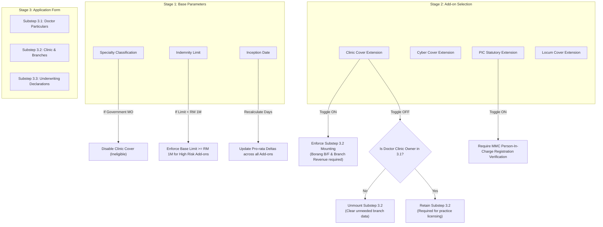

# OPTIONAL COVERAGE & ADD-ON INTERACTION SPECIFICATION
## DoctorShield Individual Medical Professional Indemnity Portal

> **Document ID:** `DOC-ARCH-ADDON-001`  
> **Status:** Architecture Design Baseline (Phase 03)  
> **Classification:** [PROPOSED / SPECIFICATION]  
> **Author:** Principal Insurance Product Designer & Underwriting Interaction Architect  
> **Created:** 2026-10-30  
> **Governance:** DoctorShield Product Engineering & Design Rules v2.0 (AGENTS.md)  
> **Scope:** Modular add-on catalog, card design anatomy, dynamic delta pricing patterns, reactive dependency trees, and quote recalculation lifecycles.

---

## 1. Architectural Role of Stage 2

Stage 2 (`Stage2QuoteReview`) is the single most critical commercial and decision-making screen in the entire DoctorShield journey:
- It transforms an abstract clinical inquiry into an **authoritative legal offer**.
- It establishes complete pricing trust before requiring sensitive personal data (NRIC, home address).
- It enables modular policy customization without cognitive overload or hidden price jumps.

Following our benchmark analysis (QIC Online transactional clarity and Ditto Insurance restraint), optional add-ons are presented as **modular choice cards** featuring explicit net price deltas, transparent benefit explanations, and zero deceptive pre-selection.

---

## 2. Optional Coverage Catalog & Underwriting Tariffs

| Add-on Identifier | Add-on Product Name | Underwriting Scope & Benefit | Annual Tariff (RM) | Pro-rated Formula | Eligibility Conditions |
|---|---|---|---|---|---|
| **`ADDON-CLN-001`** | **Clinic Premises & Vicarious Liability Extension** | Protects clinic owners against vicarious liability for clinical assistants, registered nurses, and administrative staff, plus premises occupier liability. | **RM 1,200.00** | $\text{Rate} \times \frac{\text{Days}}{365}$ | Non-government practitioners only (`classification_id != '5'`). Requires SSM / Borang B/F in Stage 3. |
| **`ADDON-CYB-001`** | **Cyber & Patient Data Breach Cover** | Covers legal defense, forensic investigation, and regulatory penalties under PDPA 2010 arising from ransomware, hacking, or lost patient records. | **RM 350.00** | $\text{Rate} \times \frac{\text{Days}}{365}$ | Available to all registered medical and dental classifications. Limit: RM 250,000 in aggregate. |
| **`ADDON-PIC-001`** | **Person-In-Charge (PIC) Statutory Extension** | Protects designated Persons-In-Charge against statutory prosecutions and civil liability under the Private Healthcare Facilities and Services Act 1998 (PHFSA). | **RM 450.00** | $\text{Rate} \times \frac{\text{Days}}{365}$ | Practitioner must be registered as PIC for a private clinic or ambulatory care center. |
| **`ADDON-LCM-001`** | **Locum Practitioner Extension** | Extends full indemnity protection while performing locum duties, weekend call cover, or visiting sessions at external registered healthcare facilities. | **RM 250.00** | $\text{Rate} \times \frac{\text{Days}}{365}$ | Available to private practitioners and government MOs with official moonlighting permission. |

---

## 3. Dynamic Delta Pricing Pattern

A frequent cause of user drop-off in online insurance is unexpected price inflation at checkout. DoctorShield enforces the **Transparent Price Delta Pattern**:
- Every add-on card displays the exact pro-rated financial addition that selecting it will cause.
- The delta is calculated relative to the remaining days in the calendar year ($\text{Inception Date}$ to $31/\text{Dec}/\text{YYYY}$).
- Display Format: `+RM [Pro-rated Amount] / year` (or `+RM [Monthly Equivalent] / mo` where appropriate).

### Mathematical Calculation Formula:
$$\text{Pro-rated Delta} = \text{Round}\left( \text{Base Annual Addon Tariff} \times \frac{\text{Remaining Calendar Days}}{365}, 2 \right)$$

```
Example: Inception Date = 01 November 2026 (61 days remaining)
- Clinic Extension Annual Rate: RM 1,200.00
- Pro-rated Calculation: RM 1,200.00 * (61 / 365) = RM 200.55
- Card Display: "+RM 200.55 pro-rated (+RM 1,200.00 / yr)"
```

---

## 4. Add-on Card Anatomy & Interaction States

```
+--------------------------------------------------------------------------------------------------+
| [ ] Clinic Premises & Vicarious Liability                            +RM 200.55 pro-rated        |
|     Extends protection to clinic staff, nurses, and premises.        (+RM 1,200.00 / yr)         |
|     Recommended for private clinic owners and partners.              [ Details v ]               |
+--------------------------------------------------------------------------------------------------+
                                        | (User clicks card or toggle)
                                        v
+==================================================================================================+
| [*] Clinic Premises & Vicarious Liability                            +RM 200.55 pro-rated        |
|     Extends protection to clinic staff, nurses, and premises.        [ SELECTED - ACTIVE ]       |
|     -------------------------------------------------------------------------------------------- |
|     [i] Selecting this add-on will request clinic registration details in Step 3.                |
|     Coverage Highlights:                                                                         |
|     - Vicarious liability for registered nurses and medical assistants up to policy limit        |
|     - Slip, trip, and accidental premises third-party property damage included                   |
|     - Deductible: RM 1,000 each and every claim                        [ Hide Details ^ ]        |
+==================================================================================================+
```

### Visual Specifications
- **Container Geometry:** 8px border radius, 16px internal padding (`tokens.spacing.md`).
- **Unselected State:**
  - Background: `#FFFFFF` (White)
  - Border: 1px solid `#E2E8F0` (`tokens.colors.border.subtle`)
  - Title: Inter 500, 16px, `#1E293B`
  - Delta Price: Inter 500, 15px, `#0F172A`
- **Selected State:**
  - Background: `#F0FDFA` (Soft brand teal tint, 5% opacity)
  - Border: 2px solid `#08A5B5` (`tokens.colors.primary.main`)
  - Checkbox / Switch: Filled `#08A5B5` with white checkmark
  - Active Tag: `#066F7B` badge: `[ SELECTED ]`
- **Focus & Keyboard Navigation:**
  - Focus ring: 2px solid `#132766` with 2px offset (`:focus-visible`).
  - Spacebar or Enter toggles selection state.
  - Native accessible checkbox (`role="checkbox"`, `aria-checked="true/false"`).
- **Expandable Details Drawer:**
  - Trigger: Accessible button with text `[ Details v ]` / `[ Hide Details ^ ]`.
  - Accessible attributes: `aria-expanded="false"`, `aria-controls="addon-details-CLN"`.
  - Smooth slide-down animation (150ms ease-in-out).

---

## 5. Reactive Upstream & Downstream Dependencies



---

## 6. Financial Recalculation Flow & Price Lock Guarantee

When an add-on is toggled, DoctorShield executes a dual-phase recalculation to balance responsiveness with regulatory precision:

```
[ Dual-Phase Recalculation Architecture ]

Phase 1: Optimistic Local State Update (< 16ms)
1. User clicks Add-on Card.
2. Toggle switch animates immediately.
3. Card styles transition to Selected State.
4. Local React State calculates provisional totals:
   New Gross = Previous Gross + Pro-rated Add-on Delta
   New Rebate = New Gross * 0.10
   New Net = New Gross - New Rebate
   New SST = New Net * 0.08
   New Total = New Net + New SST + Stamp Duty (RM 10.00)
5. Sidebar / Sticky Mobile Bar updates provisional total with subtle pulse animation.

Phase 2: Authoritative Server Sync (< 300ms)
1. Client dispatches debounced background request:
   `POST /api/calculateQuotationTotals` {
     classification_id: 7,
     liability_id: 2,
     start_date: "01/11/2026",
     selected_addons: ["ADDON-CYB-001", "ADDON-CLN-001"]
   }
2. Server validates underwriting tariffs, pro-rata days, and tax rounding.
3. Server returns authoritative JSON payload.
4. Client replaces provisional figures with authoritative numbers.
5. In the event of network failure: UI retains optimistic values and displays a soft retry icon.
```

---

## 7. 15-Minute Price Lock Timer & Expiration Recovery

In accordance with insurance underwriting integrity, quoted rates are locked for **15 minutes** to prevent stale quotation checkout during live tariff adjustments:

```
+--------------------------------------------------------------------------------------------------+
| Quotation Ref: DS-QUO-89104                 [Clock Icon] Guaranteed Price Lock: 14:48            |
+--------------------------------------------------------------------------------------------------+
```

### Expiration Lifecycle Rules:
1. **Calm Presentation:** Displayed as a small, neutral badge (`#475569` text on `#F1F5F9` background). Never red, never blinking, never using countdown panic language.
2. **Graceful Expiration:** When timer hits `00:00`, the form is **NOT erased**. The current state is preserved 100%.
3. **One-Click Refresh:** If the doctor attempts to continue after expiration, a calm dialog appears:
   ```
   +----------------------------------------------------------------------------------------+
   | Your Quotation Price Lock Has Expired                                                  |
   |                                                                                        |
   | To ensure your policy is issued with current statutory tariffs and tax rates, please   |
   | refresh your quotation. All your selected options will be preserved.                   |
   |                                                                                        |
   | [ Refresh Quotation Rates (1 Click) ]                                                  |
   +----------------------------------------------------------------------------------------+
   ```
4. Clicking **Refresh Quotation Rates** dispatches `POST /api/refreshQuote`, resets the 15-minute clock, and confirms: *"Rates verified current. You may proceed."*

---

## 8. Summary of Add-on UX Governance

1. **Total Price Transparency:** No hidden fees; every optional protection states its exact annual and pro-rated cost prior to selection.
2. **Modular Architecture:** Add-ons are decoupled modules that dynamically mount or unmount subsequent underwriting sections.
3. **Resilient Recalculation:** Optimistic UI with authoritative server sync guarantees speed and financial accuracy.
4. **Reassuring Integrity:** 15-minute price lock protects against stale contracts without creating artificial checkout anxiety.

