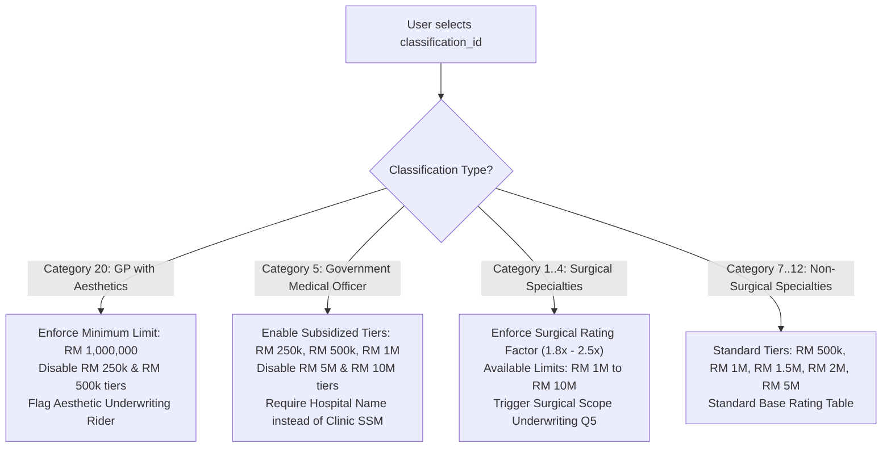
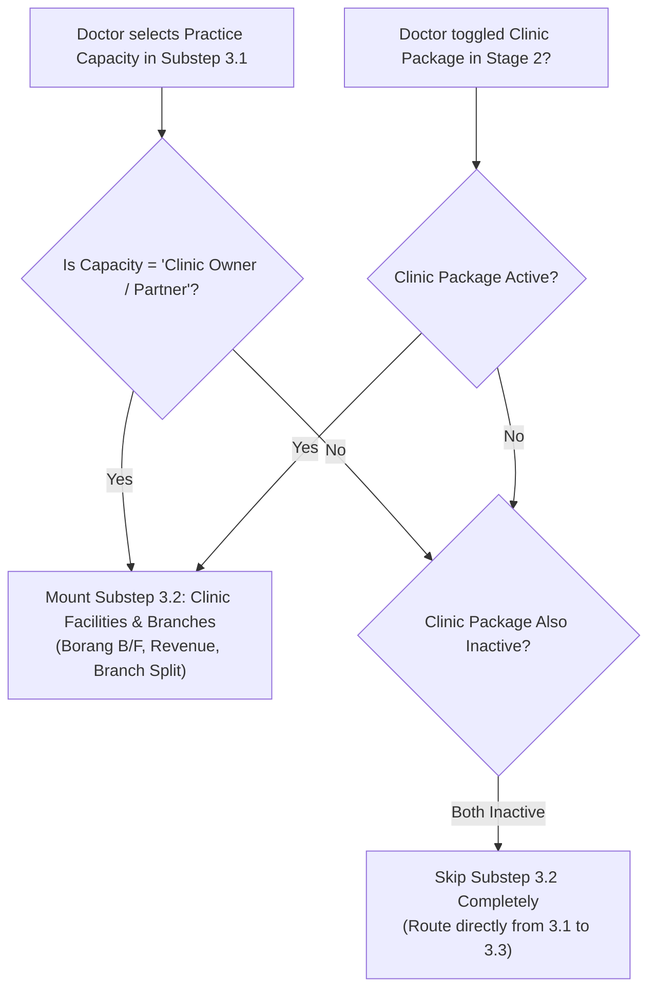
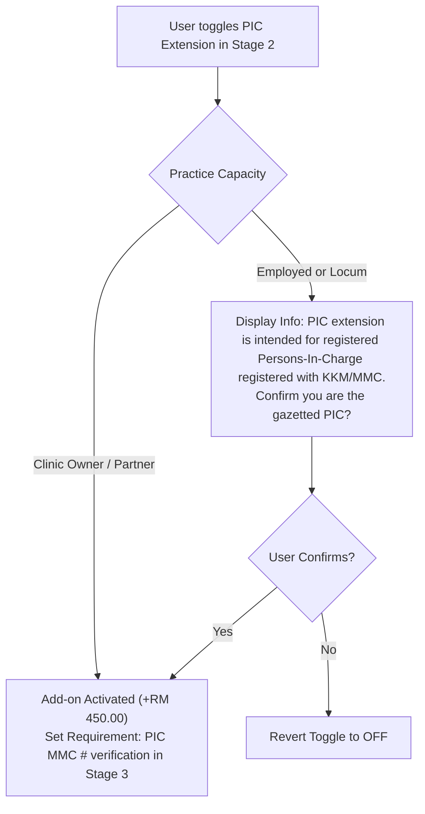
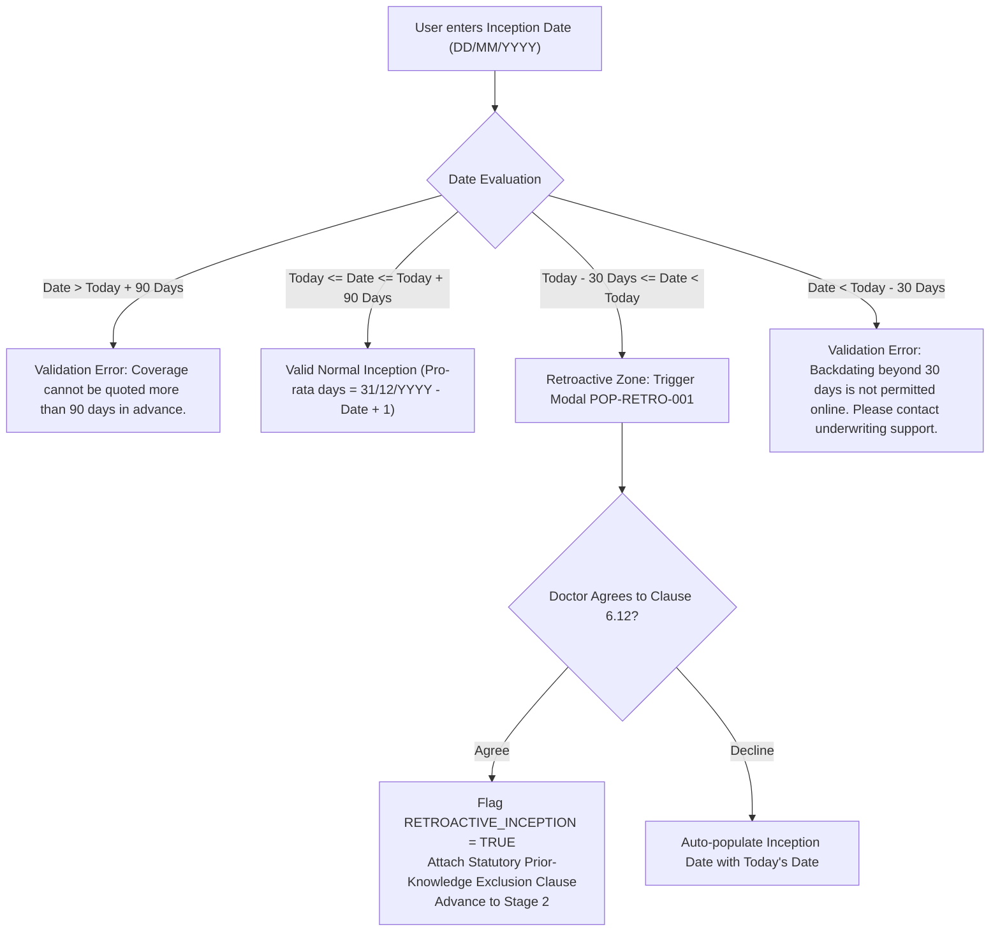

# CONDITIONAL INTERACTIONS & STATE MACHINE SPECIFICATION
## DoctorShield Individual Medical Professional Indemnity Portal

> **Document ID:** `DOC-ARCH-COND-001`  
> **Status:** Architecture Design Baseline (Phase 03)  
> **Classification:** [PROPOSED / SPECIFICATION]  
> **Author:** Principal Insurance Product Designer & Interaction Architect  
> **Created:** 2026-10-30  
> **Governance:** DoctorShield Product Engineering & Design Rules v2.0 (AGENTS.md)  
> **Scope:** Formal conditional rules, reactive state machines, cross-stage invalidation matrices, and interactive edge-case behaviors.

---

## 1. System Interaction Principles

Insurance transactions require rigorous state governance: any change to an upstream risk factor directly influences eligibility, rating factors, statutory requirements, and downstream form validity.

The DoctorShield interaction engine operates on five strict governance principles:
1. **Zero Silent Invalidation:** When an upstream parameter change modifies downstream validity (e.g., lowering indemnity tier invalidates an add-on requiring a RM 1M threshold), the system must explicitly notify the user with a transparent diff rather than silently clearing selections.
2. **Optimistic Local Feedback with Authoritative Server Sync:** UI controls reflect user intent immediately (toggling an add-on switches state and computes an estimated delta), while an asynchronous background request reconciles the authoritative rating schedule.
3. **Progressive Requirement Mounting:** Form fields are only mounted into the DOM when their qualifying condition is met. Unmounted fields are completely omitted from validation schemas and network payloads.
4. **Resilient Data Preservation:** Navigating backward to inspect or revise previous stages must *never* wipe valid downstream inputs unless a direct causal conflict exists.
5. **No Urgency-Induced Anxiety:** Session timers (e.g., the 15-minute quote lock) are informative service guarantees, not high-pressure countdown clocks.

---

## 2. Core Conditional Dependency Rules

### 2.1 Specialty Classification & Liability Tiers (`RULE-LIAB-01`, `RULE-ELIG-01`)



| Classification | Allowed Limits | Special Surcharges / Riders | Required Evidence / Fields |
|---|---|---|---|
| **GP without Aesthetics (Cat 7)** | RM 500k, 1M, 1.5M, 2M, 5M | None (Standard Rate) | MMC Registration Number |
| **GP with Aesthetics (Cat 20)** | RM 1M, 1.5M, 2M, 3M, 5M, 10M | Minimum RM 1M required; Letters of Credentialing & Privileging (LCP) rider | LCP Certificate # or Declaration |
| **Government Doctor (Cat 5)** | RM 250k, 500k, 1M, 1.5M, 2M | Subsidized MO/Specialist rates; Moonlighting declaration | Government Hospital / Facility Name |
| **Obstetrics & Gynaecology (Cat 1)** | RM 1M, 2M, 3M, 5M, 10M | High-risk surgical multiplier; Annual delivery volume declaration | Delivery volume bracket (<50, 50-150, >150) |
| **Dental Practitioner (Cat 21-23)** | RM 500k, 1M, 1.5M, 2M | Dental rating schedule; Orthodontics/Implant rider | MDC Registration Number |

---

### 2.2 Clinic Ownership & Branch Architecture (`RULE-CAD-01`, `RULE-CAD-02`)

The relationship between Practitioner Capacity, Clinic Ownership, and the Clinic Package Add-on governs whether Substep 3.2 is rendered.



#### Detailed Interaction State Table:
| Stage 2: Clinic Add-on | Stage 3.1: Practice Capacity | Substep 3.2 Status | Borang B/F Validation | Branch Revenue Validation |
|---|---|---|---|---|
| **Not Selected** | Employed Resident / Associate | **SKIPPED** | Not Required | Not Required |
| **Not Selected** | Visiting Consultant / Locum | **SKIPPED** | Not Required | Not Required |
| **Not Selected** | Clinic Owner / Partner | **MOUNTED** | Mandatory | Mandatory (Must equal 100%) |
| **SELECTED** | Employed Resident / Associate | **MOUNTED** (Notice: Clinic package requires clinic registration details) | Mandatory | Mandatory (Must equal 100%) |
| **SELECTED** | Clinic Owner / Partner | **MOUNTED** | Mandatory | Mandatory (Must equal 100%) |

---

### 2.3 Branch Allocation & Revenue Balancing (`RULE-BRCH-01`)

When Substep 3.2 is mounted, revenue balancing enforces strict financial integrity:

```
[ Revenue Validation State Machine ]

State A: Single Clinic Location
- Additional Branches: NO
- Revenue: RM [Input Amount]
- Validation: Valid if 0 < Revenue <= RM 5,000,000.
- Result: 100% assigned to Principal Location.

State B: Multi-Branch Clinic Network
- Additional Branches: YES
- Principal Location: Revenue Share [ X ] %
- Branch 1: Revenue Share [ Y ] %
- Branch N: Revenue Share [ Z ] %
- Total Share Sum = X + Y + ... + Z

Validation Matrix:
- IF Sum == 100%: Status = VALID (Green indicator: "Balanced - 100%") -> Next Step Enabled
- IF Sum < 100%: Status = INVALID (Yellow indicator: "Underallocated: Currently [Sum]% (Remaining: [100-Sum]%)") -> Next Step Disabled
- IF Sum > 100%: Status = INVALID (Red indicator: "Overallocated: Currently [Sum]% (Exceeds by [Sum-100]%)") -> Next Step Disabled
- IF Any Branch Revenue Share <= 0%: Status = INVALID ("Each branch must have a revenue share > 0%")
- IF Total Revenue > RM 5,000,000: Status = WARNING ("Revenues > RM 5M undergo manual underwriting referral")
```

---

### 2.4 Person-In-Charge (PIC) Extension Eligibility (`RULE-PIC-01`)

The Person-In-Charge extension protects against statutory vicarious liability under the Private Healthcare Facilities and Services Act 1998 (PHFSA).



---

### 2.5 Statutory Underwriting Disclosures (Adverse Risk Interaction)

The 5 statutory underwriting questions (`QST-UW-001` through `QST-UW-005`) operate with progressive narrative disclosure:

```
[ Underwriting Question Interaction Pattern ]

Initial State:
- Segments: [ ( ) Yes ]  [ (*) No ] (Defaults unselected; requires explicit user touch)
- Narrative Container: HIDDEN

Transition: User selects [ Yes ] on Question N:
1. Animated expansion of Narrative Container (Height: auto, transition: 200ms ease-out).
2. Input field mounted: Textarea `uw_details_N`.
3. Validation rules applied:
   - Mandatory field (`required = true`)
   - Minimum character count: 20 characters
   - Maximum character count: 1,000 characters
   - Live character counter rendered: "Characters: 0 / 1000 (Minimum 20)"
4. Global Journey Flag set: `HAS_ADVERSE_DECLARATION = TRUE`.

Transition: User changes selection from [ Yes ] to [ No ]:
1. Dialog prompt: "Clear previous explanation for Question N?"
2. If confirmed: Textarea value cleared, Narrative Container collapsed, validation removed.
3. System re-evaluates `HAS_ADVERSE_DECLARATION`. If all 5 questions are "No", flag reverts to FALSE.
```

#### Adverse Risk Submission Logic (Stage 4 Gate):
```
IF HAS_ADVERSE_DECLARATION == TRUE:
  - Payment Gate is BYPASSED (No payment collected).
  - Primary CTA changes from:
    "Pay RM [Amount] Securely" -> "Submit for Underwriting Assessment"
  - Submission routes directly to:
    Stage 5R (Referral Screen): Generates Application Reference ID (REF-2026-XXXX)
    Triggers automated notification to DoctorShield Medical Legal Panel.
ELSE:
  - Normal Straight-Through Payment Gateway is invoked.
```

---

### 2.6 Inception Date Constraints & Retroactivity (`RULE-DATE-01`, `RULE-DATE-02`)



---

### 2.7 Existing Customer NRIC Recognition & Fast-Track Renewal

To eliminate repetitive data entry for returning doctors:

```
[ NRIC Input Blur Event in Substep 3.1 ]

1. User enters 12-digit NRIC in `FLD-PART-002` and field triggers `onBlur`.
2. Format validation passes (checksum valid, length == 12).
3. Background API request dispatched: `POST /api/checkPolicyholderHistory { nric: "850714105231" }`.

Response Scenarios:
Case A: No Prior Record (New Applicant)
- Form remains in standard new-application mode.

Case B: Existing Policyholder Found (Expiring or Renewed)
- Banner rendered above form:
  "Welcome back, Dr. Ahmad! We found your existing policy (DS-2025-04192).
   Would you like to auto-populate your details from last year?"
  [ (Button: Auto-fill My Details) ]  [ (Dismiss) ]
- If user clicks "Auto-fill":
  - MMC Registration No, Clinic Name, Practice Address, and Clinic SSM are pre-populated.
  - Substep 3.1 fields transition to "Verified" state.
  - User can immediately proceed to Underwriting Declarations.

Case C: Duplicate Active Policy Found (Same Year)
- Modal dialog triggered: `POP-DUP-001`
  "Active Policy Detected: You already hold an active DoctorShield policy for 2026.
   To add branches or increase your indemnity limit, please request an endorsement."
  [ View My Active Policy ]  [ Contact Support ]
```

---

## 3. Cross-Stage State Invalidation Matrix

When a user navigates backward and alters an earlier decision, downstream state must be reconciled accurately:

| Upstream Change (Stage / Field) | Affected Downstream Component | Invalidation Action | User Communication / Notification |
|---|---|---|---|
| **Stage 1:** Change Specialty Classification | Stage 2 Add-ons | Re-evaluate add-on eligibility; re-rate baseline premium | Inline notification: "Quotation updated for [New Specialty]. Please review your add-ons." |
| **Stage 1:** Lower Indemnity Limit below RM 1M | Stage 2 Aesthetic / Surgical Add-ons | Auto-remove add-ons requiring RM 1M threshold | Toast alert: "Aesthetic coverage removed as it requires minimum RM 1M indemnity limit." |
| **Stage 1:** Change Inception Date | Stage 2 & 4 Premium Calculations | Recalculate pro-rata days and pro-rated add-on sums | Financial breakdown automatically updates; pro-rated days counter reflects new span. |
| **Stage 2:** Deselect Clinic Package Add-on | Stage 3.2 Clinic Branches Form | If user is NOT a clinic owner, Substep 3.2 is automatically unmounted | "Clinic Package removed. Branch allocation details are no longer required." |
| **Stage 3.1:** Change Practice Capacity from "Owner" to "Employed" | Substep 3.2 Branch Data | Branch data archived in draft; Substep 3.2 unmounted | Substep counter dynamically updates from "1 of 3" to "1 of 2". |
| **Stage 3.3:** Change any question from "Yes" to "No" | Stage 4 Checkout CTA & Referral Gate | Discard narrative text; remove referral flag; re-enable instant payment gateway | CTA transitions from "Submit for Review" back to "Pay RM [Amount] Securely". |

---

## 4. Session Persistence & Re-Rating Lifecycle (15-Minute Lock)

```
[ Session Lifecycle State Machine ]

Stage 2 Boot:
- Timestamp recorded: `quote_created_at = Date.now()`
- Expiry scheduled: `quote_expires_at = quote_created_at + 15 * 60 * 1000`
- Subtle badge rendered: "Price guaranteed for: 14:59"

Elapsed Time: 0:00 - 13:00 (Active State)
- Normal user interaction.
- Timer ticks down quietly in sidebar.

Elapsed Time: 13:01 - 14:59 (Warning State)
- Badge transitions to soft amber: "Price guarantee expires in 1:45"
- No disruptive popups; workflow uninterrupted.

Elapsed Time: 15:00+ (Expired State)
- Session flag set: `QUOTE_EXPIRED = TRUE`.
- Primary CTA temporarily disabled: replaces "Continue" with "Refresh Quotation Rates".
- Light dialog rendered if user attempts to proceed:
  "Your 15-minute price guarantee has expired. Please refresh rates to verify current underwriting tariffs."
  [ (Button: Refresh Rates - 1 click) ]
- Action on Refresh:
  - Calls `POST /api/refreshQuote` preserving all selections.
  - Resets timer to 15:00.
  - Updates total if rate table changed (rare); otherwise confirms rate lock.
```

---

## 5. Summary of Conditional Interaction Governance

1. **Deterministic Branching:** Every path through the application is governed by explicit boolean guards and validated API parameters.
2. **Substep Adaptability:** Stage 3 expands or contracts intelligently based on the applicant's real-world practice capacity, preventing irrelevant questions.
3. **Graceful Error Recovery:** Backdating, quotation expiration, and adverse claims disclosures provide non-blocking recovery pathways.
4. **Data Preservation:** Forward and backward navigation maintains complete user inputs, preventing repetitive form re-entry.

