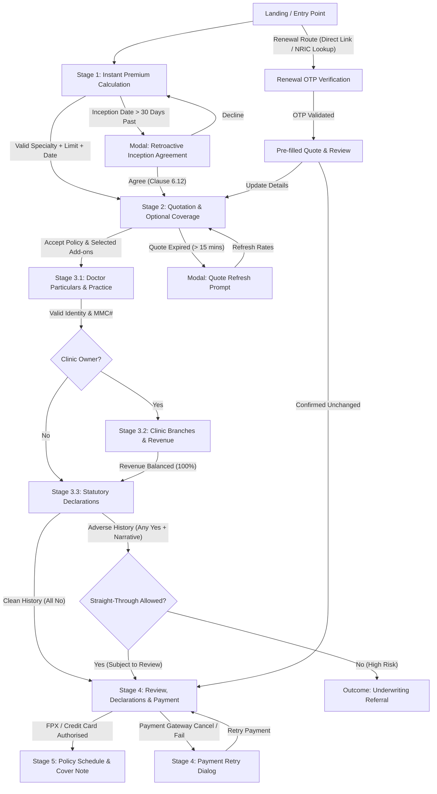
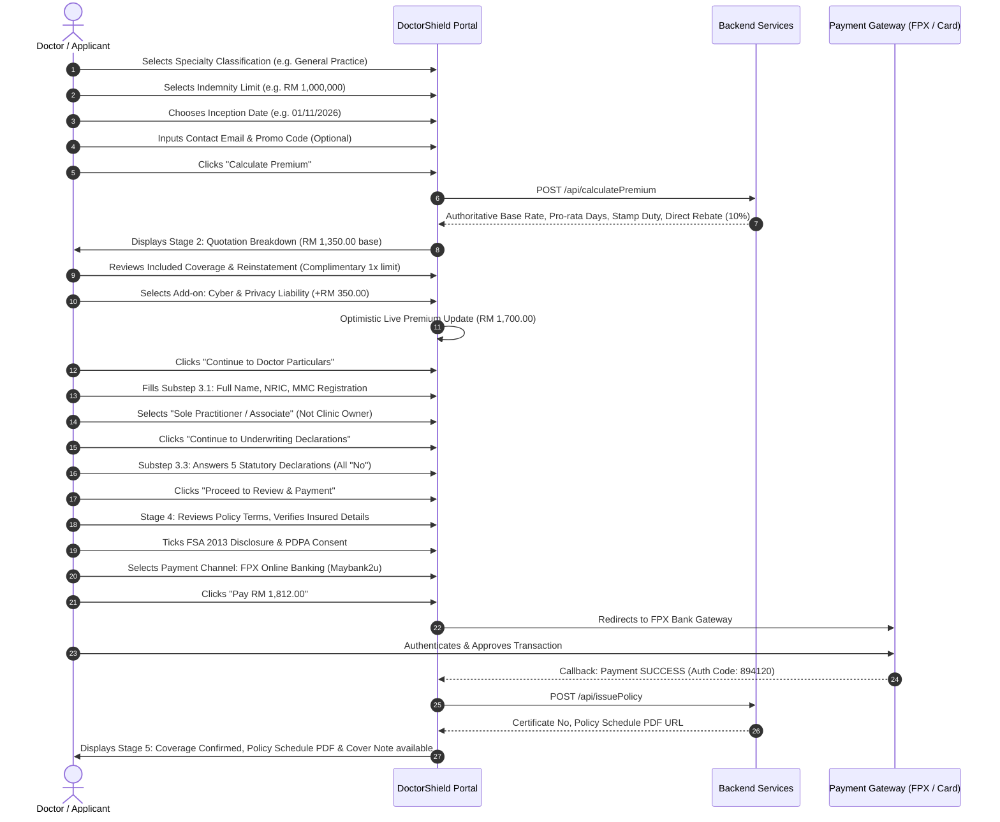
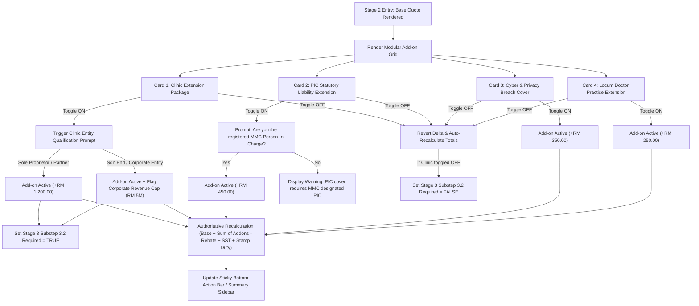
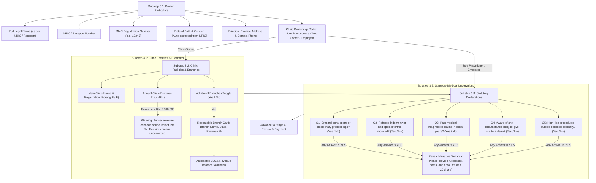
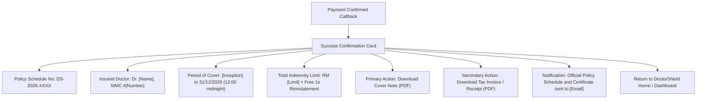
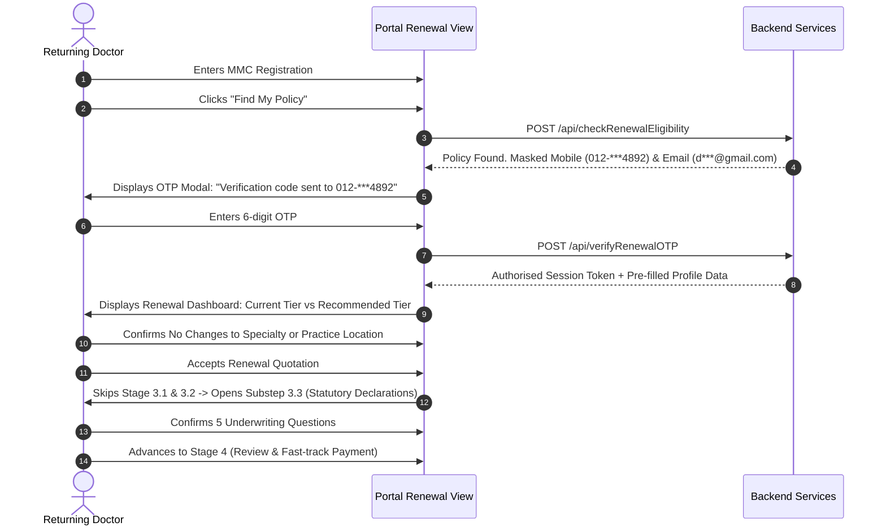
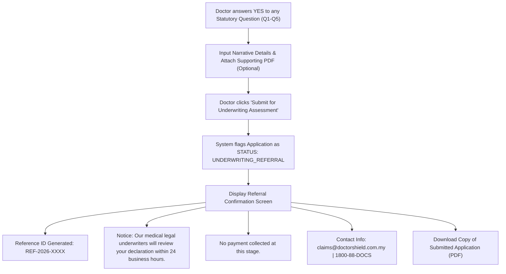
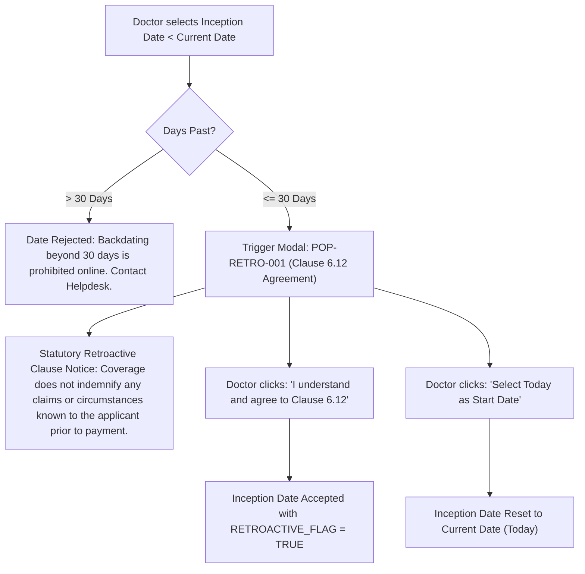
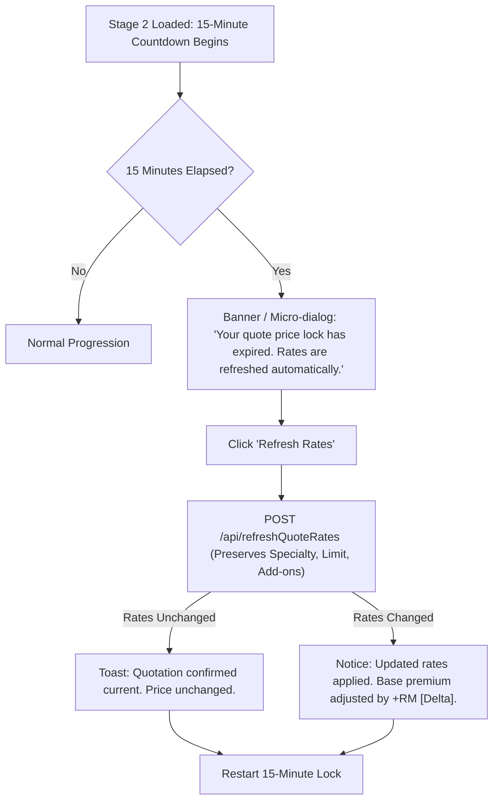

# FUTURE USER FLOW — MINIMAL INSURANCE JOURNEY
## DoctorShield Individual Medical Professional Indemnity Portal

> **Document ID:** `DOC-ARCH-FLOW-001`  
> **Status:** Architecture Design Baseline (Phase 03)  
> **Classification:** [PROPOSED / SPECIFICATION]  
> **Author:** Principal Insurance Product Designer & Interaction Architect  
> **Created:** 2026-10-30  
> **Governance:** DoctorShield Product Engineering & Design Rules v2.0 (AGENTS.md)  
> **Scope:** Comprehensive end-to-end journey maps, state transitions, branch conditions, and recovery loops for all customer pathways.

---

## 1. Architectural Philosophy & Journey Principles

The current DoctorShield portal imposes significant cognitive friction: monolithic screens (Stage 3 stretches 4,240px vertically), repeated financial breakdowns on four distinct pages, premature underwriting disclosures before a quote is viewed, and ambiguous error recovery.

The **Minimal Insurance Journey** resolves these issues through four fundamental principles derived from Phase 02 benchmark research (Ditto restraint, QIC Online clarity, ACKO progression, and Baymard insurance research):

1. **Instant Value Before Personal Commitment (Quote-First):** Doctors receive an authoritative baseline premium calculation within 20 seconds by providing only 3 clinical variables (Specialty Classification, Desired Indemnity Limit, Inception Date). Personal identifiers (NRIC, MMC#, Home Address) are deferred until after quotation acceptance.
2. **Progressive Modular Disclosure:** Add-ons are presented as clear, self-contained modular cards with visible net price deltas (`+RM 350.00 / year`). Selecting an add-on reveals only its immediate dependencies.
3. **Chunked Focused Application (Substep Wizard):** Stage 3 is decomposed into three focused, low-fatigue substeps:
   - **Substep 3.1: Doctor Particulars & Practice Information** (Identity, Qualifications, Principal Clinic)
   - **Substep 3.2: Clinic Facilities & Branch Allocation** (Only rendered if private clinic ownership is flagged; 100% revenue balancing)
   - **Substep 3.3: Statutory Medical Underwriting Declarations** (5 statutory questions with 44px segmented Yes/No controls)
4. **State Carry-Forward & Graceful Backward Navigation:** Edits to earlier stages preserve valid downstream data. If an upstream change invalidates an add-on or branch, the user is notified with transparent reconciliation rather than silent data erasure.

---

## 2. Global Journey State Machine

---

## 3. Detailed Journey Specifications

### Journey 1: New Application & Instant Straight-Through Quotation (Happy Path)

**User Goal:** Obtain professional indemnity insurance coverage quickly and receive an official Cover Note / Policy Schedule.

---

### Journey 2: Optional Coverage & Add-on Selection Flow

**User Goal:** Customise indemnity protection with institutional, premises, cyber, or locum extensions.

---

### Journey 3: Progressive Underwriting & Particulars (3-Substep Wizard)

**User Goal:** Complete statutory disclosures and professional identity verification without visual overwhelm or horizontal scrolling.

---

### Journey 4: Review, Financial Breakdown & Payment Gateway

**User Goal:** Verify all policy details, understand final payable fees, execute payment securely.

```mermaid
flowchart LR
    S4_IN["Enter Stage 4"] --> POL_REV["1. Review Policy Details: Limit, Specialty, Inception Date, Included Reinstatement"]
    POL_REV --> ADDON_REV["2. Review Add-ons: Selected extensions & individual costs"]
    ADDON_REV --> FIN_SUM["3. Financial Breakdown: Base + Add-ons - 10% Direct Rebate + 8% SST + RM 10 Stamp Duty"]
    FIN_SUM --> STAT_DEC["4. Statutory Consents: FSA 2013 Schedule 9 Duty of Disclosure + PDPA 2010"]
    STAT_DEC --> PAY_SEL["5. Payment Selection: FPX Online Banking OR Credit / Debit Card"]
    PAY_SEL --> PAY_ACT["Click 'Pay RM [Total]'"]
    
    PAY_ACT --> GATEWAY["External Bank / Card Gateway"]
    GATEWAY -->|"Success"| S5_OUT["Stage 5: Confirmation"]
    GATEWAY -->|"Cancel / Timeout"| RETRY["Payment Aborted: Return to Stage 4 with State Preserved"]
```

---

### Journey 5: Policy Completion & Documentation

**User Goal:** Download official Cover Note, view policy schedule, understand policy activation timeline.

---

### Journey 6: Policy Renewal Route with OTP Authentication

**User Goal:** Existing policyholders renew their indemnity cover in under 60 seconds with pre-filled particulars.

---

### Journey 7: Adverse Risk Underwriting Referral

**User Goal:** Doctors with prior claims or disciplinary history submit details for underwriter manual review without losing entered information.

---

### Journey 8: Retroactive Date Prior Inception Handling (Clause 6.12)

**User Goal:** Doctors who need coverage backdated (up to 30 days) understand and agree to retroactive claims indemnity conditions.

---

### Journey 9: Quotation Expiry (15-Minute Price Lock) & Instant Re-rating

**User Goal:** Doctor returns after 15 minutes of inactivity; price is smoothly verified and refreshed without clearing user form data.

---

## 4. Journey Validation Rules & Transition Matrix

| Transition | From Stage | To Stage | Trigger Action | Required Validation Gates | Fallback / Error State |
|---|---|---|---|---|---|
| **T-01** | Stage 1 | Stage 2 | `ACT-CALC-001` (Calculate) | Valid `classification_id`, valid `liability_id`, valid date format, future/retroactive valid | Highlight invalid field with inline message; modal if >30 days past |
| **T-02** | Stage 2 | Substep 3.1 | `ACT-QUOT-002` (Continue) | Base quote active, add-on compatibility verified | Quote expired modal if session timed out |
| **T-03** | Substep 3.1 | Substep 3.2 | `ACT-PART-001` (Next) | NRIC valid checksum, MMC# 4-6 digits, Principal address complete, `clinic_owner == 'yes'` | Show field errors; if `clinic_owner == 'no'`, route directly to Substep 3.3 |
| **T-04** | Substep 3.2 | Substep 3.3 | `ACT-BRCH-001` (Next) | Borang B/F provided, Total branch revenue % == 100%, Clinic revenue <= RM 5M | Highlight revenue imbalance; show referral warning if revenue > RM 5M |
| **T-05** | Substep 3.3 | Stage 4 | `ACT-UW-001` (Proceed) | All 5 declarations answered; if any "Yes", narrative text length >= 20 chars | Incomplete questions flagged; if high-risk adverse, route to Referral Screen |
| **T-06** | Stage 4 | Payment Gateway | `ACT-REV-001` (Pay Now) | FSA 2013 consent ticked, PDPA consent ticked, Payment method selected | Inline checkbox validation shake; disable button during gateway dispatch |
| **T-07** | Gateway | Stage 5 | Gateway Success Callback | Gateway Auth Code verified, Policy record committed | Show Payment Failure dialog with retry options; do not invalidate quote |
| **T-08** | Any Stage | Prior Stage | Back Button / Breadcrumb | None (User initiated back navigation) | State preserved 100%; warn if modifying Stage 1 will reset custom add-ons |

---

## 5. Summary of Architectural Improvements

1. **Step Count Reduction:** Replaces fragmented 7-step legacy journey with a coherent **4-stage purchasing pipeline** + 1 confirmation outcome.
2. **Substep Containment:** Stage 3 contains all underwriting complexities in a structured, linear 3-part stepper with zero horizontal scroll.
3. **Decoupled Add-ons:** Add-on selection is isolated to Stage 2 with clear financial feedback before personal identity collection begins.
4. **Resilient Recovery:** Clear handling for retroactivity, quotation expiration, adverse disclosures, and gateway aborts.

