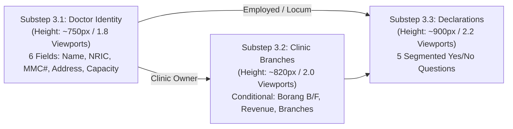

# MOBILE EXPERIENCE & RESPONSIVE FLOW MODEL
## DoctorShield Individual Medical Professional Indemnity Portal

> **Document ID:** `DOC-ARCH-MOBL-001`  
> **Status:** Architecture Design Baseline (Phase 03)  
> **Classification:** [PROPOSED / SPECIFICATION]  
> **Author:** Principal Mobile UX Architect & Interaction Specialist  
> **Created:** 2026-10-30  
> **Governance:** DoctorShield Product Engineering & Design Rules v2.0 (AGENTS.md)  
> **Scope:** Independent mobile layout specifications, viewport boundaries (360px–390px), touch ergonomics, keyboard adaptations, and scroll containment models.

---

## 1. The Mobile Challenge & Remediation Strategy

In the legacy portal, mobile users experienced extreme UX degradation:
- **Excessive Scroll Depth:** Stage 3 alone stretched **4,240px vertically** on a 390px viewport, requiring over 8 complete screen swipes to reach the submit action.
- **Horizontal Overflow:** Unbounded tables for branch revenue allocation caused horizontal page shaking and off-canvas clipping.
- **iOS Auto-Zoom Disruption:** Form inputs with 14px text forced iOS Safari to zoom into every field, breaking layout context.
- **Sub-par Touch Targets:** Checkboxes, info icons, and radio buttons were under 32x32px, causing mis-taps.
- **Displaced Financial Context:** Users lost sight of their running total while filling lengthy medical questionnaires.

### Remediation Blueprint
The DoctorShield Minimal Mobile Architecture resolves these failures through five foundational pillars:
1. **Vertical Scroll Containment:** Stage 3 is decomposed into 3 discrete substeps, capping each screen at **1.5 to 2.0 viewport heights** maximum.
2. **Sticky Bottom Transaction Bar:** A persistent 64px bottom bar maintains financial context (Total Payable + Drawer Toggle) and anchors the primary CTA.
3. **Bottom Sheet Financial Breakdown:** Detailed price composition is accessed via an accessible slide-up bottom sheet instead of dominating screen real estate.
4. **Ergonomic Touch & Keyboard Hygiene:** Strict 48px input heights, 16px base font size (eliminating iOS auto-zoom), 44x44px touch targets, and specialized virtual keyboard flags (`inputmode="numeric"`, `type="tel"`, `type="email"`).
5. **Card-Based Vertical Branch Allocation:** Data tables are completely eliminated in favor of self-contained vertical branch cards with zero horizontal overflow.

---

## 2. Mobile Viewport Composition (390px Baseline)

```
+-------------------------------------------------------------+
| [DoctorShield Logo]                       Step 2 of 4 [Help]| (56px Sticky Top Bar)
+-------------------------------------------------------------+
|                                                             |
| YOUR DOCTORSHIELD QUOTATION                                 |
| Ref: DS-QUO-89104 | Locked for: 14:48                       |
|                                                             |
| +---------------------------------------------------------+ |
| | BASE INDIVIDUAL COVERAGE                                | |
| | General Medical Practitioner                            | |
| | Indemnity Limit: RM 1,000,000 (Aggregate RM 2,000,000)  | |
| | Pro-rated (61 days): RM 451.23                          | |
| | [+] Free 1x Reinstatement Included                      | |
| +---------------------------------------------------------+ |
|                                                             |
| OPTIONAL COVERAGE EXTENSIONS                                |
|                                                             |
| +---------------------------------------------------------+ |
| | [ ] Clinic Premises & Vicarious Liability               | |
| |     +RM 200.55 pro-rated (+RM 1,200.00 / yr)            | |
| |     [ Details v ]                                       | |
| +---------------------------------------------------------+ |
|                                                             |
| +---------------------------------------------------------+ |
| | [*] Cyber & Patient Data Breach Cover                   | |
| |     +RM 58.49 pro-rated (+RM 350.00 / yr)               | |
| |     [ Hide Details ^ ]                                  | |
| |     --------------------------------------------------  | |
| |     Covers patient data breach defense and penalties.   | |
| +---------------------------------------------------------+ |
|                                                             |
| (Scroll Padding: 80px to clear sticky bottom action bar)    |
|                                                             |
+-------------------------------------------------------------+
| TOTAL: RM 505.45  [ Breakdown ^ ] | [ Continue -> ]         | (64px Sticky Bottom Bar)
+-------------------------------------------------------------+
```

---

## 3. Persistent Mobile Bottom Action Bar & Financial Drawer

### 3.1 Sticky Bottom Bar Anatomy
Positioned at `bottom: 0`, `z-index: 100`, with backdrop blur and safe-area padding:
- **Left Region:** Current total payable in bold tabular numbers (`RM 505.45`).
- **Center Region:** Interactive text button `[ View Breakdown ^ ]` triggering the slide-up drawer.
- **Right Region:** Primary advance button (`[ Continue -> ]` or `[ Pay RM 505.45 -> ]`), 48px height, minimum 130px width.

### 3.2 Slide-Up Financial Breakdown Drawer (`MobileBreakdownDrawer`)

When `[ View Breakdown ^ ]` is tapped, a native-feeling bottom sheet slides up from the bottom (using CSS `transform: translateY(0)` with 250ms ease-out):

```
+-------------------------------------------------------------+
|                     [ Drag Handle ]                         |
| FINANCIAL BREAKDOWN                                 [ X ]   |
|                                                             |
| Base Annual Premium (General Practitioner)        RM 451.23 |
| Cyber & Privacy Breach Cover                      +RM  58.49 |
| ----------------------------------------------------------- |
| Gross Total Premium                               RM 509.72 |
| Less: 10% Direct Channel Rebate (BNM)            -RM  50.97 |
| ----------------------------------------------------------- |
| Net Taxable Premium                               RM 458.75 |
| Service Tax (8% SST)                              +RM  36.70 |
| Stamp Duty (Section 60 Stamp Act 1949)            +RM  10.00 |
| =========================================================== |
| TOTAL PAYABLE                                     RM 505.45 |
|                                                             |
| [ Close Breakdown ]                                         |
+-------------------------------------------------------------+
```

---

## 4. Substep Wizard: Eliminating the 4,240px Scroll Depth

To solve mobile form fatigue, Stage 3 is presented as three distinct, lightweight screens:



### Comparison of Scroll Depth:
| Screen Metric | Legacy Stage 3 | Minimal Journey Stage 3 (Substep 3.1) | Minimal Journey Stage 3 (Substep 3.2) | Minimal Journey Stage 3 (Substep 3.3) |
|---|---|---|---|---|
| **Total Height (px)** | **4,240 px** | **750 px** | **820 px** | **900 px** |
| **Viewport Heights** | ~10.8 screens | ~1.9 screens | ~2.1 screens | ~2.3 screens |
| **Number of Inputs** | 28 inputs | 6 inputs | 4 inputs | 5 questions |
| **Cognitive Load** | Overwhelming | Minimal | Focused | Transparent |

---

## 5. Touch Target Ergonomics & Keyboard Optimization

### 5.1 Mobile Form Controls Specification
To guarantee effortless completion on mobile touchscreens without zoom disruption or input mis-taps:

| Field Name | HTML Input Type | Input Mode Attribute | Autocomplete Attribute | Height | Minimum Font Size | Touch Target Boundary |
|---|---|---|---|---|---|---|
| **Doctor Full Name** | `type="text"` | `text` | `name` | 48px | 16px (1rem) | Full width |
| **NRIC / Identity #** | `type="tel"` | `numeric` | `off` | 48px | 16px (1rem) | Full width (Auto-formats `YYMMDD-SS-NNNN`) |
| **MMC Registration #** | `type="tel"` | `numeric` | `off` | 48px | 16px (1rem) | Full width |
| **Mobile Phone** | `type="tel"` | `tel` | `tel` | 48px | 16px (1rem) | Full width |
| **Email Address** | `type="email"` | `email` | `email` | 48px | 16px (1rem) | Full width |
| **Postcode** | `type="tel"` | `numeric` | `postal-code` | 48px | 16px (1rem) | 50% width |
| **Statutory Yes/No** | `role="radiogroup"` | N/A | N/A | 44px | 15px | 50% width each (Minimum 44x44px target) |
| **Add-on Toggle** | `role="checkbox"` | N/A | N/A | 44px | 16px | Minimum 44x44px tap zone |

---

## 6. Mobile Branch Allocation: Eliminating Horizontal Overflow

In the legacy portal, branch clinics were arranged in an HTML table containing 6 columns (Branch Name, Address, Borang B, State, Revenue %, Action), causing massive horizontal overflow (> 680px width on 390px screens).

### The Card-Stack Solution:
Each clinic branch is presented as a **self-contained vertical card**:

```
+-------------------------------------------------------------+
| BRANCH CLINIC #2                                 [ Delete ] |
|                                                             |
| Branch Clinic Name:                                         |
| [ Klinik Sulaiman - Subang Jaya                           ] |
|                                                             |
| State:                                                      |
| [ Selangor                                                v]|
|                                                             |
| Branch Address:                                             |
| [ No. 45, Jalan SS15/4, 47500 Subang Jaya                 ] |
|                                                             |
| Revenue Share:                                              |
| [ 30 ] %  (Estimated: RM 360,000.00)                        |
+-------------------------------------------------------------+
```

### Mobile Layout Benefits:
- **Zero Horizontal Scrolling:** Maximum element width is 100% of the mobile container (`max-width: 100vw; overflow-x: hidden`).
- **Visual Grouping:** Branch details are grouped into distinct, touch-friendly cards with generous spacing.
- **Clear Action Targets:** `[ Delete Branch ]` and `[ + Add Branch ]` buttons exceed 44px in height.

---

## 7. Responsive Breakpoint Rules

The design system enforces three canonical responsive breakpoints:

```
[ Responsive Layout Hierarchy ]

Breakpoint 1: Compact Mobile (320px - 480px)
- Single column layout (100% width)
- Sticky bottom action bar active
- Financial summary rendered via slide-up bottom drawer
- Form inputs full-width (stacked vertically)
- Substep wizard active for Stage 3

Breakpoint 2: Tablet / Foldable (481px - 768px)
- Single centered column (Max width: 600px)
- Sticky bottom action bar active
- Two-column inline layouts for Postal Code + City
- Substep wizard active for Stage 3

Breakpoint 3: Desktop (769px - 1440px+)
- Two-column split layout for Stage 2 & Stage 4 (65% form / 35% sticky sidebar)
- Sticky bottom action bar deactivated (Desktop sidebar takes precedence)
- Single comprehensive page for Stage 3 with smooth section anchoring
- Maximum page container width: 1120px
```

---

## 8. Summary of Mobile Flow Architecture

1. **Scroll Containment:** Eliminates the 4,240px vertical marathon, breaking Stage 3 into digestible 2-viewport substeps.
2. **Ergonomic Precision:** 16px font baseline prevents iOS auto-zoom; 48px touch targets eliminate mis-taps.
3. **No Horizontal Overflow:** Eliminates wide tables in favor of vertical stacked branch cards.
4. **Persistent Transaction Context:** The sticky bottom bar and slide-up drawer ensure the doctor always knows their final payable amount.

