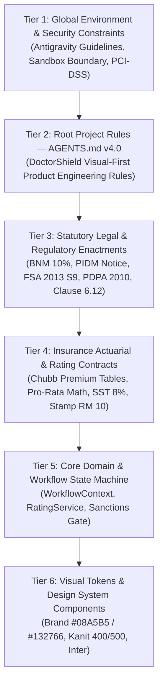

# DOCTORSHIELD — 03 / VISUAL-FIRST GOVERNANCE ACTIVATION REPORT
## Phase 03 — Visual-First Product Engineering Rules V4.0 Enactment

```
==================================================================================================
DOCUMENT CLASSIFICATION:  [AUTHORITATIVE] GOVERNANCE ACTIVATION SPECIFICATION
GOVERNING SPECIFICATION:  DoctorShield Visual-First Product Engineering Rules (Version 4.0)
AUDIT AUTHORITY:          Principal Product Architect & Design Director
DATE OF ENACTMENT:        2026-11-01
STATUS:                   ENACTED, RECONCILED, VERIFIED, AND COMMITTED
PRECONDITIONS MET:        Phase 00 Checkpoint, Phase 01 Cleanup, Phase 02 Architecture Reset
==================================================================================================
```

---

## 1. Executive Summary

Phase 03 formally establishes and activates **DoctorShield — Visual-First Product Engineering Rules Version 4.0** as the single authoritative root governance in [`AGENTS.md`](file:///c:/Users/salee/Downloads/Portal_ds/AGENTS.md).

The previous Master Agent Rules V3 have been cleanly backed up to [`docs/archive/AGENTS_V3_MASTER_RULES.md`](file:///c:/Users/salee/Downloads/Portal_ds/docs/archive/AGENTS_V3_MASTER_RULES.md). All nested governance references have been reconciled. Higher-priority security, statutory, and environment boundaries remain strictly preserved.

Version 4.0 explicitly grants the mandate to completely redesign and replace the rejected frontend visual system, while strictly preserving the validated insurance engine, actuarial formulas, and legal disclosures without compromise.

---

## 2. Preconditions Verification

| Precondition | Verification Evidence | Status |
| :--- | :--- | :---: |
| **Phase 00 Checkpoint** | Git tag `checkpoint-recovery-v12`, branch `recovery/checkpoint-phase00-authoritative`, commit `8326105`, and [`docs/recovery/BASELINE.md`](file:///c:/Users/salee/Downloads/Portal_ds/docs/recovery/BASELINE.md). | **VERIFIED** |
| **Phase 01 Cleanup** | Clutter purged (11 duplicate root markdown files, 10 legacy scripts, 64 redundant images), commit `1586701`, and [`docs/recovery/CLEANUP_RESULT.md`](file:///c:/Users/salee/Downloads/Portal_ds/docs/recovery/CLEANUP_RESULT.md). | **VERIFIED** |
| **Phase 02 Architecture Reset** | Decoupled core runtime from dev-catalogs (`vite.config.ts`), established unified barrel export (`src/design-system/index.ts`), 130/130 passing tests, commit `62d1be8`, and [`docs/recovery/02_FRONTEND_ARCHITECTURE_RESET.md`](file:///c:/Users/salee/Downloads/Portal_ds/docs/recovery/02_FRONTEND_ARCHITECTURE_RESET.md). | **VERIFIED** |

---

## 3. Active Rule Hierarchy

The active operational governance adheres to a strict 6-tier precedence hierarchy:



### Detailed Tier Analysis:

1. **Tier 1 — Global Environment & Security Constraints:**
   - Universal Antigravity system guidelines: sandbox integrity, credential protection, proxy enforcement, non-destructive file operations.
   - PCI-DSS SAQ-A hand-off compliance: Zero storing or transmission of unencrypted cardholder PAN/CVV in client memory.

2. **Tier 2 — Root Project Rules ([`AGENTS.md`](file:///c:/Users/salee/Downloads/Portal_ds/AGENTS.md) v4.0):**
   - Authoritative for all UI redesign, visual benchmarks (QIC Online, Ditto, ACKO), component anatomy, token usage, and the 8-step Visual-First Execution flow.

3. **Tier 3 — Statutory Legal & Regulatory Enactments:**
   - Bank Negara Malaysia (BNM) 10% Direct Distribution Rebate.
   - PIDM Protection Statement (`LEG-PIDM-001`).
   - Financial Services Act 2013 Schedule 9 Duty of Disclosure (`LEG-FSA-001`).
   - Personal Data Protection Act 2010 Consent (`LEG-PDPA-001`).
   - Chubb Elite Clause 6.12 Retroactive Warranty (`LEG-BACKDATE-001`).

4. **Tier 4 — Insurance Actuarial & Rating Contracts:**
   - 20 Medical Classifications, 7 Indemnity Tiers (RM 500k to RM 10M).
   - Pro-rata calendar equation: $(\text{Days remaining to 31 Dec} + 1) / 365$.
   - Sales & Services Tax (SST 8.00%), Inland Revenue Stamp Duty (RM 10.00).

5. **Tier 5 — Core Domain & Workflow State Machine:**
   - Stage transitions (`Stage1` $\rightarrow$ `Stage2` $\rightarrow$ `Stage3` $\rightarrow$ `Stage4` $\rightarrow$ `Stage5`).
   - Underwriting decision trees (`DT-IND-01..06`, `DT-CLN-01..06`, `DT-BRN-01..04`).
   - AML/CFT sanctions screening gate (`DT-IND-06`).

6. **Tier 6 — Visual Tokens & Design System Components:**
   - Official Primary: `#08A5B5` (with accessible derivatives `#066F7B`, `#055C66`).
   - Official Secondary: `#132766`.
   - Heading Typography: **Kanit** (weights 400 and 500 only; never bold 600+).
   - Body/Interface: **Inter** (weights 400 and 500).

---

## 4. External Rules Audit (Outside Repository Scope)

| Rule Source | File Path | Scope & Purpose | Conflict Status | Resolution |
| :--- | :--- | :--- | :---: | :--- |
| **Science Plugin Rules** | `C:\Users\salee\.gemini\config\plugins\science\rules\AGENTS.md` | Mandates interactive sidecar viewers (e.g. Mol* 3D viewer) for science visualization tasks. | **NO CONFLICT** | External plugin configuration outside workspace authority. DoctorShield is an insurance portal that does not invoke biomolecular tools. Project root `AGENTS.md` v4.0 takes exclusive precedence over all repository tasks. |

---

## 5. Reconciled Documentation & Obsolete Instructions

1. **V3 Historical Backup:**
   - Backed up to [`docs/archive/AGENTS_V3_MASTER_RULES.md`](file:///c:/Users/salee/Downloads/Portal_ds/docs/archive/AGENTS_V3_MASTER_RULES.md).
2. **Current Documentation Reconciled:**
   - [`docs/recovery/CURRENT_SOURCE_OF_TRUTH.md`](file:///c:/Users/salee/Downloads/Portal_ds/docs/recovery/CURRENT_SOURCE_OF_TRUTH.md): Updated governing specification header and section references to `AGENTS.md v4.0`.
   - [`docs/recovery/04_RESPONSIVE_DESIGN_RULES.md`](file:///c:/Users/salee/Downloads/Portal_ds/docs/recovery/04_RESPONSIVE_DESIGN_RULES.md): Updated governance reference to `DoctorShield Visual-First Product Engineering Rules v4.0 (AGENTS.md)`.
3. **Root Clutter Status:**
   - Verified 0 loose markdown prompt files in repository root. Only essential project configurations exist (`.env.example`, `.gitignore`, `AGENTS.md`, `index.html`, `package.json`, `package-lock.json`, `README.md`, `tsconfig.json`, `vite.config.ts`).

---

## 6. Discoverability & Antigravity Validation

- **Location:** Workspace root [`C:\Users\salee\Downloads\Portal_ds\AGENTS.md`](file:///c:/Users/salee/Downloads/Portal_ds/AGENTS.md).
- **Mechanism:** Antigravity automatically detects and parses workspace root `AGENTS.md` on every interaction.
- **Verification:** System prompt injects `<RULE[c:\Users\salee\Downloads\Portal_ds\AGENTS.md]>` containing the exact Version 4.0 content. Discoverability by all future subagents and tasks is 100% verified.

---

## 7. Visual Replacement Authority vs. Insurance Engine Preservation

Version 4.0 explicitly and authoritatively balances radical UI replacement with absolute insurance fidelity:

1. **Complete UI Redesign Mandated (§1, §6):**
   - *"The current visual system is rejected."*
   - *"Existing CSS and old component styling are migration sources, not design benchmarks."*
   - *"Changing only colors, fonts, radius or shadows does not qualify as a redesign."*
2. **Insurance Engine Strictly Preserved (§4, Final Principle):**
   - *"Never invent, silently change or remove: Products, benefits and coverage. Premium calculations. Eligibility rules. Add-on dependencies. Underwriting questions. Legal disclosures and consents. Payment behavior. Renewal behavior. Verified API contracts."*
   - *"Preserve the insurance engine; replace weak interface design without compromise."*

---

## 8. Remaining Conflicts

**ZERO CONFLICTS REMAIN.**
All internal project documentation and active rules are in complete alignment with Version 4.0.
