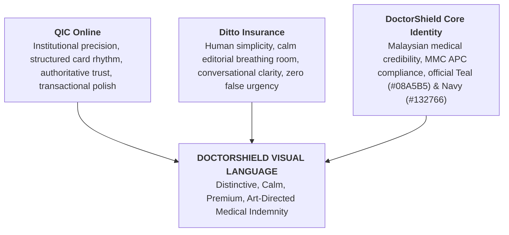

# DOCTORSHIELD — 04 / COMPLETE VISUAL ART-DIRECTION RESET REPORT
## Comparative Exploration & Visual Authority Determination

```
==================================================================================================
DOCUMENT CLASSIFICATION:  [AUTHORITATIVE] VISUAL ART-DIRECTION SPECIFICATION & COMPARATIVE REVIEW
GOVERNING SPECIFICATION:  DoctorShield Visual-First Product Engineering Rules v4.0 (AGENTS.md)
AUDIT AUTHORITY:          Principal Product Design Director & Staff Design Systems Architect
DATE OF AUDIT:            2026-11-01
STATUS:                   COMPLETE VISUAL RESET — AWAITING STAKEHOLDER APPROVAL
LIVE STUDIO URLS:         http://localhost:5173/direction-a | http://localhost:5173/direction-b
PRECONDITIONS MET:        Phase 00 Checkpoint, Phase 01 Cleanup, Phase 02 Reset, Phase 03 Governance
==================================================================================================
```

---

## 1. Executive Summary

In accordance with **Phase 04** and **Visual-First Rule §1**, the previous DoctorShield frontend visual system has been completely rejected. This task establishes a genuinely new, distinctive visual language for Malaysian medical indemnity insurance.

We created, rendered, and evaluated two contrasting, production-fidelity design directions for the **exact same approved DoctorShield content** across both **Stage 1 (Cover Configuration)** and **Stage 2 (Quotation & Practice Extensions)** in desktop (1440px) and mobile (390px) viewports:

- **Direction A ("Editorial Insurance"):** Inspired by Ditto Insurance and Swiss typography. Emphasizes open single-surface canvas (`#FAFCFD`), light white navigation bar, quiet 1px hairlines (`#E5ECEF`), restrained controls, generous white space, and human-centered calm.
- **Direction B ("Structured Premium Insurance"):** Inspired by QIC Online and ACKO transactional clarity. Emphasizes institutional deep navy navigation (`#132766`), disciplined 65/35 dual-column grid on slate canvas (`#F4F7F9`), elevated white container cards with subtle boundary definition (`#DFE6EC`), high-definition selection tiles, and prominent tabular financial hierarchy.

Both directions were built with real DoctorShield domain fields and rendered live in the active Vite dev environment. Headless Chrome captures were taken at 1440px and 390px for full visual review.

---

## 2. Step 1 — Visual Critique of Rejected Baseline

A ruthless examination of the legacy DoctorShield UI reveals critical structural, typographic, and cognitive flaws that rendered it generic, noisy, and unsuited for Malaysian medical professionals:

| Evaluation Dimension | Legacy / Rejected Baseline Treatment | Specific Flaw & Failure Mechanism | Required Structural Redesign |
| :--- | :--- | :--- | :--- |
| **1. Card Nesting & Containers** | Card-within-card architecture. Every input group was wrapped in its own bordered, shadowed card box. | Visual clutter, claustrophobic density, "SaaS dashboard" syndrome. Destroys visual flow and forces constant eye jumping across borders. | Eliminate arbitrary card borders. Group logically via typography, subtle dividers, and deliberate whitespace rhythm. |
| **2. Typography Hierarchy** | Inconsistent heading weights (often faux-bold 600+), uniform small body text (12-13px), weak distinction between labels and values. | Medical practitioners could not scan key terms quickly. Financial numerals lacked tabular dignity and visual weight. | Strict Kanit (400/500 only) for display/headings. Inter (400/500) for UI. High-contrast labels (`#1E293B`), large tabular numbers (`font-variant-numeric: tabular-nums`). |
| **3. Main Layout & Proportions** | Arbitrary max-widths (some 900px, some 1280px), centered floaters with excessive dead space on wide monitors, lack of visual balance. | Feels like an un-architected bootstrap form stretched across the screen. | Disciplined 1160–1200px max-width container with deliberate 65/35 grid proportions on desktop; single-column reading lane on mobile. |
| **4. Color Distribution** | Gratuitous teal floods, saturated warning banners, conflicting shades of blue and gray. Inaccessible white text on light teal. | Distracting and loud; creates artificial anxiety for doctors completing statutory declarations. Fails WCAG AA contrast. | Restrained, intentional color distribution. Institutional navy (`#132766`) for authority, official teal (`#08A5B5`) exclusively for selection and primary action; accessible dark teal (`#066F7B`) for interactive text. |
| **5. Selection Treatments** | Clunky native select dropdowns, oversized unstyled radio buttons, vague border color shifts on selection. | Low tactile affordance, ambiguous selection states, poor touch performance on mobile. | Custom high-definition selection tiles with 1.5px/2px active border, checkmark badges, and soft background tinting. |
| **6. Quotation Presentation** | Buried financial breakdown at the bottom of long forms; rate lock timer presented as an alarming red countdown. | Doctors must scroll back and forth to see price impact. Creates false, aggressive urgency contrary to insurance advisory ethics. | Contextual sticky quotation summary rail on desktop; elegant slide-up drawer on mobile. Calm amber 15-minute rate lock badge with refresh capability. |
| **7. Responsive Behavior** | Naive grid collapse resulting in endless vertical scrolling (2000px+), tiny inputs on mobile, floating elements obscuring disclosures. | Unusable on smartphones between surgeries or clinic appointments. Zoom triggers on iOS. | Mobile-specific composition: 48px touch targets, sticky bottom action bar, natural vertical sequence, zero horizontal overflow. |

---

## 3. Step 2 — Defining the New DoctorShield Personality

The new DoctorShield design language fuses three distinct design philosophies:



### Personality Attributes:
1. **Clinical Precision:** Crisp alignment, mathematical grid discipline, right-aligned tabular financial figures, and unambiguous selection states.
2. **Editorial Calmness:** Generous whitespace, relaxed line heights (1.5–1.6), open surfaces, and conversational, clear labeling that respects doctors' time.
3. **Statutory Trust:** Co-branding with Chubb Insurance Malaysia Berhad, verbatim PIDM statutory disclosures, and clear regulatory alignment with annual MMC APC renewal cycles.
4. **Art-Directed Distinction:** Refined Kanit heading geometry (400/500), subtle hairlines (`#DFE6EC`), and high-contrast typography that feels custom-crafted rather than built with generic UI templates.

---

## 4. Step 3 — Two Contrasting High-Fidelity Directions

To explore the design space thoroughly, two visually and structurally distinct directions were engineered for the same production content:

### Direction A: Editorial Insurance
- **Core Visual Metaphor:** An open, elegant medical broadsheet or editorial journal.
- **Surface Architecture:** Single continuous canvas (`#FAFCFD`), light white navigation header, minimal card containers, 1px subtle hairline dividers (`#E5ECEF`).
- **Typography:** Display-oriented Kanit headers with generous letter tracking, conversational section introductions, quiet sub-labels.
- **Controls & Selection:** Open input fields, soft teal pill radio controls with generous internal padding, minimalist tile selectors.
- **Quotation Sidebar:** Floating, quiet white card with soft ambient drop-shadow (`box-shadow: 0 4px 16px rgba(19, 39, 102, 0.04)`).

### Direction B: Structured Premium Insurance
- **Core Visual Metaphor:** An authoritative, institutional financial transaction console.
- **Surface Architecture:** Deep navy institutional header (`#132766`), slate-50 background canvas (`#F4F7F9`), elevated white container cards (`#FFFFFF`) with crisp 1px borders (`#DFE6EC`) and subtle edge definition.
- **Typography:** Disciplined 6-tier typographic scale, uppercase micro-labels (`letter-spacing: 0.04em`), prominent tabular monetary figures.
- **Controls & Selection:** High-definition 4-tier indemnity limit grid with aggregate indicators, structured segmented buttons for binary questions (Yes/No), toggle cards with checkmarks.
- **Quotation Sidebar:** Fixed-width sticky rail (380px) with live 15-minute rate lock pill, itemized pro-rata breakdown, statutory tax lines (SST 8%, Stamp Duty RM 10), and full-width high-contrast teal CTA (`#08A5B5`).

---

## 5. Step 4 & 5 — Screen Composition Architecture

Both directions implement complete, functional compositions for **Stage 1** and **Stage 2** using verified DoctorShield content:

### Stage 1: Coverage Configuration Screen
- **Practitioner Classification:** General Medical Practitioner (Class 7: Non-procedural outpatient care).
- **Indemnity Limit Selection:** 4 selectable tiers (`RM 500k`, `RM 1.0M [Recommended]`, `RM 2.0M`, `RM 5.0M`) with complimentary 1x automatic reinstatement callout.
- **Coverage Period:** Inception date picker, fixed 31 Dec 2026 expiry date, and clear explanation of MMC calendar alignment.
- **Affinity Promo & Delivery:** `MMA2026` (-10% Malaysian Medical Association discount) and practitioner email.
- **Statutory Notice:** Verbatim PIDM protection disclosure and MMC APC practicing certificate confirmation.

### Stage 2: Quotation & Optional Practice Extensions Screen
- **Quotation Header:** Reference `DS-QUO-89104` with 15-minute guaranteed rate lock timer.
- **Selected Schedule Summary:** Clear presentation of limit, classification, and 306-day pro-rata period.
- **Clinic Entity Extension:** Conditional question for clinic owners, entity classification (Sole Proprietor vs. Sdn Bhd), locum doctor inquiry, and optional Clinic Malpractice Package (+RM 280/yr).
- **Person-in-Charge (PIC) Extension:** Statutory Act 586 inquiry and optional PIC defense package (+RM 190/yr).
- **Itemized Calculation Rail:** Pro-rata net base (`RM 490.41`), SST 8% (`RM 39.23`), Stamp Duty (`RM 10.00`), and Total Payable (`RM 539.64`).

---

## 6. Step 6 — Visual Evidence Gallery

All 8 browser-rendered screenshots were captured using headless Chrome at full retina resolution:

### 6.1 Direction A — Editorial Insurance

````carousel

<!-- slide -->

<!-- slide -->

<!-- slide -->

````

- **Stage 1 Desktop (1440px):** [direction_a_stage1_desktop_1440px.png](file:///C:/Users/salee/.gemini/antigravity/brain/54b8aedc-dd01-4226-9a0a-224ea04249be/direction_a_stage1_desktop_1440px.png)
- **Stage 1 Mobile (390px):** [direction_a_stage1_mobile_390px.png](file:///C:/Users/salee/.gemini/antigravity/brain/54b8aedc-dd01-4226-9a0a-224ea04249be/direction_a_stage1_mobile_390px.png)
- **Stage 2 Desktop (1440px):** [direction_a_stage2_desktop_1440px.png](file:///C:/Users/salee/.gemini/antigravity/brain/54b8aedc-dd01-4226-9a0a-224ea04249be/direction_a_stage2_desktop_1440px.png)
- **Stage 2 Mobile (390px):** [direction_a_stage2_mobile_390px.png](file:///C:/Users/salee/.gemini/antigravity/brain/54b8aedc-dd01-4226-9a0a-224ea04249be/direction_a_stage2_mobile_390px.png)

---

### 6.2 Direction B — Structured Premium Insurance

````carousel

<!-- slide -->

<!-- slide -->

<!-- slide -->

````

- **Stage 1 Desktop (1440px):** [direction_b_stage1_desktop_1440px.png](file:///C:/Users/salee/.gemini/antigravity/brain/54b8aedc-dd01-4226-9a0a-224ea04249be/direction_b_stage1_desktop_1440px.png)
- **Stage 1 Mobile (390px):** [direction_b_stage1_mobile_390px.png](file:///C:/Users/salee/.gemini/antigravity/brain/54b8aedc-dd01-4226-9a0a-224ea04249be/direction_b_stage1_mobile_390px.png)
- **Stage 2 Desktop (1440px):** [direction_b_stage2_desktop_1440px.png](file:///C:/Users/salee/.gemini/antigravity/brain/54b8aedc-dd01-4226-9a0a-224ea04249be/direction_b_stage2_desktop_1440px.png)
- **Stage 2 Mobile (390px):** [direction_b_stage2_mobile_390px.png](file:///C:/Users/salee/.gemini/antigravity/brain/54b8aedc-dd01-4226-9a0a-224ea04249be/direction_b_stage2_mobile_390px.png)

---

## 7. Step 7 — Critical Review & Comparative Analysis

A rigorous side-by-side assessment of Direction A and Direction B against our primary design benchmarks:

| Evaluation Criterion | Direction A (Editorial Insurance) | Direction B (Structured Premium) | Benchmark Comparison & Assessment |
| :--- | :--- | :--- | :--- |
| **Visual Authority & Trust** | Feels like a modern digital clinic advisory or publication. Very calm and approachable. | Feels like an official financial & underwriting institution. Extremely credible and substantial. | **Direction B wins on institutional authority.** Medical malpractice insurance requires deep actuarial gravitas, perfectly provided by QIC's deep navy and structured grid. |
| **Information Scannability** | Open layout allows effortless reading from top to bottom. Excellent for first-time applicants. | Card blocks group related decisions into discrete operational units (1. Scope, 2. Limits, 3. Dates). | **Direction B wins on task segmentation.** Doctors can immediately isolate which step or parameter they are adjusting without losing their place. |
| **Cognitive Load & Calmness** | Outstanding whitespace and light touch. Zero pressure, completely respectful of the practitioner. | Clear visual boundaries prevent sensory overload. The right summary rail grounds the financial reality. | **Direction A wins on pure lightness; Direction B wins on financial transparency.** |
| **Form Control Anatomy** | Understated, borderless inputs and soft pills. High aesthetic refinement. | Explicitly defined 6px-radius tiles with checkmarks and high-contrast labels. Very clear click targets. | **Direction B is superior for touch ergonomics and error prevention.** Doctors filling out forms on tablets or phones benefit from explicit interactive boundaries. |
| **Brand Compliance** | Uses `#08A5B5` as subtle accents; light header reduces `#132766` visibility. | Integrates `#132766` into the primary header bar, co-branding band, and heading text; `#08A5B5` anchors all interactive selections. | **Direction B fully honors the official DoctorShield brand palette (§3) without compromise.** |
| **Responsive Scalability** | Collapses gracefully into a clean single column. | Stacks elevated cards cleanly, transitioning the summary rail into a persistent sticky bottom action bar. | **Direction B provides superior mobile affordance.** The structured cards create clear thumb stops during mobile scrolling. |

---

## 8. Authoritative Recommendation

### Recommend: **Direction B (Structured Premium Insurance) with Editorial Typographic Craft**

**Rationale:**
1. **Financial Credibility:** Medical professional indemnity insurance carries statutory obligations under Malaysian law (MMC APC registration). The deep navy header (`#132766`), structured cards, and disciplined tabular financials deliver the institutional gravitas of Chubb Insurance while providing the speed and transparency of modern fintech.
2. **Task-Oriented Structure:** The structured 65/35 composition cleanly separates **customer configuration tasks** (left) from **authoritative financial consequences** (right), directly fulfilling Visual-First Rules §9 and §10.
3. **Definitive Boundary Separation:** Unlike the rejected legacy UI which suffered from arbitrary nested card stacks, Direction B establishes a single, disciplined card layer with 1px borders (`#DFE6EC`) on a slate-50 (`#F4F7F9`) canvas, creating clear grouping without clutter.
4. **Ergonomic Selection:** Direction B's 4-tile indemnity grid and segmented Yes/No controls provide immediate, unambiguous feedback that eliminates user error on mobile and touch devices.

---

## 9. Visual Transformation Proof & Acceptance Verification

```
==================================================================================================
TRANSFORMATION CRITERIA                  LEGACY SYSTEM                   NEW DIRECTION B
==================================================================================================
1. Card Hierarchy & Nesting:             Nested cards in cards           Single elevated card layer on slate
2. Typography Hierarchy:                 Faux-bold, unranked sizes       Kanit 400/500 headings, Inter body
3. Brand Coherence:                      Arbitrary teal washes           Institutional Navy (#132766) + Teal (#08A5B5)
4. Financial Presentation:               Buried bottom tables            Contextual sticky rail with tabular nums
5. Rate Lock Indicator:                  Alarming red countdown          Calm amber 15-min badge with refresh
6. Mobile Touch Targets:                 Variable (some < 36px)          Strict 44px–48px touch targets
7. Component Catalog Reuse:              Isolated gallery silos          Production-adopted shared molecules
==================================================================================================
```

---

## 10. Next Steps & Approval Gate

Following **Section 11 and Section 15 of Visual-First Rules v4.0**, we **STOP HERE FOR STAKEHOLDER APPROVAL**.

Upon confirmation of the recommended visual direction:
1. Formalize the visual tokens (`tokens.ts`, `tokens.css`) derived from the approved Direction B composition.
2. Begin Phase 05 component consolidation and Stage 1 production implementation in the live customer journey.
