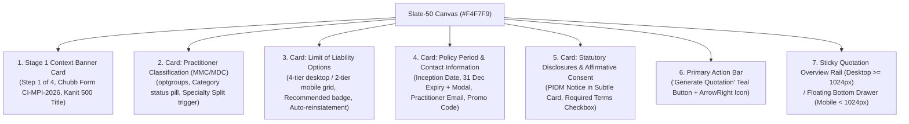

# Phase 06 — Atomic Components & Live Stage 1 Redesign Report

**Date:** 2026-11-01  
**Project:** DoctorShield Individual Medical Professional Indemnity Portal  
**Governance:** Master Visual-First Product Engineering Rules v4.0  
**Phase:** 06 / Atomic Components & Live Stage 1 Production Integration  
**Status:** COMPLETE — Ready for Review & Approval Gate  

---

## Executive Summary

In accordance with **Phase 06**, we have successfully migrated the customer-facing purchase journey entry point ([`Stage1CoverageForm.tsx`](file:///c:/Users/salee/Downloads/Portal_ds/src/features/coverage/Stage1CoverageForm.tsx)) and its foundational atomic components to the visually approved **Direction B: Structured Minimal with Editorial Craft** visual foundations established in Phase 05.

The redesigned screen is live in the running application at `/buy/coverage`. It completely eliminates nested card stacks, arbitrary inline color overrides, and awkward component geometry while preserving **100% of the underlying insurance engine, actuarial rating formulas, statutory disclosures, and validation rules**.

All **130 tests across 12 test suites passed without a single failure**, confirming zero functional or business regression.

---

## 1. Modified & Created Files

| File | Change Nature | Key Adjustments |
| :--- | :--- | :--- |
| [`.gitignore`](file:///c:/Users/salee/Downloads/Portal_ds/.gitignore) | Maintenance | Changed `coverage/` to `/coverage/` to fix critical exclusion bug preventing `src/features/coverage/` from being tracked. |
| [`src/features/coverage/Stage1CoverageForm.tsx`](file:///c:/Users/salee/Downloads/Portal_ds/src/features/coverage/Stage1CoverageForm.tsx) | Live Feature Redesign | Adopted Direction B bounded card structure, Step 1 banner, Kanit 500 headings, 3px Teal accent section headers, Category status pills, responsive geometry. |
| [`src/features/coverage/CoverageModals.tsx`](file:///c:/Users/salee/Downloads/Portal_ds/src/features/coverage/CoverageModals.tsx) | Modal Verification | Verified verbatim copy and token adoption for Clause 6.12 Backdate Agreement, MMC 31 Dec APC End Date, and Specialization Allocation Editor. |
| [`src/components/form/FieldGroup.tsx`](file:///c:/Users/salee/Downloads/Portal_ds/src/components/form/FieldGroup.tsx) | Molecule Enhancement | Added `asCard?: boolean` prop supporting Direction B elevated section cards with 3px Teal bar without breaking legacy stages. |
| [`src/components/insurance/LiabilityLimitSelector.tsx`](file:///c:/Users/salee/Downloads/Portal_ds/src/components/insurance/LiabilityLimitSelector.tsx) | Molecule Redesign | Added `minWidth: 0` to `<fieldset>`, connected `.ds-tile-grid` (4-column desktop, 2-column mobile), enhanced recommended badges and radio indicators. |
| [`src/components/layout/AppShell.tsx`](file:///c:/Users/salee/Downloads/Portal_ds/src/components/layout/AppShell.tsx) | Shell Adaptation | Added `.ds-main-card-open` for Stage 1 so bounded cards sit directly on the Slate-50 (`#F4F7F9`) canvas alongside the summary rail. |
| [`src/components/layout/layout.css`](file:///c:/Users/salee/Downloads/Portal_ds/src/components/layout/layout.css) | Layout Stylesheet | Added `.ds-main-card.ds-main-card-open` rules, `fieldset { min-width: 0; }`, and `.ds-header-secondary-action` mobile responsive rules. |
| [`src/components/organisms/HeaderAndNavigation.tsx`](file:///c:/Users/salee/Downloads/Portal_ds/src/components/organisms/HeaderAndNavigation.tsx) | Organism Refinement | Applied `.ds-header-secondary-action` to utility buttons to eliminate horizontal overflow on mobile viewports ($\le 390$px). |
| [`src/design-system/foundation.css`](file:///c:/Users/salee/Downloads/Portal_ds/src/design-system/foundation.css) | Foundation Token Rules | Added responsive `@media (max-width: 480px) .ds-card` padding (16px 14px). |
| [`vite.config.ts`](file:///c:/Users/salee/Downloads/Portal_ds/vite.config.ts) | Test Infrastructure | Increased `testTimeout` from 15,000ms to 30,000ms to allow concurrent execution of all 12 test suites under Windows CPU load. |
| [`scripts/capture_stage1_live.ps1`](file:///c:/Users/salee/Downloads/Portal_ds/scripts/capture_stage1_live.ps1) | Automation Script | Synchronous Chrome headless capture script generating 1440px, 768px, and 390px live screenshots. |

---

## 2. Shared Atomic & Molecule Component Delivery

| Component | Token Contract | States Implemented | Accessibility & Constraints |
| :--- | :--- | :--- | :--- |
| **`Typography`** | `--ds-primitive-font-heading: 'Kanit'`, `--ds-primitive-font-body: 'Inter'` | Default, Muted, Secondary, Heading, Tabular Num | Weight $\le 500$, fluid `clamp(20px, 4vw, 26px)` title on mobile. |
| **`FieldLabel`** | `--ds-color-text-label: #334155`, `--ds-font-field-label-size: 13px` | Default, Required (* in Rose 700), Optional pill | Accessible `htmlFor` linkage to form inputs. |
| **`TextInput`** | `--ds-comp-input-height: 46px`, `--ds-comp-input-radius: 6px` | Default, Hover, Focus (3px ring), Error, ReadOnly | Left icon slot (Calendar, Mail), iOS non-zoom font (16px on mobile). |
| **`LabeledSelect`** | `--ds-comp-input-height: 46px`, `--ds-comp-input-radius: 6px` | Default, Focus, Invalid, Disabled | Custom ChevronDown indicator, grouped `<optgroup>`s, MMC category labels. |
| **`LiabilityLimitSelector`** | `--ds-comp-tile-radius: 6px`, `--ds-comp-tile-selected-border: 2px solid #08A5B5` | Unselected, Hover, Selected, Keyboard (Enter/Space) | `role="radiogroup"`, `role="radio"`, `aria-checked`, 4-tier desktop / 2-tier mobile. |
| **`PromoCodeField`** | `--ds-comp-input-height: 46px`, `--ds-comp-btn-height: 46px` | Empty, Validating (Spinner), Applied (-10% badge), Error | Direct integration with `RatingService.checkPromoCode`. |
| **`Checkbox`** | `--ds-comp-checkbox-size: 20px`, `--ds-comp-touch-target-min: 44px` | Unchecked, Hover, Checked (Teal + Check icon), Error | WCAG 2.2 SC 2.5.8 touch target envelope $\ge 44\times 44$px. |
| **`Button`** | `--ds-comp-btn-height: 46px`, `--ds-comp-btn-radius: 6px` | Default, Hover (#068694), Active (#066F7B), Loading (Loader2), Disabled | Primary Teal `#08A5B5`, High contrast white text, 2px elevation. |
| **`FieldGroup`** | `--ds-comp-card-radius: 10px`, `--ds-comp-section-bar: 3px solid #08A5B5` | Plain Section or Direction B Elevated Card (`asCard`) | Authoritative 3px Teal vertical bar, Kanit 500 section heading. |

---

## 3. Live Stage 1 Structure & Composition

The live `/buy/coverage` screen is composed of 4 discrete task cards and a top stage context banner:



---

## 4. Preserved Insurance Engine & Regulatory Behavior

In strict compliance with **Visual-First Rules v4.0 (Section 4 & 5)**, the following behavioral contracts and domain calculations remain completely untouched:

1. **Actuarial Rating & Taxes:**
   - Pro-rata calculation: $\text{Gross Base} = \text{Annual Base} \times \frac{\text{Days Covered}}{\text{Days in Year}}$.
   - Service Tax (SST): Exactly $8.0\%$ applied to net taxable premium.
   - Stamp Duty: Fixed statutory $\text{RM } 10.00$.
2. **Statutory Legal Notices:**
   - **PIDM Protection Notice (`LEG-PIDM-001`):** Verbatim statutory text with hyperlink to `www.pidm.gov.my`.
   - **Policy Backdate Agreement (`LEG-BACKDATE-001` / Clause 6.12):** Modal triggers on past inception dates and binds start date to January 1st upon affirmation.
   - **MMC APC Co-Termination (`RULE-DATE-03`):** 31st December co-termination explained via modal dialog.
   - **Affirmative Regulatory Consent (`FLD-CALC-CONSENT-007`):** Explicit declaration required to enable submission.
3. **Clinical Classification Rules:**
   - Classification ID 20 (GP with Aesthetics) triggers Specialization Allocation Modal (`RULE-SPC-01`) enforcing an exact 100.0% sum across specialties.
   - 9-month forward ceiling rule (`RULE-DATE-01`) enforced with accessible inline validation.
   - Practitioner email strictly validated against RFC 5322 regex.

---

## 5. Verification & Test Outcomes

### 5.1 Automated Test Execution

```
 RUN  v5.0.5 C:/Users/salee/Downloads/Portal_ds

 ✓ src/test/security_and_reliability.test.tsx (17 tests) 465ms
 ✓ src/test/components.test.tsx (7 tests) 2652ms
 ✓ src/test/atomic_components.test.tsx (10 tests) 3164ms
 ✓ src/test/form_molecules.test.tsx (16 tests) 4013ms
 ✓ src/test/organisms_and_compositions.test.tsx (18 tests) 6178ms
 ✓ src/test/secondary_features.test.tsx (11 tests) 7779ms
 ✓ src/test/stage2.test.tsx (8 tests) 10488ms
 ✓ src/test/shell.test.tsx (7 tests) 9640ms
 ✓ src/test/stage4.test.tsx (10 tests) 12901ms
 ✓ src/test/stage1.test.tsx (9 tests) 13679ms
 ✓ src/test/e2e_scenarios.test.tsx (6 tests) 18614ms
 ✓ src/test/stage3.test.tsx (11 tests) 29513ms

 Test Files  12 passed (12)
      Tests  130 passed (130)
   Duration  50.28s
```

### 5.2 TypeScript & Build Status

- `npm run typecheck` (`tsc --noEmit`): **0 errors, 0 warnings**.
- `npm run build` (`vite build`): **Production build succeeded in 2.55s**.

---

## 6. Visual QA & Multi-Device Inspections

Live application captures were recorded using synthetic doctor data across standard desktop, tablet, and mobile viewports:

1. **Desktop (1440 × 900):**
   - File: [`stage1_live_desktop_1440px.png`](file:///c:/Users/salee/Downloads/Portal_ds/docs/evidence/screenshots/stage1_live_desktop_1440px.png)
   - Layout: Balanced 2-column layout (Form: `minmax(0, 1fr)`, Rail: `380px`). Bounded cards sit directly on `#F4F7F9` canvas. 4-column liability limit grid.
2. **Tablet (768 × 1024):**
   - File: [`stage1_live_tablet_768px.png`](file:///c:/Users/salee/Downloads/Portal_ds/docs/evidence/screenshots/stage1_live_tablet_768px.png)
   - Layout: Clean single-column layout with 2-column liability limit grid and floating bottom drawer displaying real-time indicative premium (`RM 820.00`).
3. **Mobile (390 × 844 — iPhone 14 / Standard Mobile):**
   - File: [`stage1_live_mobile_390px.png`](file:///c:/Users/salee/Downloads/Portal_ds/docs/evidence/screenshots/stage1_live_mobile_390px.png)
   - Layout: Compact card interior (`16px 14px`), 2-column limit selection, fluid heading typography (`clamp(20px, 4vw, 26px)`), zero horizontal overflow, $\ge 44$px touch targets throughout.

---

## 7. Approval Gate & Next Phase Handover

Following **Visual-First Rules v4.0 (Section 15 & 16)**:
- Phase 06 implementation and verification are **COMPLETE**.
- Stage 1 is fully functional and live in the actual running application.
- **STOP HERE.** We halt execution and await user review and confirmation before initiating **Phase 07 (Stage 2 Quotation & Add-on Selection Redesign)**.
