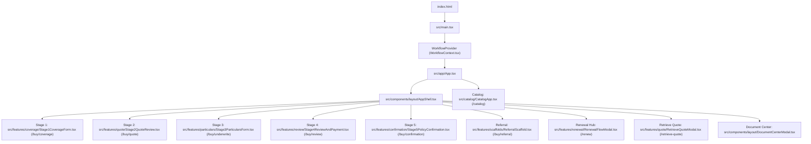

# DOCTORSHIELD — ACTIVE CODE & ARCHITECTURE MAP
## Phase 00 — Safe Baseline & Repository Verification

```
==================================================================================================
DOCUMENT CLASSIFICATION:  [AUTHORITATIVE] ACTIVE CODE & DEPENDENCY MAP
GOVERNING SPECIFICATION:  DoctorShield Master Agent Rules V3 (2026-10-30)
APPLICATION ENTRY POINT:  index.html -> src/main.tsx -> src/app/App.tsx
ROUTER IMPLEMENTATION:    src/core/state/WorkflowContext.tsx (History API State Machine)
PRIMARY ACTIVE STYLES:    src/design-system/tokens.css, foundation.css, src/components/layout/layout.css
==================================================================================================
```

---

## 1. Application Entry Point & Route Traversal

The customer purchasing workflow is a single-page application governed by a specialized state machine in `WorkflowContext.tsx`. Routing is synchronized with the browser History API without requiring third-party routing dependencies.



---

## 2. Active Screen & Feature Component Inventory

| Stage / View | Active File Path | Current Status & Composition |
| :--- | :--- | :--- |
| **Shell Header** | `src/components/layout/BrandHeader.tsx` | Active. Delegates to `ApplicationHeader` in `src/components/organisms/HeaderAndNavigation.tsx` (52px slim height, Chubb underwriter co-branding). |
| **Shell Stepper** | `src/components/insurance/InsuranceStepProgress.tsx` | Active. Delegates to `MinimalStepNavigation` in `src/components/organisms/HeaderAndNavigation.tsx` (4-segment linear bar desktop, concise badge mobile). |
| **Shell Summary** | `src/components/layout/SummarySidebar.tsx` | Active. Contextual right rail on desktop; sticky bottom drawer via `MobileSummaryDrawer.tsx` on mobile. |
| **Shell Footer** | `src/components/layout/AppFooter.tsx` | Active. 4-column Deep Navy `#132766` footer with PIDM notice, 256-Bit SSL badge, and legal disclosures. |
| **Stage 1 (Cover)** | `src/features/coverage/Stage1CoverageForm.tsx` | Active & Refined. Composed with atomic primitives (`Button`, `Heading`, `Text`, `TextInput`, `Checkbox`, `LiabilityLimitSelector`, `LabeledSelect`). |
| **Stage 1 Modals** | `src/features/coverage/CoverageModals.tsx` | Active & Refined. Houses Clause 6.12 Backdate Agreement, 31st Dec MMC Period Modal, and GP Aesthetics Specialization Modal. |
| **Stage 2 (Quote)** | `src/features/quote/Stage2QuoteReview.tsx` | Active (Pending Phase 07 Refinement). Houses 15-minute rate lock, Clinic Entity Protection toggle, and PIC coverage selection. |
| **Stage 3 (Details)** | `src/features/particulars/Stage3ParticularsForm.tsx` | Active (Pending Phase 08 Refinement). Houses Tier 1 personal particulars, MMC registration, NRIC auto-extraction. |
| **Stage 3 Branches** | `src/features/particulars/BranchManager.tsx` | Active. Dynamic branch manager (max 4 branches, RM 5,000,000 revenue ceiling check). |
| **Stage 3 UW** | `src/features/underwriting/UnderwritingQuestionnaire.tsx` | Active. Statutory health declarations (Q1-Q5), adverse declaration referral triggers. |
| **Stage 4 (Review)** | `src/features/review/Stage4ReviewAndPayment.tsx` | Active (Pending Phase 09 Refinement). Itemized premium breakdown, BNM 10% rebate disclosure, rate-lock refresh, affirmative consents. |
| **Stage 5 (Confirm)**| `src/features/confirmation/Stage5PolicyConfirmation.tsx` | Active (Pending Phase 10 Refinement). Policy schedule download, certificate display, MMC APC submission guidance. |
| **Referral Gate** | `src/features/scaffolds/ReferralScaffold.tsx` | Active. Terminal referral page with relationship manager callback form (`FLD-REF-070..073`). |

---

## 3. High-Risk Business Modules (Zero Modification Allowed)

These modules represent actuarial rating, regulatory compliance, and statutory protections that must remain inviolable during visual redesign:

1. **`src/core/api/ratingService.ts` (Actuarial Core):**
   - Implements Chubb pro-rata calendar formula:  
     $$\text{Pro-Rata Fraction} = \frac{\text{Days to 31 Dec} + 1}{365}$$
   - Calculates Sales & Services Tax (SST 8.00%) and Inland Revenue Stamp Duty (RM 10.00).
   - Enforces 10% direct distribution rebate / MMA partner discount math.
2. **`src/core/data/classifications.ts` (Classification & Liability Matrix):**
   - Authoritative catalog of all 20 Medical Classifications (Class 1 to Class 20).
   - Authoritative liability limits: `RM 500,000`, `RM 1,000,000`, `RM 1,500,000`, `RM 2,000,000`, `RM 3,000,000`, `RM 5,000,000`, `RM 10,000,000`.
3. **`src/core/api/underwritingService.ts` (Underwriting Decision Tree):**
   - Enforces statutory decision tree logic: Clean $\rightarrow$ Direct Bind; Adverse $\rightarrow$ Support Referral.
   - Enforces AML/CFT sanctions screening gate (`DT-IND-06`).
4. **`src/core/api/paymentService.ts` (PCI-DSS SAQ-A Hand-off):**
   - Cryptographic transaction tokenization, idempotency header injection, and outcome reconciliation (SUCCESS, FAILED, CANCELLED).
5. **`src/core/api/renewalService.ts` (Policy Renewal Hub):**
   - NRIC and policy verification, SMS / WhatsApp OTP delivery, and 60-second cooldown timer.

---

## 4. Active Styling Architecture

The application does not use utility-class frameworks or CSS-in-JS runtimes. All visual styling originates from three consolidated cascading stylesheets:

1. **`src/design-system/tokens.css` (Foundational Design Tokens):**
   - Color primitives: Navy (`#132766`), Teal (`#08A5B5`), accessible interactive derivatives (`#066F7B`, `#055C66`).
   - Typography tokens: Font families (`Kanit`, `Inter`, `JetBrains Mono`), scale ratios, line heights.
   - Spatial tokens: 4px base spatial scale (`--ds-primitive-space-1` to `--ds-primitive-space-24`).
   - Elevation and radii: `--ds-primitive-radius-sm` to `--ds-primitive-radius-xl`, elevation shadow layers.
2. **`src/design-system/foundation.css` (Component Semantic Tokens):**
   - Maps primitive tokens to semantic components (buttons, text inputs, form labels, badges).
3. **`src/components/layout/layout.css` (Shell Layout & Grid Engine):**
   - Responsive grid containers (`.ds-shell-grid`, `.ds-shell-main`, `.ds-main-card`).
   - Viewport media queries (360px, 390px, 768px, 1024px, 1440px, 1920px).
   - Responsive visibility helpers (`.ds-hide-mobile`, `.ds-stepper-desktop`, `.ds-stepper-mobile`).

---

## 5. Duplicate Component Systems & Migration Plan

| Component System | Location | Current Role | Target State in Controlled Recovery |
| :--- | :--- | :--- | :--- |
| **Approved Shared UI** | `src/components/ui/` | Production primitives: `Button`, `Typography`, `TextInput`, `SelectionControls`, `FieldFeedback`. | **Retain as sole primary UI system.** All screens must adopt these components. |
| **Form Molecules** | `src/components/form/` | Intermediate molecules built in Wave 2 (`LabeledTextField`, `ChoiceGroup`). | Progressively integrate into `src/components/ui/` and `src/components/molecules/`. |
| **Organisms & Layout** | `src/components/organisms/` | Production organisms (`ApplicationHeader`, `MinimalStepNavigation`). | **Retained as active architecture.** |
| **Catalog Sandbox** | `src/catalog/CatalogApp.tsx` | Development fixture showcasing tokens and components at `/catalog`. | Keep decoupled from production customer journeys. Wrap in `React.lazy()` during bundle optimization. |
| **Bespoke Legacy Markup** | `src/features/quote/` & `src/features/particulars/` | Historical inline CSS and un-tokenized form markup in Stages 2, 3, and 4. | **Target for systematic replacement in Phases 07, 08, 09.** |

