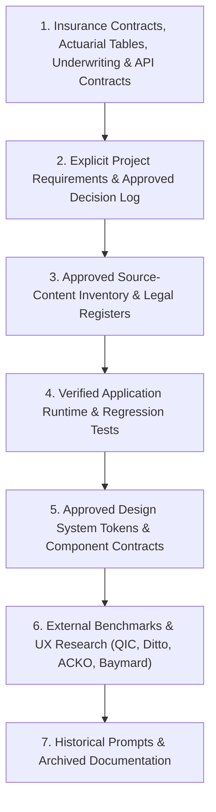

# DOCTORSHIELD — CURRENT SOURCE OF TRUTH CONSOLIDATION
## Phase 01 — Governance & Documentation Cleanup

```
==================================================================================================
DOCUMENT CLASSIFICATION:  [AUTHORITATIVE] SOURCE OF TRUTH CONSOLIDATION SPECIFICATION
GOVERNING SPECIFICATION:  DoctorShield Master Agent Rules V3 (Section 2 — Design Benchmarks & Precedence)
AUDIT AUTHORITY:          Principal Software Architect & Lead Product Designer
DATE OF ENACTMENT:        2026-10-30
==================================================================================================
```

---

## 1. Authoritative Precedence Hierarchy

In accordance with **DoctorShield Master Agent Rules V3**, when information or instructions appear to conflict, agents and developers must adhere strictly to the following precedence hierarchy:



---

## 2. Directory Mapping & Authoritative Document Index

### Tier 1: Insurance Contracts, Actuarial Tables & Legal Enactments
*Highest authority in the repository. Never modify, invent, or compromise.*

| Specification Document | Path | Scope & Invariants Defined |
| :--- | :--- | :--- |
| **Pricing & Tax Contract** | `docs/insurance/PRICING_AND_TAX_CONTRACT.md` | Authoritative Chubb rating tables, annual rates, calendar pro-rata fraction formula, SST 8.00%, Stamp Duty RM 10.00, partner discount rules. |
| **Underwriting Decision Tree** | `docs/insurance/UNDERWRITING_DECISION_TREE.md` | Statutory risk algorithms (`DT-IND-01..06`, `DT-CLN-01..06`, `DT-BRN-01..04`), direct-bind vs. referral triggers, AML/CFT sanctions gate. |
| **Business Rule Catalog** | `docs/insurance/BUSINESS_RULE_CATALOG.md` | Full inventory of 68 active business rules governing eligibility, dates, clinics, PICs, and exceptions. |
| **Content Master** | `docs/insurance/CONTENT_MASTER.md` | Master content repository, classification titles, coverage descriptions. |
| **Copy & Legal Register** | `docs/insurance/COPY_AND_LEGAL_REGISTER.md` | Verbatim statutory legal disclosures (PIDM, BNM, FSA 2013, PDPA 2010, Clause 6.12). |
| **Field Dictionary** | `docs/insurance/FIELD_DICTIONARY.md` | Canonical field names, validation constraints, data formats, and error copy. |
| **API Contracts** | `docs/architecture/API_CONTRACTS.md` | REST endpoint definitions, HTTP headers, idempotency keys, and RFC 7807 problem details. |
| **Security Design** | `docs/architecture/SECURITY_DESIGN.md` | PCI-DSS SAQ-A hand-off architecture, XSS sanitization, CSP rules, session timeout (25m/30m). |

---

### Tier 2: Product Requirements & Approved Decisions

| Specification Document | Path | Scope & Authority |
| :--- | :--- | :--- |
| **Product Requirements** | `docs/product/PRODUCT_REQUIREMENTS.md` | Core functional requirements across customer journeys. |
| **Decision Log** | `docs/product/DECISION_LOG.md` | Chronological record of approved architectural and product design decisions. |
| **Project Charter** | `docs/product/PROJECT_CHARTER.md` | Project goals, scope boundaries, stakeholder alignment. |
| **Requirements Traceability**| `docs/product/REQUIREMENTS_TRACEABILITY.md` | Cross-reference mapping requirements to screen components. |
| **Phase Acceptance** | `docs/product/PHASE_ACCEPTANCE.md` | Criteria and verification gates for phase completion. |

---

### Tier 3: Content Inventories & Link Registers

| Specification Document | Path | Scope & Authority |
| :--- | :--- | :--- |
| **Document & Link Register** | `docs/product/DOCUMENT_AND_LINK_REGISTER.md` | Regulatory links, PDS document links, policy wordings, and statutory forms. |
| **Content Coverage Matrix** | `docs/product/CONTENT_COVERAGE_MATRIX.md` | Verification of content placement across application stages. |
| **Source Register** | `docs/product/SOURCE_REGISTER.md` | External institutional references (MMC, BNM, PIDM, Chubb). |

---

### Tier 4: Verified Application Runtime & Regression Tests

| Asset Category | Location | Role in Source-of-Truth Hierarchy |
| :--- | :--- | :--- |
| **Customer Journey Entry** | `src/app/App.tsx` & `src/components/layout/AppShell.tsx` | Mounted runtime shell and stage navigation. |
| **Active Feature Screens** | `src/features/` (`coverage/`, `quote/`, `particulars/`, `review/`, `confirmation/`) | Customer-facing feature screen components. |
| **Automated Test Suite** | `src/test/` (11 test suites, 120 tests) | Authoritative behavioral verification of pricing, validation, and workflow state. |

---

### Tier 5: Approved Design System Contracts

| Asset Category | Location | Scope & Invariants |
| :--- | :--- | :--- |
| **Foundational Tokens** | `src/design-system/tokens.css` | Color tokens (`#132766`, `#08A5B5`), typography scales, 4px spatial units. |
| **Semantic Tokens** | `src/design-system/foundation.css` | Component semantic mappings (buttons, inputs, cards). |
| **Layout & Grid Stylesheet**| `src/components/layout/layout.css` | Responsive shell grid and breakpoint rules. |
| **Atomic Components** | `src/components/ui/` | Shared UI primitives: `Button`, `Typography`, `TextInput`, `SelectionControls`, `FieldFeedback`. |
| **Organisms & Navigation** | `src/components/organisms/` | `ApplicationHeader`, `MinimalStepNavigation`, `QuotationSummary`. |

---

### Tier 6: External Benchmarks & Research References

*Design inspiration and usability benchmarks only. Never copy competitor code, assets, or colors.*

| Reference | Benchmark Focus | Application in DoctorShield |
| :--- | :--- | :--- |
| **QIC Online** | Transactional UI & Precision | Structured form layouts, clear quotation breakdowns, precise input geometry. |
| **Ditto Insurance** | Human-Centered Simplicity | Approachable editorial typography, understated card treatments, calm pacing. |
| **ACKO** | Progression & Selection | Clear plan selection cards, concise step navigation. |
| **Baymard Institute** | Form & Checkout UX | Form usability, error presentation, rate-lock countdowns, payment recovery. |

---

### Tier 7: Historical & Archived Documents
*Located in `docs/archive/`. Retained strictly for forensic reference; superseded by Tiers 1–5.*

